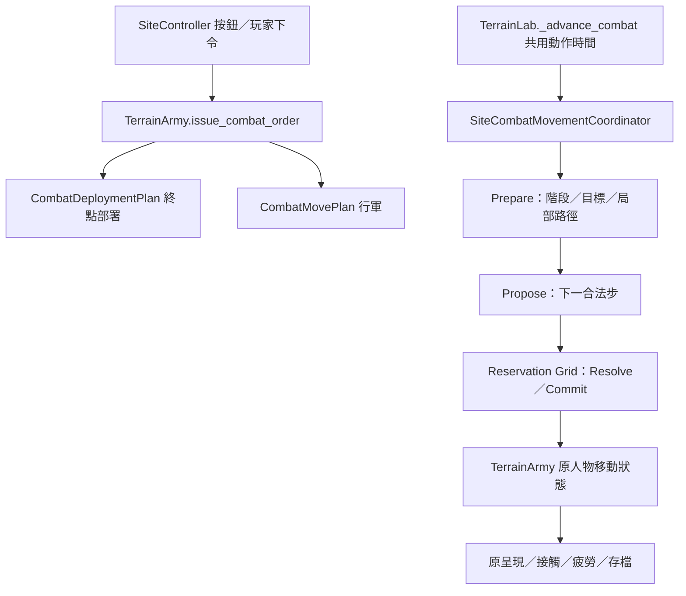

# 隊伍尋路與部署修改計畫：交付 SOL

> 本文件是 2026-09-24 實作前的調查與交付基線；下文「尚未實作」描述當時狀態。當前實作、逐項驗證與尚未通過的案例，以 `output/pathfinding_impl_20260924/README.md` 為準。

日期：2026-09-24。狀態：調查與設計完成，尚未實作、尚未動態驗證。

本計畫依使用者附件及**目前工作樹**制定。目標是讓隊伍能合法、連續地穿越隘口與轉彎，最後完成指定部署；保留一格一人、坡道／懸崖限制、原人物與存檔擁有者。

採用附件的核心方向：**交換目標槽位；下令固定終點隊形，途中依物理順序流動，接近終點才鎖定普通士兵的具體位置。** 不以瞬間對穿或提高尋路上限掩蓋死鎖。

## 1. 本輪範圍、證據及接手基線

- 本輪只讀程式與既有測試，新增本計畫及來源快照；未修改遊戲程式、資產或存檔，未啟動 Godot，未執行新測試。
- 下文「確認」指靜態程式證據；反例是供 SOL 動態重現的測試設計，不能當成已重現的執行結果。
- 調查時 HEAD 為 `39f1444`（V0.49R），分支為 `master`。精確 SHA、時間、45 個來源檔案雜湊及來源狀態見 `output/pathfinding_plan_20260924/source_snapshot.json`。
- 附件原文已保存為 `output/pathfinding_plan_20260924/user_reference.txt`。原文中的聊天引用不構成專案證據；本計畫重新追查實際程式。
- 已有未提交修改：`terrain_army.gd`、`terrain_data.gd`、`terrain_lab.gd`、`site_npc_combat_orders_test.gd`。另有 11 個移動模組及多份測試／UID 尚未追蹤。**這些全部是接手基線，禁止還原、刪除或忽略。**
- SOL 開始前比較雜湊；若來源已變，先重新對照相關函式。本文行號僅定位本次版本，以函式名稱為準。
- 若另開隔離工作區，必須完整帶入相關未提交及未追蹤內容並比對雜湊；只從 HEAD 建 worktree 會漏掉現有移動系統。預設直接在目前工作區接續，保留其他人的修改。

## 2. 目前真正的執行路徑

正式入口是 `project.godot:15` → `scenes/terrain_lab/TerrainLab.tscn`。



現有責任分工應保留：

- `TerrainData`：地形通行與 `navigation_revision`，唯一靜態通行依據。
- `TerrainArmy`：人物 ID、名冊、生命、權限、`cells/moving_to`、動作與動畫、命令及快照的擁有者。
- `CombatMovePlan`：路徑、隊列、行軍分配及可重建的短路徑快取。
- `CombatDeploymentPlan`：目的地槽位、平台／進路分組、最終指派與入場狀態。
- `FormationTransitPlanner`、`FormationDestinationPlanner`、`FormationRecoveryController`：上述資料的既有計算入口。
- `SiteCombatMovementCoordinator`：Site 同步調度、跨隊預約及提交邊界。
- `SiteMovementReservationGrid`：當步提案衝突與依賴檢查；`SiteDeploymentReservationRegistry`：終點槽位租用。兩者用途不同。
- `SiteStore`：資料驗證、遷移、保存／讀取交易；`SiteController`：操作入口；`TerrainLab`：共用時鐘與整合。

不另建附件示意中的 `FinalFormationPlan`、`TransitFlowPlan`、第二份人物位置或平行導航系統。將其概念放進上述兩個既有 plan。

## 3. 確認的缺口及優先級

### F01／P0：提交繞過原實體移動，步速取決於動作 tick

`terrain_army.gd:1009` 的 `apply_committed_move()` 直接把 `cells` 改到目的地、清除 `moving_to`，另寫 `visual_from_cell/visual_to_cell/visual_move_progress`。後三者沒有正式呈現讀取路徑；`combat_ground():2994`、`_sync_visual_positions():10829` 仍讀原 `moving_to/move_progress`。

`MOVE_STEP_DURATION_TICKS=4`；協調器跟隨 `TerrainLab` 的 1/30 或 1/120 秒動作步，故四 tick 約為 0.133 或 0.033 秒，並非既有 `MOVE_DURATION=0.38` 秒。這是靜態時間推算，畫面症狀仍需 GPU 錄證。

**決策：** 回到原移動時間、曲線與欄位，預約成功只開始一步，完成時才提交實體格位。不能只替這些新字典另寫一套 renderer。

### F02／P0：新預約視圖未納入完整占格，提交前檢查不足

協調器 `:172` 呼叫 `begin_tick(_current_occupancy)` 未傳地形；`:212` 重建只列 army 的目前 `cells`。獨立玩家／NPC、其他軍令已開始的 `moving_to`、車輛占用與掃掠預約沒有完整併入。Army `propose_combat_moves():789` 的相鄰直走分支可跳過局部尋路，未走原 `_reserve_combat_step():1758` 的完整外部阻擋／動作／車輛守衛。

Grid `commit_all():213` 對 lookup 缺人或 owner 無效沒有一致拒絕分支，可能仍把目的地寫入派生 occupancy。

**決策：** 先補完整唯讀占格投影及提交 preflight；動態占格不能混成靜態無路。缺成員、舊命令、動作鎖、失效來源必須拒絕並連帶拒絕其依賴者。

### F03／P0：階段列舉存在，正常推進未接上

`combat_movement_types.gd` 定義 TRANSIT、INGRESS_STAGING、PLATFORM_INGRESS、QUEUE_SETTLING、COMPLETE、FAILED；正式執行只有下令設 TRANSIT、恢復設 FAILED 和讀檔還原，未見正常推進寫入。

Army `:744–750` 只在 PLATFORM_INGRESS 或人已位於某個 platform slot 才追最終平台槽；進路成員一直追 transit slot。`FormationDestinationPlanner.get_member_current_target()` 沒接入正式目標選擇，`mark_platform_member_settled()` 也沒有正常運行呼叫。

**決策：** 只保留一個正式「當前目標解析」入口，同步維護階段、每人入場／整隊狀態與抵達計數。尾隊仍在行軍時，前隊可以先整隊。

### F04／P0：進路停止線會反過來攔住平台成員

`formation_transit_planner.gd:293–299` 用未釋放的 queue hold 限制全體 head_s；`formation_destination_planner.gd:149` 停止線在入口前四格。Army `:969–973` 的單列游標推进需要至少兩人達到下一位置。

必做反例：至少兩人、單列、cursor=hold_k−1。目標依序落在 hold_k、hold_k−1……，最多一人達到 hold_k；quorum 不滿足、平台無人入場、queue 不釋放。全員到暫存槽時 `_is_stall_clock_eligible():177` 又可能停止計時。

**決策：** queue gate 只約束待命角色及入口使用，不截斷平台成員的行軍路徑。不能用放鬆全域 quorum 或放行實體交換處理此反例。

### F05／P0：换目標後仍可能沿舊路行走

Army `_refresh_member_route_caches():537–541` 發現快取終點不同時僅排入重算；若預算不足或重算失敗，舊快取仍存在。`propose_combat_moves():817–820` 沒再核對快取終點與当前目標一致。

**決策：** 指派變更時立即失效受影響快取；未重新取得合法路徑就等待，禁止走舊目標。提案處再核對 order／path／assignment／terrain 版本和來源格。

### F06／P1：行軍順序仍被歷史名次與精確槽位綁住

TransitPlanner `:351` 先依舊 rank 分配，`:512–524` 才用 `member_best_path_s` 改排序；歷史上走到前面不代表現在在前面。lane／row 字典有宣告但未真正維護。單改 `member_transit_slots[a/b]` 下個 tick 又會被重算覆寫。

**決策：** 先觀測現在物理順序，再更新穩定序列與 lane，最後生成軟目標。當前排序用 observed progress；best progress 只用於診斷真正前進。

### F07／P1：終點未形成完整隊形合同

DestinationPlanner `:194–221` 下令即按名冊順序綁每人 exact slot；Army `:1620` 沒傳 preferred_officers。平台槽目前是整片同高度可達範圍，不是依面向及寬深生成的指定隊形；`resolved_anchor` 未在 planner 正常賦值，沒有 final facing 或戰術槽位角色。

現有 `member_role_map` 的 PLATFORM／APPROACH_QUEUE 是部署分區，不等於隊長／幹部／近戰／遠程角色，不能混用。

**決策：** 下令凍結終點幾何與角色需求；普通人的具體對應延後匹配。預約實際採用的槽位，不能把整片最大 25×25 footprint 都視為本隊目的地。

### F08／P1：進度與恢复可能永久掩蓋抖動

Army `:1010–1011` 每次成功一步都清 stall；來回走也能永不超時。Recovery 的 slot adjustment 目前只是清快取。宏觀重算只換 path／cursor，舊 observed/best、入口／停止線與 staging 未一起重建。`CombatMovePlan.remove_member():72` 漏清 `member_best_path_s`；中位數仍優先讀它。

**決策：** 只以已觀測到的有效前進／通口／最終就位重置停滯。路徑座標系變更使用 path epoch，完整重建相關衍生資料。

### F09／P1：公平性參數實際接錯

Grid `propose_move():28–38` 的尾參數為 emergency、wait_age、formation_rr_rank、front_rank、persistent_serial；Army `:825–835` 只送四個值，rank／serial 因位置而送錯欄位。現有 defer age 主要統計未得到尋路預算，不等於預約持續被拒的等待年齡。

**決策：** 修正呼叫，分清 route wait 與 reservation wait；穩定身分使用原 team/person ID，round-robin 由 coordinator 產生。不要靠每人重抽優先權。

### F10／P1：取消、讀檔及地形變更未封閉

Army `:3885–3985` 只保存部分 plan，漏入口／停止線、rank/profile 重建；lease timer 寫入卻沒讀回，slot_owner_map 沒重建。`:4343–4361` 還原 registry 後才重設／註冊 runtime ID，需統一 team ID、runtime ID 的用途。HOLD／RETREAT／短距 MOVE 對舊 deployment reservation 的釋放也須逐一閉合。

現有 `TerrainData.navigation_revision` 在 SiteRuntime 更新，但 egress `terrain_rev` 固定為 0；profile／roster／terrain 欄位不能只宣告不用。`SiteStore` 已驗證人物格位，但新 plan 未有完整對稱校驗。

Registry `try_replace_reservations():68–89` 在 old serial 不符時可能保留舊 lease 卻覆寫其追蹤列表；`release_slots():114–131` 也可能在未真正刪除 lease 時先移除列表項。正式清隊／拆併未完整連上 coordinator unregister，`_retained_occupancy` 的移交與清除亦須補齊，避免幽靈阻擋。

**決策：** 保存必要的命令及最終合同，其餘由原人物狀態重建；換令、離場、拆併、死亡、讀檔都走統一失效接點。

### F11／P1：既有 PASS 不等於完整抵達

- `combat_movement_task9_test.gd:95–117` 只跑 120 個 process_frame，要求仍 MOVE、accepted_count>0、cells 改變；沒有全隊登頂／最終部署斷言。
- `test_gui_mountaintop_move.gd:50–84` 只看 250 frames、cursor、平均位置與仍 MOVE。
- `combat_movement_task6_test.gd:46–48` 只要求兩組非空、合計 100，沒有精確 60＋40。
- fixture `build_mountain_platform_map():87–135` 的圓形 radius=4 為 49 格、radius=5 為 81 格；不是 README 所說的精確 60 格，ramp_direction 也未使用。
- `test_transit_lookahead_pipeline.gd` 全圖可走、固定 width=1、只有六人，還直接設多人同格；不能證明 4→1→4 完整通行。
- `test_move_cadence_stall_clock.gd` 直接呼叫 apply 並斷言四 tick，沒有驗正式時鐘及呈現。
- `test_save_load_movement_runtime_state.gd` 沒有正式 MOVE 後存讀並繼續抵達。
- `combat_movement_task3_test.gd:138` 把 member→cell 字典傳給期待 cell→member 的 Grid；另有 `commit_all({})` 用空 owner lookup 假裝提交。Grid 加嚴 preflight 時要修正 fixture 或讓純仲裁測試止於 Resolve，不能為遷就測試保留幽靈 owner。

**決策：** 保留有用單元測試，但更正其證據範圍；新增走正式命令與 coordinator 的完整旅程驗收，不能把測試名稱或 PASS 文案當成完成證據。

## 4. 實作後必須成立的規則

### 4.1 占格、時間與人物

1. 原人物 `cells` 是完成步進後的權威格位；`moving_to/progress/duration/curve` 描述同一人物已承諾的一步。不得另建第二套座標或時鐘。
2. 同一人物一個在途步、同一目的格一個預約；來源／目的及車輛掃掠範圍在步進期間都受保護。
3. Grid 派生資料只用於仲裁，不得先宣布到達而實體仍在原地；所有新動作經相同 legality 與 action guard。
4. 保留 A↔B 及所有封閉循環拒絕。空格為尾端的链可合法推进，但要驗證連續移動及原子完成，而非只驗離散格位唯一。
5. 預約循環只用於診斷／觸發重配，不能變成穿透特權。兩格寬側移用普通合法步完成。
6. 行軍速度沿用現有 0.38 秒步行／原奔跑規則；不同 action frequency、慢幀與暫停不改速度。不能用加速換取測試完成。

### 4.2 命令時固定與途中可變

- 固定：resolved anchor、最終面向、隊形寬深、合法 final slot 集合、各槽位戰術角色、平台／進路容量、命令 serial。
- 可變：宏觀路徑的衍生入口、目前 rank/lane、軟 transit target、尚未鎖定的普通兵 final assignment。
- 固定合同只有新命令、地形失效或成員資格變更等明確事件可修訂；必須有 revision 與可見原因，不能每 tick 悄悄重定終點。
- commander／officer 是最終職位要求，不是隘口超車權。不得為隊長在後而停止前方士兵。
- 最終對應分批鎖定；已完成者固定，未通最後隘口者仍沿物理隊列。
- 玩家仍自主移動；軍隊槽位只提示，不強拉原 Actor。受控普通兵同理。自動 MOVE 完成以可自動指派成員為集合，UI 另列玩家未就位，不能因玩家站在後方永久卡住全隊，也不能忽略其實體阻擋。

### 4.3 60＋40 的明確解釋

60＋40 是「100 人、合法平台只能容納 60 人、可達進路有 40 個待命位置」的驗收場景，不是每張地圖一律上限 60 人。

開闊地有足夠合法槽位時應允許 100＋0；只有 49 格的平台是 49＋51；空間不足應原子拒絕新令、保留舊令。`capacity` 與 `assigned_count` 分开，UI 不能把所有可用進路格數當作實際待命人数。

平台尚未放行前，進路組每人有唯一、安全的等待位置；不得所有人共用停止線同一格。若排在前方的普通士兵可兼任平台角色，優先交換分配，讓物理前方的人先入場。兵種／職位不可互換時，必須在隘口外的合法等候空間排隊，不能臨到單格道路才強迫超車。

## 5. 具體修改設計

### 5.1 先修正步進與原子提交

Grid Resolve 產生可接受的 dependency component。Commit 第一階段是原子「開始步進」，不能直接搬 `cells`。

- Coordinator 以現有 Army／Actor／vehicle API 建立同一步的唯讀 blockers 與在途 claims；重複實體占格應明確報錯，不可 Dictionary 覆寫後當成沒有問題。
- 開始前整組 preflight：owner/member/order、來源格、可行動、步進合法、profile、外部 blocker、現有目的預約與全部依賴。檢查全過才写原 Army 的移動欄位；任何成員失效則該依賴鏈整組不開始。
- 可同步的第一版鏈限同向、同速度、同曲線的普通步兵直鏈。轉彎、不同速度、跨 Actor／車輛的鏈先採從空格尾端依序開始的普通步；仍能前進，不承諾同時交換。
- 不能逐一呼叫 `_reserve_combat_step()` 當成 batch，它會拒絕尚被隊友占用的目的格。抽取其必要的動作初始化／完成副作用，讓已整組驗證的 batch 使用；保留外部守衛。
- 原 `prepare_combat()` 推進既有 progress，batch 成員先不進 `_complete_move()` 的單人完成分支。全部隊伍前進後、接觸取樣前，由 coordinator 執行完成 barrier：檢查整組 → 清來源 ownership → 寫全部目的 ownership → 原 completion 副作用。
- `finalize_combat_movement_tick()` 目前假設 accepted 後 cells 已等於 to；必須一併改為「步進開始」與「真正完成」分開。真正完成後才消耗路徑首步、更新 observed progress、判定 final settled；開始記錄不可偽裝成抵達記錄。
- Coordinator 只保存可重建的在途依賴關係／ID，不複製位置、進度、HP 或時間；來源／目的永遠回查原人物欄位。既有 `_begin_formation_step/_complete_formation_step` 可借用原子寫入形式，但不要打開它不適用的舊行軍條件。
- 已開始的一步遇到換令／受擊／死亡：沿用原人物「完成安全端點」規則，停止後續步；不得中途釋放其他成員仍依赖的來源。地形寫入守衛應保護在途格；意外失效要留診斷，不可強制瞬移復原。
- 原子 batch 的存檔關係在步驟 P7 補齊前，僅暫時拒絕保存此種在途 batch 並明示 BUSY，不宣稱完整功能；最終交付須可保存／讀回，見 5.7。

### 5.2 終點合同與四階段語意

不再新增一套平行 state machine。對應既有 enum：

- TRAVEL_FLOW／CHOKE_STREAM：都由 `TRANSIT` 加目前 corridor 寬度、連通性與穩定隊列導出。
- APPROACH_REFORM：使用 `INGRESS_STAGING`、`PLATFORM_INGRESS`、`QUEUE_SETTLING`，記錄每人成員的入場／鎖定狀態。
- DEPLOYED：`COMPLETE` 後完成 MOVE → HOLD，保留 deployment 合同作守位與補位依據。

增加單一目標解析入口（可在既有 planner 加 `resolve_member_target`）：輸入 order/plan/member/current step，輸出目標格、target kind、assignment epoch 與等待原因。Army 不再各寫一套 role／phase 判斷。

TRANSIT → STAGING 的起點可用距離終點 10 path_s 作初始調校值，但還須最後隘口位置、可展開空間和成員所在路段。不得因前隊接近終點而要求尾隊立刻找 final slot。

平台 admission 先處理深處槽，保持入口／緩衝帶可通行；「越過入口」與「精確 final settled」是兩種狀態。queue release 依平台成員已越過需保留的通道及可安全整隊判定；最終 COMPLETE 必須所有自動成員精確就位、步進完成、面向就緒。

### 5.3 現有 plan 的最小資料增補

`CombatDeploymentPlan`：

- 設定並保存 `resolved_anchor`、`final_facing`（沿用四方向）、實際最終 width/depth、形狀規格版本。
- 沿用 `platform_slots/approach_queue_slots`，另存 slot 的戰術角色需求；不更改既有分區 enum 語意。
- `member_slot_map` 可以先是 provisional，增加逐人 locked 標記；不要再複製第二份 final map。交換需原子更新 `slot_owner_map`。
- 清楚分離 pending admission／已入場／真正 settled；暫時缺席 lease 要有原 owner 與資格，promotion 後重新核對 gate。

`CombatMovePlan`：

- 沿用 rank/lane/row/transit map；真正寫入 lane/row，消除一份只宣告不用的資料。
- 增加 `path_epoch`、`assignment_epoch` 及每人必要的 route target/version、換槽冷卻、reservation wait age。版本僅於實際變更遞增。
- observed progress 表示當前位置；best progress 只屬於本 path epoch 的歷史前進證據。
- 時間使用共同 action 秒或明確定義的規劃節拍。附件「5 ticks 冷卻」若採用，tick 必須是固定規劃節拍；不得直接套不定的 30/120 Hz action tick。初值可採 0.5 秒模擬時間並用驗收調校。

Profile 仍由現有成員能力組合；`can_step_static`、宏觀／局部尋路、橫斷面與目的地生成必須一致遵守 profile。車輛／騎乘 footprint 仍查原擁有者，不以單格預設吞掉限制。

### 5.4 行軍重排與槽位交換

每個實際需要規劃的時點依序處理：觀測 → 修正物理序列 → lane／zipper 合流 → 槽位分配 → 快取失效 → 局部路徑 → 提案。

- 以原 `cells` 和已承諾步確認目前路段。髮夾彎／隔牆／不同高度不能只按曼哈頓最近中心線投影；使用原路段鄰近窗口加合法連通檢查，窗口失敗才用有預算的再接軌搜尋。
- 單格道路按實際先後進入。兩側合流採穩定 lane 隊列與 zipper；同 lane 不越過前人。隊長／幹部權重留到最終部署。
- 開闊地只檢查同隊、相鄰 rank／鄰 lane 的局部候選，不做每 tick 全隊所有配對。每人每輪最多一次交換，已有 pending proposal／在途動作／鎖定 final 者延後。
- 比較可通行距離、交叉／逆行成本與原順序；不得為每個候選跑兩次完整 A*。先用已得的局部／反向距離資料；缺資料時跳過該次最佳化，不猜跨牆可走。
- 相容角色才交換；strict gain threshold（初值相當於至少少兩個合法格步）＋cooldown＋stable person ID tie-break 防來回震盪。同成本不換。
- 交換更新權威 assignment/rank/lane/row/target epoch，清除僅受影響的舊 route／尚未提交提案。不得寫 `cells`、改人格／兵種或跨隊移轉成員。
- 軟槽位表示「在合法行軍帶維持前進與大致間距」，不是一旦落後一格就倒退追本 tick 的精確點；禁止僅為糾正普通兵序號造成單格逆行。確需後退的避讓由明確恢復動作處理。

### 5.5 最終隊形、晚綁定與面向

- 點地命令：從宏觀路徑最後一個非零合法方向推導面向。起終同格／路徑單點則保留既有指揮面向。不要直接索引 path[-2]。
- 下令即生成面向對應的理想矩形／既有隊形槽（預設沿用 10 列設計、依人数及地形縮小）；經通行與連通檢查選出實際 final 集合。不可純粹按曼哈頓「最深」把人配到凹形地形死角。
- 隊長槽、幹部槽、前排／後排角色由現有職務及裝備決定。普通相容成员近終點以穩定貪婪匹配加有界相鄰交換即可；第一版不引入全域 Hungarian solver 或新依賴。
- late matching 按当前 lane／同路段距離與過入口順序降低交叉；逐批鎖定，保留未入場者的動態分配。鎖定後只因死亡、職務／資格、真正失效槽位或新命令改變。
- 移動中依實際移動方向顯示；到 final 且已完成原動作後用原 facing 入口轉向。不能只改 plan 而畫面繼續朝最後一步方向。
- `ATTACK/PURSUE` 目前是接敵／追擊，不是帶終點的 MOVE。本輪不把敵方每次移動變成全隊重新建 final plan；保留原戰鬥朝向與重新選敵，驗證 MOVE→ATTACK 不殘留 move target。附件「ATTACK 朝敵中心」適用未來具有固定部署目標的命令，不藉此重做戰鬥 AI。

### 5.6 預算、恢復與命令原子性

- 保留現有局部搜尋限制：單次 256 expansions、每隊每規劃 tick 最多 8 次／1024 expansions、Site 8192。不要先拉大常數。宏觀 A*、egress、配對估價分開記帳，避免它們不在統計中卻聲稱達標。
- 不必每個 action 小步重算整隊排序／目的地；在到格、目標／寬度變更、障礙 revision 或有限規劃節拍觸發。協調器仍按原時鐘處理在途完成與接觸。
- 預算用完是 DEFERRED，搜尋完無路才是 NO_ROUTE。巨集搜尋到上限也須區分 budget exhausted 與真無路，不能一律回空路徑後宣稱 BLOCKED。
- 恢復順序：合法短暫等待 → 真正重配相容槽位／局部側移 → 維持有期限的單列模式 → 合法重新接軌 → 有冷卻的宏觀重算 → 明確 BLOCKED／CONGESTED。
- 不以任意成功一步、assignment epoch、排序變化、重算次數當成前進。記錄安全通過關鍵路段人数與逐人 final settle，讓尾隊持續通口即使中位數不變也算真正進度。
- 合法隊列等待、動畫、排程 deferred、受控者自主行動要有可診斷原因；不能用一個全隊 deferred 旗標永遠掩蓋仍可行動者的卡住。
- 地形／路徑 revision 變更清理舊 path_s 座標系、入口與 cache；用真實可走 member cell／anchor 作重算起點，不能把算術平均格當成必然可走的 medoid。
- 新令先在暫存資料完整規劃、驗證容量與 registry replace，再發布 order/plan。失敗保留舊命令和預約。HOLD/RETREAT/ATTACK/短距MOVE/清隊都走明確取消與釋放接點；已承諾的一步安全結束。
- 短距 MOVE 的 rigid-shift 可保留作目標生成快路，但步進安全、final facing、完成判斷和 registry 生命週期必须共用。不得形成距離五格內安全、六格外另一種物理規則。

### 5.7 保存、還原與失效事件

- 在原 Army snapshot 加有版本的最終合同、locked mapping、必要的缺席 lease 与命令資訊；TerrainArmy.valid_combat_state／SiteStore 驗證型別、有限值、ID、唯一槽位、可達性、角色及容量關係。
- 不保存 A* open set、proposal ID、route cache 或 renderer 副本。恢復時依原人物 cells/moving_to 重建 profile、rank/projection、入口 gate、slot owner、registry。
- 若有同步在途鏈，需保存最小 batch 關係：persistent person IDs、成員間依賴 ID、共同規格及起始命令資訊，或可無歧義重建的等價資料；每人的 source/dest/progress 仍只在原人物快照。從原人物欄位整體重建並驗證同向、同進度、同 duration/curve、唯一 claims、空格尾端與完整 membership。SiteStore 只對已完整驗證的合法 batch 允許成員相互 source/destination claims，不能全面放寬既有重疊拒絕；任何矛盾均拒絕載入。
- 恢復先整體驗證、重建 batch 與 reservations，再接回正式場景；不能逐人載入到一半才發現衝突。讀取失敗保留舊場景及存檔原檔。
- 缺新欄位的舊存檔走明確 migration：沿用其已驗證人物／命令，重建可推導資料；無法安全重建的 active MOVE 必須明確回報需重新下令，不能悄悄丟資料後繼續舊路。若現有 schema 可選欄位能表達，不無故升級整個 Site 格式。
- 死亡／離隊／拆併／受控身分變更清除後續規劃的對應 map（含 best_s），promotion 原子更新雙向 slot map。已開始步進的 batch membership、來源／目的 claims 及完成資料保留至安全端點；占格投影須額外納入尚未完成的原人物步進，即使其已不屬 active member。缺席與 KO 是否保留最終槽位依原生命規則，不藉本輪改成一律刪除。
- runtime formation ID 不作持久身份；registry 明確採一種 ID 並在註冊／還原邊界轉換。註冊不得遺失現有 mapping，離場／換圖必須清理前圖的預約。

## 6. SOL 執行工作包與完成條件

各包完成後才進下一包；UI 可在核心接口穩定後並行。每包保留失敗證據及最終通過證據，不改 canonical verifier。

### P0：保存基線、建立真正會失敗的驗收

涉及 tests／fixtures 與任務 output。保存來源雜湊、既有差異與 test command；先更正精確平台 fixture、觀察時間及逐 tick invariant。重現 F01–F05 至少各一例，先小人數定位再 100 人。

完成條件：每個缺口能以正式命令／coordinator 的失敗斷言或明確未重現紀錄呈現；不能把直接改 cells 的 helper test 當端到端驗收。此包不順手改 unrelated code。

### P1：統一移動物理與完整占格

涉及 `terrain_army.gd`、`terrain_lab.gd`、coordinator、grid，必要時原 vehicle blocker 接點。依 5.1 建立即時／在途投影、batch 起始與完成 barrier、步速一致。先從單人、兩人直鏈，再 100 人。

完成條件：同一 action mode 下，無丟時的不同呈現幀切分／慢幀在相同已結算模擬秒得到一致結果；跨 1/30、1/120 mode 的步內插值均符合原 0.38 秒曲線，開始／完成事件的量化誤差最多各自一個 action step。另記連續 K 步的累積偏差，預先接受界線為每步至多一個較大 action step，加一次命令啟動的量化誤差，不能只測單步或暗改所有人物時鐘。動畫與接觸同源、外部 Actor／車輛不被穿過、交換循環仍拒絕。超出既有 catch-up 上限的慢幀另記 input／simulated／dropped seconds，不把未結算時間算成等時證據。開始前任一 preflight 失敗無部分 mutation。

### P2：打通階段、入口與最終目標

涉及 Army、types、destination／transit planner、兩個 plan。單一目標解析、平台與 queue 分開 gating，真正更新 admitted/settled；先補舊目標 cache 失效。

完成條件：F04 單列反例能讓平台成員通過；queue 等候格唯一；100 人在平地及已確認可行的簡化部署案例完成現有 final geometry；全員到 transit slots 卻未完成時不得無限沉默。短距與長距 MOVE 都可正常完成／取消。完整窄口轉彎與角色隊形矩陣留給 P3／P4／P8，不要求 P2 提前完成尚未實作的重配能力。

### P3：接入物理序列與可交換的軟槽位

涉及 transit planner、move plan、Army 排程／提案、route budget。補当前投影、lane、zipper、有界相鄰重配、epoch/cooldown、公平性實接。

完成條件：後排隊長不超車；4→1→4、90°、髮夾彎完整通過；交換在下一 tick 不被舊 rank 覆寫；未獲路徑預算者不走舊目標；無 swap oscillation／永久饑餓。

### P4：終點隊形、角色與晚綁定

涉及 deployment plan／planner、Army 命令與 facing。固定 anchor/facing/slot roles，選用實際槽集、角色相容匹配及分批 lock。先完成預設點擊面向。

完成條件：開闊地完成固定隊形与面向；容量 60 的平台恰好 60＋40；前隊整隊不阻斷尾隊；職務／兵種角色正確；capacity、assigned、settled 數字互不混淆。

### P5：恢復、公平性及生命週期

涉及 recovery、coordinator、registry、Army 取消／移除接點。修真進度、宏觀重算 epoch、terrain/profile/roster revision、缺席补位与既有命令替換。

完成條件：來回抖動不無限清 stall；合法單列長隊不誤判 12 秒卡住；真封路回 BLOCKED、暫時擁塞回有原因的 CONGESTED；換令失敗舊令完整保留，離場與清隊無幽靈預約。

### P6：正式操作入口與可見結果

涉及 `site_controller.gd`、`terrain_lab.gd`、既有 selection／overlay 呈現入口。現在右／中鍵拖相機、左鍵選格／框作業，不能直接搶走既有按鍵。

- 保留目前「移至所選格」按鈕，自動用路徑尾段面向。
- 在既有軍隊面板增加明確的「指定隊形方向」操作模式；該模式左鍵起點為 anchor、拖曳方向量化四方向、鬆開送令，Esc 取消。UI 上方按鍵／輸入、暫停或失焦取消不完整手勢。
- 第一版拖曳只指定方向；隊形寬度沿原預設。附件提及的「拖曳長度改寬度」列為同接口後續選配，避免方向手勢未驗證前混入第二個調整量。
- 預覽與正式送令使用相同 planner；預覽不取得正式 reservation，送令必須重新驗證。僅畫已驗證終點槽與方向，不為每兵建 Node。
- 顯示「行軍／等待通口／整隊／部署完成」，平台／進路已指派与已就位人數；阻塞區分地形、其他人、排程等待。技術診斷另存報告，不塞進一般遊戲訊息。

完成條件：玩家權限与測試指揮入口都測；普通選地、作業框選、相機拖曳不回歸；畫面終點方向與 plan 完全一致。新的手勢可用，沒有只做 API 沒接 UI。

### P7：存讀檔與在途恢復

涉及 Army serializers/validators、SiteStore、coordinator 還原。依 5.7 完整支援新合同、原動作進度與安全 batch 關係；新增欄位必須有對稱 restore 和壞資料拒絕。

完成條件：行軍中、通口中、分批整隊、已部署各保存一次；實際 `SiteStore.save/load_site` 後續行完成。同樣 seed/input 下 deterministic 結果，舊檔可遷移，非法檔無部分替換；不能只測序列化 Dictionary。

### P8：整合、視覺與效能交付

正式 TerrainLab 場景執行第 7 節矩陣，保留 trace、完成摘要與 GPU 畫面；更新 PROJECT_ARCHITECTURE／操作說明中本輪涉及部分與驗收界線。

完成條件：各層證據齊備、所有必要反例修復、未完成項誠實列出。不得只憑 task9 COMPLETE 文案交付。

## 7. 必跑驗收場景與斷言

所有整合場景：起始人物唯一合法；測試開始後不可直接改 cells 幫忙通過；固定 seed、人數、地圖、命令及模擬秒數，逐步檢查占格／預約／地形／身分。現有不相關基準測試失敗須分類，不能刪斷言求綠。

共同完成條件：全部自動指派成員已到各自正式 final slot 且唯一、面向正確，MOVE 已轉 HOLD／COMPLETE、沒有在途步或舊 motion claims、仍保留正確 deployment leases，接著穩定五個模擬秒。只看 command_status 文字、leader 到達、某人動過或「仍 MOVE」均不算完成。

1. **單步／時間**：普通兵、原玩家、受控兵共用既有速度曲線；同 action mode 的不同幀切分等模擬秒比較，跨 1/30／1/120 依 P1 的單步及累積量化界線檢查。半秒慢幀另記是否觸發 catch-up 丟時。至少取步內 25%、50%、75% 位置，證明不是瞬間跳格。
2. **交換與鏈**：A↔B、三／四人封閉循環拒絕；同向空尾链安全通過；轉角／異速退成合法 sequential；同 tick 不產生雙重目的預約。
3. **提交中失效**：Resolve 後換令／移除成員／來源不符／owner 消失，依賴鏈無部分開始；直鏈中段成員在 50% 進度死亡／KO，前後成員及外部人物都不能穿入仍受保護的格，批次保持安全端點規則。
4. **全域 blockers**：玩家 standing/in-flight、NPC、非 MOVE 軍隊、車輛與掃掠邊界均不穿透；相鄰目標快路也必須拒絕。
5. **slot 交叉**：A 接近 B 目標、B 接近 A 目標；只換 assignment、cells 不變，正常步行後完成；不允許不同兵種角色非法互換。
6. **cooldown／cache**：對稱同成本布局不來回交換；目標換掉且 route budget=0 時等待；舊 route 不能產生 proposal。
7. **後排隊長**：隊長放最後，普通兵按物理順序通口；到開闊終點後隊長走到職位槽，不跨越友軍。
8. **真實 4→1→4**：用實牆／不可走地形形成寬度，100 人完整通過再展開；包含 90° 转角，不能只在全平圖設定 width=1。
9. **髮夾彎／平行隔牆／坡道**：靠近另一段中心線不能誤跳 path_s；每步走合法 ramp，不能橫跨 cliff。
10. **queue gate 反例**：cursor=hold_k−1、兩人起步，再擴到 100；平台隊不受 queue 停止線封鎖，最後 queue 也實際移到 final。
11. **精確 60＋40**：fixture 在排除入口／需保留的 buffer 後，仍明確有 60 個連通、可部署平台 final 格，以及 40 個合法且不擋入口的 queue final 格；100 人全部完成，平台 60／進路 40，每格唯一、無未完成動畫、最終面向正確。入口暫留／等待位置也须合法。
12. **容量差異**：100＋0、49＋51、200 人名冊，以及總空間不足；不足時新令失敗不改舊令。保留 Site 原三隊／300 NPC 保存界線。
13. **正式山頂**：TerrainLab 的 TERRACED_HIGHLAND、seed=12345、目標(49,37)，用真實 UI／issue_combat_order；對實際平台容量驗收，不假設它剛好 60。
14. **連續重下令**：MOVE→MOVE、HOLD、ATTACK、RETREAT、短距平移、非法新目標；舊 proposal/cache/reservation 不洩漏，已承諾一步安全結束。
15. **狀態變更**：死亡、KO/回歸、指揮接替、離隊／拆併、受控者切換；既有禁止時機仍拒絕；合法變更後唯一 ID／slot owner／lease 正確。
16. **道路改變**：既有 Site 命令增加障礙，navigation revision 失效旧路；撤除障礙後可重新行軍，不破壞在途保護。
17. **多隊交會**：2×100、3×100 同向／交叉；驗證等待公平與無占格衝突。單格兩端對向且無退讓空間可回 CONGESTED，禁止以瞬移硬求通過；有側袋則依法侧移恢復。
18. **停滯真假**：兩格來回不算有效進度；前方按正常吞吐持續出隘口不算堵死；尾隊有人卡住不能因前隊少量移動永遠隱藏。
19. **實際存讀**：P7 四種階段＋舊檔＋畸形新欄位＋batch關係；保存／讀回後繼續走到 final，不只是 ID 排序相同。
20. **既有回歸**：軍令權限、近戰／遠程MOVE後清 target、玩家入隊、工作／物流／車輛调用 MOVE、清隊換圖、舊 FOLLOW/EDGE/V6 移動。舊入口通過不抵作新入口通過。
21. **GPU 操作**：原正式 renderer 檢查轉角、上坡、入口、尾隊與最後轉向；多幀或影片證明插值、無瞬移／動畫對穿。數據 PASS 與人工目視結果分開。

### 時限及效能驗收方式

以模擬秒判斷完成，process_frame 次數只記錄呈現。精確單列、100 人、每步 0.38 秒時，僅相鄰尾隊通過同一格就需約 99×0.38=37.62 秒，還未包括隊伍到入口及終點整隊；不能用 120 幀當完整期限。

各 fixture 在跑修正前寫入 `max_sim_seconds`，依已知最長合法路程、正常吞吐與整隊餘量估計。小型反例 20–60 秒；100 人完整場景初始可用 `2 × (L_max + N − 1) × MOVE_DURATION + 30秒` 作寬鬆 watchdog，這是測試期限估計、不是普遍路網上界。真實卡住要診斷，不因失敗反覆擴大期限。

記錄 10／100／200 人單隊及三隊總300的 completion time、最後一人 delay、A* calls/expansions、planning 每步 median/p95/max、零接受比例、swap 次數／撤回次數、各人最長等候。固定硬體、renderer、seed與步速比較；修復前不完成的案例以相同模擬秒對比，不能把瞬移版的速度當改善標竿。

第一版效能門檻：遵守上述預算、無無界重試、無每 action tick O(N²) 配對／全員重搜、同條件 p95 規劃耗時較可比較基線劣化超過10%須調查與報告。這是調查門檻，不能為了達標降精度或跳過驗收。本輪不宣稱 5000／9000 人 FPS。

## 8. 診斷與證據交付

延伸現有 metrics，另寫有界 event trace，避免每兵每 tick 無限制列印。至少包含：

- order／path／assignment epoch、phase/submode、width、terrain revision、規劃預算。
- person ID、current cell／moving_to／progress、target kind／goal、rank/lane、observed_s/best_s。
- assignment swap 前後與理由、冷卻、route失效原因、proposal接受／拒絕原因、route wait／reservation wait。
- 平台／進路 assigned/admitted/settled、gate、最後有效進度時間、恢復階段與失敗原因。
- 最終逐人位置與面向、occupancy／slot uniqueness、命令終止原因、所有未到達者明細。

資料放 `output/pathfinding_rework_<實作日期>/`，含 README、固定 scenario 描述、baseline/final 結果、verifier result.json 與必要 stderr/stdout、GPU 證據。失敗保存，解釋修正後為何重新跑，不能只留下最後 PASS。

## 9. 驗證操作與專案限制

- 使用 `C:\Users\Nekki\.codex\skills\godot-runtime-verify\scripts\verify_godot.ps1`，先讀當前 SKILL.md 與參數，helper 原樣執行。保留完成100份及所有未完成run的 retention；重要結果複製到任務 output。
- 順序：編輯器／載入檢查 → 定向資料與預約測試 → 正式 coordinator 完整旅程 → 實際存讀回歸 → TerrainLab GPU 操作／動畫 → 固定場景效能比較。
- 每次 Godot 都有明確 timeout，保留真正 exit code/result.json。若缺資產／atlas准入，分類為環境或既有阻塞，不放寬 reader。
- PASS 必須同時满足 exit 0、無 SCRIPT ERROR／Parse Error／assertion／crash／timeout；GPU 預期檔案須為本次新產生，且逐張／逐段檢查。自訂列印 PASS 不能覆蓋這些條件。
- 遵守本專案 AGENTS：失敗可自行調查、做範圍內修正後重跑，不必每次問使用者；禁止無修改盲重跑、隱藏錯誤或改 verifier。
- schedule 不可用時用原生 status/wait 主動監控，保留 session ID及有界等待，不另建 recurring automation 當計時器。
- 不改 LFS clean/process guard、不用 git add -A、不自動提交／推送，不清理使用者其他檔案。

經核對 helper 參數後的命令形式如下；先把 `$godotPath` 設為實作當日已確認的 Godot console executable 絕對路徑並記錄版本，不硬套舊報告中的引擎路徑。以下為模板，本輪未執行。

```powershell
$verifyPath = 'C:\Users\Nekki\.codex\skills\godot-runtime-verify\scripts\verify_godot.ps1'
& $verifyPath -ProjectPath (Get-Location).Path -GodotExecutable $godotPath -Mode editor -TimeoutSeconds 120
& $verifyPath -ProjectPath (Get-Location).Path -GodotExecutable $godotPath -Mode headless -TimeoutSeconds 120 -GodotArguments @('--script','res://scripts/tests/combat_movement_task3_test.gd')
```

完整旅程以新增的固定模擬秒測試替換 `--script`，按預先估算的實際執行時間設定 timeout；GPU 使用 `-Mode visual` 與 `-ExpectedOutput`。各命令依上一結果判斷後分別執行，不把一串失敗後仍繼續的命令當驗收。

## 10. 可直接交給 SOL 的執行指令

> 依 `COMBAT_PATHFINDING_REWORK_PLAN_SOL.md` 實作並完成驗證。先比對 `output/pathfinding_plan_20260924/source_snapshot.json`，讀 `AGENTS.md`、`PROJECT_ARCHITECTURE.md`、附件存本和目前工作樹；保留已有未提交／未追蹤改動，不從 HEAD 另寫一套。先做 P0 反例與基線，再依 P1–P8 進行；重用 TerrainArmy、CombatMovePlan、CombatDeploymentPlan、現有 planners/coordinator/reservation owners。必須先修原動作插值與完整占格，再完成角色專屬入口 gate、目標快取一致性、軟槽位／物理序列、晚綁定 final formation／面向、恢復及存讀。
>
> 保留封閉循環與 A↔B 實體交換拒絕；只交換 assignment。空尾鏈依原動作欄位合法開始和原子完成，禁止把直接搬 cells 當流暢通行。不拉高尋路上限或改測試文字假裝解決。使用 canonical bounded Godot helper，逐階段保留失敗與成功證據；做到正式 TerrainLab 全隊抵達、精確60＋40 fixture、GPU實際插值和存讀後續行驗收。遇到例行測試失敗先自行診斷修正，不需反覆求批准。只有真正權限／外部阻塞或新增玩法決策才停下說明。
>
> 最終回報分成「已實作」「已驗證」「仍有缺口」，列來源變更、重要測試與畫面連結，清楚說明效能與覆蓋限制。不自動提交／推送，不新增人物／座標／存檔權威，不擴成全戰鬥AI或萬人效能專案。
