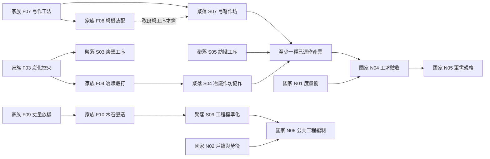

# 家族、聚落與國家科技樹規劃

日期：2026-10-02。狀態：設計提案，尚未實作。現況依據為本輪只讀核對的 `D:\worldgoing`；對話原附 Dropbox 路徑目前不存在。本文只新增規劃文件，不改遊戲程式、原有設計文件或存檔。

核心分工：**家族累積與傳授技藝；聚落把技藝變成在地設施和生產能力；國家建立標準、教育與跨地協作。** 三層同時存在，不是家族升級後消失、變成聚落，再變成國家。獨立聚落和未仕官的家族也能发展高階工藝。

先以現行農耕、手工業、弓弩與冷兵器內容規劃。下列 30 個節點是內容藍圖，不是一次全部施工的承諾；火藥、蒸汽、電力與完整近代工業暫不列入。所有新增名稱、效果、前置及權限均為建議，尚未代表使用者逐項確認。

## 1. 已有基礎與真正缺口

- 家族：`site_family_continuity.gd:20` 現有明示家人引用與死亡後控制接續。沒有正式多家族 ID、家主、家產、研究或傳承技藝。接續控制權不等於繼承知識、官職或物品。
- 聚落：`site_environment.gd:58` 的 Site 是地圖與活動狀態。`site_runtime.gd:18` 已有 19 種設施，包含農牧、炭窯、冶煉、織布及防禦工事，但沒有正式聚落成員、管轄與公共財產。Site 不直接等於聚落；建物外觀也不證明居民、維修或室內系統存在。
- 國家：`site_equipment_orders.gd:733` 的 `equipment_nations` 有軍事首長、成員、配裝標準與文化。正式國家治理、地方行政、財政與國家科技尚未成立。不能將測試用 `trial_team_` 國別升格為完整國家。
- 生產：`site_runtime.gd:12` 有弓、弩、箭及弩矢四種手作；既有建設與製作尚無科技門檻。本輪搜尋現行 TerrainLab／World／Region 腳本未找到科技樹或研究流程。
- 保存：沿 `SiteController → SiteStore` 保存原人物、Site 狀態與物品；現行格式為 3。家族與國別有嚴格欄位驗證，不能直接塞入未宣告欄位。

以上是靜態原始碼核對，不是本輪遊戲執行驗收。較早的資源文件有「尚無建築／保存人物」等歷史敘述，以現行源碼為準。

## 2. 玩家實際經營什麼

### 家族：工法、師承與專長

玩家為家族選研究方向、安排原人物試作或授徒，取得可累積的工法。家族保存工法紀錄；個人是否能熟練施作，另由原人物的學習結果決定。兩者含義不同，不能因加入家族、結婚、收養或切換控制者就直接精通。

家族可以聘請外來師傅，也可以向外傳授。第一版只有正常傳授和自主試作；婚姻政治、秘方爭奪、商業授權和間諜不作必要前置。基本傳授從第一版就可用，不能被國家教育科技反向鎖住。

### 聚落：在地工程與公共服務

玩家選擇本地要發展的產業，指派真正的設施、人員、材料和用地。研究完成只代表取得或驗收工序；工坊、渠道和倉庫仍要正式建造或改良。作用範圍由登錄且合法使用的實體設施決定，不是同一張 Site 全圖自動生效。

同一聚落可以容納多個家族，同一家族也可在不同聚落活動。首包為一 Site 一聚落的情境限制，不將此限制寫成世界資料的永久假設。多倉庫、公共產權、投入物流、住宅入住均須各自完成既有計畫的前置。

### 國家：制度、標準與推廣

領導者決定優先方向及可支配資源，合法官員執行推廣、驗收或工程。沿 [NPC AI 計畫](NPC_AI_IMPLEMENTATION_PLAN.md) 的同 Site 最小國家與授權方案前進，科技系統不另建另一組元首、會員、國庫或政策 AI。

國家科技需要先有相關制度的可執行入口。發布法令不會瞬間改變所有聚落、產物或人物；接受制度、完成地方推行且具備運作條件的範圍才生效。文化選項不排列成先進／落後等級，保留既有文化與外觀規則。

## 3. 家族科技樹：10 個建議節點

以下為新工法與改良的解鎖。既有基本耕作、製作與建造保持可用；「前置無」表示沒有其他科技硬前置，仍需要相應人物、材料、場地與試作。

- **F01 農事記錄**｜前置無。記錄真實耕作結果，形成可傳授的適地種植方法；不憑空增加肥力或水量。需補生產結果與知識累積接點。
- **F02 適地留種**｜前置 F01。解鎖明確的留種作業與適用地塊方案，收穫與保留種糧必須分帳守恆。種子回收／品系尚未實作，不能只打開科技圖示就給種子。
- **F03 炭化控火**｜前置無。完成原炭窯試作，取得改善操作工時的工法；仍消耗原木材並產出原木炭。先不新增燃料熱值模擬。
- **F04 冶煉鍛打**｜前置 F03，且有真冶煉／鍛造試作條件。解鎖進階鐵製工序的知識；現有鐵料不改名為鋼，鋼製程另列後續配方。
- **F05 纖維處理**｜前置無。改良現有植物纖維處理方法，供織造工序採用；不把羊毛視為同一原料。
- **F06 織造改良**｜前置 F05。解鎖在合適織布設施使用的改良工序；仍受投入、工時、出貨容量限制。若將來加羊毛配方，另定真實投入／產出。
- **F07 弓作工法**｜前置無。沿既有製弓流程累積試作與傳習成果；首包只改善合格施作者的製弓工時，不改射程、傷害、材料、產量或裝備資格。
- **F08 弩機裝配**｜前置 F07，且完成使用鐵料的弩機試作。解鎖改良弩作工序；現有基本製弩仍可用，不把此節點當成既有弩的首次發明。
- **F09 丈量放樣**｜前置無。取得工程測量方法，支援後續工程方案和施工準備；不改動全域格位、每格尺度或導航規則。
- **F10 木石營造**｜前置 F09。支援複雜木石工程的工法驗收。樓梯、城門、牆頂通行仍依 [建築計畫](SITE_BUILDING_REQUIREMENTS_AND_IMPLEMENTATION_PLAN.md) 分別施工和驗證。

## 4. 聚落科技樹：10 個建議節點

跨層前置可以由本地已學會的原人物提供，或由已完成傳授的工法提供，不要求某個特定血緣家族永久壟斷。

- **S01 供水排程**｜前置：可用水井／取水站、合法供水管理權。解鎖用途優先順序與缺水調度；只分配原水源能力，不增加地下水或把海水變淡水。需擴充現行分配入口。
- **S02 灌排工程**｜前置 S01、F09、適合的地形與水源。解鎖在地灌排工程方案；渠道、工程占地與服務範圍需新增正式玩法，不能用全圖農業百分比代替。
- **S03 炭窯工序**｜前置 F03、已完成的原炭窯。花費改造工時，將家族工法落實為該設施的工序；失去合格操作人員時停止改良效果。
- **S04 冶鐵作坊協作**｜前置 F04、可用冶煉及鐵匠設施、實際鐵礦／鐵料與木炭。解鎖明確的加工分工和工單；S03 是本地燃料選項，不是唯一必要來源。先採用現行單營地供料，不能冒稱已完成工坊間實體物流。
- **S05 紡織工序**｜前置 F06、原織布設施。將工法落實為本地改良生產方案；工時改善只作用於符合條件的批次。
- **S06 糧食乾燥與倉儲**｜前置：已有糧食生產、可建設地點、公共物資權限。解鎖專用存放／處理設施方案；多倉庫、乾燥品類、損耗及物流尚需實作，現有糧食不先新增腐敗懲罰來逼玩家研究。
- **S07 弓弩作坊**｜前置 F07、指定且可用的原作業設施及供料來源；改良弩工序另需 F08。解鎖正式的作坊工單、操作席位與分工，不憑空加人或增加並行名額。現有鐵匠鋪尚無此完整功能，需沿原設施擴充。
- **S08 修造與備件**｜前置 S07、實物裝備及可執行維修配方。解鎖器具維護與備件工作。耐久／维修未成立前保持後期提案；既有完好裝備不因沒研究就壞掉。
- **S09 工程標準化**｜前置 F10、可支配工程材料及合法施工授權。驗收可重用的施工方案；每次建設仍逐案檢查占地、材料和人員，不免費複製建物。
- **S10 防禦工務**｜前置 S09，並具備所選防禦設施的真實功能。解鎖較複雜的防禦配置與維護作業。現有木牆／防禦陣地不反向封鎖；多層牆、城門、破壞與修復各自依建築計畫接入。

## 5. 國家科技樹：10 個建議節點

每個節點都先要求正式國家身分、合法決策者和明確授權物資來源；這些不是現有配裝國別已具備的能力。

- **N01 度量衡制度**｜科技前置無。建立共同的驗收與計量規格，支援公共採購；不更改玩家可見的基本物品數量，也不要求先研究才能交易。
- **N02 戶籍與勞役登記**｜科技前置無。建立合法人口／勞力登記和工程徵調入口；登記必須引用原人物，不能由住宅數生成居民。需人口歸屬、服役權限及徵調規則。
- **N03 糧儲與賑濟制度**｜前置 N01、至少一处實際運作的 S06。設定儲備、配送和發放政策；只使用有授權的真糧食，不能借用整個 Site 營地冒充國庫。需真受益人與配送入口。
- **N04 工坊驗收制度**｜前置 N01，至少一種已運作的 S04／S05／S07。形成標準工法、驗收和採購資格；可以有多種文化和工藝，不把每種產物都重新建立成新物品帳本。
- **N05 軍需規格制度**｜前置 N04、S07、正式軍事首長與配裝標準權限。把合格生產工單和原配裝標準相連，減少不合需求的生產；科技不直接換裝、補滿彈藥、擴編或提升訓練數值。
- **N06 公共工程編制**｜前置 N02、S09。由合法工程負責人指派原人、原料及原建設命令。研究本身不給額外工人、施工速度或全圖道路。
- **N07 技藝傳習制度**｜前置：至少一項已完成技藝、合格教師及授權教學地點。建立較有組織的教學與工法保存，降低跨家族傳授的管理成本。基本家族授徒無需 N07，也無需先有國家。
- **N08 道路驛運制度**｜前置 N06、可用運輸工具與路線。建立公共運輸安排；道路不自動獲得速度加成。跨 Site 版本需正式旅行、共同時間和人車貨交接，首版不可啟用遠地效果。
- **N09 稅籍與財政制度**｜前置 N01、N02，且已有正式財產權及徵收／支出命令。建立可查核的實物稅或後續貨幣預算；研究不把所有人物與庫存變成國有。首包不以完整稅務作為前置。
- **N10 地方行政制度**｜前置 N02、N09；跨地版本另需 N08 與正式聚落隸屬。定義地方官授權與行政範圍，允許多聚落協作；無效授權、離任與分離都須停止相關命令。

國家制度分開選擇，沒有「研究國家 3 級便同時解鎖全部民生、軍事、財政」的總等級。國家崩解不抹除人物已會的技藝，也不自動拆除地方設施。

## 6. 跨層關係與避免循環依賴

實線代表前置關係，虛線只在啟用改良弩工序時適用；N04 的產業條件是 S04／S05／S07 至少一種，不要求三者全有。材料、真設施和權限詳見節點定義。N07 傳習、N08 驛運促進技藝擴散，但不是最早技藝的硬前置，避免「先有國家教育才能有家族技藝、先有家族技藝才能建立國家教育」的死循環。沒有鐵礦的 Site 可以先發展農作、纖維與木工；正式交易未成立前，不將進口材料當作已可用的解法。

## 7. 研究、傳授與實際生效

### 一條共用研究流程

選定項目與知識歸屬 → 查驗前置、權限、場地與原人物 → 指派試作／授課工作 → 依階段使用真材料與有效工時 → 達到明確驗收條件 → 原子提交知識或工序紀錄。

不設三套可互換的科研點數，也不讓人口每天自動吐研究點。探索取得的線索、師傅傳授與自主試作是不同入口；首包只做明確指派的試作與傳授，不做隨機突破、書籍戰利品或外交購買。

首包每個組織同時一項研究；這是介面和管理上限，不額外生成工作人員。每名原人物同時只做一種主要作業，與採集、製作、訓練、搬運和戰鬥互斥。同一個試作成果只記一次，不能同時替家族、聚落、國家兌換三份成果。研究試作是原製作工單的用途標記，實際只有一份人物作業；不再並行一個會重算工時的「研究工作」。

進度採有效工作量，時間只由原 Site 時鐘提供。暫停、失能、敵情中斷、缺工具、不可達和缺料時給出具體原因。現行 `SiteRuntime.game_seconds` 已處理戰和平時間倍率；研究跟隨它，不重新訂戰鬥時間。

### 投入與取消

研究階段開始前一次查驗並扣除該階段耗材，記錄已支付；當前材料不足就不進入該階段。已消耗材料取消不退，未開始階段不扣。反覆取消不能刷免費實驗，讀檔也不能再扣一次。

真製弓試作仍走原製作交易：原手作在完成時才扣材料並產生實物，科技只接收一次「該工單已完成」證據，不額外再扣同一份配方成本。研究專用耗材若存在，必須與這份製作成本分開明示。試作品走原庫存／實物 holder；取消不刪已合法完成的試作品。

切換研究保留該項已驗收的階段和已耗成本，暫停未完成階段，不允許同時挪用已支付的原料。材料不另存「科技背包」。

### 知識、資格、設施、政策分開

- 「已知」：組織保存工法或制度設計。
- 「能施作」：原人物完成該技藝的學習；家族成員身分只決定學習權限，不等於熟練度。
- 「已建成／已採用」：特定設施完成改造或地方完成制度推行。
- 「目前生效」：合格人員、設施、材料、授權和維護條件均成立，由現況推導，不再保存另一份永久加成旗標。

技藝出走仍隨原人物；家族保留原有工法紀錄。最後一位師傅離開後，紀錄可以支援較慢的重新學習，但不產生即時熟手。首包只在同 Site 處理；跨地紀錄搬遷、書籍實物與遠距分享需另接正式載入和移轉契約。

占領只按既有物品／建物規則取得可取得的資產，不自動學會所有工法、不自動獲得官職。工匠合作與制度接管要另外成立。家族分家不重發研究獎勵；可複製的知識和不可複製的人、設備、庫存分開處理。

### 效果不三層連乘

家族改善施作者工法；聚落提供真實設備和操作席位；國家提供標準、授權與推廣。首條弓作鏈只有家族工法調整製弓工時，其他兩層先增加可執行選項，避免同一產品獲得三次相同的速度加成。

每一條新配方仍保存投入、產物、適用人員和設施要求。已開始的工作採開始時鎖定的工時／配方版本，研究完成不縮短已過半的舊工單，也不重算已扣材料的 `batch_paid` 生產。撤權、失能等即時安全資格仍在原提交前重查。

## 8. 第一個可玩的範圍與後續順序

### P0：組織與保存契約

先補正式家族身分與成員／學習權限，沿現有家族資料做版本化擴充；舊明示家人引用和死亡接續語義要保留。加入聚落時，在原 `TerrainData.site` 保存最小聚落身分、原人物／設施引用和管轄，不建立第二份地圖或庫存。這是補原本不存在的責任，不是將 Site 改名為聚落。

國家沿 NPC AI 計畫 B0 一次擴充或遷移既有 nation 記錄；配裝標準改引用同一身分，禁止兩套會員、軍事首長雙寫。家主、聚落負責人和國家職位由明示合法任命決定，不因開啟科技面板自動產生。

### P1：家族弓作工法，首個交付

範圍：一 Site、一個正式家族、至少兩位原人物、一個 F07 項目。先由一人完成真製弓試作和研究，再對另一位原人物完成傳授。

可見差異：未學會者維持現有製弓；完成傳授者的新製弓工单使用改善工時。初始候選為工時減少 10%，只作待調校參數，沒有本輪平衡或效能數據支持。原配方木材 4、纖維 2、產物一把弓與原裝備／圖集准入不變。

這個切片必須包括正式入口、進度與停工原因、效果差異、人物互斥及研究狀態存讀。現行尚未完成的 `SitePersonActions` 作業仍會阻擋保存；先保留守衛。已完成階段及未在執行原手作的研究可保存，不宣稱在途製弓已可讀回。若要任意時刻存檔，必須額外完成原作業快照契約。

### P2：聚落弓弩作坊

加入最小聚落管理權與 S07。把原設施擴充為可選工序和原人物操作席位，展示「知道工法但沒有可用作坊」與「作坊已建但無合格匠人」的不同原因。原物品照常交給原 holder，原採集／製作仍可獨立使用。

此時再決定是否需要並行操作席位；若實作多席，必須有對應真實工人、占用、入口與一次出貨契約，不能先用倍增產量模擬。

### P3：國家驗收與軍需規格

以同 Site 一國的正式治理／授權為前置，加入 N01、N04、N05，讓合法軍事首長選擇原標準，地方作坊接受有物資上限的訂單，原配裝流程領用實物。這是第一條完整跨層鏈：F07 → S07 → N04 → N05，另需 N01。

因此首條跨層鏈合計 5 個節點，不是一次實作全部 30 個節點，也不是只掛三個科技圖示。完成後才依實際需求擴充炭窯／冶煉和農業支線。

### P4：更多產業與跨地擴散

先擴充已有真生產端的 F03／S03、F05／F06／S05。水利、倉儲、防禦依既有建築計畫完成消費端，再開对应節點。跨 Site 技藝、稅務、驛運及地方行政，須等待共同時間、正式旅行、穩定組織身分和原人物／車貨交接。

不對未載入 Site 按現實離線時間補科研；遠地系統建立前只明示暫不運作。既有跨 Site 家族控制接續不等於上述能力已成立，Crowd 路徑目前還有跨 Site 接續限制。

## 9. 接入現行程式的範圍

- `TerrainData.site`：保存新增組織科技／項目狀態；人物掌握的技藝沿原人物資料保存，不建立第二份人物。
- `SiteFamilyContinuity`：繼續只負責原家人引用、合法接續與相關驗證。家族科技不掛在死亡後切控制權時自動發放；正式家族身分擴充須同步舊 validator／caller。
- `SiteRuntime`：在原命令層查科技與權限、處理原材料／建設／生產交易；共享原時鐘的有效工作量。科技預覽與提交走同一驗證，不能只鎖 UI。
- `SitePersonActions`：F07 透過原 `begin_ranged_craft`、作業互斥、接觸後結算和 `ranged_craft` 完成事件接入。暫時失去資格時沿原取消／拒絕規則，不替换原人物作業 owner。
- `SiteWorkTeam`：使用原隊員分配和有效工作結果；不新增一份研究者身體、位置或疲勞。
- `SiteEquipmentOrders`：保留國別文化、標準、實物換裝與合法任職守衛。N05 不繞過現有圖集、物品 holder 或原人物資格。
- `SiteController`：沿原正式功能窗新增「技藝與研究」入口，呈現三層頁籤及命令結果。測試按鈕只在原明示測試工具，不用它代替正式開始研究流程。
- `SiteStore`：保存與驗證知識版本、組織引用、項目、有效工時、階段支付、負責原人物及配方版本；仍先驗候選再替換現場，不另寫 `tech_save.json`。
- `SiteSustain`／原 Army／Crowd：維持原訓練、生命、疲勞、軍令與實物規則。首包若僅普通模式成立，入口必須明示限制並拒絕未接入的 Crowd 操作，不能默默切換後端。完整正式接入再驗兩條人物保存與交接路徑。

科技定義先採一份小型靜態目錄，含穩定 ID、層級、前置、可執行條件、階段工作量和效果種類。運行紀錄只保存進度與引用；UI 狀態、候選清單、目前生效理由由原資料推導。不引入通用效果語言、科技外掛框架或第二套排程器。

新欄位必須有明確版本與範圍驗證。舊檔缺科技欄位時初始化為「既有玩法照常、新改良未學會」，不鎖死已有建築／手作，也不假定既有家人或軍事首長擁有全部新知識。未知必需版本、非法 ID、進度或重複人員引用要拒絕載入，保留原存檔。

## 10. 操作介面與驗收

科技節點顯示名稱、作用對象、目前狀態、前置、缺少的真條件、指派人員、階段成本和剩餘有效工時。點「開始研究」或「傳授」才送命令；打開頁面不扣料、不建國、不指派人、不補研究進度。

狀態至少能區分：未滿前置、可開始、進行中、暫停及原因、已知但尚未建設、已採用且生效、已採用但停效。仍未有執行系統的遠期節點明示「規劃中」，不能像當前可研究節點一樣按下扣資源。

首條鏈的必要驗收：

1. 未學會者、已學會施作者、只有家族紀錄但尚未學會者三者表現正確；受控角色死亡切換不自動授技。
2. 同一人在研究、手作、採集、訓練和战鬥間遵守互斥；原人物失能、離開或撤權後停止相應工作。
3. 材料不足、場地失效、容量不足和提交前狀態變更皆不部分扣物或發成果；每份試作只記一次。
4. 暫停、慢幀與戰和平切換使用同一有效遊戲時間；相同有效工時得到相同進度，不靠多開面板加速。
5. 保存／載入不重扣耗材、不重發知識、不重發試作品；未完成原人物作業仍按原守衛處理。
6. 舊合法存檔的基本製作、已建設施、已付批次及死亡接續維持原語義；非法新資料拒絕而不破壞現場。
7. 作坊停用只停止其能力；家族工法和原人物學習保留。未經授權的同 Site 他人／其他聚落不能消耗其資源。
8. N05 完成後只開合法訂單／標準路徑，庫存、裝備、彈藥和訓練不憑空增加；撤職後舊命令需重查。
9. 正式 UI 與直接命令呼叫得到一致的准入／拒絕；測試工具不得繞過正式權限當作驗收。
10. 先驗單 Site 普通模式。Crowd、跨 Site、離線推進、規模效能及全科技平衡另列，不能用首包 PASS 代替。

可沿現有 `site_ranged_crafting_test.gd`、`site_resource_contract_test.gd`、`site_work_team_clock_test.gd`、`site_family_continuity_test.gd` 與 Crowd 家族回歸擴充；本輪僅核對它們與原始碼存在，未執行測試。

## 11. 交付界線

本次已完成：三層分工、30 個節點提案、前置及跨層關係、研究／傳承／停效規則、現有 owner 接線方向與五節點首條鏈分期。

本次已核對：現行家族、配裝國別、資源／製作、時鐘、保存及相關 UI／測試入口的原始碼。未進行 Godot 執行或效能驗收。

仍需後續實作與調校：正式組織身分和授權、研究工作、人物技藝、聚落工序、國家制度及存讀遷移；精確工時、材料成本、教學速度與 AI 研究偏好。先完成 P1 的可見差異，再逐步擴充。
