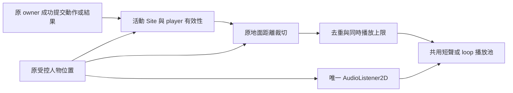

# 遊戲音效實作計畫

日期：2026-10-08。狀態：**整份計畫仍 OPEN，未 close；P0／P1 元件 335 checks 通過，正式專用檔已發布，原遊戲接線／流程、P2 Native、P3 世界聲、匯出、效能與裝置聽感仍待完成**。第 14 節為最新 close 查核；前述復審與失敗紀錄保留原證據範圍。

審核紀錄：2026-10-08 Claude 補充 7 處（匯出清單、暫停判定、失焦、死亡／昏迷腳步、地圖編輯器禁音、播放節點座標空間、GD 交鋒接點）；Nekki 同日決定 Q1=B、Q2=C、Q3=B。原檔備份為 `GAME_AUDIO_IMPLEMENTATION_PLAN.before-review.md`，本次保留。**本次復審不採納「接點全部正確」的舊結論**：GD signal 可早於真提交，Actor 與 Native 腳步也有未覆蓋邊界；已修正相關段落，逐項結論見第 11 節。

〔審核二〕第二輪待決問題已由 Nekki 於 2026-10-08 決定：R2-1=B、R2-2=B、R2-3=A，正文相關段落已依決定改寫並加〔審核二〕標記，選項留於第 12 節作紀錄。本次修改前備份為 `GAME_AUDIO_IMPLEMENTATION_PLAN.before-decisions2.md`。

〔復審三〕2026-10-08 再對照現行來源；保留六項已決方向及最新 P1 音量 UI 階段，修正隊長互換時間、移動來源、火群組計數與 SFX 設定生命週期，清除舊的待決／素材數文字。第 11 節同步結果；這是文件修訂，沒有遊戲音效 runtime PASS。

使用者已確認的要求是「只有 player 周圍有音效」。所有世界音效以目前受控玩家的原人物位置為中心，遠處的戰鬥、採集、火勢及船隻繼續由原系統模擬，只裁切聲音呈現。相機移動、縮放、定位隊長或打開地圖不改變聆聽範圍。

已決方向是每格完成後播 2–3 步段、一般聲 20 m／指定大聲源 60 m，以及配樂／UI／Region 旅行聲留後續階段。單類播放上限、素材數、一般 loop 緩衝距離與施工順序仍是提案，待實際驗收調整；不能把已決半徑重新列為待確認。〔審核二〕修正：依 Q2=C，全站共用 20 短聲＋4 loop 槽（大聲源不另開額度）與大火 loop 55 m 建立／60 m 停止也是已決，不屬提案。沿用現有 Site、人物、Army、Native Crowd、工作、火勢及保存 owner。

## 1 現況與接入範圍

以下為正式實作前的 `D:/worldgoing` 原始碼盤點；現行施工狀態見第 13／14 節：

- `project.godot` 現在由 `scenes/main_menu/MainMenu.tscn` 啟動；新遊戲經 Region 選點、角色建立及原 `RegionEntry` 進入 Site，繼續／載入則交接原活動地點。`PROJECT_ARCHITECTURE.md` 第 143 行的 TerrainLab 直接啟動描述已落後於目前入口，本計畫以實際程式為準，不修改入口。
- 可遊玩的 Site 世界仍是 Node2D + Camera2D；人物 3D 模型與 SubViewport 是呈現。音效使用原 2D 地面座標。
- 在正式 `scripts/`、`scenes/` 與 `project.godot` 未找到 AudioStreamPlayer、AudioListener 或 AudioServer 接線；在 `assets/` 未找到 wav、ogg、mp3、flac、aiff 音檔。尚無可直接沿用的正式音效系統。
- GD 與 Native Crowd 的事件能力不同。Native 現有事件不含一般近戰結果、命中及腳步；不能只接現有事件 signal 就宣稱兩條路徑都完成。

首版僅讓有正式在場玩家的活動 Site 發出世界音效。主選單、建人物預覽、Region 檢視／選點及冷 Site 補算保持無世界聲音。〔審核〕補：`MAP_EDITOR_IMPLEMENTATION_PLAN.md` 規劃的地圖編輯器作者模式（獨立 MapEditor 主機、玩法時間停止、沒有受控 player）同樣禁音；由作品建立的試玩世界則照一般活動 Site 規則。UI 點擊、全域通知聲、配樂及語音台詞不列入這次第一版，避免建立繞過 player 距離的例外。〔審核〕Nekki 決定（Q3=B）：第一版不做，配樂、UI 聲與 Region 旅行聲列為之後的獨立階段，屆時另訂規則。

## 2 player 周圍的明確規則

| 項目 | 已決規則與第一版接入方式 |
| --- | --- |
| 聆聽者 | `controlled_person_id()` 對應的原在場人物，不固定為 character 節點，也不使用選中人物或隊長 |
| 聽覺半徑 | 一般聲：水平地面距離 20 m = 10 格 = 640 地面 px。〔審核〕Nekki 決定（Q2=C）：大聲源 60 m = 30 格 = 1,920 地面 px，大聲源清單見下一列 |
| 範圍內 | 距離越遠越小聲；P0／P1 先用不偏左右的聲像，左右定位在 P3 經補償與驗證後才啟用，不因鏡頭遠近放大聽覺範圍 |
| 邊界與範圍外 | `distance >= radius` 不啟動短音效；已播放的短聲及 loop 也需重新裁切並 stop |
| 遠處大聲源 | 〔審核〕依 Q2=C 修正：只有下列種類用 60 m 半徑：建物／結構倒塌、攻城器具發射與重投射接觸、大火 loop（小火、熄滅仍用 20 m）。〔審核二〕R2-2=B：大火＝同一火群組有 4 格以上 BURNING，或有建物部件正在燃燒；其餘火勢為小火（20 m），判定見第 6 節。其餘一律 20 m。大聲源仍有半徑上限，不設全地圖可聽特例；種類清單放 helper 定義表，每種聲音只有一個固定半徑 |
| 來源 | 發射用真發射位置，命中用真接觸位置，工作用真工位，腳步用真落地位置 |
| 活體失能 | 昏迷或被俘但仍存活、在場且有合法原位置時，繼續聽周圍；不增加特殊濾波 |
| 聆聽者失效 | 死亡、無人物、已離場、無合法座標或正在粗粒度跨區船旅程時，停世界聲音 |
| 控制權接續 | 原控制權提交成功後重新定位；清除前一聆聽者的待播短聲並重查現存 loop |

以 `TerrainLab._combat_target_in_site(controlled_person_id())` 取得原目標，再核對 HP、有限座標與活動地圖邊界。此入口能接 Actor、Army 及 Native，並排除 `site_exited`；一般 `controlled_target()` 本身未排除已退出者。

`RegionGrid.CELL_MM=2000`、`TerrainRenderer.CELL_PIXELS=64`，因此 1 m = 32 地面 px。不能使用人物模型的 `CharacterRenderContract.MAP_PIXELS_PER_METRE`、Sprite 側移、攻擊跳躍、`surface_visual_offset_at()` 或 Camera2D 螢幕座標算距離。首版只算原 XY 地面距離；建物遮音、高低差聲學、回音及多樓層傳播留到有實際需求再加。

Actor 取原 `position`；Army 取 `combat_ground()`，其已處理原承諾步進與船上有效位置；Native 取 `CrowdSite.combat_target()` 的原 px/py 投影。不得拿被 Native 接管後的舊 Actor 呈現位置作權威。

## 3 最小播放結構

由原 TerrainLab 持有一個 `SiteAudioView`（規劃檔名 `scripts/terrain_lab/site_audio_view.gd`），只負責聲音呈現：

- 唯一 AudioListener2D 放在活動 Site 的同一世界 Viewport，跟隨原 player 地面位置並 `make_current()`。音效與 listener 都使用未加表面視覺偏移的地面座標。
- 〔審核〕補：Godot 的 2D 距離計算用 `global_position`。Site 經 `change_scene_to_file` 成為根 Viewport 下的場景，TerrainLab 是 Node2D；listener 與播放池節點要直接掛在 TerrainLab 下（與 character、TerrainArmy 同一座標空間），或以 `TerrainLab.to_global()` 換算後再設定，不能假設任意父節點的 local position 就是地面 px。
- 使用共用 AudioStreamPlayer2D 池，單節點 `max_polyphony=1`；短聲與 loop 分配後都受總上限管理。`max_distance` 在分配播放槽時依該聲音種類設為 640 或 1,920 px（〔審核〕Q2=C），原生距離衰減先用 `attenuation=1`，不再疊一份同樣的手寫衰減公式。
- P0／P1 設 `panning_strength=0`，保留距離衰減。Godot 4.7 的原生聲像公式會使用 canvas scale 與 viewport width，只有 listener 並不足以消除 zoom／視窗尺寸的影響。P3 若啟用左右聲像，先沿原生公式做小範圍縮放補償並驗證 player 相對方向；未通過就維持原 mono 聲像，不增加專用音訊 Viewport 或每槽 bus。依據為 [Godot 4.7 的聲像計算](https://github.com/godotengine/godot/blob/4.7/scene/2d/audio_stream_player_2d.cpp#L145-L168)。
- 在呼叫 `play()`、分配播放槽及載入聲音前先做硬距離門檻。不能只把全站音效播出後交給 Godot 靜音，也不能靠 hide 節點停聲。
- 一個短聲保留事件發生時的原位置；每個呈現幀對目前 listener 重查距離。步伐段另保留原 person ID，起播與播放期間都核對來源活著、清醒、在場及世代有效，死亡／昏迷／退出立即停剩餘步伐；這不撤回已發生的受傷、倒地或接觸聲，也不禁止仍存活的 KO／俘虜聽周圍。長期移動聲源的 loop 保留原 ID，每次借用原 owner 位置，不另模擬速度或路線。
- 第一版只需要 `Master <- SFX` bus，世界短聲與 loop 共用 SFX；不為每兵、每種材質或每棟建築建立 bus。
- 種類與音檔變體先放 helper 的小型定義表。授權來源放音效目錄 README；不建立通用事件平台、每 NPC Audio Node、全域 AudioManager 或新的空間世界。

- 〔復審〕GD 雖有 `exchange_resolved(a_id, b_id, result)`（terrain_lab.gd:133／2664），但 `_settle_exchange_batch()` 在排入 Region 端點後也會回 true（3716），signal 並非完整提交證明，且不帶原 pair 的位置或 round。不能直接 connect 後播命中聲；要在原非排隊結算分支取得原 pair／位置／round，只形成暫態候選，通過第 5 節的原共步／端點提交守衛後才播放。`ranged_resolved` 同樣不能作成功守衛。

Godot 原生支援 2D 距離衰減、單節點 polyphony 及可覆寫螢幕中心的 listener；沒有 listener 時會以螢幕中心聆聽，因此啟用條件要明確。參考 [AudioStreamPlayer2D](https://docs.godotengine.org/en/stable/classes/class_audiostreamplayer2d.html)、[AudioListener2D](https://docs.godotengine.org/en/stable/classes/class_audiolistener2d.html)。bus 定義可沿原生 [Audio buses](https://docs.godotengine.org/en/stable/tutorials/audio/audio_buses.html)。施工時以專案使用的 Godot 4.7.2 驗證。

## 4 音效種類與素材清單

風格提議為短、清楚、有材質差異的實物聲。首批先試聽 player 的腳步、交鋒及弓弩，確認音量與風格後擴充。**已依使用者要求取得 31 段候選／7 類，製成 4 組分類 WAV**，見 `output/audio_preview_20261008/AUDITION_GUIDE.md`、`manifest.json` 與 `validation.json`；本次復審只修計畫，素材仍未正式接入。

| 類別 | 要準備的聲音 | 真實觸發條件與第一版界線 |
| --- | --- | --- |
| 步行／跑步 | 草土、硬地／石、木板、淺水接觸聲 | 只對第 5 節列出的原合法行走／跑步／押送／騎乘及互換完成，播含 2–3 步的段；測試搬位、部署、restore、擊退不當一般步伐。R2-1=B：走、跑各有快、慢檔，選段與倍率沿下文唯一公式，0.9–1.1 是優先目標，0.8–1.25 是硬限。沒有真落格或來源死亡／昏迷／離場不播；取消後續命令但原承諾步仍完成時照提交判斷。淺水只沿既有合法通行，不放寬導航 |
| 騎乘 | 馬蹄，必要的近距短嘶聲 | 真騎乘步進；同一步不疊人類鞋底聲，騎乘位置沿原 owner |
| 近戰 | 短揮動、武器接觸、盾擋、鈍擊／受傷、倒地 | 起手聲依原動作成立；接觸／受傷依原結果提交；平手、格擋與真 HP 傷害分開，不能全套都播 |
| 弓／弩與投射 | 弓弦、弩機、落地、木／石／金屬接觸 | 真扣彈與 flight 成立才發射；接觸依原實際點；首版省略每箭持續飛行嗖聲 |
| 攻城器具 | 裝填／機構、重弩釋放、重投射接觸、結構破裂 | 原器具可用與真動作／損傷；展示用圖片與尚無機制的器具不發玩法聲 |
| 火焰 | 小火、大火／火堆劈啪 loop，熄滅短聲 | 讀已提交 BURNING／EMBERS／強度；附近多個燃燒格合併，無火狀態不播；不由煙霧或重繪推定 |
| 採集 | 砍木、鑿石／採鐵、挖土／黏土、鹽／食物／藥草收集、捕魚水聲、活捉短聲 | 九類來源全部有對應行為；低聲量收集可共用沙沙變體。只在原實際工作有效或交易成功時發聲，不因資源圖存在就常駐響 |
| 建設／生產／修理 | 木工、敲擊、有效加工 loop，完工短聲 | 真工作者在工位並有有效工時；缺料、停工、未到場及純預覽均停止；生產批次成功交付才播完成 |
| 門與實物操作 | 城門開閉，裝備／物資交接短聲 | 原門狀態或原實物交易提交成功；單次整隊配裝／交貨只播一次，失敗命令不播完成 |
| 船與車 | 划槳／行船水聲、近距木車滾動、登離船接觸 | 讀原有效承諾移動與位置；真正落步或作業完成才播短聲；取消、wreck 或跨區旅程停 loop |
| 動物 | 鹿、野豬、馬、羊的低頻叫聲 | 讀原 wildlife source、species 與存量。現有野生動物只是資源呈現，沒有真動物腳步；不為叫聲新建動物 AI |
| 水域與植被 | 岸邊水聲、近距植被沙沙 | 只從附近真水域／植被來源選取；不在全圖鋪聲。雨、雷及全域風需先有原天氣 authority，首版不憑空加入 |

正式首批依 R2-1=B 規劃約 **36 個短音檔＝24 個步伐段＋其餘 12 個**。四種表面 × 走／跑 × 快／慢＝16 個必要檔位，每檔位先有一段，另分配 8 個變體；不能把 24 段誤寫成每檔位三變體。最小製作配額提案：草土、硬地各 4 檔位 × 2 變體＝各 8 段，木板、淺水各 4 檔位 × 1＝各 4 段，合計 24。其餘為馬蹄 3、武器接觸 3、盾擋 2、受傷 2、弓／弩各 1＝12。表面配額可隨試聽調整，必要的走／跑快慢檔位不取消。

這與現有 31 段候選是不同清單；分類 WAV 的兩次試聽重播不能算正式步伐段，也尚無走／跑節奏適配證據。投射落點與火 loop 接入前再補對應素材。

Q1／R2-1=B 接受原生 pitch_scale 同時改變節奏與音高（[Godot 官方屬性說明](https://docs.godotengine.org/en/stable/classes/class_audiostreamplayer2d.html#class-audiostreamplayer2d-property-pitch-scale)）。令 L 為該變體實際音檔段長，T 為該次合法格步進的原動作耗時，**所需倍率＝L/T，最終 pitch_scale＝clampf(L/T, 0.8, 1.25)**；L、T 必須有限且大於零，非法資料跳過並記一次診斷。先按表面／走跑種類選耗時最接近的快慢檔及變體，優先讓 L/T 落在 0.9–1.1；目前檔位超出此區間且另一檔更接近時換檔。兩檔皆超硬限時仍選最近者並夾限，這時播放段長不完全等於 T，不要求無法達成的精準步頻對齊。

不加 bus PitchShift、不乘遊戲 60 倍或 simulation_speed、不新增即時伸縮系統；首版步伐只選變體，不再疊額外隨機 pitch，最終倍率始終受上述硬限。段在真完成後起播，是完成格步進後的擬聲，不能宣稱移動期間每隻腳精確著地。同一 person 只播放一段，新段取代舊尾段；同幀多步先沿第 6 節收斂成最新有效步，再 play 一次，不能逐筆起播後立即截斷。

候選缺口：正式 2–3 步段、淺水腳步、獨立弓弦、人類受傷／倒地、真野豬、專用攻城／結構倒塌／大型城門、車輪、正式母檔、單擊分離與無縫循環。Kenney 為官方原 Ogg，Freesound 為公開 MP3 預聽；家豬只是替代候選。`shore` 完整 MP3 解碼曾有錯誤，選用前 12 秒未出現解碼警告，仍須母檔重驗。31 段與 4 組 WAV 已做解碼／輸出檢查；本機 HTML 播放、主觀音色、Godot 匯入／播放均未驗收。

高頻聲的 2–3 變體是後續追加目標；首批步伐檔位沿上述 24 段配額，不假定每檔已有 2–3 變體。變體選擇與其他短聲的小幅音高變化只用音效本地 RNG 或事件衍生值，不消耗遊戲 RNG。短聲優先 mono WAV，loop 使用可無縫循環的 mono Ogg/WAV；實際音長、音量與格式以試聽及匯入為準。素材記錄檔名、來源、作者、授權、修改與用途；缺素材跳過該聲並記一次診斷，不阻擋原交易。

## 5 既有 owner 的接點與 Native 缺口

行號是 2026-10-08 查核時定位，施工前以函式與 caller 再核對，共用工作區的變更不得覆寫。

**〔復審〕以下接點是取得暫態候選的位置，不代表函式回 true／ok 就可 `play()`。** `_resolve_ranged_arrival()`（3594）、`_settle_fire_impact()`（6278）、`_settle_exchange_batch()`（3716）、`_finish_fire_boundary()`（6450）都有先排隊／延後的成功回傳。原聲源／接觸位置需在原結果成立時快照，不可在回呼中重新查人物現在的位置冒充歷史落點；候選與去重不寫回玩法 packet、保存或狀態 hash。

- 一般活動共步：借 `_advance_original_shared_step()`（1454）的原 fault、`record_completed_region_step()` 及 Region progress commit 成功分支（1597–1620）；`recorded.completed=true`（1629）不保證 ok，也不排除 `REGION_EVENT_PENDING`。需原結果 ok、端點已 complete／無 pending、原活動 Site／player／世代仍有效、非 replay／restore 且未暫停，才交給 presenter 本幀候選挑選。
- 延後端點：`consume_region_point()`（7503）先執行 `_region_point_effect()`，還需火邊界（7561）、攻城批次（7564）、工作與 settlement 守衛全部成功，最後清 pending（7582）並回 `complete=true`（7587）。在原外層提交成功後 flush；排隊、PENDING 或失敗不播放，端點失敗／世代變更／暫停即丟棄該批聲音。PENDING 不累積跨幀待播音效，不補播已過期短聲。
- 結構與攻城：`siege_queue_damage()`（3015）只代表加入原損傷批次，`siege_flush_contact_batch()`（2998）可回 ok 但 complete=false；`siege_apply_damage_batch()` 的外層 ok 也不保證各 `results[key]` 成功（3029–3045）。每個目標須有自己的成功收據與實際 HP／結構變化，倒塌須原倒塌提交；不能播拒絕目標的成功聲。

| 原檔案與入口 | 要借用的結果與位置 |
| --- | --- |
| `terrain_lab.gd::_settle_exchange_batch`（3714–3771）／原活動共步與端點 | 在非排隊分支的 prepare／knockback／contact／finish 全部成功後，借原 pair 位置、stats、result、round 形成候選；通過上述提交守衛才播放。signal 不作提交證明；一個 pair 不因兩側回呼重播 |
| `terrain_army.gd::_finish_move_state`（16432）及其原開始 caller | 一般 _complete_move 與 finish_committed_move 共用落格接點；先快照該次原 duration／locomotion／騎乘種類／落點，16438–16441 會重設。只接原合法行走來源，hp>0、ko<=0、未 site_exited；exchange_batch_knockback（6735–6745）也借 _reserve_combat_step，WALK 或相鄰格不足以排除擊退。整隊／互換繞過此函式，資料規則見下表；ship_disembarked（558）歸登岸短聲，不當一般步伐 |
| `terrain_test_character.gd::step`（621）→`_advance_movement`（697） | 只有 step 成功開始的步行／跑／合法押送／騎乘，在 elapsed 首次跨端點時取本次原 duration／種類／落點，核對 hp>0、knockout_left<=0、未 site_exited。place（599）亦供測試搬位（terrain_lab.gd:1271）及本檔 exchange_batch_knockback 擊退（terrain_test_character.gd:1554–1564）〔審核四〕，插值完成不當一般步伐；advance_combat 先移動才處理死亡／KO，所以仍需存活守衛 |
| `terrain_lab.gd::_commit_fire_releases`（5968） | 原 `ranged_release()` 成功且正式 flight 建立後；借原 projectile ID 與 source cell |
| `terrain_lab.gd::_resolve_ranged_arrival`（3593）、`_settle_fire_impact`（6276） | 非排隊分支原結果／收據成功後從 flight／接觸 event 取真落點與材質，仍等外層提交。fire_receive_impact 失敗會 latch，但 ranged_resolved 仍可能 emit（6311／6321），不能只接 signal；空地 target=0 不以 shooter 位置代替 |
| `terrain_lab.gd::_advance_siege`（2812）、`_resolve_siege_projectile_events`（3187） | 真發射／接觸提交後借原 attack ID、flight 及 contact；不看 View 消失判命中 |
| `site_runtime.gd::damage_structure_part`（3470）、`_fire_commit_collapse`（5830） | 成功損傷、倒塌的原結果／收據；preview、拒絕及收據重播不得產生聲音 |
| `site_runtime.gd::_fire_step`（4996）、`terrain_lab.gd::_finish_fire_boundary`（6449） | 真 fire_finish_boundary 及原活動端點完成後，才讀已提交火勢供 loop 投影；deferring 分支的 true 不是完成。火熱／保存收據不與聲音佇列綁定 |
| `site_runtime.gd::harvest`（662）、`_feature_work`（3951）、`_deliver_feature_batch` | `preview=false` 的真交易、有效工位／工時及成功交付；由原 live caller 轉給 presenter，不讓 static Runtime 直接播放 |
| `site_work_team.gd::advance`（826）、`_work_step`（1000） | 真工作狀態；不另存工人進度或敲擊工作量 |
| `site_vehicle_transport.gd::update_ships`（1999） | 原 `cell/facing/revision` 完成提交；`_commit_ship_step` 只有預約，不能當到達 |
| 原城門／人物作業與實物交易提交處 | 城門到達開閉端點、領裝／登離船／交貨成功才發短聲；施工時逐一追 caller，不以 UI 回應字串觸發 |

步伐來源只作暫態呈現標記：原合法步進／互換成功開始處記本次種類，完成、真正取消、搬位覆寫、restore／接管或世代失效時清除；不入保存，不改導航／承諾步／戰鬥 authority。未取得合法開始來源時略過該段，不能由 walk 動畫、相鄰格、移動插值或普通 WALK 欄位猜測。擊退聲沿原接觸／擦地結果，部署與測試搬位不製造玩法腳步。

| Army 其他原完成入口 | 本次步伐資料與成功界線 |
| --- | --- |
| _complete_formation_batch（11943） | 原開始處已設 MOVE_DURATION／WALK（11934／11937）。全 batch 原預檢及落格成功後，每位完成者各一候選；清欄位前取資料，最後仍等共步／端點成功 |
| _complete_follower_swap（15416） | _begin_follower_swap 已設兩人 MOVE_DURATION／WALK（15397–15402）；原互換成功後兩人各一候選，不因雙方回呼重播 |
| _complete_swap（15453，隊長互換） | _begin_captain_swap（15292）未重設逐人 duration／locomotion；_simulate_step 用 maxf(MOVE_DURATION, move_duration[0])，對方共用隊長進度（16163–16165）。兩人須用這個共同有效 T，種類按原行走互換取 WALK；不能讀 partner 舊 duration 或兩人殘留 IDLE／RUN。原互換成功後各一候選 |

Native 必須獨立驗收：

1. `native/crowd10k/src/crowd_core.hpp` 的 EventKind 只有 DEATH、KO、WAKE、RESCUED、CAPTURED、ESCAPED、SUCCESSION、COMMAND_LOST、ROUT、RALLY、SHOT。現有 4-INT event packet 是 kind/person/other/formation，缺接觸位置、時間及一般交鋒／腳步；畫面 V_ATTACK／V_HIT 不能代替已結算音效結果。
2. `CrowdSite._consume_events()`（1857）已有驗整包、drain、死亡／ammo 提交，capture／escape 還有後續 `settle_events()`。音效不能自行 drain、改變原順序或在原交易尚未成功時播放完成聲。
3. `SiteController.advance_crowd_sustain()`（5652–5661）遇到 `events_received` observer 會停用 `native_sample` 批次快路徑。首版選原成功消費／投影位置直接交給 SiteAudioView，避免為聲音永久 connect 這個 signal。
4. 一般近戰、命中、腳步，以及可發音的生命／SHOT 事件，都需要原 Native 結算點的**有界、暫態、唯讀音效輸出**：快照原 ID、發生時 XY、action tick／time 與當步識別。`CrowdSite.combat_target()` 只查現在位置，跨多個 Native 步後不能拿它代替事件位置。輸出隨既有唯一 consumer 同步消費；不擴可靠事件 ABI、不自行 drain、不改生命事件順序。範圍過濾及溢出只影響這份聲音輸出；Native 容量內也按優先級、平方距離及穩定原事件順序保留較佳候選，不能先輸出遠處前 N 筆再讓 host 裁切。
5. 優先在原結算迴圈取已存在的接觸與步進資料，不新增全站逐人掃描、人物鏡像或新的持續空間索引。現有 `standing_near` 只回人數、`nearest_enemy` 只查敵人，不能冒稱通用聲源清單。
6. Native 新二進位仍須遵守原 DLL/build 保存准入與來源合同；任何相容問題明列，不修改／繞過原拒絕守衛，也不承諾舊 native 存檔自然相容。
7. Q1=B 在 Native 不能假設有 GD 的 move_duration。普通兵是 soldier_stage 連續運動、worker 完成後才提交位置；只在原已提交自主位移真正跨格時產生一次步伐段，附原移動時間／種類，排除擊退滑動、死亡／KO、初始化及還原。並行 worker 使用各自有界暫態候選，完成後穩定合併；不可共寫未同步 vector。准入另驗音效輸出開／關不改 Native 位置、RNG、可靠事件、保存或 sustain 快路徑。

## 6 密集戰場的播放與查詢預算

第一版全站只有 **20 個短聲槽 + 4 個 loop 槽 = 最多 24 個同時聲部**，不隨 300／5,000／10,000 人放大。單類建議上限為腳步 6、交鋒接觸 8、投射 6、叫聲 2；這些上限共用 20 槽，不能相加突破總額。

- player 自己的命中／受傷與近身接觸優先，其次近距射擊、倒塌，再一般 NPC 腳步、工作及環境。高優先聲可取代低優先且較遠的聲音；同級按距離及原事件順序穩定選取。
- 遠處短聲在最前面丟棄，不排隊。近處短聲只保留當前顯示幀有界候選，最多 64 筆；滿額時以優先級、距離與事件新鮮度取代較差候選，不能先到先滿而排掉較近的聲音。多個活動模擬步一起到達時取新鮮且優先的聲音，不在下一幀補播一整場戰鬥。此限制不刪除任何玩法事件或欠秒。
- 同 person 同幀多次成功步先按原 tick／提交順序只留最新有效候選，再做距離與 64 筆挑選；新步到達時先移除有界候選中同 ID 的舊步，最新步出界或被預算丟棄時不回退播舊步。沿同一有界候選池收斂，不建全站逐人歷史；播放階段只對最後被選到的段 play 一次。
- 同一原 pair／round、同一 projectile 接觸、同一工作完成交易各播一次；短期去重只留有限數量與期限，切 Site 清空，不入保存。顯示重繪不能讓同一次事件重新發聲。
- 待播候選附本次活動 Site／owner 接管世代；讀檔替換、GD／Native 接管或控制人物成功交換時失效並清空。不能只用 person ID 去重，因為另一個世界可有相同 ID；任何延遲回呼都要重查來源仍屬本世代。
- 玩家腳步照真落地事件；NPC 密集腳步按距離與槽位挑少量代表。音效挑選不能改人物是否移動、碰撞或出手。
- 資源／wildlife 沿 `SiteEnvironment.resources_in(data, area)` 的 resources_at 原索引取附近方形，再用精確圓距裁切。該 API 不包含所有水域、植被或火：水域／表面沿原 TerrainData 格資料，火沿原 fire_hazard_snapshot cells／chunks 找 key 再讀已提交 unit，不冒稱通用聲源索引。最多每 0.1 現實秒刷新附近候選，不掃全站；每幀的禁音、listener 定位與已播聲出界 stop 不受這個刷新節流限制。
- 火焰只從原已提交火勢的附近格取發聲 seed；同群組共用 loop，優先最近者。大型建物／水域用真工位或附近發聲格，不拿遠處中心點裁切；代表發聲位置仍須在該種半徑內。
- 一般 loop 建議 18 m 內新建、20 m 即停止，既有者在 18–20 m 內衰減。大火 loop **55 m 內建立／60 m 即停止與共用 4 槽已決**。R2-2=B 判定已決：同一火群組至少 4 個唯一 BURNING 地面格，或有有效建物部件 BURNING，為 60 m 大火；不足且無燃燒建物部件時為 20 m 小火，只有 EMBERS 也是小火。尚待 helper 實作與驗收，不能再寫成分類待決；大火降級即以 20 m 重查並 stop 出界者，升級才可在 55 m 內建大火 loop。
- 「格」沿原 unit.state==BURNING 與原 descriptor.hazard_cells 的唯一地面 index 計數；不數 snapshot entry、unit、surface，也不拿 resource.cells 資源覆蓋範圍當燃燒格。site_runtime.gd::_fire_resource_descriptor（4726；hazard_cells 於 4733）〔審核四〕只把原 resource.cell 當 hazard 格；同格多 entry／多部件不重複計數。snapshot 含熱風險與倒塌警告，HEATING／COOLING／EMBERS／warning 不可因 risk>0 計為 BURNING。
- 燃燒建物條件須原 feature／part 仍有效、part.hp>0、unit.state==BURNING 且非 debris_version；倒塌殘骸仍可能 kind=feature，不能藉此自動套建物大火條件。BURNING 殘骸只按原 debris descriptor 的 hazard_cells 參與唯一地面格計數。建物 body／roof 多部件不可重複加地面格；不以煙、貼圖或 entry.surface_id 代替原部件狀態。
- 火群組只在 helper 作有界暫態投影；原 state 沒有群組 owner，fire_expand_feature 也不代表火群組。沿原 descriptor、_fire_resource_edges（4943）／_fire_feature_edges（5693）的鄰接、高度／阻隔及部件接觸規則連接已提交可發聲火源；不用 DORMANT／HEATING／COOLING 的無聲來源串成整片林地。20／60 m 查詢只選發聲 seed，不能先截掉半徑外相連來源再判 4 格。達 4 個唯一 BURNING 格或有效燃燒建物即可確定大火；相連查詢完整結束且不足門檻才定小火。有界讀量不足而分類未知時略過該 loop，既有未知 loop 也 stop，不冒判小火或沿用過期大火；多 seed 同群或是否重複未確定時只保留最近者，不另配重複 loop。投影不入保存、不增火勢 state、不掃全站，代表發聲格仍須通過播放半徑。
- 〔審核〕Q2=C 補：60 m 大聲源仍共用同一組 20 短聲＋4 loop 槽，不另開額度；同優先級時距離較近者優先，因此 20 m 內的 player 受傷、近身接觸仍排在遠處倒塌之前。環境候選查詢的方形範圍依該種類半徑取，一般聲仍只查 20 m。
- 聲音資源只讀並共用已載入 AudioStream，不為每個事件複製音檔。靜音時不分配新播放、不產生 loop；原遊戲照常進行。

聲部上限只是預算，還需要實測事件投影、候選查詢、解碼、混音及整體幀時間；不能據此直接宣稱大量人物效能通過。

## 7 暫停、存讀與換場

- 聲音以現實時間播放，不直接把和平 60 倍、戰鬥時間或 simulation_speed 乘到音高，也不把 game_seconds 當播放次數時鐘。Q1 依原格步進耗時的 0.8–1.25 節奏調整是限定例外，沿第 4 節選段規則；事件照原實際完成時間發生，超額聲音由播放預算取捨。
- 手動暫停、失焦實際觸發原暫停，或 SceneTree／Site paused：清短聲並停止世界 loop。恢復時只依目前活動來源重建 loop，不補播暫停前的歷史短聲。
- TerrainLab 在 `_region_original_ready()` 設為 PROCESS_MODE_ALWAYS（169），子播放池會繼承；terrain.site.paused 又獨立於 SceneTree。**SiteAudioView 自己以 ALWAYS _process 每幀先跑禁音 gate**，核對 get_tree().paused／site.paused、活動世代與 player，再定位 listener／重查已播放距離；禁音時只清聲，不查環境或建 loop。TerrainLab._process 在 1358／1370 等位置提前 return，不能只在父 _process 正常尾端呼叫 audio，亦不能把 presenter 改成 PAUSABLE 後期待它在暫停時自行 stop。
- 〔審核〕修正：失焦只有在原 `pause_when_unfocused` 為真、遊戲真的進入暫停時才停聲（terrain_lab.gd:330–345）。若玩家關閉了失焦暫停，遊戲照常運行，聲音也照常，不另建「失焦即靜音」的特例。
- 初始化預設禁音。TerrainLab 啟動先生成 placeholder，再處理世界請求，不能在 generate_terrain 或首次 bind_terrain 成功就啟用。主選單請求等 SiteController._settle_boot_request（9265）真正成功分支：PENDING 續作完成、原世界開啟成功，需建立角色時 apply_created_character 的 save_to 回 ok（9305）；失敗回選單仍禁音。_record_world 是無成功收據的 metadata 呼叫（9274／9307），不能宣稱此分支已驗證所有保存。直接執行 Site 則等 _ready 的原讀檔嘗試完成，再確認真正活動人物與地圖；只有合法 player、非 restore_only 或 bind receipt 都不足以排除 placeholder。
- `restore_only`、冷 Site、replay、Region 地形預覽及讀檔候選一律禁音；還原歷史事件不能播放。補算成功後也只在真正活動 Site 啟用當前狀態的 loop。
- `bind_terrain`／`_region_bind_original_terrain` 在**成功替換原 Site 的提交段**清聲音、去重及來源引用；候選檢查失敗不先清掉仍在遊玩的原 Site。
- 返回主選單、離開 Site、開 Region 檢視或開始跨區旅程，沿原成功離場／暫停／場景生命週期停聲。新 Site 接手後只聽新 player 附近，不保留上一張地圖的 loop。
- 短聲佇列、listener、播放進度、去重及環境候選都是暫態，不加入 SiteStore、Native save blob、重播 hash 或地圖差異。音效開關不改原 BUSY／原子提交／死亡結算合同。

## 8 施工順序與完成界線

| 階段 | 交付內容 | 必須證明的界線 |
| --- | --- | --- |
| P0 核心與小套件 | player 定位、20 m／60 m 分類裁切、共用池／SFX bus、本機設定讀取、暫停與換場；先試聽少量腳步／交鋒素材 | 鏡頭移遠仍只聽 player；無 player／placeholder／冷補算無聲；範圍外無播放；啟音前已套本機音量，cold 實例不改 global bus |
| P1 GD 可玩音效 | 真落地、近戰結果、弓弩發射與真落點、受傷／倒地，至少一種火 loop；〔審核三〕「存讀與介面」窗 SFX 音量滑桿＋靜音（ConfigFile 本機存，R2-3=A） | 原事件只播一次；失敗／preview／空地不假播命中；密集戰場槽位有界；音量／靜音即時作用於 SFX bus、跨重啟還原、不入玩法存檔 |
| P2 Native 同等接入 | 原已消費生命／SHOT 及一般交鋒／接觸／跨格腳步的有界唯讀輸出，含歷史位置與原 tick；Native player 定位與接管 | GD／Native 各自功能驗證；worker 安全且穩定合併；不關閉 sustain 快路徑；聲音開關不改原狀態／可靠事件 |
| P3 世界聲與設定 | 採集九類、有效工作／完工、門／實物、車船、動物、水域；左右聲像補償與完整聽覺調整（〔審核三〕音量／靜音已移至 P1，依 R2-3=A；分類音量或主選單設定不在此範圍） | 每類有音檔、真 owner 觸發、近／遠／停止實證；沒有素材或機制的類別明確標缺口；聲像補償未通過就保持 mono |

P1 是可試玩的最小切片；Native 與全部世界音效到 P2／P3 各自驗收。R2-3=A 已決：P1 現有「存讀與介面」窗放 **SFX 音量與靜音**，以獨立 user://audio_settings.cfg（ConfigFile）跨重啟保存，與 gameplay／視窗 geometry 設定分開；UI 計畫 system 列已同步。只控制 SFX，不改 Master；未來主選單設定沿同一檔與同一聲音設定入口，不在本輪新增主選單設定。

最小設定讀寫由活動 SiteAudioView 持有，SiteController 既有 system builder 只借此入口，不另建設定 manager。P0 真正活動 Site 成功接手後先確認 SFX bus 存在，再讀檔、驗有限音量並夾在 0–1、驗 bool mute、套用 bus，最後才准啟音；缺檔／非法欄位沿 P0 試聽確認的有限預設，不阻擋 gameplay。無 SFX bus 則停世界聲並記診斷，不任由節點 fallback Master 繞過設定（[Godot bus 屬性說明](https://docs.godotengine.org/en/stable/classes/class_audiostreamplayer2d.html#class-audiostreamplayer2d-property-bus)）。換 Site 沿同一檔還原，不回到固定預設；bootstrap／cold／restore 候選不讀改全域 bus、不搶 listener，也不保存。

_build_ui 在 cold Site 也會跑：SiteController.setup（site_controller.gd:268）於 282 無條件呼叫 _build_ui（461），restore_only 時只由 464 設 SiteUI 不可見〔審核四〕，hidden 不代表跳過 builder。P1 slider／mute 初值用不發 signal 的 setter，cold／候選控制不接有效寫入；僅使用者操作有效活動窗時即時套 SFX 並保存，成功 bind／初始化／程式刷新不寫檔。靜音或音量 0 清既有聲、禁新配槽；解除後只重建當前 loop，不補歷史短聲。ConfigFile 保存失敗只回報本機設定未保存，保留本次音量，不影響 SiteStore／BUSY／hash（[ConfigFile](https://docs.godotengine.org/en/stable/classes/class_configfile.html)）。

`export_presets.cfg` 兩個 preset 都用 export_filter="resources" 與明確 include_filter（11–12／44–45）。動態字串 load 不可假定音檔已列為相依資源；施工時把正式 assets/audio/* 與 default_bus_layout.tres 明確納入使用中的 preset，再驗實際 package。這沿 [Godot 選定資源與相依匯出規則](https://docs.godotengine.org/en/stable/tutorials/export/exporting_projects.html#resource-options)。.gitattributes 目前未將 wav／ogg 放 LFS；若正式素材採 LFS，沿既有本機 clean guard 增補模式，不能重裝／覆蓋 guard。預覽 output 繼續不作正式匯出素材。

〔復審〕音效資源包含不等於目前完整遊戲入口已可匯出：現有 preset 只選 TerrainLab（另含一個測試），未明列 MainMenu／Region 場景及 native/crowd10k；tools/build_site_release_package.ps1:112 的 staged 入口也仍直開 TerrainLab。因此驗收拆為既有 TerrainLab package 的音檔／bus 與實際播放，以及目前 MainMenu→Region→Site／Native 整包入口完整度。後者是既存 release owner 缺口，需其原流程另行補齊，這次計畫修訂不擅改它或宣稱發版完成。

施工預計新增一個 presenter、一份原生 bus layout、正式音檔／授權清單與一個集中音效契約測試；原檔只加必要成功接點及生命週期 hook，Native 只補已確認缺少的呈現資料。候選預覽檔案已存在於 output/audio_preview_20261008；這是規劃時的施工估計；目前 presenter、bus、42 WAV 與元件契約已正式保存，原 owner 接線及完整驗收仍未完成，見第 13／14 節。

## 9 驗收要求

集中 `site_audio_contract_test.gd` 已完成元件層 335 項；以下完整驗收還需要真原 owner／shared-step／UI／生命週期、Native、世界聲及 package 檢查，再用實際 Windows 音訊裝置試聽。元件 headless 通過不算遊戲全流程或可聽音質通過。

1. player 固定時，鏡頭拖到遠方交戰、定位另一隊隊長、不同 zoom／視窗尺寸：遠處發音數仍為零，player 周圍聲音距離規則一致。P0／P1 維持 mono；P3 若啟用左右聲像，還須證明同一相對位置的聲像不因鏡頭偏移、zoom 或視窗尺寸改變。
2. 同一聲源放在半徑內、邊界及半徑外（一般聲 20 m、大聲源 60 m 各測；〔審核〕Q2=C 另測 30 m 處倒塌可聽、同位置腳步／交鋒不可聽）；測斜角圓距、player 移動出界、loop 進出緩衝區及瞬間換控制者。外部聲源既不 `play()`，也不占播放槽。
3. Actor、Army 成員、騎乘、船上、Native 控制分別核對原位置；不得以角色視覺跳躍／船舊格／相機 fallback 判聲音距離。地理距離換算須直接對照 RegionGrid／TerrainRenderer。
4. 阻擋移動、未成立起手／真正取消、缺彈、未命中、交易拒絕、preview、未到工位、停工與來源耗盡不播成功聲／不留 loop；承諾步仍完成與真正取消分開驗。Actor／Army／Native 死亡／KO 不起播腳步，段中途失能停尾段，KO listener 仍聽周圍；測試 place／任意遠格搬位、instant placement、部署／restore、Actor 與 Army 的存活擊退均無一般步伐，合法押送／騎乘正常。整隊、隊員互換與隊長互換各成功者只一候選；隊長互換刻意讓 partner duration／locomotion 殘留不同值，仍按隊長共同有效 T 與 WALK 選段。R2-1=B 驗 L/T 選檔、0.9–1.1 優先及兩檔皆超限時 0.8–1.25 夾限，不要求夾限後精確對齊 T；同幀多步只播最新有效步一次，即使舊步更近也不回退。
5. 遠處 shooter 射入 player 附近：可聽近處真接觸，聽不到遠處弓弦；近處 shooter 射向遠處：可聽發射，聽不到遠處命中。無 target ID 的落地仍用原真接觸點。
6. 暫停後即使 TerrainLab 提前 return，audio gate 仍清短聲／loop；恢復、主選單、Region 檢視、成功／失敗讀檔、Site 交接、船旅程、冷補算及 replay 不殘音、不補播歷史聲，失敗候選保留原活動 Site。失焦暫停開啟且原流程真暫停時停聲，關閉時照常播放；焦點移至原工具 Window 也照原暫停判定。新建角色 save_to 失敗及世界開啟 PENDING 不啟用 placeholder。
7. 300 人 GD 與正式 5,000 人 Native 用同一真活動工作量測音效開／關；若另測 10,000 人，另列其准入與結果。記錄音效 CPU p95／p99、總幀時間、聲部峰值、丟棄原因與記憶體；不能把原生模擬 benchmark 當 Godot 音訊／整體 FPS。
8. 相同原輸入下，音效開／關的原人物／物品／火勢／事件／時鐘／保存內容或既有狀態 hash 相同；Native 原事件仍由唯一 consumer 處理，供養快路徑資格不因聲音改變。
9. 真實喇叭／耳機核對近遠、左右、爆音、loop 接縫、步頻與變體；player 受傷在密集腳步中仍可辨認。缺音檔、音訊裝置不可用、音量 0 或 presenter 停用不使玩法失敗。R2-3=A 驗 P1 system 窗 SFX 控制即時作用、跨重啟／換 Site 同一設定、靜音／0 音量清聲、解除不補歷史；cold setup／hidden UI／程式設初值不改 bus 或寫檔。缺檔、NaN／非法 mute、保存失敗不阻擋玩法，缺 SFX bus 不 fallback Master 發聲；不寫 gameplay 存檔、不改 hash。
10. 音效匯出先驗使用中 preset 的音檔、bus、相對路徑與實際播放；MainMenu→Region→Site／Native 整包完整度依第 8 節另列，不能拿 TerrainLab package 取代。每種素材／事件／GD／Native／裝置／效能證據各自列結果，不能用一次啟動或截圖代替全套驗收。
11. 強制覆蓋延後提交：exchange／legacy_ranged／fire_impact 排入端點時發音數為零，ok 但 complete=false／REGION_EVENT_PENDING／fault 也為零；原整批成功只投影一次。火收據失敗仍 emit ranged_resolved、攻城外層 ok 但單目標失敗時不得播該成功聲，失敗／重試／replay 不重播。跨多個 Native 步後事件位置仍為原發生位置，平行 worker 合併順序穩定。
12. R2-2=B 判定已決，實作後驗同群組 3 個唯一 BURNING 格＝小火、4 格＝大火、有效建物部件 BURNING＝大火；變 EMBERS 後不足 4 格且無燃燒建物時降小火。另驗多 entry／同格多 surface／body-roof 去重、resource.cells 多格但 hazard 只一格、熱／collapse warning、燃燒殘骸非建物捷徑、3 格在近查範圍內而第 4 相連格在外、分類預算耗盡時不假判及不留過期 loop。驗 20／60 m 硬邊界、18／55 m 建立緩衝、升降級；環境 0.1 秒刷新不延後每幀禁音／出界 stop。定義已完成不等於真 loop、接縫或裝置驗收已完成。

Godot 執行沿未改動的 godot-runtime-verify/scripts/verify_godot.ps1，單一測試時段、明確 timeout 並保留失敗紀錄；遵守 AGENTS.md 的原生監控、修正後有界重驗及最新 100 份完成 run 保留規則。本次復審核對現行原始碼、Godot 官方文件與既有候選預覽記錄；未執行 Godot、改玩法程式或正式接入音檔，沒有遊戲音效 PASS。

## 10 審核決策紀錄

〔審核〕以下三題涉及聽感與範圍取捨。**Nekki 已於 2026-10-08 決定：Q1=B、Q2=C、Q3=B**，前文相關段落已依決定改寫；選項保留作紀錄。

**Q1 腳步聲密度。** GD 原格步進每格（2 m）才完成一次落地，真人走 2 m 約 2–3 步。若嚴格「一格一聲」，聲音較稀疏；Native 連續位移的對應跨格接點見第 5 節。
- A：一格一聲（最簡單，聽起來稀疏）。
- B（已選）：每格真提交後播含 2–3 步的段，沿原格步進耗時／走跑種類選段，節奏只小幅調整。阻擋或原落格真正取消不播；只取消後續命令但原承諾步完成，仍按該提交判斷。Native 沿其原位移／時間資料，不假設具 GD move_duration。
- C：在已承諾的移動期間按時間平均排 2–3 個腳步，移動中途失效就取消剩下的。最自然，但要處理中途取消。

**Q2 聽覺半徑。** 一般聲 20 m 只有 10 格；即使畫面看得到 15 格外的一般交戰，也不播放該處一般交鋒聲。指定大聲源則依已選的 60 m 規則。
- A：維持 20 m（嚴格只聽身邊）。
- B：放大到 30–40 m（建議 32 m = 16 格，畫面中段的戰鬥聽得到）。
- C（已選）：一般聲 20 m，倒塌、攻城、大火等指定大聲源 60 m；已取代原統一 20 m 提案。指定種類仍有硬上限並共用播放池。

**Q3 配樂、UI 聲與 Region 地圖。** 計畫把「只有 player 周圍有音效」解讀為不做配樂、UI 點擊聲，Region 地圖與主選單完全靜音。
- A：永遠如此，遊戲只有 player 周圍的世界聲。
- B（已選）：第一版如此，配樂／UI／Region 旅行聲列為之後的獨立階段，屆時另訂規則。

## 11 本次復審結論與未完成事項

| 前次補充／本次查核項目 | 本次結論與修正 |
| --- | --- |
| 匯出清單 | 音檔／bus 明確納入方向保留；補充 TerrainLab package 與目前完整入口／Native package 是不同驗收，既存 release 缺口仍需原 owner 處理 |
| 暫停判定 | ALWAYS 與兩種 paused 判斷正確；補 presenter 自己每幀 gate，避免父 _process 提前 return 後無法 stop |
| 失焦 | 以原 pause_when_unfocused 實際暫停為準；清除「失焦一概停聲」矛盾，補開／關及工具 Window 驗收 |
| 死亡／昏迷腳步 | Army 起播守衛保留；補 Actor／Native、已播放段失能停止與 reset 前原資料快照，不用 can_act 禁止 KO／俘虜聽周圍 |
| 地圖編輯器禁音 | 保留：作者模式仍是規劃中的無 player 主機；作品試玩依活動 Site 規則，不把作者模式規劃視為已實作 |
| 播放節點座標空間 | 保留同世界 Viewport／原地面座標與 to_global 換算；Godot 4.7 的距離與聲像公式已重查，P0／P1 mono 不變 |
| GD 交鋒 signal 接點 | 更正：signal／排隊 true 不等於完整提交；移到原實際結算分支取候選、原外層成功後投影 |
| 箭、火與攻城提交 | 補同樣延後／PENDING 守衛、單目標收據及完整端點條件，不能僅看外層 ok 或 completed |
| Native 能力 | 4-INT 原事件不具歷史座標，一般腳步也無 GD duration；補全部可發音事件快照、真位移跨格及 worker 穩定合併，可靠 consumer／快路徑不變 |
| Q1／Q2／Q3 與 R2-1／2／3 | 六項已決方向保留；步伐 16 檔位約 24 段、約 36 首批檔與唯一倍率公式統一；大火 4 唯一格／有效燃燒部件判定已定，實作與驗收待完成 |
| 預覽與正式素材 | 31 候選／7 類／4 WAV 已有靜態與解碼證據；補母檔、shore 警告、步伐段與循環等缺口，主觀試聽／HTML／Godot 播放仍未驗收 |
| boot 成功界線 | 保留排除 placeholder／PENDING；只引用可查的 world result 與需要時角色 save_to，移除「全部 metadata 保存已成功」的過度描述 |
| Army 其他落格／移動來源 | 整隊／隊員／隊長互換接點保留；補隊長共同有效 T、WALK 與測試搬位／擊退不產一般步伐，同幀只留最新有效步 |
| 火格／群組 | hazard 是熱風險索引，不能數 entry；補唯一 BURNING hazard 格、排除建物殘骸捷徑、沿原鄰接有界查詢且不先切掉第 4 格 |
| SFX 設定 | R2-3=A 與 UI 計畫一致，UI 保留最新 P1 階段；補活動初始化、cold／hidden builder 不改 global bus、無 signal 初值、使用者操作才保存及失敗界線 |

本文可作 P0 核心／素材整備依據；P1–P3 尚待實作與驗收。正式接入前完成使用者試聽選擇、母檔與授權整備、R2-1=B 的約 24 步伐段；大火沿已決 R2-2=B 實作，第 6／9 節驗原資料計數與邊界。Native 暫態輸出與整包入口各有自己的准入／驗收，不把文件復審或候選解碼標成遊戲功能、效能或發版通過。

## 12 第二輪決策紀錄

〔審核二〕2026-10-08 Claude 第二輪提出下列三題，Nekki 同日已決；選項保留作歷史紀錄，施工依正文已決規則，不再要求重選。

**〔審核二〕已決（Nekki 2026-10-08）：R2-1=B、R2-2=B、R2-3=A。** 正文第 2、4、6、8、9、11 節相關段落已依決定改寫；以下選項保留作紀錄。

**R2-1 步伐段節奏調整會改變音高。** Q1=B 定案的 0.8–1.25 倍若用 `pitch_scale`，最多約升／降 4 個半音，走跑快慢差距大時腳步聲會明顯變尖或變沉（第 4 節倍率公式〔審核四〕）。Godot 沒有每個播放節點各自的保音高伸縮；`AudioEffectPitchShift` 掛在 bus 上，會與「只有 SFX 一條 bus」衝突。
- A：直接接受 0.8–1.25 的 `pitch_scale` 音高變化（最簡單，素材最少）。
- B（建議；已選）：保留 0.8–1.25 為硬上限，但走／跑各備快慢兩檔步伐段，先選最接近該格耗時的檔，讓實際倍率多數落在 0.9–1.1；音檔多約一倍（步伐段由 12 增至約 24）。
- C：改為不調速，只依耗時選段；耗時超出各段範圍時截短尾段或接續下一段（音高不變，但步頻與移動對不準的機會較高）。

**R2-2 「大火」的判定。** Q2=C 定大火 loop 60 m；原火勢單元只有 state／intensity，沒有聲學群組或大火欄位。已選 B，由 helper 依第 6 節投影原已提交資料，原火勢不增分類 authority。
- A：單格判定：任一 BURNING 格 `intensity` ≥ 0.75 即算大火。簡單，但單一高溫格也會 60 m 可聽。
- B（建議；已選）：群組判定：合併後同一火群組中 BURNING 格數 ≥ 4（約 16 m²），或含正在燃燒的建物部件，即算大火；不足時降為 20 m 小火。較符合「大火」直覺，判定只讀已提交火勢。
- C：只有建物／結構著火才算大火，野地植被火一律 20 m。

**R2-3 音量／靜音設定放哪裡。** 已選 P1 system「存讀與介面」窗，UI 計畫該列已同步 SFX 控制；MAIN_MENU_PLAN.md:65 的設定選單仍為後續範圍。
- A（建議；已選）：第一版在「存讀與介面」窗放 SFX 音量與靜音，以獨立 ConfigFile 跨重啟保存；之後主選單設定沿同一檔／入口，UI 計畫已同步。
- B：第一版不做音量 UI，只用固定預設音量與一個快捷鍵靜音；正式音量等主選單設定選單一起做。
- C：第一版就做主選單設定選單（只含音量），Site 內不放；需擴大 MAIN_MENU 計畫範圍。

## 13 P0／P1 施工紀錄（2026-10-08）

使用者已指示「開始實作」並明示授權跨聊天協調。沿原計畫先完成可試玩的 P0／P1 切片；P2 Native 呈現輸出與 P3 世界聲仍按各自階段驗收，不由本切片推定完成。

| 工作 | 目前狀態與證據 |
| --- | --- |
| 正式播放素材 | assets/audio/catalog.json／README.md：24 步伐段＋12 其他短聲＝36，另 6 個投射／火相關檔，共 42 mono PCM16 WAV；16 必要步伐檔位與原檔／輸出 hash 已核對。擬音與公開 MP3 預聽衍生檔均標 provisional，仍待主觀試聽／母檔品質與混音驗收 |
| 原生 bus | default_bus_layout.tres：Master ← SFX；沿 Godot 原生預設路徑，不改玩法 project 設定 |
| 共用接入 | output/audio_implementation_20261008/SHARED_HOOK_PACKET.json：Lab／Controller 的來源與函式 hash、唯一前後 anchor、片段 hash，內嵌 Actor／Army 合法步伐來源 hook 包；目前只 stage，由 Region 原 sole writer 在新 core epoch 審核及整併，未覆寫正式共用檔 |
| 提交與定位 | 候選只在原成功結果形成，播放仍等原共步外層 ok／完成／無 pending／同 Site／未暫停；接觸 ground 在擊退前取原 owner，火投射接觸須原收據成功；薄 wrapper 原結果不變 |
| Presenter／測試 | SiteAudioView 與 site_audio_contract_test.gd 已原子保存；涵蓋 player 原位置、20／60 m 邊界、64 候選／20＋4 槽、batch 成敗、KO／暫停／換場、SFX／ConfigFile 及原火分類。C v9 於修正 PCM 匯入、frame／collapse fixture 及原生 loop 末端後，canonical import PASS、元件合約 335 checks PASS（8.709 秒）。2pair＋42匯入設定完全相同候選已發布 D；兩次原 FAIL 与四個刻意 WARNING 全保留於 runtime_evidence。此 PASS 不涵蓋正式事件接線、Native、GPU／聽感或效能 |
| 素材檢查 | 42 個 WAV 的 SHA、mono PCM16 44.1 kHz、實際段長與峰值已再次讀回核對通過；沒有喇叭／耳機、遊戲播放、GPU 或效能 PASS |
| 火聲查詢 | 只讀原 Runtime 已發布且 state／step／environment／navigation 相符的 fire_hazard_projection；缺少或過期時略過並停舊火 loop，不由音效重建全站索引。最近小火也須通過 18 m 新建門檻，不能遮掉 55 m 內可新建的大火；既有者仍用 20／60 m 停聲。實際活動流程的索引可用率及原 descriptor／edge query 成本仍待驗 |
| 匯出 | EXPORT_HOOK_PACKET.json 已 stage 兩既有 preset 的 assets/audio/* 與 default_bus_layout.tres 納入；未正式套用，也沒有重做或驗收 export package |
| 原 owner 接點檢查 | SOURCE_HOOK_TEST.gd.txt 已完成，僅在 output staging；真 Actor／小隊／Lab 的落格、失敗／成功交鋒時序、queue 原 round 與過期、近候選 top64、原投射材質分派。必須先合併真 hooks 再跑，不以 mock presenter 合約代替；刻意 refusal 的三模式保留原 ERROR、預期 canonical FAIL，分開收據 |

共用 source epoch 尚在 Region／Tech 的隔離驗證流程；本切片的專用檔與 hook packet 會以完整可解析版本及 fresh hash 交接，再沿 canonical 有時限 helper 執行。曾有 packet builder 的整檔 anchor 不唯一檢查失敗，已改為具名函式內唯一 anchor 後 stage 檢查通過；該次失敗未寫入任何共用程式。

## 14 整份計畫 close 查核與續作（2026-10-08）

使用者指示「確認計畫 close 了沒，還沒就繼續做」。fresh D 查核結論為 **OPEN_P0_P1_P2_P3_NOT_CLOSED**；不以首版切片、335 元件 checks 或文件審核替代整份計畫完成。完整逐項缺口與下一道真驗證見 `output/audio_implementation_20261008/CLOSE_MATRIX.json`（25 項）。六項已決方向不重問。

| 階段／驗收 | 最新證據與剩餘工作 |
| --- | --- |
| P0／P1 專用元件 | 335 checks／canonical import PASS，正式 44 檔發布 hash 核對一致。真 owner 尚未正式 D 接線，不能標為可遊玩音效完成 |
| P1 原接線 | 已對 C 最新 ED23 重基獨立 Audio4 review；AF9D 候選加最外層共步保護，修正 live Party 同 Lab 巢狀共步重開／丟掉外層候選。候選僅 output，Region sole writer 套 C、Tech sole runner 驗證；原 Foundation 四門未通過前不正式共享發布 |
| 真流程與設定 | `ACTUAL_SITE_FLOW_TEST.gd.txt` 已備妥：正式 TerrainLab 場景、原 Actor.step→原 shared-step→原生播放器、原 system SFX 滑桿／靜音／ConfigFile、相機／暫停／換場。尚無此測試 PASS；真正 Party publisher 成敗另沿原 fixture 驗，不用 mock 共步 |
| P1 倒地／素材 | down 事件與專用 catalog key 尚缺，正補原 standing→KO／dead 提交；40／42 檔仍 provisional，11 檔由公開 MP3 preview 衍生。補真痛聲與語義正確母檔，不把通用撞擊或刀刃／皮帶聲改名宣稱真弓弦／盾 |
| P2 Native | 原可靠 Event 無 XY，且屬保存／hash；不得擴成第二 consumer。正沿既有 derived motion／原提交 owner 補有界歷史唯讀投影、worker 穩定合併與原快路徑不變；尚無 Native 音效 PASS |
| P3 世界 | 九採集類別、真有效工作／完成、門與實物、車船、動物與水域原 owner 已盤點；最小候選見 p3_candidates。world kinds 尚缺正式素材／觸發／近遠停止實證，不能標完成 |
| 匯出／效能／聽感 | preset 納入仍 staged，沒有 actual package 音效播放、300 GD／5,000 Native 音效開關工作量測量，亦沒有 Windows 裝置主觀聽感驗收。完整遊戲入口 release 依既有 release owner 分開記錄 |

後續沿同一計畫、原 owner 與共用來源／Godot 時段協調續作。每一新 source cohort 保存其 before／after hash、實際 result 與所有歷史失敗；元件、普通 Site、Party、Native、世界聲、匯出、效能及聽感各自列證據。
