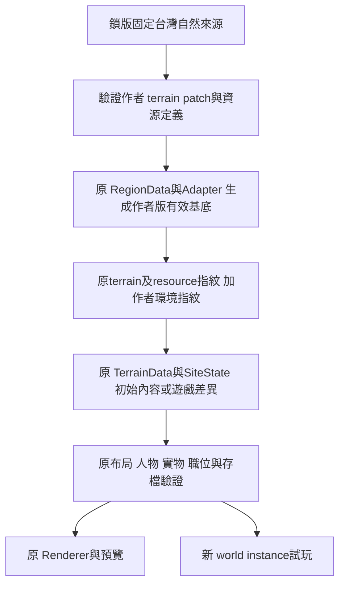

# Worldgoing 地圖編輯器詳細製作計畫

日期：2026-10-07。版本：設計 v1.2（對抗審查通過版）。狀態：本次計畫審查無未解問題；地圖編輯器尚未實作。本版重新核對來源、保存、人物與組織的實際調用鏈，修正前版計畫矛盾。審查範圍與結果見第 22 節；本次只修改此計畫書。

目標是製作遊戲內可開啟的地圖與情境編輯器：編輯地形、土地條件、自然資源及建築，設定國家與家族歸屬、聚落、實際居民和官員，保存為可反覆開新遊戲的情境。編輯器沿用現有地理來源、TerrainData、SiteRuntime、人物、SiteOffices 與保存流程；作者作品以版本化來源接入，不建立另一套人物、庫存、導航或 World 狀態。

## 1 需求與建議範圍

### 1.1 本次明確要求

- 能編輯地圖地形。
- 能編輯自然資源。
- 能放置建築。
- 能編輯所屬國家與家族。
- 能設定聚落及人口。
- 能編輯官員及相關人事。
- 主選單提供獨立「地圖編輯器」選項，直接進入專用編輯流程（使用者 2026-10-07 定案）。
- 交付可用於後續施工的詳細計畫書。

以上都列入完整交付範圍，不能只完成地形筆刷便稱整個編輯器完成。

### 1.2 已定案入口與其餘產品建議

1. **入口已定案：主選單新增獨立「地圖編輯器」選項。** 點選後直接進入專用作者介面，可建立、開啟及複製情境。
2. 本計畫正式交付以固定台灣來源為限，第一切片選一張 Site 製作。preset／seed 作者情境列為本案之外的來源擴充；在獨立 source_kind、Site ID、base loader、保存與缺鄰圖契約完成前，作者 UI 不提供此選項。
3. 作者模式停止玩法時間，在獨立草稿內立即初始化地形、建築與人物；試玩時由已驗證作品建立新的 world instance／slot。
4. 完整版擴充到多 Site、國家領土、多個家族及跨地點組織引用，仍按需載入 Site。
5. 編輯既有遊戲先「另存為作者草稿」，完成候選驗證後輸出新情境；首版不提供正在戰鬥中的直接熱修改。

主選單獨立入口已由使用者定案。其餘為本計畫提出的施工基準，以下已選定預設契約；P0 復核實際欄位及版本號，不能把尚未成立的領域能力宣稱為現成 API。

### 1.3 第一個完整可用切片

一個情境、至少一張 100×100 Site，能修改地形與九類資源，放置合法建築，配置一個國家、一個已建制家族、一個聚落、若干真實人物及官員，儲存、關閉、重開、試玩、再保存及載入。

國家第一切片先沿現有國家組織與陣營引用；「畫國界、跨 Site 統治、多家族」到第 13 節的正式領域擴充完成才開放。這是分期界線，不是刪除需求。

## 2 現行程式查核與可沿用部分

### 2.1 架構文件與程式的差異

`PROJECT_ARCHITECTURE.md` 仍是權責準則，但部分歷史段落已落後：第 143–149 行仍寫 TerrainLab 唯一入口及無 World／Region 旅行，第 186 行仍寫沒有正式聚落。現行程式已存在主選單、台灣地理接線、RegionSaveSlot、聚落及職位。新計畫保留其「唯一 owner、資料與呈現分離」原則，以以下當前程式定位實際入口；不復活已移除的 WorldData／GameSession／舊 RegionRuntime。

| 範圍 | 現行入口與資料 | 作者工具可沿用 | 真正缺口 |
| --- | --- | --- | --- |
| 主入口 | [project.godot](project.godot:15) → MainMenu；[選起點](scripts/main_menu/main_menu.gd:226) → RegionEntry → TerrainLab | 主選單、世界清單、地圖選格與角色預覽 | 作者入口、草稿清單與試玩返回 |
| 地理來源 | [RegionData](scripts/region_lab/region_data.gd:44)、[RegionTerrainAdapter](scripts/region_lab/region_terrain_adapter.gd:9)、[RegionGrid](scripts/region_lab/region_grid.gd:4) | 固定版本來源、座標、Site 展開、地理來源驗證 | 作者來源 pin、靜態 patch 解析與摘要失效 |
| 地形 | [TerrainData](scripts/terrain_lab/terrain_data.gd:9)、[整地完成](scripts/terrain_lab/site_runtime.gd:4072) | 原地形陣列、有效表面、原整地高度差分 | 地表、水體、土地條件的作者格式及指令 |
| 自然資源 | [SiteEnvironment](scripts/terrain_lab/site_environment.gd:6)、[有效來源查詢](scripts/terrain_lab/site_environment.gd:337) | 九類定義、足跡、存量、恢復、阻擋索引 | 新增、移動、刪除來源；容量與規則 authoring |
| 建築 | [SiteRuntime](scripts/terrain_lab/site_runtime.gd:1675)、[preview_build](scripts/terrain_lab/site_runtime.gd:2370) | FEATURES、布局、parts、入口、服務格、合法表面 | 作者立即初始化、搬移、複製、批次刪除的受限入口 |
| 人物 | 原 Actor／TerrainArmy／Crowd 人物 owner；[ID 配置](scripts/terrain_lab/terrain_lab.gd:787) | 原人物 ID、身體、能力、外觀、holder、軍事資格 | 正式情境人物匯入與平民初始化入口 |
| 住宅 | [SiteHousing](scripts/terrain_lab/site_housing.gd:13) | 原人物→完工住宅→唯一合法休息格 | 作者批次分配與容量不足的候選報告 |
| 聚落 | [SiteSettlement](scripts/terrain_lab/site_settlement.gd:10) | 一 Site 一聚落、中心、等級、陣營、職位、派生人口 | 作者初始化；跨 Site 管轄尚需後續 owner 契約 |
| 國家 | [SiteEquipmentOrders](scripts/terrain_lab/site_equipment_orders.gd:53) 的 equipment_nations 與 offices | 成員、文化、配裝標準、元首及已接線職責 | 正式情境建國入口、國家名稱／陣營映射、跨 Site 國家與領土 |
| 家族 | [SiteFamilyContinuity](scripts/terrain_lab/site_family_continuity.gd:25) 的 family v1／v2 | 完整本地成員引用、家主職位、死亡接續 | 多家族穩定 ID、一般家族歸屬與跨地點唯一引用 |
| 官員 | [SiteOffices v2](scripts/terrain_lab/site_offices.gd:10)；原 Army 指揮與資格 | 職位名稱、文武標籤、任職者、職責、代行、revision | 作者人事最終方案接入；不能另存 officials 名冊 |
| Site 保存 | [SiteStore](scripts/terrain_lab/site_store.gd:296) | 標準快照、校驗、暫存／備份、候選載入、嚴格引用檢查 | 作者來源相容欄位、情境封裝、無玩家草稿的完整準入 |
| 多 Site 保存 | [RegionSaveSlot](scripts/region_lab/region_save_slot.gd:47)、[原發布流程](scripts/region_lab/region_save_slot.gd:421) | 世界／slot 隔離、pin、generation、衝突與時鐘檢查 | 作者多 Site 原子發布及跨組織資料提交 |
| 呈現 | 原 TerrainRenderer、SiteResourceView、RegionLab／SitePreview | 選格、地面列排序、素材、建築與資源外觀 | 作者 ghost、圖層及同來源縮圖；不新增 renderer |

### 2.2 不能誤當成完整編輯能力的部分

- `site.terrain_changes` 目前只有「格索引→0–5 整數高度」，不是地形全欄位差分。
- `site.changes` 目前只修改既有資源 ID 的剩餘量、恢復時間、清除、發現及使用狀態，不能新增資源定義。
- 固定 `resource_base` 的指紋受保存檢查；直接改 Dictionary 後保存會被拒絕。
- 正式 `request_build` 會扣材料及建立施工，不是「免費立即放完工建築」的 API。
- 聚落人口由原人物與住宅登記推導；住宅數量及輸入數字都不能代替居民。
- 國家已有元首與職位，但尚不能因此宣稱存在完整政治領土、財政、外交與跨 Site 國民登記。
- 家族已有家主，但目前的單一家族接續名冊不是完整的多家族族譜。

## 3 地圖層級與座標

沿 `RegionGrid` 的既有契約：每格 2 公尺，Site 100×100 格、200×200 公尺，Region 100×100 Sites、20×20 公里。固定台灣 atlas 使用現有識別；不在本案重做全球投影。

| 編輯層級 | 操作 | 精度與限制 |
| --- | --- | --- |
| World 概覽 | 搜尋地點、國家顯示、情境範圍、跳轉 Region | 第一版沿台灣概覽；完整全球地理另案 |
| Region | 選 Site、框選批次、查看地形／資源／聚落摘要、後期畫領土 | 先顯示 Site 級摘要，不載入整區 2m 細圖 |
| Site | 地形與資源筆刷、建築、人物、聚落、住宅及官員 | 唯一細部編輯單位，100×100 格 |

Site ID 沿 `atlas_id + site_x + site_y`；局部格仍沿原 `Vector2i`。北向地理與畫面 y 向下的轉換只走 RegionGrid；負座標、半開邊界、四角共同點皆使用同一換算。UI 顯示公尺及坐標，不以放大倍率改變資料尺度。

完整 Region 在 2m 細度約有一億格；作者模式也採按需生成、稀疏 patch 與有限快取。一次編輯只開當前 Site 及操作必要的鄰接候選，未編輯地點繼續使用來源生成。

## 4 作者草稿、情境版本與遊戲存檔

### 4.1 三種生命週期

| 類型 | 用途 | 修改方式 |
| --- | --- | --- |
| 作者草稿 | 反覆設計地圖與初始狀態 | 可編輯、undo／redo、存草稿 |
| 已發布情境版本 | 可重複建立新遊戲的作品 | 版本不可原地改寫；修改後發布新 revision |
| 遊戲世界／slot | 某次遊玩的消耗、建設、人物、戰鬥與時間 | 原 RegionSaveSlot／SiteStore 權威，pin 到選定情境版本 |

作者草稿使用同一套 TerrainData／標準 SiteState 的候選資料；不複製出 EditorPerson、EditorInventory 或 EditorWorldState。作者 metadata 只識別來源、作品、版本與起點，不持有第二份活人物或庫存。

### 4.2 採用版本化作者來源

新增資源、地表或水域屬於「作者設定的靜態基底」。它們由自然來源加作者 patch 產生新的、可重建的有效基底，再沿原 SiteState 保存遊戲差異。

作者來源的 revision／hash 加入原 fixed_base、slot pin、Region route cache key 及摘要失效條件。原自然來源仍保留原版本與檔案；不改 pin 檢查來勉強接受不同基底。

**固定三種讀取契約，避免初始狀態污染基底：**

1. `RegionData.make_terrain_data`／Store 的 fixed-base loader 只生成「自然來源＋作者靜態 patch」的 base，不套 initial SiteState 或遊戲 delta。Store 先核對此 base，再沿原 initialize、標準快照及差異恢復流程載入。
2. 作者初始圖、初始 route 與初始摘要在上述 base 後套標準 initial SiteState，重建原資源及導航索引；不藉修改 base loader 偷套初始牆／橋／高度。
3. 當前世界圖在相同 base 後套 slot 最新正式 commit 所引用的 SiteState；不能選磁盤中較新的未提交文件。來源層與狀態層共用原恢復／查詢邏輯，cache key 明確區分 base、initial 與 committed-current。

自然 manifest hash、作者 `scenario_id/revision/package_digest`、各 Site 的 terrain／resource／environment fingerprint 分開保存；不把作者 digest 塞到自然 manifest hash 而破壞自然資源 layer 的尋址。`SiteStore._same_fixed_base`、`RegionSaveSlot._same_pin/_matches_base` 必須逐項比較新增欄位；僅加入未被檢查的 metadata 不算完成。

現有 `TerrainData.fingerprint()` 未包含 water_kind／water_body、五項土地條件、spawn 及可航來源。保留其原契約，另加入作者規則版本及有效環境指紋，驗證全部新欄位與語義。作品 checksum 涵蓋 static patches、initial_sites、start 及所有檔案清單；只改初始牆、居民或起點也須改變版本身分。草稿快取使用草稿內容 revision，不等發布後才失效。

不採用「把新資源隨意塞到 site.changes」方案：現行許多 consumers 直接讀 resource_base，改為雙來源會增加大量分支，並使保存、預覽與路徑不同步。

### 4.3 建議作者封裝

以下為待實作格式基準，不代表已有 API；P0 對照當時原碼確認版本號、正規化及全部讀寫入口。

| 區塊 | 必要內容 | 權責 |
| --- | --- | --- |
| manifest | format、source_kind=fixed_tw_author、scenario_id、revision、名稱、描述、atlas／grid 契約、自然來源 pin、package_digest、依賴與檔案清單 | 作品識別與完整性 |
| static terrain patch | Site ID、格索引、可選的高度／地表／水體／土地條件 | 版本化作者來源 |
| static resource definitions | 穩定來源 ID、新增／替換／移除、原 kind／cell／cells／capacity／variant／water／blocks／recover | 版本化作者來源 |
| initial sites | 原標準 SiteState 記錄：features、人物、housing、國家、家族、settlement、offices、實物；封裝內邏輯引用 | 初始玩法資料，原 owners 驗證 |
| start | 起點 Site、合法落腳格、受控人物選擇或新角色建立規則 | 原 RegionEntry／控制綁定接入 |
| 後期組織資料 | 正式國家／家族 ID、領土與跨 Site 引用 | 第 13 節正式領域 owner，不由 editor 私有保存 |

建議路徑為 `user://map_editor/projects/<safe_project_id>/` 的草稿及 `user://map_editor/scenarios/<safe_scenario_id>/revisions/<revision>/` 的發布版本。這是作者封裝位置；遊戲存檔仍沿 `user://region_lab/worlds/<world_id>/slots/<slot_id>/`。

檔案路徑必須是封裝內的合法相對路徑，拒絕 `..`、絕對路徑、重複條目、過大資料、未知版本與損壞 checksum。顯示名稱與路徑 ID 分離，允許中文名稱而不把名稱當檔案路徑。

首版採薄包：自然地理／資源來源、人物 atlas、模型及 Native DLL 由安裝環境提供，manifest 列出實際使用的依賴 ID、版本及 hash；不把整套安裝環境複製進每個作品。缺失或不相容即拒絕載入，保留作品。作品身分以 `scenario_id + revision + package_digest` 為準，本地目錄只是 locator，排除於內容 hash。

initial 文件保存原 SiteState 本文，不把衍生的父包 digest、目的 world_id／slot 絕對路徑或完整遊戲 save envelope 寫回被雜湊的初始模板。先算完整 manifest payload／文件 digest，再將初始本文與認證 base、已算好的作者 pin、目的 slot 邏輯引用綁成原 Store 候選 envelope，做標準驗證／磁盤讀回。如此不產生「包 hash 含一份又含該包 hash 的快照」循環，亦不建立另一份人物格式；遊戲開始後保存的完整 envelope 才含該固定作者 pin。

原 `RegionEntry` 請求、`world.json` 與 `SiteController.open_fixed_world` 同步接入此作品身分及經驗證的本地 resolver；既有自然世界缺新增欄位時沿原自然路徑。搬移／匯入作品後以同身分找到內容並驗 digest，不依賴作者機器舊絕對路徑；同名不同 digest 明確拒絕。世界清單及最後開啟記錄只在 bootstrap commit 成功後更新。

## 5 介面與操作流程

主選單常設獨立「地圖編輯器」選項，直接開啟作者介面及作品建立／開啟流程；編輯器返回操作回到原主選單。此入口納入 P1 施工與 E01 驗收。

MapEditor 是資料與呈現主機，直接沿用原 TerrainRenderer／資源及人物 View，讀標準草稿候選；不執行正常 TerrainLab `_ready` 再依賴 SceneTree pause。現行 `_ready` 會建立預設 player／Army 且 Lab 為 ALWAYS，須抽用最小資料初始化／查詢入口，避免編輯器開啟時生成幽靈人物或推進玩法。相機、UI 與作者命令可處理輸入，玩法 step／AI／供養／Fire 不執行；此限制不寫成情境永久 `paused=true`。E01／E14 核對開啟、平移、縮放與等待均不改變人物數、配置器、庫存及時鐘。

### 5.1 主要畫面

- 頂列：作品名稱、來源版本、未保存標記、儲存草稿、驗證、發布、試玩、返回。
- 左欄：地形、土地條件、資源、建築、國家、家族、聚落、人物、官員、起點。
- 中央：原地圖與原 renderer，疊加選取、筆刷足跡、合法預覽及管轄範圍。
- 右欄：選取物件屬性、目前值／候選值、引用與衝突。
- 下欄：檢查結果、變更清單與 undo／redo 名稱；點錯誤可定位 Site／格／人物／建物。

可顯示／隱藏地形、格線、高度、通行、土地條件、資源、建築、人物、國家、聚落與住宅關係。圖層只改呈現，不改玩法狀態。國旗或家徽先沿現有配色／可用素材；自訂圖案上傳另列後期能力。

### 5.2 工具與輸入

選取、單格、矩形、圓形筆刷、框選、連續路徑、複製／貼上、橡皮擦。先做單格及矩形，連續路徑供道路／牆使用；填滿須有格數上限及範圍預覽，避免一次掃完整台灣。

一段滑鼠拖曳是一筆操作，不是每格一筆。Esc 取消候選，Delete 先產生刪除方案，Ctrl+Z／Ctrl+Y 復原重做，Ctrl+S 儲存草稿。文字欄及數字欄取得焦點時不觸發地圖移動、人物軍令或地圖刪除。

返回主選單、開另一草稿及更換來源時，未保存內容提供保存／放棄／取消；保存失敗保持當前內容與介面，不先離開。試玩按已驗證候選建立獨立世界，不能藉切場景丟失尚未保存草稿。

對話框與側欄占用的區域不得被地圖選格穿透。沿原相機可用區規則計算視野；至少驗 1600×900 與 2560×1440，另列 Windows 焦點／DPI 人工驗收。

### 5.3 標準製作流程

1. 從主選單獨立「地圖編輯器」選項進入，新建作品，選定固定台灣來源並鎖定版本。
2. 在概覽／Region 選 Site，先完成地形、水體與土地條件。
3. 配置九類資源，再安排道路與建物。
4. 建立國家／家族，配置聚落中心及住宅。
5. 建立或匯入原人物，分配國籍、家族與住房，再任命官員。
6. 設定起點，執行整包驗證，修正錯誤。
7. 保存草稿，發布不可變的新情境版本。
8. 建立新世界試玩，回到作者模式時保留原草稿；試玩中的消耗不自動回寫作品。

## 6 地形與土地條件編輯

| 工具 | 可編輯內容 | 共同合法性檢查 |
| --- | --- | --- |
| 高度 | 設定高度級、升降、框選整平 | 現行 0–5 級；原 cliff／ramp／通行重建；不能覆蓋建築有效表面 |
| 地表 | 原 TerrainData 支援的地表種類 | 與水體、來源 footprint、建築地基一致，不新增只換顏色的假地表 |
| 水體 | 原 water_kind 0–4、穩定 water_body；無水為 body=-1 | 明示可航許可、相鄰接縫、岸邊工作格、橋／碼頭與人物落腳 |
| 土地條件 | fertility、moisture、drainage、foundation、groundwater | 沿原陣列範圍與語義；更新農牧、建設及供水的正式查詢 |
| 斜坡／通道 | 首版依原坡道規則派生，顯示可通行結果 | 不存第二份 navigation mask；任意手畫坡道須後期擴充原規則 |
| 道路／橋梁 | 由建築與用地工具建立原 feature | 不把路面繪色當成道路；橋沿原單一有效表面 |

第一版平滑工具只對離散高度操作，先預覽結果與通行變化；不引入連續 3D 地形或第二套地形網格。

修改順序為靜態地形→邊界及導航→土地條件→資源→建築→人物位置。地形變更使後續內容非法時，保留候選並列出衝突，不能默默刪建築、移人或補出新資源。

固定地理目前由 `SiteEnvironment.initialize` 將五項土地條件清為 0；作者來源須明示提供已驗證陣列，並由原 initialize 保留，沒有作者土地層則維持原零值行為。來源生成、指紋、磁碟重載與試玩採同一初始化順序，不能只在編輯畫面事後補值。

五項土地條件的作者輸入訂為 0–100 整數，此為新增 schema 準入契約；現有 PackedByteArray 及查詢不等於已具作者 validator。高度 0–5、地表原 Surface enum 0–6、水體 0–4 均在轉 PackedArray 前驗型別／範圍，不靜默 clamp。新增水格預設不自動獲得航行許可。需要航行時，作者來源明示 `author_water_rule_v1` 的 cells／body 許可，驗證真水、合法等高通道及非橋占格；原 `can_navigate_water` 仍檢查當前有效表面，刪水或橋占格即失效。作者水體採來源內穩定 ID，配置與自然 body ID 不重複的數值映射，跨 Site 同一水體映射一致，定義與許可均納入 environment hash。

重生成只替換選定的來源與作者 patch 候選；既有建物／人物若要保留，須完整重驗。更換自然來源即形成新的作品基底版本，不能原地污染已發布版本。

## 7 自然資源編輯

### 7.1 九類全部納入

| 類別 | 作者可配置 | 驗證重點 |
| --- | --- | --- |
| 林木 | 位置、占格、容量、variant、恢復規則 | 樹林阻擋、可採集格與道路不能衝突 |
| 石料 | 位置、占格、容量、外觀變體 | 不生成完成石材庫存；採完狀態可重建 |
| 黏土 | 位置、容量、來源範圍 | 土地／水條件與合法工作格 |
| 鐵礦 | 位置、容量、已發現／未發現初始狀態 | 保留勘探需求，不因編輯器 marker 自動發現 |
| 鹽源 | 位置、水體／鹵水關係、容量 | 鹽源、鹵水與成品食鹽分離 |
| 野生食物 | 位置、容量、恢復週期 | 不與農田生產／已入庫糧食混用 |
| 藥用植物 | 位置、容量、恢復週期 | 正式採集時間與恢復規則 |
| 漁業資源 | 水域位置、容量、恢復週期 | 真水域與岸邊作業可達；陸上魚點拒絕 |
| 野生動物 | 位置、variant 對應物種、容量、恢復 | 沿原物種與捕捉入口，不建立第二套動物 owner |

種類與正式定義來自 SiteEnvironment；不另外維護一份 editor 資源 enum。首版編輯 variant，不擅自增加尚無 Runtime／View 支援的新物種。

### 7.2 靜態定義與初始狀態分離

- 作者靜態層設定來源的位置、種類、容量及恢復規則。
- 原 `site.changes` 設定初始剩餘量、是否清除、是否發現、下一次恢復與使用狀態。
- 恢復到自然來源：移除對應作者 override；恢復到作者定義：只清掉相應初始 runtime delta。UI 分開命名，避免誤清整張地圖。
- 資源 key 在 Site 內穩定：既有來源保留原 `kind:cell` 字串，搬移也不改 key；新增來源用保留命名空間 `author_resource:<單調序號>`。全部 consumers 仍只查原 resource_base，不建立對映 registry；P0 查全部 caller，確認不以 key 推算位置。首版不開跨 Site 資源搬移。
- 野生動物物種目前由 variant＋source cell 派生。在原定義加入可選且不可變的 `identity_cell`，缺欄位時 fallback 原 cell 保持舊資料；對缺欄位的舊來源，第一次搬移前在同候選填入舊 cell，之後才改實際 cell／cells，保留 key。新來源／複製明示物種對應的 variant 與 identity_cell。Env 提供唯一物種 resolver，原 View、Controller 名稱、WorkTeam、捕捉與 Runtime 全沿此查詢；後續搬移不改 identity_cell。
- 刪除有工作區、目標或進度引用的來源時，將清理引用列入同一候選；首版從活動世界匯入時須先完成安全快照。

作者可明示初始化資源存量，但「放一片森林」不增加木材庫存；若要設定初始庫存，須經原 inventory／holder 初始資料入口。

新增來源不能只沿用 Store 的 runtime-delta validator：在原 Env 的來源準入入口驗 kind、非空且不重複的 cells、anchor 包含於 footprint、Site 範圍、capacity、variant、water、blocks、recover 及 identity_cell；再由 source loader／Store 共用。kind 僅原九類，variant 首版 0–2；作者容量上限訂為 1,000,000，capacity 為 1..1,000,000 整數，recover 為 0..1,000,000 遊戲分鐘的整數且 0 表不恢復；remaining 為 0..capacity。此上限是新增作者輸入防護，非現有自然來源或人口上限。blocks 沿原種類派生、water 依同候選的 water_body 重算，不准藉欄位關閉樹／石阻擋或在陸上生魚。檔案與 footprint 上限沿既有 Site／Store 限制；identity_cell 在 Site 格界內。空 cells、越界 kind、重複或保留 key（如 depot／feature:）、NaN／小數及未知欄位一律拒絕，避免分母為零與表格索引越界。

修改容量、recover 或位置時，同一候選重驗初始 delta、引用與同一 Site 時鐘。recover=0 或 cleared 時要求 next_recovery=-1；不得留下會被原 regenerate 執行的舊排程。原石／黏土／鐵礦預設不自然再生；再生類按其原週期，鹽源沿 used／used_minute 的分鐘配額，不能把九類統稱逐次扣 remaining 後自然恢復。作者 reset 是明示編輯指令，不當成玩法恢復。

## 8 建築、用地與初始物資

### 8.1 目錄及可編輯屬性

目錄由 `SiteRuntime.FEATURES`、building_spec 及已準入素材派生，包含住宅、井／取水站、農牧用地、作坊、倉庫、道路／整地、防禦工事、軍營／校場、碼頭／船塢、橋梁、營帳、戰俘營與聚落中心。具體種類及尺寸以當前正式定義為準，不在 editor 複製第二份表。

可編輯種類、anchor、尺寸、面向、原 variant／camp_type、管理方、原 grade、完工 HP／parts、配方及合法供水／庫存初始配置。首版僅生成合法完工建物，不自由設定未完工進度／paid batch／pending_build／repair；此類活動快照拒絕發布為首版情境。未支援旋轉的布局不能只轉圖片；尺寸不符原 min／max 或入口被封必須拒絕。

攻城器械、車與船仍是原 vehicles，不塞入 features 冒充建築。可先唯讀顯示，後期作者部署接原車船 initializer 與席位／crew／cargo 契約。

### 8.2 作者初始化與玩法建設

作者「放完工建築」使用 SiteRuntime 內的受限初始化入口，產出標準 feature、合法 parts、已投入條件與引用，再由原 Store 驗證。一般完工材料是已耗用紀錄，不同時另生現貨；原拆收仍沿原規則。營帳可收回的營帳包、牧場／馬場 residents 可取回的活物及庫貨則是真正初始資產，須列在候選資產報告並保存唯一承載；不為防退款而改掉原回收契約，也不重複初始化一份在庫物。

不能只改 `stage=complete`；聚落中心還須成立對應 settlement 紀錄，grade／中心等級、已付投入、完工狀態一致。營帳由作者初始配置入口驗證，但遊戲中搭收仍保留原營帳包與原人物作業契約。

放置及搬移重用原 `_preview_build` 的完整環境、占位、地基／地下水、坡口、工作入口、橋岸／船水域及住宅合法性，再驗標準 feature layout；作者入口只隔離現場材料與施工時間條件。若需要採伐／清理，先列出來源並拒絕，或由使用者明示同筆清理候選；不以 complete 掩藏仍活躍的來源。Store 可讀寫不等於新布局已合法。

正式遊戲操作照常走 request_build、材料、工人與時間。作者入口必須驗明目前是草稿初始化候選，正式遊戲 UI 不得呼叫它免費建造。

### 8.3 移動、複製、刪除

- **移動**：保留原 feature ID；重算 footprint、服務格、供水及入口，映射原 parts 並保留其 HP、已投入材料、Fire fuel／generation。不隱性滿血、補燃料或退款；部件無法合法映射即拒絕。原 resize 不支援用加減格冒充搬移，須新增同 owner 的候選搬移入口。
- **複製**：新 feature ID；首版只複製布局與合法靜態屬性，不複製住戶、駐營、囚犯、正在付費的批次、貨物及個別實物 ID。
- **刪除**：先檢查所有 holder／housing／garrison／captivity／water／settlement／repair 引用；必須同交易提供清空／合法重新分配方案，否則拒絕。不得以刪建物順便刪人或物。
- **換管理方**：重驗住宅、聚落、倉庫、職位及同陣營條件；不自動把居民國籍或人物 faction 一起改掉。

有內容的建物搬移首版可拒絕並列出引用；空建物搬移先完成。後期支援帶關係搬移時，逐項驗原住戶休息格及承載，而非平移所有位置數值。

「空建物」還須沒有付費批次、待領貨、pending_build、repair、gate／梯作業、船修、工作目標及 Fire 引用。作者刪營帳或已完工聚落中心亦須專用候選契約處理原實物／聚落關係，不繞過 gameplay 拆除禁止。

## 9 國家、陣營與歸屬

### 9.1 先區分四種不同關係

1. `faction_id`：原人物、隊伍及建物的陣營，影響敵我與管理資格。
2. 原 nation 記錄：原成員、職位、裝備文化及配裝標準的組織。
3. 聚落 `owner_faction`：中心管理方，不等於所有居民國籍。
4. 國家領土／主權：跨地點政治關係，目前尚需正式資料契約。

編輯器不能把四者放在一個「所屬」下拉選單並全部連動。UI 分成國籍／組織、陣營、建物管理方與領土，顯示實際改動及需要處理的引用。

### 9.2 單 Site 首版

沿現有 equipment_nations／SiteEquipmentOrders 擴充正式情境建國與成員編輯入口；不得呼叫 `register_trial_equipment_nation` 代替正式建國。國家名稱及與 faction 的明示映射需由該正式領域保存，不能只存在 editor 字串。

可設定國家名稱、穩定 ID、原裝備文化、原標準與染色、成員、元首及已接線職位。改名不改 ID；任命者必須引用原人物並滿足對應正式資格。

單國家切片也須真正的聚落國家歸屬：版本化擴充原 SiteSettlement 的可選 `nation_id`，無國家可空；由原國家領域及 Store 檢查引用存在。`owner_faction` 保持獨立，不能只以 nation↔faction 映射代替所屬國家。

修改國籍／陣營時預檢住宅、隊伍、軍營、聚落職位、披風資格及其他標準引用。同一份方案包含「解除哪些關係／改派哪些人」，最終合法才提交；不沒收或重生裝備。

未建制的陣營可以有建物及人物。採單人同一正式國籍、允許無國籍，不對舊檔暗自補國家。國家↔faction 採明示可空映射，不作等同或改一項連動全部關係。

P4 新增國家 name／id／faction 映射與 settlement.nation_id 後，原保存、任主、重建名冊及全部查詢入口保留新欄位並驗引用。現行旅行會搬走 nation 正文而留下聚落；P6 registry 前，涉及新增組織欄位／聚落關聯、不能被舊旅行完整保留的出發一律在改動前拒絕，返回明確 `RELATION_OPEN`／不支援原因。無新增欄位的舊世界沿原旅行；不能先損壞來源關係再拒絕，也不能將此相容工作全推到 P6。

### 9.3 完整國家編輯

多國清單、國家領土筆刷、首都／統治聚落及跨 Site 國民引用到 P6 接正式組織 owner。首版領土精度建議為 Site；細到單格、爭議主權與多國共管另定。與聚落管轄分層，不能把「聚落半徑」當國界。

本案設定初始政治分布；不把稅收、外交、戰爭決策與領土變更 AI 當作編輯器必需的新玩法。

## 10 家族與人物關係

### 10.1 單一家族切片

沿現有 family v2 成員引用及 SiteOffices，設定名冊完整性、族人、家主、已接線職責及 AI 開關。P4 版本化擴充同正式 owner／Store 的顯示 name 與穩定 family_id；register_members、任主、office 更新及重建名冊全部保留它們。首版一人一個正式家族、允許無家族；不靠 editor 私有欄位假裝已支援。

每位族人仍是原人物：不複製 HP、位置、國籍、裝備或能力到家族名冊。現有 member 的 site_id／path／person_id 按原驗證解析；發布及開新世界時重綁目的 slot 路徑，禁止帶入作者機器的絕對 user 路徑。

本輪複審期間重新讀原碼：FamilyContinuity.validate_family／member_ids／office_person_ok、SiteDutyAI.same_family 及 Store 已接完整本地 Site＋person_id 篩選，前版「現行僅比 person_id」描述已失效。P4 沿此現有守衛保全；首版作者名冊限定當前 Site，外地引用保留唯讀，不參與本地任官或同族判定。從既有世界匯入也須遵守，E11 保留外地同號回歸案例；此查核不代表其新變更已經執行驗證。

外地唯讀參考可留在草稿，但發布要求每個人物引用都可在作品／目的 slot 的完整閉包解析。首版未納入外地正文則拒絕發布，提示明示解除關係或待 P6 完整導入；只改路徑不算修復，不能默默刪族人或繼續讀舊世界。原旅行會重建單一 v1/v2 family 而丟新字段，P4 同第 9 節先拒絕未能完整保留新 family 契約的旅行。

死亡接續仍只決定玩家控制權，不等於自動繼承家主、財產或技藝。作者設定初始家主不改其原接續規則。

### 10.2 多家族與族譜

完整目標包含建立／改名／刪除家族、選取人物家族歸屬、家主、跨 Site 族人及關係檢查。多家族需正式 family_id 與單一 family registry，將現有接續名冊轉為引用其中一個家族；不能每個 Site 複製一套家族正文。

父母、配偶、子女、家產與科技是後續關係欄位：只有其正式 owner／玩法介面成立才可編輯。無對應玩法時顯示「尚未接入」；不發布會被遊戲忽略的裝飾性族譜。

## 11 聚落與人口編輯

### 11.1 沿既有聚落規則

目前每 Site 最多一個 settlement，中心是原 feature，聚落名稱、等級、中心、管理陣營、offices 與陷落紀錄由 SiteSettlement 保存。人口、管轄與停效派生，不能自由寫入。

| 現行等級 | 管轄半徑 | 人口門檻 | 作者設定要求 |
| --- | --- | --- | --- |
| 1 聚落 | 12 格 | 0 | 合法中心及聚落紀錄 |
| 2 村 | 20 格 | 12 | 原升級投入、住宅及其他原條件一致 |
| 3 鄉 | 30 格 | 40 | 原升級投入、住宅／倉庫／作坊等原條件一致 |

4–5 級與跨 Site 管轄目前是後續設計；編輯器首版不提供能存下卻沒有正式效果的高等級。

可編輯中心位置、名稱、已支援等級、管理方、正式所屬國家、首長／典獄職位及居民住房。新增 nation_id 先經原領域版本化驗證，改聚落國家不自動改中心陣營、居民國籍或財物。等級設定使用同 owner 初始配置方案，保留中心完工與投入驗證；人口不足時顯示原停效原因，不把等級強制降級或造人補足。

### 11.2 人口數字是生成／配置目標

「配置 12 位居民」先產生一份人物與住宅方案：

1. 查現有同陣營原人物，可選既有角色或明示新增。
2. 新增者經原 ID allocator、原 body schema、外觀準入、實物 holder 及供養初始化。
3. 查合法完工住宅與唯一休息格，規劃住房分配；可選自動安排空位。
4. 同步處理國家、家族及官位引用，確認起點與實體格位合法。
5. 顯示新增人數、已有居民、缺住房、無法安置者與初始物資變動。
6. 整份驗證後才提交；重新查 SiteSettlement 派生人口，必須與方案結果一致。

缺 3 個床位就拒絕整筆或由使用者明示改為可安置人數，不能輸入 12 人卻只生成 9 人並顯示 12。

減少人口使用移出聚落／解除住房／移到另一地點的方案；不把刪除或死亡當預設減人口。作者刪人物須顯示國籍、家族、職位、住宅、隊伍、物品及被俘關係，處理完所有引用才可刪。

### 11.3 真正平民生成的前置缺口

現行 actors 容器只支援 player／npc，其他人物主要由原 Army 或 Crowd 名冊持有。已有 ID 配置及人物初始化流程，不代表已有任意平民群的正式生成入口。

P4 在 TerrainArmy 補「正式初始人物名冊建立／匯入」入口，抽用原人物列初始化與外觀准入，沿 TerrainLab 原 ID allocator。人物正文仍在 `TerrainData.site.armies[*].units`／原 TerrainArmy，首版沿已合法的 `role="work"` 技術容器，UI 顯示「居民名冊」，不新增 resident bodies 或任意 actors 鍵。

純平民全為 `military_role="civilian"`，formal／acting／current commander 均為 `-1`，HOLD、`needs_attack_order=true`、`combat_attacking=false`、office `duty_ai=false`，不產生派工／軍令意圖。保留原 body、holder、住房、供養及死亡路徑；作者可合法配置住宅及初始休息格。返家／手採只保留受控本人等已具正式請求權的路徑；零隊長居民名冊沒有 team.work 下令人，國家／聚落首長也不能因此派工或命令未受控平民返家。不得為成立容器造軍官或隊長。居民 NPC 調度須另有正式權限／生活 AI 契約才開放，不是本案新增人口的先決玩法。

首版先驗有限人數；Army 50 隊／5,000 行、Crowd 10,000 行與文件大小上限只是當前後端準入界線，不是聚落容量或效能承諾。

## 12 官員、能力與個性

### 12.1 唯一職位系統

官員是原人物持有 SiteOffices 的職位，不是另一種人物或 officials 表。介面以組織→職位→任職者→職責顯示，支援新增／裁撤／改名、任免、職責重新分配、文武標籤及已接線 AI 開關。

不能將 raw CATALOG 當成玩法已接線證據：例如 nation.corps 目前可解析職責／元首席，尚無正式軍團編成 caller，作者可配置其既有席位，軍團編成 AI 控制顯示尚未接入。每項可開 AI 的職責須能定位現行真命令 caller；沒有 caller 不生成命令或宣稱可運作。

沿現行規則：

- 每組織保留一個不可裁撤的首長職位。
- 職位數量不設任意新上限，清單捲動與按需繪製；格式與檔案大小防護仍保留。
- 同一組織一人最多一職位；跨組織可兼任。
- 每項已接線職責恰好屬於一個職位。
- 有任職者的職位至少一項職責；空缺職位可零項。
- 文官／武官是標籤與建立預設，文官亦可帶兵；特定職責仍按原軍官資格驗證，不用文武標籤代替資格。
- 空缺／失格時由合格首長代行，代行不改職責歸屬；首長不適格時按原規則暫停。
- 隊伍 formal／acting／current commander 仍沿原 Army，不能只改一位 office holder 就偷換正式隊長。
- AI 職責目錄只顯示已接真命令的項目，不能讓使用者自創一個名稱便取得新權限。

### 12.2 人事整份方案

任免、裁撤與調職責組成一份方案，以最終狀態一次驗證及提交；例如交換兩個職位的職責不在中間步驟被誤拒。提交檢查 office revision 與人物資格，預覽不持有任職權或材料。

資格沿每種組織的正式規則：Army 檢查原 military_role／指揮資格；nation 檢查國家成員，family 檢查完整本地族人引用，settlement 檢查活人、同陣營及已接線職責條件。現行四組織 callback 並未全部使用 SiteOffices.needs_officer，不能聲稱共用 Offices 已自動補齊資格。P4 抽用同一領域候選守衛接到作者入口與 Store；有真命令 caller 的軍事職責驗其實際要求，不因文武標籤自行賦權，保留舊檔既有準入。若正式資格語義需要改變，必須版本化處理，不在作者 validator 暗改舊世界資格。

初始 AI flag 在起點受控人物確定後按原組織建立規則一次決定，純平民名冊仍全部 duty_ai=false；已有 flag 隨標準快照保存，讀檔／角色接管不得自行翻轉。

作者模式可初始化人事，不需要玩家扮演元首點每個按鈕；此權限只在獨立草稿成立。試玩後命令完全回到原受控人物與職責權限，不帶永久「作者可任命所有人」旗標。

### 12.3 可編輯人物欄位

先開放原 schema 已支援的姓名／顯示欄位、性別與外觀、軍事資格、原能力與人格範圍、陣營／國籍／家族、住房與職位。能力、人格、資格與權限分開；不能因能力高便自動任官。

裝備及染色沿原物品 definitions／records／holder 與視覺準入；改外觀不製造不存在的裝備。年齡等只有外部名冊支援、原人物未支援的欄位先標明語義，不把顯示年齡自動變成老化系統。

## 13 多 Site 與正式組織資料的擴充

此階段才完成完整的「多國、多家族、領土及跨聚落人口」需求。以下是正式領域缺口，不應由 editor 表單自行解決。

### 13.1 穩定引用

- nation_id／family_id 在 world instance 內唯一；settlement_id 以 Site ID＋原中心／聚落穩定 ID 唯一解析，聚落正文仍在原 SiteSettlement。
- 原整數 person_id 在 P6 擴為 world／slot 範圍唯一，沿原 31-bit 準入並跳過保留 ID；`PersonRef={world_instance_id,person_id}`。原 RegionSaveSlot generation／control 持 allocator 高水位，TerrainLab 原 allocator 接同一計數器；不得跨 Site 各發同號，也不在移動時重編號。額滿明確拒絕新增。
- `person_location` 只記唯一所在地 `{kind:site|party,id}`；origin_site_id 是 provenance，不是防撞鍵。移動只改所在地與正式引用，人物正文仍在原 Site／旅隊，索引不複製 HP、裝備或人口。
- 原 slot 的版本化組織區塊持唯一 `nations[id]`／`families[id]` 正文；國家保成員整數 ID、standards／culture／offices，家族保成員、complete、label／age metadata／offices。領域操作仍走原 EquipmentOrders／FamilyContinuity／Offices，Site 僅持組織引用；settlement.nation_id 為單向真值。此區塊與 sites／control 在同 generation 的正式 commit 一起驗證發布。
- P6 一次遷移後原 Store 不再序列化 Site 的 nation／family 正文，全部原 queries 改查同一正式 resolver；legacy 只讀／遷移，不與 registry 雙寫。出生地及名稱不能充當人物身分。

舊世界有本地同號碰撞時拒絕原地自動升級並保留；作者匯入多 Site 到新作品若需要新 ID，只在完整候選作一次 mapping，更新 body、holder person:id／original_owner、housing、受控引用、offices、nation／family、captivity、corps、供養與 Native 全閉包並保 provenance。發布後不再變更身分。P6 先完成此 schema 及所有 readers／writers 遷移，再開跨地點面板；首版不宣稱能無損自動升級任意舊世界。

### 13.2 所有權與管轄

國家領土先以 Site 為單位，聚落管轄沿其正式等級與邊界規則。多聚落重疊、無主地、異國居民、主權與實際控制不一致，各自有明確欄位／規則；首版不做模糊的自動歸屬猜測。

國家／家族 registry 持有唯一組織正文，Site 人物或建物只持引用；Region 地圖的名稱、人口與旗幟是可重建摘要，不可由 UI 單獨改寫。

### 13.3 跨 Site 批次交易

筆刷跨邊、遷移居民、移轉建物管理方與組織調整都先收集必要 Site 候選，驗證完整引用閉包後，一次發布新 generation。任一 Site 寫入或驗證失敗，舊 generation 仍完整可讀，不發布半個國界或半個家族。

現行 RegionTravel R1 對 nation 全員同去有 `RELATION_OPEN` 限制；不能默默刪關係讓遷移成功。P4 先設新增 schema 的無損拒絕守衛。P6 列齊 ground crossing、ship transfer、RegionTravel、死亡接續、任官、裝備文化／披風與 Store 對 family／nation／PersonRef 的全部 readers、writers、closure guards；同時改到正式 registry／location 契約並回歸，才解除對應旅行限制。

## 14 變更、復原與安全提交

### 14.1 一次操作的共同流程

1. UI 讀取原資料，建立有限候選與操作範圍。
2. 檢查來源 revision、草稿 revision、物件 ID 與相關 owner revision。
3. 套候選，重建地形邊界、資源索引、feature geometry 與派生關係。
4. 運行相應領域驗證；有沖突則回 `ok/code/message` 與可定位清單。
5. 全部合法才替換草稿中的目標資料，並發布一次 redraw／navigation invalidation。
6. 成功替換後登記一筆 undo／redo，採 `commit_action(execute=false)`，不再次執行 initializer；存草稿時才寫文件。建立 action 前已完成全部可能失敗的驗證，拒絕候選不丟 redo 分支。

不要為編輯器另建 Command Bus、CQRS、事件資料庫或通用 object factory；以現有 owner 的明確候選／初始化函式完成。

### 14.2 原生 undo／redo

使用 Godot 原生 [UndoRedo](https://docs.godotengine.org/en/stable/classes/class_undoredo.html)，以一次筆刷／搬移／人事方案為 action，登記本筆操作影響範圍的前後候選與引用閉包。它提供歷史動作，不替代本案交易驗證。

Undo／Redo 在呼叫原生 `undo/redo` 前 preflight 目標候選、引用、版本及索引重建；失敗時不調歷史 API，草稿、history cursor、redo 分支、dirty、checkpoint 均不變。callback 只交換已驗證候選與索引，不能包含寫檔、fallible initializer 或 gameplay 命令；回傳 false 不能當作取消原生歷史前進。恢復原本不存在的 key；不以 cancel_feature 或反向 gameplay 命令復原，避免退款、清地與作業副作用。

首版歷史上限建議 100 次，重操作設位元組預算；這是 editor 性能參數，不是職位數／人口玩法上限。編輯範圍內保存稀疏差異及必要的標準記錄，不每個筆刷深層複製整個世界。

undo／redo 只在同一草稿版本有效；試玩使用獨立 instance，返回不會還原遊戲物品或傷亡。載入另一作品時清空歷史；保存 checkpoint 與 dirty 標記要按內容／歷史分支識別，不能只比較遞增 version 便宣稱已保存。

ID 配置器保持單調，不因 undo 回退造成引用復用；redo 恢復同一候選 ID。長筆刷在首格建立 before，重複掃到同一格只保留第一次 before 與最後 after。

### 14.3 從活動世界複製

先走原 SitePersonActions、戰鬥／火場／器械飛行／跨 Site 交易與 Store 保存守衛，取得可完整複製的快照。首版只接受安定狀態；即使一般遊戲存檔支援合法半步，作者複製也可更嚴格地等原步完成。

原世界只讀取可驗的完整快照；Native→GD 接管／作者轉換在完整隔離副本上沿原 handoff prepare→validate→commit，確認同一 ID／holder 接回。現行 Crowd clear／ClearHandoff.commit 會改 owners 與預約，不能在來源世界上拿它當純投影。無法建立安全副本時維持唯讀或拒絕導入；成功／拒絕都不得改來源 Native hash、人物、holder、預約或存檔。

現行 Fire 支援合法完整保存快照，但快照可存不等於燃料／部件可編輯。另檢查 Fire units、contacts、待處理 projectile／work／collapse、repair generation、inventory 及 owner 引用；熱或在途目標拒絕，冷殘留若缺正式遷移入口也拒絕，不清空火場來取得修改權。首版活動狀態只留原世界；轉為可開新遊戲的作品前須收束並驗完整歷史。

## 15 跨地點邊界、預覽與失效

### 15.1 同一來源到所有出口

當前 RegionData 概覽／summary、RegionSitePreview 與 RegionRoute 通行表主要讀取固定基底。作者版本必須進入以下所有出口：

- 細部編輯地圖與原 TerrainLab 試玩。
- Region／World 縮圖與地形摘要。
- 資源 marker 與資源類型／容量摘要。
- RegionRoute cache key 及原通行表建立。
- RegionTravelSite.start_component 與初始 route 同版本的 component 編號。
- RegionSaveSlot neighbor 查詢與 Store 固定基底 loader。
- 原 GPU／Native terrain 同步與 navigation revision。

只改現場 TerrainData 而忘記其中一處，不能驗收為完成。runtime 已清除／採竭資源的預覽也需明確標成「作者初始圖」或「當前存檔圖」，不得混顯示。

同作者靜態來源還不足以得到初始通行：完工牆／橋在 initial SiteState，清除與發現狀態在 changes。第 4 節 initial 投影由純 base 後套 initial state、重建有效導航與資源；route table 與正式旅行 start_component 使用相同投影與 component 編號。實際抵達／跨界仍以 current 的原 landing 守衛為準；runtime 改堵通道不能靠初始 route 強制通過。current 不再疊 initial state，避免重生住民／物資；查圖不推進時間，真正進場才沿原冷補算。未發現鐵礦只在明示作者全知圖層顯示，正常預覽沿原發現狀態。

### 15.2 四邊及四角

沿原 RegionData 的 404 個 halo samples 原子邊界更新。靜態作者水體、地表與高度均從同作者來源解析；runtime 高度差異繼續走現有 checksum-verified neighbor delta。兩層順序與缺資料狀態明確，不能用平原補缺邊界。

halo 同樣按 base／initial／committed-current 選狀態：先作者 static，initial 再從同作品版本的 initial_sites 取鄰格高度 delta，current 則只讀同正式 commit 引用的鄰快照。沒有 initial 項視空差異；正式引用缺失／損壞則拒絕。initial 查詢不得偷讀現存 slot；base 不讀任何 SiteState。初始 route 跨界開口以兩側 initial 的原有效表面查詢判定，實際跨界以兩側 current 判定；原 boundary_surface 取得對應模式的標準 TerrainData，不另建導航權威。

天然 cliff／ramp halo 與完工橋／牆等有效 feature 表面分層；跨界實際通行沿原 RegionSaveSlot.boundary_surface／boundary_surfaces_can_step 比較兩側有效面，不把橋面塞回自然高度樣本。概覽地點標記沿原 known_saved_sites 的正式 marker 範圍，不能掃 generations 裸檔名；標示「已配置／已保存地點」，不把 bootstrap 已物化而未訪問的 Site 冒稱已訪問。未提交候選不可出現在概覽。

跨 Site 筆刷以全局格位枚舉、分別寫入候選並共同發布。首版尚未接跨 Site 交易時，工具在邊界顯示明確限制，不靜默裁掉筆刷一半。

## 16 保存、發布與試玩

### 16.1 草稿保存

保存作品 metadata、靜態作者 patch 與標準 initial Site 記錄；不保存 UI 窗口位置、ghost、Node、導航快取或完整自然來源陣列。形狀、型別、ID、路徑及範圍始終沿正式準入；未選起點、未完成外地引用等可留在草稿診斷清單，不為能存草稿而放寬 playable SiteStore。發布／試玩才要求整包可玩引用閉包全部成立；不能把診斷中的候選當成有效遊戲快照載入。

無玩家的地理草稿沿原空 actors／actor_presence 語義保存設計；未配置玩家不阻止草稿，但正式發布須具合法開局規則。`start.mode=existing_person|created_player` 互斥：前者綁定已有原人物，不能再執行固定覆寫 lab.character 的 apply_created_character；後者走原 player 模板／allocator 建立新玩家，再驗完整關係。最終恰有一位可解析、活着且非被俘的受控者與合法起點，由原控制綁定接入，不只改 controlled_person_id，也不重複生 scenario 人物。

沿現有 temp、checksum、讀回與舊代保留模式；失敗保留草稿與最後成功文件，不清空當前編輯內容。

### 16.2 發布不可變版本

1. 同一草稿／作品先取得單一發布者鎖，讀取當前草稿及預期 revision，完整驗證來源與引用；第二 session 明確拒絕。
2. 使用唯一 staging 目錄寫 static patches 與 Site 快照，逐件校驗並建立完整 manifest；digest 按固定正規化 payload 計算，排除 digest 自身及本地 locator，包含檔案 hash、依賴、initial_sites、start。
3. 從磁盤重新載入候選，用原 fixed-base loader 與 Store 再驗一次。
4. 所有文件成功後以無覆蓋方式提交正式版本記錄，最後才更新可見指針；舊版本保持可讀。獨占鎖覆蓋提交／指針操作，不能只用 exists＋共用 .tmp 或 revision 預檢冒充互斥。
5. 同 revision 已有內容或並發改動時拒絕覆蓋，回明確沖突。

多文件發布沿 RegionSaveSlot generation／commit 思路：資料先落盤、提交記錄最後。未發布 staging 可忽略，先前已發布作品仍可讀；已正式發布作品 checksum 損壞則拒絕，可由使用者明示另選仍完整的舊作者版本。遊戲 slot 沿現行「最新正式 commit 選中資料損壞即拒絕」契約，絕不自動回退舊 generation，以免復活人物／物品所有權。不能用列出最新 json 或掃描較舊完整文件偷換已提交版本。

### 16.3 試玩與存檔相容

原 MainMenu／RegionEntry 接情境版本身分與本地 resolver，原 RegionSaveSlot 建立新世界並認證自然 pin＋作者版本；各 Site 認證各自有效環境指紋。world_id 沿原安全字元規則但加入唯一後綴，不只依秒數。建立 instance 時，將作品內全部有 initial state 的 Site 重綁合法路徑、逐一驗證並寫入候選，沿原 generation／publish 一次提交及登錄 marker，成功後才寫 world.json／更新世界清單與進起點 TerrainLab；未配置初始內容的 Site 才沿 fresh 分支。

bootstrap 使用建立 token、唯一 staging 及待提交狀態；未有首代完整 commit 的 world 不列清單、不接受 resume。第二張 Site 寫失敗等中斷保留候選與診斷，同 token 重試可續建／重驗，不因先寫過 slot manifest 就永久卡在 create_new 衝突。首次 commit 成功即轉正式世界，重試同 token 回既有結果，不重生人物；同 slot 同時只允許一個 writer，提交後才發出成功回應。

不能只初始化起點：現行 open_site 缺檔會生成基底，其他作者 Site 的建物與居民將遺失。初始化各 Site 的共同遊戲時鐘、simulation_settlement 與 fire clock／journal 必須一致；新作品不攜帶未收束作業或旅程。從遊戲快照轉情境時，不直接歸零帶歷史的 Fire 紀錄；無合法初始化／遷移規則即拒絕發布。

試玩正常運行原 AI、採集、施工、供養、軍令與時間。保存後關閉／重載仍讀同一情境版本；新版情境不能自動替換舊世界基底。升級／遷移另有明示流程，首版拒絕不相容來源並保留舊檔。

人物外觀／atlas 來源、原生 DLL／blob、現行 schema 不相容時保留原證據並拒絕相關內容；不為編輯器關閉這些守衛。

## 17 分期與完成條件

| 階段 | 制作內容 | 可演示結果 | 進入下一階段的門檻 |
| --- | --- | --- | --- |
| P0 契約與復核 | 復核本版字段／範圍、base／initial／current、無玩家草稿、ID／pin／舊檔；列 readers／writers | 一份 field 與調用鏈清單，確認現有 owner | 新格式與三種讀取分層明確，不含第二套狀態 |
| P1 作者入口與來源 | MainMenu 獨立選項、data-only 作者主機、地圖瀏覽、草稿；原 RegionData／Adapter 作者來源與identity resolver | 主選單→地圖編輯器→草稿→Site→預覽 | 開啟不造人／推時間；hash 貫穿 loader、preview、pin；舊自然世界可開 |
| P2 地形與九類資源 | 筆刷、土地條件、水體、來源增刪移、初始狀態、原邊界及 route 失效 | 改山水與資源後儲存、重開、試玩相同 | 指紋不被繞過；九類逐項驗證，魚與野生動物包含 |
| P3 建築與初始配置 | 標準作者初始化入口、放置／空建築搬移／複製／刪除、管理方、庫房初始物資 | 建合法聚落基礎設施；非法刪除明確報引用 | 同一布局產生外觀與通行；人／物守恒 |
| P4 社會與人事 | 正式人物匯入、住房、單國家／家族／聚落、官員；新 schema 保留／無損旅行守衛、資格與wired-AI核對 | 真居民、任命、派生人口、無權請求拒絕 | 不造軍官派平民，全部新字段存讀／重建完整；不兼容旅行先拒絕 |
| P5 發布與首切片結案 | 全包驗證、單一writer／原子發布、bootstrap續建、隔離試玩、來源搬移與存讀 | 所有指定類別有一個完整可用實例 | 首切片矩陣／畫面證據完成，正式commit損壞不自動回退 |
| P6 多 Site 與組織 | 跨界編輯、穩定 PersonRef、多國領土、多家族、跨聚落關係與共同提交 | 兩地以上、兩國、兩家族、兩個聚落能完整編修 | 新組織 owner 與所有 travel closure guards 同步準入 |
| P7 完整版驗收 | 批次、邊界／四角、損壞文件、回歸、DPI／焦點、負載測量 | 獨立作品可在新世界重複使用 | 全目標矩陣通過；性能與平臺限制明確 |

P0–P5 是第一個可用版，不能宣稱 P6／P7 完成。P6 也不是新造全套政治 AI／經濟的階段，只補編輯要求真正需要的正式組織及引用。

### 17.1 粗估工作量

下列是單人熟悉現有 owners、以本計畫邊界施工的工程量提案，不是實測交付日期；包含定向測試與有限 GPU 驗收，不含新美術／完整政治模擬／全球地圖。

| 階段 | 工作日粗估 | 主要不確定性 |
| --- | --- | --- |
| P0 | 2–3 | 當前並行代碼變化及組織欄位 |
| P1 | 5–8 | 同一作者來源貫穿 preview／slot／route |
| P2 | 6–10 | 水體邊界與地形資源互相約束 |
| P3 | 4–7 | 完工初始化與引用保全 |
| P4 | 5–9 | 原 work 名冊的平民匯入與正式組織初始化 |
| P5 | 4–7 | 初始快照、路徑重綁與原子發布 |
| P6 | 8–14 | 跨 Site 身分／多家族／領土契約 |
| P7 | 3–5 | 真輸入與回歸問題 |

P0–P5 合計約 26–44 工作日，完整範圍約 37–63 工作日。P0／P4／P6 後重新估算；共享 Godot 測試時段、Native 不相容或領域契約改動會增加工作量。分工可並行 UI 與只讀查核，觸及同一 SiteStore／Runtime 的提交和 Godot 運行需協調。

## 18 驗收矩陣

所有下列項目目前都是待驗條件，本計畫不把既有測試文件存在或歷史 PASS 當作編輯器新證據。

| 編號 | 項目 | 必測情境 | 通過條件 |
| --- | --- | --- | --- |
| E01 | 主選單獨立入口 | 獨立選項進入／返回／開原世界，作者平移縮放與等待 | 專用介面可直接開啟返回；未造預設人物，人物數／ID配置器／庫存／時鐘不變 |
| E02 | 地理定位 | 公尺→Site→local、負坐標、四角 | 使用原 Grid；正反定位一致 |
| E03 | 地形保存 | 高度、地表、水體、五項土地條件 | 重開全部欄位／原指紋與作者環境指紋／通行一致；五項非零值不被清空 |
| E04 | 資源全類別 | 九類增刪移；舊wildlife首次跨奇偶格／重載／Undo／Redo；再生／非再生／鹽分鐘配額／reset；非法source與recover=0 | 工作格／View／重載一致；legacy身分／物種不變；空cells／越界kind／殘留排程拒絕 |
| E05 | 水域約束 | 陸上魚點、斷水、碼頭／橋、新水無許可、明示許可、刪水、跨界body | 新水不自動可航；許可與真水／有效面一致；跨界身分一致，非法候選原圖不變 |
| E06 | 建築幾何 | 原布局／支援面向／軍營類型／牆梯門橋；非法地基、坡口、工作入口、未清來源 | 原建設環境與geometry共用；非法布局拒絕，不靠complete掩藏活資源 |
| E07 | 建築引用保全 | 刪住戶／庫貨／駐營／囚犯；搬移HP／fuel；營帳收包與畜群取回 | 拒絕或同交易合法重分配；人／物不丟失、初始資產不重複，不補血燃料或改原回收 |
| E08 | 人口 | 12 人配置、住房不足、死亡／無登記／異方 | 數值完全由原居民規則推導；缺位不造假 |
| E09 | 平民建立 | 零軍官存讀、existing／created起點、重複導入；受控本人手採返家、未受控無權請求 | 唯一ID／受控者及原body／holder；兩起點模式不混覆寫；本人合法成功，外部無權拒絕，不造軍官 |
| E10 | 國籍／陣營 | 改國籍、改 faction、改中心 owner／聚落 nation_id | 無效國家引用拒絕；改所屬國家不強改居民、中心陣營或財物 |
| E11 | 家族 | 任主／重建名冊保name與id、重複引用、重綁、外地同號、外地正文未納入 | 完整閉包可解析；外地同號不能冒充，缺正文拒絕發布；新世界不讀作者舊slot |
| E12 | 官員 | 任免／改名／裁撤／交換職責／空缺 | 每職責唯一；首長保留；一組織一人一職 |
| E13 | 文武與軍職 | 四組織各真職責資格、文官合法帶兵、無資格者、未接nation.corps AI | 沿各owner真資格；標籤不賦權；未接caller不宣稱AI；既有flag存讀／接管不翻轉 |
| E14 | 權限隔離 | 作者初始化；試玩普通人任免；data-only開圖與試玩開始 | 草稿權限不進玩法，作者不step／AI；開局按正式paused／權限運行 |
| E15 | 原生顯示 | 原人物換裝／染色、未準入 atlas | 沿原準入拒絕，未複製裝備或 body |
| E16 | undo／redo | 多格／建築／人口／人事、失败preflight、undo後分支、redo同ID | 失敗state／游標／redo／dirty不變；成功不二次initializer；高水位不回退，引用恢復 |
| E17 | 摘要與 route | 初始高度delta／牆堵口／橋連岸、隱礦；無組織fixture正式出發／抵達／存讀 | base hash不混initial；initial route與start_component同編號；current landing仍守衛；快取一致 |
| E18 | 原子保存 | 全故障點、第二Site寫失敗同token重試、兩publisher、未commit裸檔、已commit損壞 | 不覆寫／半包／重生人；半bootstrap不列世界；未提交不顯示；正式commit壞即拒絕不回退 |
| E19 | 文件防護 | checksum 損壞、過大、未知版本、非法路徑 | 明確拒絕，不改當前資料或覆蓋舊檔 |
| E20 | 來源相容 | 自然 source、作者 hash、DLL／atlas 不一致 | 保留版本守衛，不靜默接受 |
| E21a | 單Site獨立試玩 | 同作品開兩世界、原內容／時鐘存讀、bootstrap多文件隔離fixture | 作品與兩世界獨立；初始人物物資一次建立；fixture證明全初始文件commit，不稱多Site UI完成 |
| E21b | 多Site首次進場 | P6至少兩真實作者Site，起點遊玩後首次到未訪Site與冷補算 | 全初始Site內容保留；已配置不冒稱已訪；正式跨Site關係與時鐘一致 |
| E22 | 安全導入 | 活動作業／戰鬥／飛行／Fire／Native／旅程，副本handoff成功與拒絕 | 原守衛完整；不清燃料歷史；來源Native hash／人物／holder／預約／存檔全部不變 |
| E23 | 跨 Site 地形 | 四邊／四角、兩Site初始邊格高度delta與橋／牆、current鄰圖改變、失敗中斷 | halo與有效面同模式；initial不讀slot、current同commit；整體提交無半筆刷 |
| E24 | 多組織 | 兩國／兩家族／兩聚落，人物遷移與任職 | 唯一正式關係，舊地退出與新地進入同交易 |
| E25 | 真輸入 | 文本輸入、拖曳、快捷鍵、側欄、DPI／焦點 | 無輸入穿透或誤下軍令；控件可用 |
| E26 | 性能 | 單 Site、9 鄰圖、多物件列表及一大筆刷 | 有實際耗時／記憶體／frame 資料；不以小樣本推論 10k 流暢 |
| E27 | 回歸 | 原主選單、建造、採集、住房、職位、保存及旅行 | 已使用的原契約不退步 |
| E28 | 作品搬移與依賴 | 搬到另一目錄、移除原locator、開新及既有世界；同名異digest／缺依賴 | 按內容身分驗證新locator；不得回退自然source；缺依賴不開半世界且保留作品 |

首切片完成 E01–E20、E21a、E22、E25、單 Site 的 E26、相關 E27 及 E28；E05的真跨界body、E21b／E23／E24、E26九鄰圖到 P6–P7。E17 出發fixture不帶新增國家／家族／駐營／拘押關係，可由一張作者Site向自然Site驗原旅行，不能用它解除P4組織旅行守衛。E18多文件故障用隔離fixture，不代表多Site編輯介面已完成。無GPU／真實輸入證據明確未驗，不以headless代替。

## 19 測試沿用與證據

優先擴充相關現有測試，每個新增契約留下最小可運行檢查，不另造通用測試框架。可沿用文件如下；施工前復核當時原始碼及測試內容。

- 入口：[main_menu_flow_test.gd](scripts/tests/main_menu_flow_test.gd)、[輸入流程](scripts/tests/main_menu_input_flow_test.gd)。
- 固定來源與坐標：[region_lab_contract_test.gd](scripts/tests/region_lab_contract_test.gd)、[資源](scripts/tests/region_lab_resource_contract_test.gd)、[山地通道](scripts/tests/region_mountain_pass_contract_test.gd)。
- 預覽：[region_lab_preview_contract_test.gd](scripts/tests/region_lab_preview_contract_test.gd)、[preview UI](scripts/tests/region_lab_preview_ui_test.gd)。
- 資源：[site_resource_contract_test.gd](scripts/tests/site_resource_contract_test.gd)、[visual](scripts/tests/site_resource_visual_test.gd)。
- 住房：[site_housing_test.gd](scripts/tests/site_housing_test.gd)、[Crowd 住房](scripts/tests/site_housing_crowd_test.gd)。
- 聚落：[site_settlement_center_test.gd](scripts/tests/site_settlement_center_test.gd)、[聚落拘押](scripts/tests/site_settlement_prison_test.gd)。
- 官員：[site_offices_duty_test.gd](scripts/tests/site_offices_duty_test.gd)、[文武](scripts/tests/site_office_class_test.gd)、[家族職位](scripts/tests/site_family_offices_test.gd)。
- 邊界與旅行：[site_cross_boundary_wall_test.gd](scripts/tests/site_cross_boundary_wall_test.gd)、[region_travel_test.gd](scripts/tests/region_travel_test.gd)。

編輯器專屬檢查按階段增加，建議先一份 `map_editor_source_contract_test.gd` 與一份 `map_editor_initial_state_test.gd`，覆蓋新邏輯而非重複原實現；發布錯誤恢復與跨 Site 引用達到對應階段再加入。

Godot 實作驗證使用 canonical `C:\Users\Nekki\.codex\skills\godot-runtime-verify\scripts\verify_godot.ps1`，保持原腳本及保留最近 100 completed runs 的規則。共享工作區先確認 Godot 運行時段、一次一臺進程、明確執行 timeout；用原生 status／wait 監看運行與子任務。

失敗保留日誌，診斷並做定向修正再重跑相關檢查，不降低驗收或無改動反覆重跑。每階段收據保存原始碼版本／hash、PASS 與 FAIL、圖像／真輸入證據、命名範圍和未通過項目。編輯器功能、Native、GPU、性能及發布可攜帶性分別驗收。

## 20 預計程式修改範圍

文件名為施工建議，不是本次已新增文件。以最少文件完成，功能不按每個類別各造獨立 authority。

| 位置 | 允許的改動 | 禁止形成的重複權威 |
| --- | --- | --- |
| MainMenu／RegionEntry／SiteController | 獨立作者入口、identity與locator、互斥起點、bootstrap提交後列世界、已保存標記 | 第二份世界清單或玩家控制器 |
| 新 MapEditor 場景＋少量腳本 | UI、選取、候選、UndoRedo、草稿流程；嵌用原地圖呈現 | 私有人物／建築／庫存資料庫 |
| RegionData／RegionTerrainAdapter | 認證作者 static layer、有效基底、same-source sample | 第二套坐標或地形生成器 |
| RegionSitePreview／RegionRoute／RegionTravelSite | base／initial／current分層、summary、cache key、start_component | UI 自存可走與資源結果作為權威 |
| SiteRuntime／SiteEnvironment | 受限作者 initializer、原 geometry 與索引 | 免費 gameplay build 開關、雙資源 enum |
| 原人物 owner／TerrainLab | 共用建立／匯入與原 ID allocator、合法純平民名冊 | EditorResident 或複製原 body |
| SiteHousing／SiteSettlement | 批次初始化／派生人口／原中心紀錄 | 可任意寫的 population 數字 |
| SiteEquipmentOrders／SiteFamilyContinuity／SiteOffices／SiteDutyAI | 組織初始化、字段保留、資格與同族完整引用；P6唯一registry查詢 | 第二套nation／family／official表或雙寫正文 |
| SiteStore／RegionSaveSlot | 新作者 pin 相容、同標準驗證、整包提交 | editor_save 另存活人／庫存副本 |
| 原 renderer／View／Controller | ghost 與圖層、重用 redraw／失效 | 另一個正式地圖 renderer |

原 Architecture／Status 文件的漂移在施工時以獨立、受控修訂補齊，並標注歷史證據；本次不一並改寫其他人的文件。

## 21 主要風險與已選定施工基準

| 風險 | 可觀察錯誤 | 控制方法 |
| --- | --- | --- |
| 繞過來源指紋 | 編輯器能看，存檔卻 SAVE_VERSION | 作者來源有 revision／hash，原 loaders 共同認證 |
| 三種地圖庫不同源 | Site 已改，Region 縮圖／route 仍舊 | E17 端到端驗同版本，不只驗筆刷陣列 |
| 人口被偽造 | 面板 100 人但沒有人物／住房 | 原人物生成與 housing，人口唯讀派生 |
| 官員變第二套名冊 | panel 任職與實際權限不一致 | SiteOffices 唯一權責，最終方案驗證 |
| 變更國籍刪關係 | 轉國成功卻遺失家族／住房／物品 | 引用閉包與整份方案，非法拒絕 |
| 作者複製帶舊路徑 | 新世界操作原作者存檔 | 發布及建立世界重綁 path，引用校驗 |
| 多文件只存一半 | 舊新家族／國界混合 | generation 最後發布，所有故障點測試 |
| 並行原始碼變化 | 計畫與施工對象已經不同 | 每階段開始再核對真實 API 與 schema |

採用基準：運行時data-only作者工具、固定台灣、合法完工配置與獨立試玩、單Site起步；一人同一正式國家／家族且可無歸屬；nation↔faction明示可空；P6領土按Site、PersonRef用world唯一原整數ID、組織正文在原slot唯一registry。聚落仍一Site一個，管轄沿原半徑，不新增跨Site聚落正文；P6跨聚落人口以原人物遷移及住房重新分配達成。

preset作者來源、任意未完工進度、跨Site資源搬移、血緣／家產、自訂國旗、熱修改與全居民NPC調度後置，不阻礙使用者本次要求的地形、資源、建物、國家、家族、聚落人口及官員編輯。尚未接入的玩法不能在UI宣稱可用；多Site／多國／多家族要求仍列P6／P7完整交付門檻。

完成交接包括：作者操作說明、已發布示範情境、開新世界與存讀證據、全部指定類別的可見實例、原始碼及格式版本、失敗記錄與準確驗收邊界。只有這些成立，才稱該階段編輯器完成。

## 22 本次計畫審查與修訂紀錄

2026-10-07 重新以地理／保存、建築／資源、人物／社會三條獨立審查線對照現行原碼，前次 PASS 不沿用。以下列出本輪發現與修訂，不是實作測試結果。

| 審查發現 | 修訂位置與處理 |
| --- | --- |
| 基底混initial state、pin僅寫metadata、preset錯走fixed | 第4／15節三種讀取契約及逐字段pin驗證；preset排除正式範圍 |
| 作者水體／source欄位缺trust-boundary檢查、資源搬移改物種 | 第6／7節新增來源validator、明示可航、穩定key及統一物種resolver |
| 完工初始化漏環境合法性、施工退款與tent／畜群資產混淆 | 第8節只完工、沿原preview_build，初始可回收實物單列 |
| Undo callback不能abort／可能二次初始化 | 第14節先preflight、失敗不碰歷史、commit_action(false) |
| 正常Lab啟動造幽靈人物、Native轉換改來源世界 | 第5／14節data-only主機及隔離副本handoff |
| P4新組織字段被旅行／重建丟棄、早期同號族人風險 | 第9／10節同步writers及無損旅行拒絕；本地引用原碼已補，複審更新現況並保留回歸 |
| 跨Site PersonRef不解裸整數碰撞、registry與本地正文可能雙寫 | 第13節world唯一原ID、原slot高水位、唯一registry及全閉包遷移 |
| 平民返家／派工越權、職責目錄被當真AI、起點模式混覆寫 | 第11／12／16節原權限、真caller及互斥受控人物初始化 |
| 外地唯讀關係缺正文仍能發布 | 第10／16節草稿診斷與發布完整閉包分離 |
| route漏start_component、未提交檔誤顯已訪 | 第15節同initial component、current landing及marker標記 |
| 正式commit損壞回退、publisher無互斥、半bootstrap不能重試 | 第16節拒絕損壞commit、單一writer、staging及token續建 |
| 包搬移後仍按舊絕對路徑、外部依賴未列 | 第4／16節內容identity／locator分離、薄包依賴與E28 |
| 單Site首版要求多Site E21 | 第18節E21a／b及故障fixture、首版／P6門檻分開 |

最終複審結果：`PASS_MAP_EDITOR_PLAN_V1_2`。三條獨立審查線重讀修訂文件後確認：地理／來源／pin／route／邊界／保存、建築／資源／Undo／安全導入、人物／平民／組織／聚落／官位契約均無未解實質問題。第二輪再修正 legacy 野生來源首次搬移的身分固化、initial 鄰圖 halo／有效面與包 digest 循環，亦同步本輪已更新的家族本地引用原碼；沒有沿用前版 PASS。

文件檢查涵蓋 22 個章節、29 列驗收案例與 38 個本地來源／測試連結的存在及行號，另檢查編碼、表格與程式區塊一致性。此 PASS 限本計畫契約及所查原碼範圍；全部 E 項仍待實作與執行驗證。此次未修改程式、未跑 Godot，不推論 GPU／Native／性能或發布已通過。共享原碼後續變更時，施工階段依第 17／19 節重新核對相關 owners。
