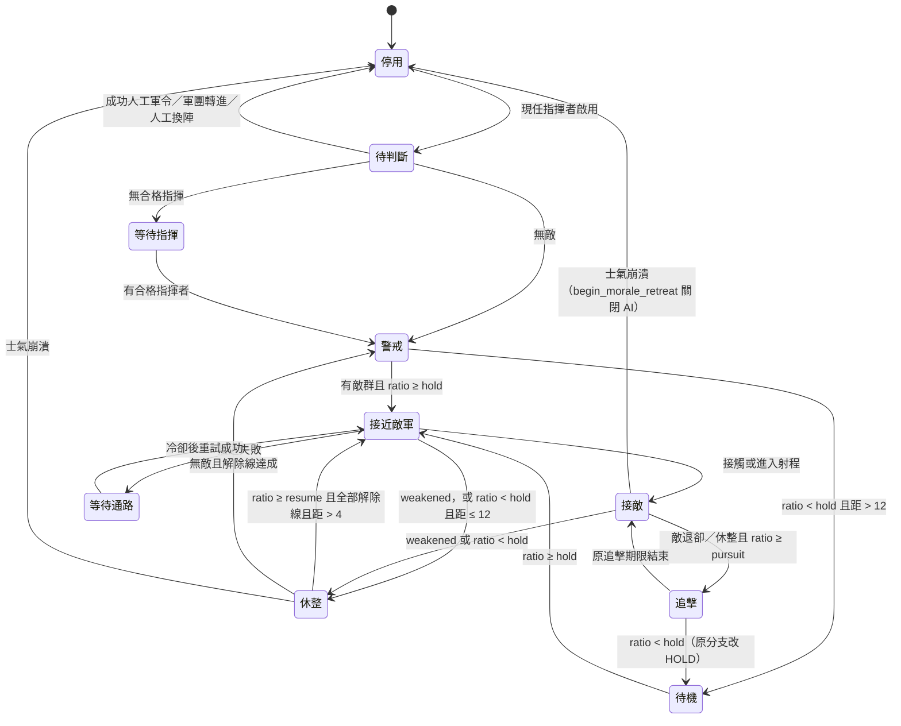
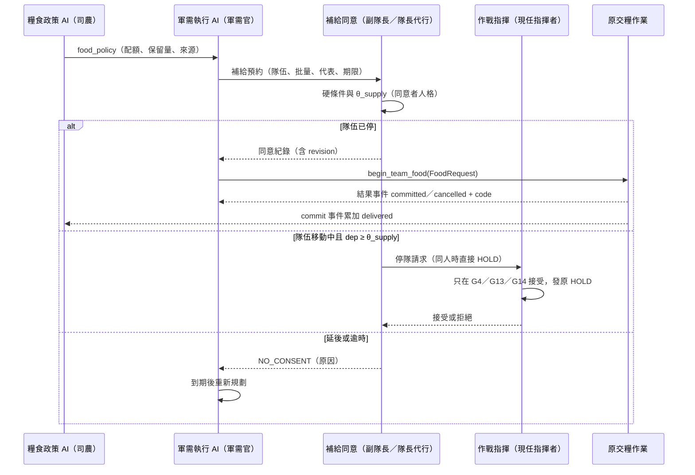

# NPC AI 詳細實作計畫：隊長人格、國家領導與官員決策

日期：2026-10-06。版本：0.5（同日修訂：D17 職責 AI 開關改依首長是否為玩家決定預設值；同日 0.4 為原始碼核對版；0.3 為 2026-10-04；0.2 為 2026-10-02 依 kaka 回覆重新對齊版）；待實作。

**主軸：不同個性的原人物擔任隊長、國家領導或官員——更一般地說，擔任任何負責某項職責的職位——時，在同樣限制下作出不同、可解釋、能真正執行的決策。** 先在正式 TerrainLab 完成小隊長人格切片（A1），再完成同 Site 的領導政策與官員執行（B0→B1），並把同一套決策契約推廣到 [職位與職責計畫](OFFICE_POSITIONS_AND_DUTIES_PLAN.md) 的各項職責（主線 C）；Crowd 對齊（A2）與跨 Site（W）分別接續。居民作息、住宅、社交與一般工作優先級不是這兩條主線的先決條件。

本文只是計畫：**未修改遊戲程式、未安裝 HTN、未執行 Godot、未宣稱任何玩法驗收通過。** 所有新欄位、數值、制度與分期都是提案，第 13 節列出需逐項批准的選擇；未批准前不得默默施工。

## 0. 版本變更摘要

### 0.00 2026-10-07：人格擴為十軸

主選單建人物定案：人格由三軸擴為十軸（軍事、為人、處事三組），格式、保存與驗證見第 4.1 節。A1 行為與所有數值例不變，只讀三個軍事軸；資料層改由主選單計畫 P3 先行完成。（2026-10-07 更新：十軸全部已批准使用。職責 AI 依職位計畫附錄 D 接入全部十軸，每軸最多兩個決策點、非軍事軸權重不超過軍事軸一半；政治系統〔本人願歸降、不滿消退、叛離門檻〕依 `reports/ai-office-duty-integration-v2-plan.md` 第 11 節例外放寬，使用者 2026-10-07 決定。主線 A 的戰術隊長〔`SiteArmyAI`〕尚未接人格，A1 施工時仍只讀三個軍事軸。）

### 0.0 v0.5：接上職位與職責計畫

`OFFICE_POSITIONS_AND_DUTIES_PLAN.md`（2026-10-06 第三版，以下簡稱**職位計畫**）把「隊長、元首、軍事首長、軍需官」從寫死的角色改成「可自訂名稱、可增減的職位」加上「系統定義、可調動的職責」。使用者已定案：每項職責恰屬一個職位；空缺或暫時失格的職位由首長代行；組織調整權屬首長且首包不可委派；國家 `military_head` 遷移成一般職位；作戰指揮到職位計畫 P4 才開放調動；同一人在同一組織最多一個職位。v0.5 據此修改：

| 項目 | v0.4 | v0.5 |
|---|---|---|
| 決策者是誰 | 依角色寫死：隊長＝現任指揮者、元首、軍需官 | 新增第 3.5 節：決策者＝`SiteOffices.resolve(組織, 職責)` 回傳的實際執行者（任職者或代行首長），用**他本人**的人格；作戰指揮在 P4 前仍是現任指揮者 |
| B0 國家職位 | 新增「元首」「軍需官」兩職位；保留 `military_head` 為唯一來源（D9） | 改用職位計畫的 nation `offices`：元首（首長，負責軍團編成）、司農（糧食政策）、軍需官（軍需執行）等是**預設名稱**；`military_head` 改為唯讀推導，不雙寫（D9 修訂） |
| 權限請求 | `FoodRequest`（來源授權＋代表指揮授權） | 以職位計畫的 `DutyRequest {requester_person_id, position_id, duty_id, revision}` 為共同底座，`FoodRequest` 是它的延伸（第 7.3 節） |
| 補給同意 | 隊長同意，必要時自己發 HOLD | 由 `team.supply_consent`（預設「副隊長」）負責；同意者若不是作戰指揮執行者，只能在隊伍已停時同意，移動中改送「停隊請求」（第 7.7 節，D16） |
| 政策／決策紀錄 | `office: "head_of_state"`、`office: "captain"` | `{org_kind, org_id, position_id, position_name, duty_id, acting}`（第 4.8、7.4.5 節） |
| 其他職責 | 不在範圍 | 新增**主線 C：職責 AI**（第 8 節）：共通排程、同輪優先序、開關、人格參數化規則，以及專職後勤與訓練令兩項試點的具體公式 |

新增驗收：B12、DA01–DA08；新增待批准：D16–D20（第 13.1 節）。v0.4 的原始碼核對結論全部保留（第 0.1–0.3 節）。

### 0.1 v0.4：對照原始碼後的更正（v0.3 與現況不符或不完整）

| # | v0.3 說法 | 2026-10-06 原始碼實況 | v0.4 處理 |
|---|---|---|---|
| E1 | 狀態機「潰退整補 → 警戒：原集結完成」 | `begin_morale_retreat` 會呼叫 `_stop_tactical_ai()`，**士氣崩潰即關閉該隊 AI**；整補完成後不會自動回到警戒，須由現任指揮者重新啟用。native 則不關 `ai_enabled`，整補後直接續判 | 第 4.5 節狀態機改正；GD／native 差異列入第 6.3 節對齊表 |
| E2 | D7 戰術撤離「若批准，只走原 `_preview_tactical_retreat` 預檢」 | `_issue_combat_order` 對未潰退的 RETREAT 一律回 `NOT_ROUTED`；這是 `SITE_TEAM_ORDERS_FOLLOW_RETREAT_PLAN_SOL.md` 已定案的規則（隊長、代理、AI 都不能在未崩潰時下令撤退）。預檢程式存在，但呼叫鏈在 Army 正式入口就被擋下 | D7 改寫為「須重開使用者已定案的撤退規則」，不是單純接上預檢 |
| E3 | 軍需官失敗碼 `BUSY` 只代表代表疲勞輪休 | `SiteController.begin_team_food` 有**全 Site 只能同時一件交糧作業**的鎖（任何隊伍有進行中 delivery 就回 `BUSY`），玩家自己的交糧也佔同一個鎖 | 第 7.3 節新增全域交糧槽位規則；失敗碼表拆分 |
| E4 | requester 化只要把 `controlled_person_id` 換成 requester | `SiteFoodDelivery` 內依賴點有 9 處（另 Controller 的取消、疲勞豁免與作業推進至少 4 處），且 depot 來源的權限是「接收者是受控者本人，或受控者是接收者隊伍的現任指揮」：這其實是**兩種權限**（動用來源、指揮代表身體）。官員只擁有前者 | 第 7.3 節把 requester 上下文拆成「來源授權」與「代表指揮授權」，後者由隊長同意（第 7.7 節）提供 |
| E5 | 首版來源只能是單一 `site.inventory` depot | 2026-10-04 起已有 `SiteStockpiles`：完工倉庫／加工設施的 `site.stockpiles`，記錄 `owner_faction` 與分級容量。這比無主的營地 depot 更接近「有歸屬的公庫」。但 `SiteFoodDelivery` 尚不支援 stockpile 來源 | 第 7.2 節把來源選擇列為 D14，建議以本陣營倉庫為正式來源 |
| E6 | 人格「不可另建 index-keyed 表」 | 現有能力值 `command_abilities` 本身就是 Army 上以 row index 為鍵的旁表，拆併隊時經 `_roster_metadata` 以 person ID 中轉。人格放在 row Dictionary（與 `military_role` 同層）才會隨原人物自然搬移 | 第 4.1 節定出具體 schema，並說明為何不採 abilities 旁表模式 |
| E7 | Crowd 與 GD AI「兩者排他」 | 一般隊伍策略確實排他；但 Crowd 啟用時 `SiteArmyAI.review` 仍對 `ai_enabled` 的 Crowd 隊伍呼叫 GD `_review_siege`（攻城器具 AI） | 第 2.1 節補註：排他只限一般隊伍策略 |
| E8 | 未提及隊伍數量 | 正式容量已是最多 50 隊、合計 5,000 行；AI review 是隊伍兩兩比較 | 第 5.3 節補成本預算 |
| E9 | 未提及船隊、駐營與新射擊命令 | `set_tactical_ai_enabled` 拒絕乘載／船岸中（`EMBARKED`）與駐營（`GARRISONED`）隊伍；`issue_ranged_order(requester, target, ammo_mode)` 是 2026-10-06 火攻 P1 新增的射擊目標入口；`issue_formation_change` 在 `_issuing_tactical_ai_order` 為真時不會關閉 AI（但目前只有 `issue_tactical_ai_order` 會設此旗標，AI 換陣需新增包裝） | 第 2.1 節與第 4.10 節行動庫補入 |
| E10 | 行號 | v0.3 引用的 `_decide:235`、`command_eligible:3220` 等在兩天內已漂移（`terrain_army.gd` 仍在火攻施工中） | 改以函式名為準，附第 2.5 節「2026-10-06 核對行號」表，只作定位線索 |

### 0.2 v0.4：已核對無誤、保留的部分

- `_decide` 判斷順序、全部常數（0.65／0.90／12／2／3／1.35／20／30／0.5）與硬底線（健康 0.35、可用 0.45、疲勞 80、士氣 25、缺彈）。
- 中性萬分位公式逐位等於原常數；全 101³ 組合「恢復嚴格高於投入、解除線嚴格於觸發線」以腳本驗證 0 違例（附錄 A）。
- 第 4.6 節六個原型、第 4.11 節 Utility 數值例、第 7.4 節 B07 配額（謹慎 25／11、進取 34／14）、`θ_supply`（0.84／0.44）皆重算一致。
- `SiteSustain` 每名活人每日 1 份口糧（`demand = count × 期間 / DAY`）已確認，B07「每人每日 1 份」不再只是假設。交糧作業時間 `2.0 + 0.2 × q` 的單位確認為**有效遊戲秒**（受疲勞輪休與威脅暫停影響）。
- `valid_nations` 嚴格驗 3（+culture）鍵、軍團上限 3 軍團 × 3 隊、`PLAYER_MEMBER = 1000000000`、`simulate_npc_commander` 為整隊領裝的測試參數。

### 0.3 v0.4：新增設計（加深）

- 第 4.1 節：人格的確切儲存格式、稀疏保存、四條後端（Army row、Actor、Crowd cold、native PersonState）的對應欄位。
- 第 4.2 節：接任時正處休整的規則、玩家本人擔任現任指揮時的人格來源。
- 第 4.7 節：四個單軸案例補齊全部控制輸入（v0.3 的 C4 漏了 casualty 100 的人數解除線是 0.70）。
- 第 4.10 節：行動庫加入「陣型選擇」「集中射擊目標」兩個**已有原執行入口**的候選，並把側翼／高點的候選檢查改用無副作用的 `preview_combat_move`。
- 第 6.3 節：GD／native 戰術 AI 的既有語義差異表，A2 須先決定哪些要對齊。
- 第 7.3 節：全域交糧槽位、玩家優先、官員讓位規則。
- 第 7.5 節：軍需官人格對照的完整數值例（愛兵官選 T1、好功官選 T2）。
- 第 7.10 節：與 `FAMILY_SETTLEMENT_NATION_TECH_TREE_PLAN.md` 共用 B0 的介面約定。
- 第 12 節：新增 A13（休整中接任）、A14（崩潰關閉 AI）、B10（全域交糧鎖）、B11（倉庫來源歸屬）。

## 1. 原討論決定了什麼

### 1.1 已確認的需求

kaka 回覆的原問題：「未來想用不同個性隊長有不同小隊決策，不同個性國家領導跟官員有不同決策，有沒有值得借鏡的地方？」當時討論了 [htn_planner](https://github.com/urosidoki/htn_planner)，目的是借鏡決策與任務分解。交付須回答：

1. **隊長人格如何改變 Formation 決策？** 同一局勢，謹慎、勇猛、愛兵、好功者有合理差異。
2. **領導者與官員如何各自決策？** 領導者決定目標與授權資源；官員在職掌內選擇執行方式；兩層不直接控制同一個士兵或物品。
3. **哪些 HTN 概念適合現有專案？** 決策、任務分解、真正執行分開；先證明需求，再決定是否接外部程式庫。

原討論**沒有**敲定人格維度、精確數值、任免制度、情報共享、拒令／欺瞞玩法、存檔格式或第三方庫採用，也沒有授權搬入舊社交模擬器的規則。

### 1.2 kaka 的提議與本文落地方式

- 以不同偏好使用同一組能力（勇猛接受風險、謹慎等情報、愛兵重損失、好功重戰果）→ 規劃為**可混合的三軸數值**，不是互斥職業標籤。
- Utility 選目的、HTN 分步、既有系統執行 → 先只調整原戰術門檻（A1）；出現多階段目標時才比較簡單任務序列與 HTN（A3／第 9 節）。
- 搶高地、偵察、迂迴、等援、賑濟、官員隱瞞等是**構想**，不是現有行動，也不是首包內容。
- 「撤退」受現行軍令契約限制：未潰退不得發 RETREAT（E2）。首包以合法 HOLD 表現保守或休整，不能把撤退改名成 MOVE 偷渡。
- 首個可玩證據：正式 TerrainLab 兩隊固定起始情境，加 3–4 Formation 整合案例。不另起展示場景，也不讓一萬人各跑完整規劃器。

v0.1 以工作 NPC 為主線，已被取代；既有工作／物流能力是官員的執行依賴，不是本計畫目標。

## 2. 目前原程式的責任與實際缺口（2026-10-06 靜態核對）

### 2.1 隊長與戰術 AI

- **節拍與入口：** `TerrainLab._advance_tactical_ai` 以動作秒累積，每 0.5 秒呼叫一次 `SiteArmyAI.review(lab, elapsed)`；任一隊啟用 AI 才累積。`review` 先凍結全部隊伍與獨立人物的摘要，再逐隊 `_decide`（同一輪所有陣營看同一份事實），每隊再跑 `_review_siege`。
- **Crowd 啟用時：** `review` 只對 `ai_enabled` 的 Crowd 隊伍呼叫 `_review_siege` 後返回；一般隊伍策略交 native `World::ai_review`（每 15 tick，原 30 Hz 即 0.5 秒）。**一般隊伍策略兩後端排他，攻城器具 AI 兩種模式都走 GD**（E7）。新增人格不得讓兩者同時對一般隊伍發軍令。
- **現有決策：** `_decide` 已有等待指揮、潰退整補、完成原令、警戒／休整、待機、追擊、接敵、沿原 MOVE 前進、等待通路等完整分支與原因文字，不是「沒有 AI」。
- **啟用與接管：** `set_tactical_ai_enabled(requester, enabled)` 只接受現任在場指揮者；拒絕 `EMBARKED`（乘載或船岸作業中）、`GARRISONED`（駐營）、非 combat 隊與暫停。任何**成功的非 AI 軍令**（人工、軍團轉進、人工換陣）在 `_issue_combat_order` 尾端呼叫 `_stop_tactical_ai()`；AI 自己發令時以 `_issuing_tactical_ai_order` 旗標避開。`begin_morale_retreat` 也會關閉 AI（E1）。
- **發令：** AI 經 `issue_tactical_ai_order(order, goal, target, retreat_threats)` → `issue_combat_order(current_commander, …)`，與人工同一驗證。RETREAT 分支會先跑 `_preview_tactical_retreat`，但 `_issue_combat_order` 對未潰退 RETREAT 回 `NOT_ROUTED`，所以現行 AI 實際上無撤退權（E2）。
- **無副作用預檢：** `preview_combat_move(goal, facing, preset)` 跑完整部署預檢但不取得租約、不改序號；`preview_formation_change(preset)` 同理。這是 A3 候選生成現成可用的合法預檢入口。
- **指揮者：** `formal_commander／acting_commander／current_commander` 是 row index（或 `PLAYER_MEMBER` 哨兵）；`settle_combat_command` 處理失能代理與死亡接任，`_select_commander` 在沒有順位時以 `command_rng` 從合格軍官中抽一位。人格提供者是 **current_commander 經 `combat_identity` 解析出的原人物**；不可用 row 0、隊長模型或 native soldier index 當人物 ID。
- **能力不是人格：** `command_abilities`（tactics／leadership／coach，0–100 整數）以 row index 為鍵存在 Army 旁表，Actor 存在自身；`command_effect(kind, cap)` 把全隊在場合格軍官的值加總後遞減（`cap × t / (100 + t)`），影響軍令延遲（tactics）、士氣損失（leadership）等戰鬥公式。驗證器嚴格要求三鍵，新數值不能塞進去。
- **保存：** `tactical_ai` 快照 v1 只存 `{enabled, recovering, order_cooldown, chase_cooldown}`；目標人物、狀態文字、原因不保存，載入後顯示「待判斷」。
- **攻城 AI**（`_review_siege`）與 2026-10-05 結案的攻城計畫一致，本計畫不改。

### 2.2 國家、軍團與官員

- `equipment_nations` 是配裝國別：`military_head／members／standards`（＋可選 `culture`）。`SiteEquipmentOrders.valid_nations` 嚴格驗鍵數與人物引用；`military_head` 不得存入 `PLAYER_MEMBER` 哨兵值，須是真人物 ID。**軍事首長不等於國家元首**，現在也沒有元首。
- 軍事首長能經 `set_standard／set_nation_culture` 改之後的領裝政策，不會直接產生或換上物資；換裝仍是 `SitePersonActions` 的五秒作業。國別建立目前只有 `register_trial_equipment_nation`（限 `trial_team_` 前綴的測試入口）。
- `site.corps`：最多 3 個軍團、每軍團最多 3 隊；`authorize_corps_reposition` 只授「轉進 MOVE」，且軍團長須同陣營、在場、清醒自由。成功的轉進會關閉被轉進隊的 AI（沿原人工接管政策）。50 隊容量下，軍團只能涵蓋其中 9 隊。
- `record_officer_service` 是人事事件接點（隊伍幹部任卸），不是讓 AI 自行任命的 API；隊伍幹部也不是行政官員。`military_role ∈ {officer, soldier, civilian}` 是資格，不是職位。
- 沒有國家領土、財政、預算、官署、外交或跨地行政。戰鬥 `faction_id` 與國籍不能直接畫等號。
- **職位與職責尚未實作。** 職位計畫提出共用 owner `site_offices.gd`（`validate／resolve／apply_plan`）與每個組織一份 `offices`（職位、任職者 person_id、職責歸屬、`revision`）。目前各命令入口仍寫死「現任指揮者」或「受控者本人」：`order_team_logistics` 要求 `requester == controlled_person_id`；派工經 `_can_command_person`（受控者本人，或受控者是該隊現任指揮）且從 UI 選取 `selected_army_target` 取對象；`order_team_training` 收 row index 並要求是 `TrainingGround.inspect` 回傳的指揮者，停止時要求「原下令軍官」；`reorder_officers` 要求正式隊長＝現任指揮者。國家配裝三項（`set_standard`、`set_nation_culture`、`dye_person`）已接受任意 requester person_id。

### 2.3 真正執行與保存

- `TerrainArmy`、原 MOVE／deployment／Reservation Grid 負責身體、軍令、路線與逐格提交；AI 不寫座標、速度、HP 或占格。
- `SiteRuntime` 持有資源、實物、工作與生產；`SiteStockpiles` 是完工倉庫／加工設施的現場庫存（`site.stockpiles[key] = {version, cargo, holder}`，`owner_faction` 由 feature 決定，倉庫容量 `60 × (grade+1)`）。`SiteWorkTeam` 沿原 Army 人物行走／工作，含自動派工 `choose_task`（這是「工作 AI」，官員不取代它）。
- **交糧（`SiteFoodDelivery` + Controller）：**
  - 來源種類 `person／team／vehicle／depot／ground`；**沒有 stockpile**。`depot` 指 `site.inventory`＋`depot_cell`，接收代表本人須與 depot 格相鄰並親自搬取。
  - `prepare` 驗：每批 1–30 日份整數（或整批零頭）、接收者是停止隊伍的自由成員、權限、相鄰、版本、載量（每名可行動成員 3 日份，後勤成員 6 日份）、代表非疲勞輪休。作業時間 `2.0 + 0.2 × q` 有效遊戲秒；`valid` 在完成時逐項重查；`commit` 原子轉移。
  - `begin_team_food` **全 Site 同時只允許一件交糧**（E3）；`cancel_team_food` 只允許原發起人取消。進行中交糧使保存回 `BUSY`。
  - `controlled_person_id` 依賴：`SiteFoodDelivery` 9 處、Controller 交糧流程至少 4 處（E4）。官員不能假切玩家身分來調用。
- 整隊領裝的 `simulate_npc_commander` 是明示測試參數，不是正式官員 API。`site.inventory` 不是兩國各自的國庫。
- `SitePersonActions` 未完成作業會阻擋保存；`SiteStore` 是單一 Site 的驗證與原子保存 owner（外層 format 3；native blob `KW06`）。
- 人物／隊伍 ID 由 Site 單調配置；舊 World／Region／Travel 流程已移除，RegionLab 只是地理預覽。

### 2.4 Crowd／native

- native `World::ai_review`（`native/crowd10k/src/ai.cpp`）是 `_decide` 的移植，常數相同，但有既有語義差異（第 6.3 節）。
- 指揮者 `formal_cmd／acting_cmd／current_cmd` 是 soldier index；能力在 native 的逐兵 `CommandAbility{tactics, leadership, coach}`（`-1` 表尚未生成），經 C API `PersonState`、`crowd10k_gdext.cpp` 的 doubles 陣列（第 9–11 位）與 `state.cpp` 驗證／序列化，並納入 state hash（`crowd_core.cpp` 的 hash 走訪）。
- `CrowdPersonOwner.COLD_FIELDS` 是**明列白名單**（現有 `command_abilities`、`military_role` 等 15 欄）；新欄位不列入就不會被投影或保存。
- 交接用的 `FormationState` 沒有 `ai_recovering／ai_order_cd／ai_chase_cd／ai_target／ai_status`；native 自身 blob 有存前兩項，但 GD↔native 交接時會遺失。

### 2.5 2026-10-06 核對行號（只作定位線索，施工前以函式名重查）

| 檔案 | 符號（行） |
|---|---|
| `site_army_ai.gd` | `review` 13、`_review_siege` 52、`_team_summary` 158、`_decide` 240、`_nearest_person` 348、`_try_approach` 369 |
| `terrain_army.gd` | `command_eligible` 3256、`_ensure_command_abilities` 3311、`_select_commander` 3328、`record_officer_service` 3339、`settle_combat_command` 3389、`preview_combat_move` 3950、`issue_formation_change` 3998、`_stop_tactical_ai` 4064、`set_tactical_ai_enabled` 4073、`issue_tactical_ai_order` 4092、`_preview_tactical_retreat` 4120、`_capture_tactical_ai_state` 4184、`issue_combat_order` 4195、`issue_ranged_order` 4218、`issue_corps_reposition` 4284、`_issue_combat_order` 4342（`NOT_ROUTED` 4351）、`combat_identity` 5596、`_roster_metadata` 5707、`is_sustain_routed` 6875、`begin_morale_retreat` 6881 |
| `terrain_lab.gd` | `controlled_person_id` 989、`_advance_tactical_ai` 1582 |
| `site_controller.gd` | `_trial_team_ai` 1320、`register_trial_equipment_nation` 1422、`_team_stopped` 5150、`team_food_capacity` 5180、`begin_team_food` 5251、`cancel_team_food` 5268、`settle_supply_deliveries` 5360 |
| `site_food_delivery.gd` | `source` 40、`prepare` 151、`valid` 223、`commit` 249 |
| `site_equipment_orders.gd` | `set_nation_culture` 27、`set_standard` 47、`begin_team_issue` 152、`valid_nations` 735 |
| `site_runtime.gd` | `authorize_corps_reposition` 141、`valid_corps` 172 |
| `terrain_test_character.gd` | `capture_state` 1812、`normalize_saved_state` 1863、`valid_state` 1870、`restore_state` 2042 |
| `crowd_person_owner.gd` | `COLD_FIELDS` 7 |
| `native/crowd10k/src` | `ai.cpp` 的 `World::ai_review`；`crowd_core.cpp` 的 `tick % 15` 呼叫點 |

`terrain_army.gd`、`terrain_lab.gd` 正在火攻 P1 施工中，行號會繼續漂移。

## 3. 共通決策契約

### 3.1 一次決策的順序

**解析真決策者 → 查職位與授權 → 讀本輪允許知道的情報 → 篩合法候選 → 人格／政策比較 → 經原 API 預檢 → 成功才提交 → 追蹤原執行結果。**

- 人格只改「合法候選中選哪個、何時投入或等待」，不新增權力、不改傷害／命中／疲勞／士氣公式。
- **能力**決定做得好不好；**人格**決定較想怎麼做；**職位**決定誰坐在哪個位置；**職責**決定那個位置管哪些事、能呼叫哪些入口；**情報**決定知道什麼。五者分開存放、分開驗證（與職位計畫第 2 節一致）。
- 隊長決定小隊意圖，原 Formation 與個體動作執行；領導者給政策與授權，官員安排職掌內作業。高層不能跳過下層正在使用的 owner。
- 成功的人工接管沿原入口取代 AI；失敗的人工命令保留原 AI 開關與已接受軍令。玩家控制隊長本人，不代表人格 AI 可強拉玩家身體。
- 同一原人可跨組織兼職（同組織最多一個職位），每次決策須標明以哪個組織、哪個職位、哪項職責行使權限；權限不相加。

### 3.2 情報與真值分開

A1 沿用 `SiteArmyAI.review` 的全 Site 真值摘要，明示這是既有基線，**不宣稱已有視線、戰爭迷霧或偵察 AI**。

偵察、誤判、回報延遲成為已確認玩法時才加入「所知情報」。最小記錄：觀察者／接收職位、對象引用、觀察量或估計區間、來源、觀察遊戲時間、有效期、信心。它代表某人相信的資訊，不能覆蓋真正 HP、物資或位置。

- 策略比較只看授權情報；執行預檢仍看真值以保障合法性，且失敗訊息不得反向洩漏未偵察的敵情。
- 同陣營不自動全知；情報傳到軍團／官員的範圍與延遲在該階段定義。
- 「目標不再可見」與「目標死亡」是兩回事；失去視線保留有期限的最後消息，不讀全圖當前座標續追。
- 生命、潰退等硬事件仍由原 owner 立即處理，不等待情報或政治 AI。

### 3.3 可解釋，但不新增另一份權威狀態

每次有意義的選擇變更記錄：決策者 person_id、職位、人格版本與值、本輪 review 序號、關鍵輸入、門檻、停下的判斷步（G 編號）、API 成敗與原軍令序號。區分「打算追擊」「軍令已接受」「原追擊仍在執行」。原因取自作決定的那份摘要，不能事後用新狀態編理由。一般 UI 一句話；完整記錄走既有診斷出口、有界近期資料（第 4.8 節）。

### 3.4 A3 情報估計：能力決定準度，人格決定解讀（D8，提案）

第 3.2 節的所知情報落地後，敵方戰力改為估計區間：

- **己方狀態**（健康、可用人數、疲勞、士氣、彈藥）視為隊長確知，用真值；休整底線不受估計影響。
- **區間半寬** `E = min(0.60, 0.30 × (1 − 0.5 × T/100) × (1 + 情報年齡秒/30) × (1 + max(0, 距離 − 12)/24))`。`T` 取**現任指揮者本人**的 `command_abilities.tactics`（不是全隊 `command_effect` 加總；若要讓幕僚提升判讀，另列 D8b）。例：T=0、新鮮、12 格 → ±30%；T=100 → ±15%；T=50、15 秒、20 格 → ±45%；上限 ±60%。
- **誤差來源：** `e = hash(觀察者 person_id, 對象 team_id, 觀察序號)` 映到 `[−E, E]`；不消耗戰鬥、能力或 `command_rng`，同輸入同估計，存讀與重播穩定。
- **人格解讀：** 敵方戰力 `採用值 = 低估 + (高估 − 低估) × (100 − risk)/100`。risk 0 用最壞估計、100 用最樂觀、50 取中央；再依第 4.3 節門檻比較。
- **結果：** 高能力隊長的不同人格判斷貼近真實但風格不同；低能力者可能真的誤判。誤判只影響選擇，不影響原 API 預檢，也不把真值洩漏到原因文字。
- 情報年齡與觀察序號是持續狀態，須列入快照；估計值載入後重算。到 A3-c 才施工，A1 明示用全 Site 真值。

### 3.5 職位、職責與決策者解析（v0.5 新增）

所有 AI 決策都先回答「這件事由誰決定」，答案一律來自職位計畫的 `SiteOffices.resolve(org, duty_id)`，不在 AI 端另寫一套角色判斷：

| 情況 | 決策者 | 用誰的人格 | DecisionTrace |
|---|---|---|---|
| 職責所在職位有人在任且合格 | 任職者 | 任職者本人 | `acting = false` |
| 職位空缺，或任職者暫時失格（昏迷、被俘、不在命令要求範圍） | 首長代行 | **首長本人** | `acting = true` |
| 首長也空缺或失格 | 隊伍：沿原代理隊長規則，代理者即代行人；家族、國家：暫停 | 代理者本人 | 隊伍 `acting = true`；家族／國家寫 `OFFICE_PAUSED`，不做決策 |
| 執行者是玩家目前受控的人物 | 不由 AI 決定 | — | 只顯示待辦提示（職位計畫 D20） |
| 「僅人工」職責（`family.roster`） | 不由 AI 決定 | — | 介面顯示「此職責不由 AI 執行」 |

- **作戰指揮例外：** 職位計畫 P4 之前 `team.command` 不在職責目錄，主線 A 的決策者仍是 `current_commander`（第 4.2 節）。P4 開放後改為 `resolve(team, "team.command")` 的執行者；屆時第 4.2 節的「接任」規則改寫為「職責執行者變更」，休整狀態一樣保留在隊伍上。
- **AI 不改組職位：** 組織調整權（新增、裁撤、改名、任免、調動職責）屬首長固有權限，首包不可委派，**AI 也不行使**。B1 情境中的元首、司農、軍需官由正式情境或玩家明示任命；首長 AI 做人事另案。
- **授權版本：** 每次 `resolve` 回傳 `offices.revision`；AI 從規劃到提交之間若 revision 改變，提交一律重查，過期授權回 `STALE_REVISION`，不得沿用舊判斷扣物或發令。v0.4 的 `authority_revision` 即此值。
- **請求格式：** 所有 AI 呼叫原入口都附 `DutyRequest {requester_person_id, position_id, duty_id, revision}`（職位計畫 D11）；入口用它做權限判斷，原有在場、清醒、停止、互斥、材料等條件全部保留，不放寬。玩家經正式介面的呼叫也組成同一份 `DutyRequest`，確保兩者准入一致。
- **同一人、同一份人格，只換解讀**（D12）：第 7.9 節的對照表推廣到全部職責，各職責的人格參數見第 8 節與職位計畫附錄 A。

## 4. 主線 A：人格隊長

### 4.1 人格資料：格式、位置與生成（D13）

**2026-10-07 修訂（主選單建人物定案，見 [MAIN_MENU_PLAN.md](MAIN_MENU_PLAN.md)）：** 人格擴為十軸，玩家在建人物時設定。每軸都是 0–100 整數，50 為中性，100 為左側描述。A1 行為仍只讀三個軍事軸；其餘七軸先保存與顯示，行為接線由各系統計畫逐項批准。（2026-10-07 更新：十軸全部已批准使用。職責 AI 依職位計畫附錄 D 接入全部十軸，每軸最多兩個決策點、非軍事軸權重不超過軍事軸一半；政治系統〔本人願歸降、不滿消退、叛離門檻〕依 `reports/ai-office-duty-integration-v2-plan.md` 第 11 節例外放寬，使用者 2026-10-07 決定。主線 A 的戰術隊長〔`SiteArmyAI`〕尚未接人格，A1 施工時仍只讀三個軍事軸。）

| 組 | 鍵 | 100 ↔ 0 | A1 用途／預定讀取者 |
|---|---|---|---|
| 軍事 | `risk`（risk_tolerance） | 勇猛 ↔ 謹慎 | A1：可接受的交戰風險；高值在較小優勢下也接近 |
| 軍事 | `casualty`（casualty_aversion） | 愛兵 ↔ 不惜損失 | A1：對本隊損失的顧慮；高值在原硬底線前就傾向休整 |
| 軍事 | `achievement`（achievement_drive） | 好功 ↔ 淡泊 | A1：追求戰果；高值較願意追擊符合條件的退卻／休整敵軍 |
| 為人 | `ambition` | 野心 ↔ 安分 | 預定：爭取或接受職位、接任、叛離（職位計畫、國家） |
| 為人 | `mercy` | 仁厚 ↔ 嚴酷 | 預定：俘虜處置、受降、懲處 |
| 為人 | `thrift` | 節儉 ↔ 慷慨 | 預定：公庫支出、賞賜、糧食分配（第 7.4 節現行公式不改） |
| 處事 | `lawful` | 守法 ↔ 變通 | 預定：職責 AI 是否只在明文職責內行動、是否便宜行事 |
| 處事 | `diligence` | 勤勉 ↔ 安逸 | 預定：工作與職責 AI 的工作／休息門檻 |
| 處事 | `kinship` | 重家族 ↔ 重國家 | 預定：家族與國家利益衝突時的取捨 |
| 處事 | `innovation` | 求新 ↔ 守舊 | 預定：技藝與研究的優先順序 |

**封包格式（四條後端同義）：** `personality = {"version": 1, "risk": int, "casualty": int, "achievement": int, "ambition": int, "mercy": int, "thrift": int, "lawful": int, "diligence": int, "kinship": int, "innovation": int}`，恰好十一鍵。尚未實作，所以沿用版本 1，不需要舊格式遷移。

| 後端 | 存放位置 | 為何在這裡 | 需同步修改 |
|---|---|---|---|
| Army | `combat_units[i]["personality"]`（與 `military_role` 同層） | row Dictionary 在拆併、轉隊、入營時整份搬移（`_install_roster` 搬原 row），人格自然跟人；`PersonFatigue.saved_body` 會整份複製 row，所以**不加驗證就會把壞值存進檔** | Army 快照 validator、`normalize_roster_snapshot`、SiteStore 的 roster 驗證 |
| Actor／NPC | `TerrainTestCharacter.personality`（`TerrainTestNPC` 繼承） | 玩家、獨立人物與未入隊的未來官員都在此 | `capture_state／normalize_saved_state／valid_state／restore_state` 四個入口 |
| Crowd cold | `CrowdPersonOwner.COLD_FIELDS` 加入 `"personality"` | 白名單外的欄位不會被投影或保存 | `_cold_get／_cold_set` 投影、SiteStore 的 Crowd row 驗證 |
| native | 逐兵 `Personality{int8 × 10}`（順序同上表），`-1` 表不存在＝中性 | 與 `CommandAbility` 同一模式（`-1` 尚未生成） | `crowd_core.hpp`、`state.cpp` 驗證／序列化、hash 走訪、C API `PersonState`、gdext doubles 陣列（A2 才做） |

**不採 `command_abilities` 旁表模式**：該表以 row index 為鍵，只在任官時生成，拆併需經 `_roster_metadata` 以 person ID 中轉，且驗證器把它和指揮者綁在一起。人格屬於每個人（官員可能是 civilian），放 row 本身最簡單、最不易遺漏。

**規則：**

- **稀疏保存：** 缺欄位 ＝ 全部十軸中性 50；寫出時十值皆 50 也省略（D13）。舊檔讀入與現況逐位相同，萬人 cold row 不增加體積。
- **嚴格驗證：** 欄位一旦存在就必須完整：版本 1、恰好十一鍵、十值皆為 0–100 的整數（JSON 浮點須 `== floor`）。拒絕錯型、非有限數、越界、未知版本或多餘鍵；不得默默改成中性。
- **不重抽：** 讀檔、接任、換隊、Crowd 交接都不重新產生。
- **不生成：** 玩家人物由主選單建人物設定；A1 的 NPC 由測試情境給定；**不新增隨機人格生成，不消耗 `command_rng` 或戰鬥 RNG**。NPC 正式生成分布等行為完成後再定（待決）。
- 勇猛、謹慎、愛兵、好功是 UI 描述與測試組合（第 4.6 節），不是 enum。勇猛又愛兵的隊長可以敢接近、又較早因傷亡停止擴大投入。
- 2026-10-07 起取代原「第一包不預存無作用維度」：七個非軍事軸先保存與顯示，**沒有批准的讀取者前不影響任何行為**。〔同日更新：職位計畫附錄 D 已批准七軸在職責 AI 的讀取點並已實作（`site_duty_ai.gd`，測試 `site_duty_axes_test.gd`）；政治系統讀取點另依 v2 計畫第 11 節。此條限制改為「新讀取點仍須逐項批准」。〕第 4.3 節 D2「每軸只影響一個決策點」仍只針對三個軍事軸；第 4.6 節原型標籤與第 4.11 節 Utility 仍只用三個軍事軸。
- 資料層（`person_personality.gd`、四條後端驗證、舊檔中性）由主選單計畫 P3 先行完成，本計畫 A1-a 直接沿用。

### 4.2 決策者解析

每次 review 沿 `current_commander → combat_identity → 原 row 或 Actor` 取人格：

- `current_commander == PLAYER_MEMBER` → `player_member.personality`（玩家本人擔任現任指揮並啟用 AI 時，用玩家角色自己的值；預設中性，可在測試窗設定）。
- 其他 index → `combat_units[index].personality`。
- 失能代理使用代理本人的值；正式隊長回任、死亡接任、拆併隊或名冊重排後，下一輪自然換人換值。
- 不得以 formal_commander、隊長模型、row 0、native soldier index 或 `PLAYER_MEMBER` 數值當人物 ID。缺少合格指揮者時沿原「等待指揮」，不找一個高人格值的人私自接權。

**休整中接任（新）：** `tactical_ai_recovering` 是隊伍狀態，接任時保留；新指揮者從下一輪起用自己的解除線判斷。若新指揮者較大膽，可能比前任更早結束休整，這是預期行為（A13）。不做平滑、不繼承前任門檻。

**與職位計畫的關係：** 隊伍首長職位（預設名「隊長」）的任職者由原 `formal_commander` 派生；職位面板只能改名，不能換隊長。主線 A 讀的是 `current_commander`（含代理），不是首長職位任職者，兩者在正式隊長失能時不同，這是預期的。P4 之前作戰指揮不是可調動職責，A1 不讀 `offices`。

### 4.3 門檻映射（D1–D3）

> **2026-10-07 待施工依賴（Region V0.4.2 使用者決定，見第 10A.3、10A.5 節）：** 人格主動撤離與軍階傷亡順序是公式戰鬥與**即時戰鬥**的共同規則。本節的 `risk` 兵力比與 `casualty` 休整線須擴成正式「主動撤離門檻」，在 `site_army_ai.gd` 的休整／HOLD 路徑接入；即時戰鬥的傷亡順序（一般士兵優先、幹部其次、隊長最後）由戰鬥主線以目標選擇或護衛傾向實作，「幹部」以 v2 計畫 R1b 的在任官職判定。兩項都會改變現有戰鬥行為，目前**未實作**；映射定案前，公式戰鬥不得先用。原士氣潰退仍是硬下限，現行「未潰退不得 RETREAT」規則（E2）是否放寬須隨撤離門檻一併定案。

只替換 `_decide` 的軟門檻來源，不改判斷順序。比例門檻用萬分位整數、疲勞／士氣用十分位整數，比較時才除成浮點。`6500 / 10000.0` 與字面 `0.65` 是同一個 IEEE double，因此中性結果逐位等於原常數，不需要中性特殊分支。

令 `Δx = x − 50`，`c = max(0, Δcasualty)`：

| 門檻 | 原常數 | 公式 | 值 0 | 值 100 | 用途 |
|---|---|---|---|---|---|
| 投入 `hold` | 0.65 | `6500 − 40·Δrisk` | 0.85 | 0.45 | `outmatched = ratio < hold` |
| 恢復 `resume` | 0.90 | `hold + 2500` | 1.10 | 0.70 | 休整解除 |
| 追擊 `pursuit` | 1.35 | `13500 − 40·Δachievement` | 1.55 | 1.15 | 追擊條件 |
| 休整觸發：健康 | 0.35 | `3500 + 30·c` | 0.35 | 0.50 | `weakened` |
| 休整觸發：可用比例 | 0.45 | `4500 + 30·c` | 0.45 | 0.60 | `weakened` |
| 休整觸發：疲勞 | 80 | `800 − 3·c`（十分位） | 80 | 65 | `weakened` |
| 休整觸發：士氣 | 25 | `250 + 3·c`（十分位） | 25 | 40 | `weakened` |
| 解除：健康 | 0.60 | `max(6000, 觸發 + 1000)` | 0.60 | 0.60 | 休整解除、無敵分支 |
| 解除：可用比例 | 0.60 | `max(6000, 觸發 + 1000)` | 0.60 | 0.70 | 同上 |
| 解除：疲勞 | 50 | `min(500, 觸發 − 150)` | 50 | 50 | 同上 |
| 解除：士氣 | 45 | `max(450, 觸發 + 100)` | 45 | 50 | 同上 |

「值 0／100」欄對 casualty 相關列指 `casualty = 0／100`；`casualty < 50` 一律等於原底線（D3：愛兵只加不減）。

- **不受人格影響：** 缺彈、`THREAT_DISTANCE = 12`、追擊時疲勞 ≤ 50、目標距離 < 20、追擊冷卻 30、解除休整須距敵 > 4、review 0.5、成功冷卻 2、失敗重試 3、原追擊二十秒／二十格。
- **遲滯保證：** `resume − hold = 0.25`；健康／人數解除線至少比觸發線高 0.10，疲勞至少低 15，士氣至少高 10。附錄 A 以全部 101³ 組合驗證 0 違例。
- **單調性：** 風險越高投入門檻越低；好功越高追擊門檻越低；愛兵越高休整觸發越早。
- **純函式：** `SiteArmyAI.thresholds(personality: Dictionary) -> Dictionary`，無狀態；每輪依當輪現任指揮者解析一次，不跨輪快取。缺封包傳空 Dictionary 即中性。
- **D2 三軸正交：** A1 每軸只影響一個決策點；跨軸耦合延到 A3 Utility。

### 4.4 擴充後的 `_decide` 判斷順序

`[硬]` 任何人格都一樣，`[人]` 讀第 4.3 節門檻，`[原]` 沿用原邏輯。

```text
G0  [硬] 非 combat、無合格現任指揮、可行動 0 人          → 等待指揮
G1  [原] 掃描敵我摘要：最近敵群（接觸優先）、友軍支援 ×0.5
G2  [硬] is_sustain_routed()                              → 潰退整補（不發令）
G3  [硬] 已接受 RETURN／RETREAT                           → 完成原軍令；追擊冷卻至少 10
G4  [人] 無敵：HOLD；全部「解除」線達成才清除休整           → 警戒／休整
G5  [原] 選目標人物（A1：_nearest_person；A1.5：第 4.9 節）
G6  [原] pressure 與 ratio = (own.power + support) / max(0.1, pressure)
G7  [人] weakened = 任一「休整觸發」或缺彈；outmatched = ratio < hold
         weakened 或（outmatched 且 distance ≤ 12）→ 進入休整（首次進入時清零下令冷卻）
G8  [人] 休整中：ratio ≥ resume 且全部「解除」線且 distance > 4 → 解除；否則 HOLD
G9  [人] outmatched                                      → HOLD 待機（會中止進行中的 PURSUE）
G10 [原] 已在 PURSUE                                     → 延續原追擊，不重置
G11 [人] 敵 RETREAT 或休整中 且 ratio ≥ pursuit 且 [硬] 疲勞 ≤ 50、距指揮參考點 < 20、兩冷卻皆 0 → PURSUE
G12 [原] 接觸，或遠程隊在射程−1 內                         → ATTACK（不帶目標）
G13 [原] 原 MOVE 仍在且（目標仍在原群且終點距目標 ≤ 8，或冷卻中）→ 不重發
G14 [原] 冷卻中                                          → 等待
G15 [原] _try_approach：半徑 1–3、最多 4 次合法 MOVE       → 接近／等待通路
```

- 每輪記錄停在哪個 G（第 4.8 節）；UI 原因由這個 G 產生，不從事後狀態推理。
- **測試預期須寫入的原結構後果：**
  - 謹慎隊長在 12 格內被判 outmatched 時走 G7→G8，顯示「休整」而非「待機」，解除需達 `resume`；12 格外才是 G9「待機」。
  - G9 在 G10 之前：較謹慎的隊長在追擊途中若 ratio 掉到自己的 `hold` 以下，會被原分支改發 HOLD 而中止追擊。這不是新規則，但人格會讓它更早發生。
  - G4 每輪都經 `_hold`；已是 HOLD 時不重發。

### 4.5 隊長狀態機（E1 更正）

狀態名稱沿用 `tactical_ai_status` 文字；人格只改箭頭上的門檻。



- 「潰退整補」只在「已 routed、但原撤退流程尚未接管」或讀入此類存檔時短暫出現；GD 一旦進入 `begin_morale_retreat` 就停用 AI，整補完成後保持停用，須由現任指揮者重新啟用。
- native 的潰退不清除 `ai_enabled`，整補後直接續判（第 6.3 節差異 N1）。A2 必須決定是否對齊，A1 測試不得假設兩者相同。

### 4.6 人格原型（D4，只作描述與測試，不作生成分布）

| 原型 | risk | casualty | achievement | 投入 | 恢復 | 追擊 | 休整觸發（健康／人數／疲勞／士氣） | 解除（健康／人數／疲勞／士氣） |
|---|---|---|---|---|---|---|---|---|
| 均衡 | 50 | 50 | 50 | 0.65 | 0.90 | 1.35 | 0.35／0.45／80／25 | 0.60／0.60／50／45 |
| 謹慎 | 20 | 70 | 35 | 0.77 | 1.02 | 1.41 | 0.41／0.51／74／31 | 0.60／0.61／50／45 |
| 勇猛 | 85 | 40 | 65 | 0.51 | 0.76 | 1.29 | 0.35／0.45／80／25 | 0.60／0.60／50／45 |
| 愛兵 | 45 | 90 | 40 | 0.67 | 0.92 | 1.39 | 0.47／0.57／68／37 | 0.60／0.67／50／47 |
| 好功 | 65 | 30 | 90 | 0.59 | 0.84 | 1.19 | 0.35／0.45／80／25 | 0.60／0.60／50／45 |
| 勇猛又愛兵 | 80 | 85 | 50 | 0.53 | 0.78 | 1.35 | 0.455／0.555／69.5／35.5 | 0.60／0.655／50／45.5 |

UI 標籤取三軸 L1 距離最近且 ≤ 30 的原型，否則顯示「混合」；永遠附三個數值，避免標籤被誤認為固定劇本。

### 4.7 單軸因果案例（A02 的固定輸入）

原型是組合；因果證明一次只動一軸，其餘兩軸固定 50。每案兩次執行除人格外完全相同（人、能力、物資、地形、時鐘、`command_rng` 狀態），在記錄中逐項列出控制輸入。

| 案例 | 變動 | 全部控制輸入 | 預期首個分歧 |
|---|---|---|---|
| C1 投入 | risk 10（hold 0.81）對 50（0.65） | 雙方近戰（`range = 0`）；gap 2–12、未接觸；ratio 0.70–0.78；健康 1.0、可用 1.0、疲勞 ≤ 50、士氣 ≥ 45；敵方 HOLD 且非休整；兩冷卻 0 | risk 10：G7 進休整、G8 HOLD「休整」；risk 50：G15 發 MOVE 接近 |
| C2 追擊 | achievement 90（1.19）對 50（1.35） | 敵隊 `tactical_ai_recovering = true`（敵隊 AI 停用，只設旗標）；ratio 1.22–1.30；己方疲勞 ≤ 50；目標距指揮參考點 < 20；未接觸、近戰；兩冷卻 0 | ach 90：G11 發 PURSUE；ach 50：走 G13／G15 接近 |
| C3 傷亡 | casualty 100（健康觸發 0.50）對 50（0.35） | 可行動者平均健康 0.42–0.48；**可用比例 > 0.60**（casualty 100 的人數觸發是 0.60，否則會變成人數軸觸發）；疲勞 < 65；士氣 > 40；調整敵方規模使 ratio 約 1.0（降 HP 也降 power） | cas 100：G7 休整 HOLD；cas 50：接近或接敵 |
| C4 遲滯 | casualty 100 | 健康 0.45 → 0.55 → 0.62；其餘解除條件全部成立：**可用比例 ≥ 0.70**、疲勞 ≤ 50、**士氣 ≥ 50**、ratio ≥ 0.90、不缺彈、距敵 > 4 | 0.55 仍休整（解除線 0.60）；0.62 才解除 |
| C5 接任（新） | 正式隊長 risk 20（resume 1.02）KO → 代理 risk 50（0.90） | 已在休整；ratio 0.95；其他解除線成立；距 > 4 | 正式隊長在任時保持休整；代理接任後下一輪解除 |

- 健康只計可行動者（`hp_sum / (100 × ready)`），可用比例分母含不可行動成員。
- C2 敵方旗標只供本案隔離變數；整合案例（A07）才讓敵方 AI 自然進入休整。
- 每案記錄門檻表、首個分歧輪的 DecisionTrace，以及其後 10 動作秒的真實軍令序列。

### 4.8 決策追蹤 DecisionTrace

```text
DecisionTrace v1 = {
  review_serial, action_time, team_id,
  decider_person_id,
  office: {org_kind: "team", org_id, position_id | null, position_name | null,
           duty_id: "team.command", acting: bool},   // P4 前 position_* 為 null，決策者＝current_commander
  personality_source: "row" | "actor" | "default",
  commander_changed: bool,                // 與上一筆不同人
  personality: {version, 十軸},
  thresholds: {hold, resume, pursuit, enter_*, exit_*},   // 萬分位整數
  inputs: {ratio, distance, contact, health, ready_fraction, fatigue,
           morale, ammunition_empty, enemy_order, enemy_recovering, target_id},
  gate: "G0".."G15", decision,
  issued: {order, goal, target, ok, code, order_serial} | null,
  reason_text
}
```

- 每隊保留最近 32 筆環狀緩衝，只在 `(gate, decision, decider)` 改變或真的發令時寫入；不保存、不每幀寫檔，經既有診斷出口匯出。
- 原因模板（依停下的 G 選一句；門檻顯示兩位小數）：
  - G7 風險：「有效兵力比 0.74，低於此隊長的投入門檻 0.81；守位休整。」
  - G7 愛兵：「平均健康 0.45，低於此隊長的休整線 0.50（原底線 0.35）；守位休整。」
  - G8：「恢復未齊：兵力比 0.95／1.06、健康 0.58／0.60。」
  - G9 中止追擊：「兵力比 0.62，低於此隊長的投入門檻 0.65；停止追擊、守位。」
  - G11：「敵軍退卻，兵力比 1.25 達此隊長追擊門檻 1.19；追擊，遵守二十秒／二十格。」
  - G15 失敗：沿用原 API 失敗訊息，不改寫成人格原因。
- 「打算追擊」「軍令已接受」「原追擊仍在執行」分別對應 `decision`、`issued.ok`、原 `combat_order`，UI 不合併。

### 4.9 A1.5：敵群內目標人物選擇（可選，D5）

原邏輯以 `_nearest_person` 選最近者。A1.5 只在**同一個最近敵群**內換人，不改敵群、壓力或 ratio：

`score_j = 距離_j − 0.075 × max(0, Δach) × [j 是該敵隊現任指揮者] + 0.02 × max(0, Δcas) × 鄰近敵人數_j`

- 取最低分；同分依 person_id。好功 90 的指揮者加成 3 格；愛兵 90 每個 2 格內鄰近敵人加 0.8 格，偏向邊緣接觸。
- 兩項加成皆 0 時直接呼叫原 `_nearest_person`，保證中性逐輪相同。
- 只在原規則允許換目標時生效（非 MOVE 延續、非 PURSUE）。AI 的 ATTACK 不帶目標，目標只影響接近終點與 PURSUE 對象。
- 擊倒敵方現任指揮者的後果由原失能代理／死亡接任／士氣 `commander_present` 損失（+10）處理，不新增斬首加成。
- 讀敵隊現任指揮者屬全 Site 真值，與第 3.2 節同屬基線限制。

### 4.10 A3 戰術行動庫（需逐項批准，D6–D7）

| 行動 | 候選前置 | 執行器（原入口） | 真實收益依據 | 人格傾向 | 尚缺前置 |
|---|---|---|---|---|---|
| 守位 | 永遠可選 | HOLD | 原 | 低風險 | 無 |
| 接近 | 有敵群 | MOVE（`_try_approach`） | 原 | — | 無 |
| 接敵 | 接觸或射程內 | ATTACK | 原 | — | 無 |
| 追擊 | 原追擊資格 | PURSUE | 原 | 高好功 | 無 |
| 等待援軍 | ratio < hold，但友軍到達後 ≥ hold，且友軍估計 20 動作秒內進入 12 格 | HOLD＋持續意圖（友軍 team_id、期限） | 原支援：12 格內友軍 0.5 倍戰力 | 低風險、高愛兵；高好功不耐等 | 友軍 ETA（唯讀路徑長／原行軍速度）與成本預算 |
| 側翼接近 | 友軍已與敵群接觸；垂直於友軍—敵群連線、半徑 3–6 的接近格經 `preview_combat_move` 可達，路徑長 ≤ 正面 × 1.5 | MOVE（指定 goal） | 交鋒 v1 逐對獨立結算：同時接觸更多敵人形成一對多劣勢 | 高好功、中高風險；高愛兵不喜長暴露 | 側面格評分、預檢次數上限 |
| 射界高點 | 僅遠程隊；候選格 `effective_height ≥ 敵 + 1` 且原遠程視線可射 | MOVE（指定 goal） | `SiteCombatRules` 遠程高度與視線遮擋；近戰沒有高度收益，不產生候選 | 低風險、高愛兵 | 每 review 視線取樣上限 |
| **陣型選擇（新）** | combat 隊、非乘載、非潰退；`preview_formation_change(preset)` 通過 | `issue_formation_change(requester, preset)`；需新增 AI 包裝，設 `_issuing_tactical_ai_order` 才不會關閉 AI | 槽位幾何改變接觸對數（同上交鋒 v1）；**須先以固定兩隊對照證明不同陣型的接觸對數確有差異** | 高風險／好功偏錐行、鉤行；高愛兵偏方、圓 | 收益證據；換陣冷卻（原 `_formation_retry_seconds` 2 秒之外的 AI 冷卻） |
| **集中射擊（新）** | 遠程隊；`issue_ranged_order` 的守衛與目標驗證通過 | `issue_ranged_order(requester, target, "NORMAL")` | 原射擊目標順序 | 好功偏敵指揮者、愛兵偏最近威脅 | 火攻 P1 結案；`FIRE_ARROW` 不准入 AI，直到火攻計畫明示 |
| 戰術撤離 | **未授權**（E2） | 現行 `_issue_combat_order` 對未潰退 RETREAT 回 `NOT_ROUTED` | 預檢程式存在，但被已定案的撤退規則擋下 | 高愛兵、低風險 | 使用者重開「未崩潰不得撤退」規則；與潰退、轉進區分；防濫用 |
| 守點 | 上級意圖指定地點 | MOVE 後 HOLD | 原 | — | 第 5.2 節持續意圖 |
| 偵察 | 需第 3.4 節情報 | 拆隊或派員 | 只有存在情報系統才有價值 | — | 拆隊規則（帶車隊伍暫拒拆併）與情報系統 |

不在表中的動作（佯退誘敵、夜襲、火攻自主決策等）不得在施工時順手加入。火攻 P2 以後若有燃燒區，「避開火場」屬硬否決輸入（與人格無關），由火攻計畫定義查詢，不在此表。

### 4.11 A3 Utility 框架

**門檻決定可選集合，Utility 只在合法新行動多於一個時排序。** A3-a 只放原四個行動時，每個情境的可選集合只剩一個，與 A1 自然等價。

1. 候選生成 → 2. 硬否決（指揮資格、潰退、硬底線、權限、`preview_*` 預檢）→ 3. 評分 → 4. 承諾加成 → 5. 選最高分 → 6. 原 API 提交 → 7. 寫 DecisionTrace（含前三名分數）。

- `U_k = W_k(P) × f_k(x)`；`W_k(P) = base_k + α_risk·s_risk + α_cas·s_cas + α_ach·s_ach`，`s = Δ / 50`。`f_k` 是 0–1 的考量曲線（線性、logistic 或階梯），只讀當輪摘要。
- **承諾：** 目前意圖 +0.10；新意圖至少維持 4 動作秒，除非硬否決或新危險。切換須贏過加成。
- **平手：** 固定行動順序（守位 < 接敵 < 接近 < 側翼 < 射界 < 陣型 < 等援），再比穩定目標 id。
- 權重表為腳本內版本化常數 `ai_weights v1`，不進存檔；存檔只保存意圖（第 5.2 節）。
- **預算：** 每隊每次 review 最多 6 個候選、最多 2 次 `preview_combat_move`、最多 8 條視線取樣；超出就不生成該候選，而不是延後決策。

**數值例：側翼或正面。** 友軍已接觸敵群、ratio ≥ hold，可選 {接近, 側翼}。接近固定 `U = 0.40`；側翼 `base 0.50, α_risk +0.10, α_cas −0.20, α_ach +0.25`，考量值 = 增加接觸對數 0.7 × 路徑係數 0.8 = 0.56。

| 隊長 | s_risk／s_cas／s_ach | W 側翼 | U 側翼 | 選擇 |
|---|---|---|---|---|
| 好功（65／30／90） | 0.3／−0.4／0.8 | 0.81 | 0.454 | 側翼 |
| 均衡（50／50／50） | 0／0／0 | 0.50 | 0.280 | 接近 |
| 謹慎（20／70／35） | −0.6／0.4／−0.3 | 0.285 | 0.160 | 接近 |

權重與考量值是說明用提案；正式值在 A3 以固定情境校準並記錄，不得把例子數字當成已平衡結果。

## 5. 決策延續、取消與時間

### 5.1 先保留原來有效的行動

人格改變選擇，不代表每次 review 都重發軍令。原 MOVE 的目標仍適合、路線合法且無更高優先事件時，保留原 order serial、deployment lease、在途步進與進度。現任隊長換人時更新下一輪決策者，不先清空原計畫。

- 新候選必須經原命令 API 成功提交，才取代舊軍令。候選無路／越權／容量不足時保留合法舊令，回報實際失敗原因。
- 目標消失、權限撤銷、原執行失效、潰退或人工成功接管時，沿對應 owner 的安全取消接點處理；已承諾的一步不瞬移回滾。
- PURSUE 途中出現更近敵人，不重置原追擊對象、起點與期限；人格不得每輪重新給二十秒。
- 「沒有合法新候選」不等於「任務完成」，也不等於「可清掉舊命令」。

### 5.2 高層任務真正出現時才加意圖狀態

單純人格門檻不新增長期 planner，也**不需要** `tactical_ai` 快照升版（人格在人身上，A1 沒有新的隊伍狀態）。之後若加入「抵達集合區 → 部署 → 等待條件 → 攻擊」等跨階段目標，才把 `tactical_ai` 升為 v2，新增最小持續意圖：意圖 ID、小版本、發令原人／職位、對象、授權 revision、目前階段、成功／失效條件。v1 快照讀入時意圖為空。

執行中的移動、預約、物資作業仍由原 owner 保存；高層只引用，不複製。候選規劃不得試扣物品、取得格位或偷偷發令，規劃失敗不留副作用（A3 只用 `preview_*` 預檢）。

若未來加入 planner，結果至少區分：保留有效計畫、有新計畫、無可行計畫、成功且無剩餘任務、等待較新狀態、規劃錯誤。相同候選不取消再重建。

### 5.3 時間與負載

- **隊長 AI 時鐘：** review 0.5 動作秒；成功發令冷卻 2、失敗重試 3；這不是軍令執行延遲（原 `0.5 × (1 − command_effect("tactics", 0.20))` 不變）。native 每 15 tick 對應原 30 Hz，不另開 AI delta。
- **政治時鐘：** 沿 Site 遊戲分鐘。和平時 1 現實秒＝1 遊戲分鐘，交戰期間 1 現實秒＝1 遊戲秒，所以「每遊戲分鐘評估一次」在和平約每秒一次、交戰中約每 60 現實秒一次。這是刻意的：政治在戰鬥中變慢；死亡／撤權等執行守衛仍即時生效。交糧作業的 `2.0 + 0.2 × q` 是**有效遊戲秒**（代表疲勞輪休或受威脅時暫停累計），不是動作秒。
- 手動暫停、失焦暫停與讀檔不補現實經過時間；保留離線不補產量的契約。
- **負載上限：** 正式容量 50 隊／5,000 行。現行 `_decide` 對每隊掃描全部摘要（含獨立人物），接觸判定以包圍盒 ≤ 1 先篩再做逐格比對，量級約 O(隊伍數² ＋ 接觸邊界人數)。人格只把常數換成一次純函式查表（每隊每輪一次），不改變量級；DecisionTrace 每隊 32 筆，50 隊 1,600 筆有界。A3 的預檢次數受第 4.11 節預算限制。
- 大量隊伍時先量測摘要、決策與發令成本；若需分批，須固定順序、有最長反應延遲、同批一致輸入，不得為追 FPS 靜默丟棄決策時間。

## 6. 人格存讀與 GD／native 邊界

### 6.1 沿現有保存鏈完成三個入口（A1）

保存流程維持 `SiteController.save_to → supply_save_guard → _capture_for_save → 原 Actor/Army/Crowd 快照 → SiteStore.save`；載入先驗候選，成功後才 bind，拒絕時不破壞現場與原檔。

- **Army：** row 驗證加入人格封包檢查（`military_role` 的同一迴圈）；roster capture／restore 不需改，因 `saved_body` 整份複製 row。拆併隊搬原 row，人格自然跟人；**不建 index-keyed 人格表**。
- **Actor／NPC：** `capture_state／normalize_saved_state／valid_state／restore_state` 都接同一欄位；只加變數不會進明列快照。
- **Crowd cold rows：** `COLD_FIELDS` 加入 `personality`；SiteStore 的 Crowd row 驗證入口與普通 Army 不同，必須同樣驗。A1 期間 Crowd 只保存與往返，不使用（第 6.2 節）。
- 外層仍是 SiteStore format 3；人格封包自帶 `version`，不為一個欄位重編整包格式。
- 首版人格、原軍令、休整狀態、冷卻按契約恢復；理由與 DecisionTrace 重算，不存過期說明。

### 6.2 A2：原生路徑需單獨完成

人格存在冷記錄，不表示 native `ai.cpp` 已使用它。A2 一次對齊：

1. **資料：** native 逐兵 `Personality`（int8，`-1` 中性）；`state.cpp` 驗證（`-1` 或 0–100）、序列化、hash 走訪；C API `PersonState` 增三欄；gdext doubles 陣列追加（不改既有索引位置）；`CrowdSite` 匯入／匯出、`CrowdPersonOwner` 投影、`CrowdClearHandoff` 雙向保留。
2. **決策：** `World::ai_review` 讀 `current_cmd` 對應 soldier 的人格，用與 GD 相同的整數門檻函式（共用一份 C++ `thresholds()`，以附錄 A 的向量做跨語言對照測試）。
3. **交接：** 補齊 `FormationState` 缺少的 `ai_recovering／ai_order_cd／ai_chase_cd`（`ai_target／ai_status` 可重算），或明確限定交接後這些值歸零並寫進驗收。不能只回傳 enabled 就稱完整接續。
4. **格式：** native blob 維持同 build／DLL SHA 契約；新增欄位使 `KW06` 升版（例如 `KW07`），舊 blob 依現行政策明確拒絕或提供 migration，在替換現場前決定，不暗示新 DLL 能讀舊 blob。
5. **權限：** host 不在 native `ai_enabled`（即 order owner）期間另發相衝命令。

A1 可單獨交付為明示「普通模式試驗」；**完整「兩種模式人格隊長」須 A2 也通過**。Crowd 掌權時 A1 的測試入口拒絕並顯示「Crowd 尚未支援人格試驗」，不強切後端，也不以中性行為冒充人格完成。

### 6.3 GD／native 戰術 AI 的既有差異（A2 須先定案）

以下是 2026-10-06 兩份原始碼的既有差異，不是人格造成的。A2 開工前逐項決定「對齊」或「保留並寫入驗收說明」；人格門檻本身必須在相同 G 點以相同整數生效。

| # | 項目 | GD `site_army_ai.gd` | native `ai.cpp` |
|---|---|---|---|
| N1 | 士氣崩潰 | `begin_morale_retreat` 關閉 AI，整補後保持停用 | 不改 `ai_enabled`；`routed` 時標記休整，整補後續判 |
| N2 | 接觸判定 | 四鄰格且 `can_attack_across`（包圍盒 ≤ 1 先篩） | 任一成員的 `target` 在 `cfg.reach` 內 |
| N3 | ATTACK 目標 | 不帶目標 | 帶 `tgt`，目標失效時就地換 |
| N4 | 接近合法性 | `is_walkable` 且非外部格，再經完整部署預檢 | 只檢 `walkable`；以 `f.order == MOVE` 判成功 |
| N5 | 冷卻遞減 | 實際累積的 `elapsed` | 固定 0.5 |
| N6 | 士氣讀取 | 逐人取所屬供養群組士氣再平均，並進入 power | 隊伍 `f.morale` |
| N7 | 獨立人物 | 未入隊 Actor 與非成員列各自成單人摘要（power = HP/100） | 只有 Formation |
| N8 | MOVE 延續 | `get_active_move_plan()` 與 `requested_goal` | `!f.arrived` 與 `goal` |
| N9 | 交接狀態 | `tactical_ai` v1 存四值 | `FormationState` 缺休整與冷卻 |

## 7. 主線 B：國家領導與官員

這條主線不等居民生活模擬；制度規格可與 A1 並行。第一個正式範圍：同 Site、一國；國家 `offices` 中「糧食政策」與「軍需執行」兩項職責各由一位 NPC 任職者負責（預設職位名「司農」「軍需官」）；兩支原隊伍；一份有明確授權的真物資來源。它證明領導與官員會決策，不代表完整國家模擬。

### 7.1 B0：國家職位與資源權限（D9 修訂）

B0 與職位計畫 P2 **合併施工**，只有一套 nation 身分與一份 `offices`。

**資料方案：** 沿 `TerrainData.site` 現有 nation 身分作版本化擴充，加入職位計畫的 `offices`、政策紀錄與明確可支配的資源來源。原 `military_head` 改為**唯讀推導**（＝目前負責 `nation.equip_standard` 的實際執行者），保留給既有 caller，不雙寫（職位計畫 D3，取代 v0.4「保留 `military_head` 為唯一來源」）。不另建 `governments`。

- 原 `equipment_nations` 的嚴格 schema 一次處理 normalizer、validator、所有配裝／披風／存讀 caller。**這也是家族／聚落／國家科技樹 P0 的同一前置**（第 7.10 節）。
- **新國家：** 一職位對一職責的預設配置；首長「元首」負責 `nation.corps`，其餘職位空缺、由元首代行，所以新國家剛建立時的實際行為等於「全部由元首處理」。
- **舊檔遷移（唯一例外）：** 「軍事首長」職位（任職者＝原 `military_head`）同時負責配裝標準、裝備文化、配色三項；元首職位空缺，不自動升格、不自動生成官員或國庫。
- **任免：** 只由首長經 `SiteOffices.apply_plan` 整份提交（組織調整權不可委派，AI 不行使）。首次正式情境可明示設定；不能靠開 UI、AI 第一輪或 `trial_*` bypass 自封。`record_officer_service` 只接隊伍幹部事件。
- **國家首長空缺：** 沿 B0「繼承另定」，首版由正式情境明示設定；首長空缺時，所有空缺職位的職責**暫停**（`OFFICE_PAUSED`），不由 AI 自行補人。
- 所有下屬命令提交前重查 `offices.revision`；撤職、調走職責後，舊候選不能因先前合法而繼續扣物。

**B1 用到的職責（預設職位名稱只是預設，玩家可改名、合併）：**

| 職責 ID | 預設職位 | 可以做 | 不可以做 | 空缺／失格 | 撤職或調走職責 |
|---|---|---|---|---|---|
| `nation.corps` | ★ 元首 | 建立軍團、任命軍團長（B1 不用） | 直接發軍令、搬物 | 首長空缺 → 暫停 | — |
| `nation.food_policy` | 司農 | 發布、修改、撤回糧食政策（第 7.4 節） | 發軍令、直接搬物、任免 | 元首代行，用元首人格；元首也不行 → 暫停，現行政策維持到期 | 現行政策維持到期；新負責者下一次評估接手 |
| `nation.supply` | 軍需官 | 在配額內建立補給預約、經 `FoodRequest` 提交交糧作業（第 7.5 節） | 發軍令、超出配額、動用隊伍自有糧、指定玩家身體 | 元首代行；元首也不行 → 停止建立新預約 | 立即撤銷所有未提交預約；進行中作業依原 `valid` 失效 |
| `nation.equip_standard` | 軍事首長 | `set_standard` | 財政、任免、改隊伍軍令 | 元首代行 | 沿原規則 |
| `team.supply_consent` | 副隊長（隊伍組織） | 同意或延後補給預約（第 7.7 節） | 調用公庫、自行發軍令 | 隊長代行（含原代理隊長規則） | — |
| `team.command`（P4 前為隊長原有能力） | 現任指揮者 | 原隊伍軍令；接受或拒絕停隊請求 | 調用公庫 | 原失能代理 | 原死亡接任 |
| 軍團長（`site.corps`，不屬 nation offices） | 軍團長 | `issue_corps_reposition` 轉進 MOVE | 攻擊、追擊、配裝、補給 | 沿原規則 | 沿原規則 |

**B02 前提：** 「換領導、換官員各自產生差異」需要司農與軍需官是**兩位不同的任職者**。若兩者都空缺，元首會以同一份人格代行兩層，B02 的雙層對照不成立；這種情況只能當作代行案例驗收。

### 7.2 來源選擇：倉庫或營地 depot（D14）

| 選項 | 現況 | 優點 | 缺點／施工量 |
|---|---|---|---|
| **A. 本陣營完工倉庫 `site.stockpiles`（建議）** | 有 `owner_faction`、分級容量、獨立 holder；`SiteFoodDelivery` 尚不支援 | 有真歸屬，最接近「公庫」；多倉庫時可依政策列出多個來源 | 新增 `"stockpile"` 來源種類：代表須與倉庫 feature 的服務格相鄰、版本序號、`can_pay`；施工前先確認 stockpile `cargo` 以 `Sustain.FOODS` 鍵存糧 |
| B. 營地 depot `site.inventory` | 已支援 `kind = "depot"` | 不用改來源種類 | 無主，全 Site 共用；兩國同場無法區分；只能當明示測試情境 |

- 不論選哪個，授權只**引用**現有 holder，不複製庫存。
- `owner_faction` 是戰鬥陣營，不等於國籍；B1 情境須明示「本國 = 此陣營」的對應，且只有一國，避免把陣營當國家。
- 多國同場（B06）前，須先有真資源所屬與國家—陣營關係，不能讓兩國各自認為同一倉庫的全部存量是自己的。

### 7.3 交糧入口 requester 化（B1-a，必要 API 工作）

把 `SiteFoodDelivery.source/prepare/valid/commit` 及 Controller 的 `begin_team_food／cancel_team_food／_delivery_active／_delivery_seconds／_finish_delivery_step` 中對 `controlled_person_id()` 的依賴，收斂成明確的請求上下文。它是職位計畫 `DutyRequest` 的延伸（D19），不是另一套權限：

```text
DutyRequest v1 = {requester_person_id, org_kind, org_id, position_id, duty_id, revision}

FoodRequest v1 = {
  duty: DutyRequest | null,          // 官員路徑：duty_id = "nation.supply"；玩家本人／隊長路徑可為 null
  requester_person_id,               // 誰發起（玩家本人或官員）
  source_authority: {kind: "self" | "commander" | "duty",
                     policy_id?},    // duty：由 duty.revision 與政策重查
  direction_authority: {kind: "self" | "commander" | "consent",
                        appointment_id?, consent_duty?: DutyRequest},  // team.supply_consent 的同意紀錄
  fatigue_exempt_person_id           // 只有實際受控者可豁免疲勞輪休；官員請求恆為 -1
}
```

- **玩家路徑：** 由 Controller 以現行規則組出等價的 `FoodRequest`（self／commander），行為逐位不變（B1-a 的回歸先過）。職位計畫 P1 接上隊伍職責後，「commander」改由對應隊伍職責的 `resolve` 判斷，玩家仍走同一份 `FoodRequest`。
- **官員路徑：** `source_authority = duty`（`nation.supply` 的實際執行者、政策、配額、`offices.revision` 都要重查）；`direction_authority = consent`（第 7.7 節的同意紀錄，含同意當時的隊伍 `offices.revision`）。兩者缺一即 `NO_AUTHORITY`；任一 revision 過期即 `STALE_REVISION`。
- `valid` 與 `commit` 重查同一份上下文，不得只改 `prepare` 而讓 `valid` 仍偷讀玩家。
- `cancel_team_food` 改為「原 requester 或其上級職位」可取消；玩家不能取消官員作業，反之亦然，除非另有職位關係。
- **全域交糧槽位（E3）：** 現行 `begin_team_food` 全 Site 只允許一件進行中交糧。B1 先**保留**這個限制，規則為：
  - 玩家請求優先：官員只在槽位空閒時建立作業；槽位被佔時回新碼 `SLOT_BUSY`（與代表疲勞的 `BUSY` 分開）。
  - 官員作業進行中，玩家仍可發起：此時玩家得到原 `BUSY` 訊息「已有原口糧交付」，並在 UI 顯示是哪個官員的作業。若使用者希望玩家能插隊，另列 D15（是否允許玩家取消官員作業）。
  - 解除全域單槽（每隊一槽）是獨立的較大改動，涉及保存守衛與 UI，不在 B1。

### 7.4 領導者：糧食保留與分配政策（D10）

#### 7.4.1 輸入（每次評估的唯讀快照）

- `A`：政策來源中可用的完整日份數（`Sustain.FOODS` 四鍵整數合計；開封零頭不列入首版預算）。
- 每支本國隊伍 i：
  - `held_i = Sustain.rations(entry.sustain, Controller._supply_stock(entry))`（與 `_capacity` 同一算法；位置庫存 v3 也適用）。
  - `cap_i = Controller.team_food_capacity(team)`（每名可行動成員 3 日份、後勤成員 6、入隊 Actor 3）。
  - `need_i = max(0, cap_i − held_i)`。
  - `living_i`：供養群組中仍存活人數（含昏迷，昏迷者也吃）。`days_left_i = held_i / living_i`（已核對：每名活人每日 1 份）。
  - `dep_i = clamp(1 − days_left_i / 3, 0, 1)`（3 日是一般成員的載量基準）。
- `threat_i ∈ [0,1]`：最近敵群壓力與距離正規化；B1 明示讀全 Site 真值，與第 3.2 節同屬基線限制。

#### 7.4.2 人格 → 政策參數（萬分位整數）

| 參數 | 公式 | 範圍 | 中性 |
|---|---|---|---|
| 保留比例 ρ | `3000 − 30 × Δrisk` | 15%–45% | 30% |
| 缺糧加權 k_need | `5000 + 100 × Δcasualty` | 0–1.0 | 0.5 |
| 整備／威脅加權 k_threat | `5000 + 100 × Δachievement` | 0–1.0 | 0.5 |

- 預算 `B = min(floor(A × (10000 − ρ) / 10000), Σ need_i)`。
- 隊伍權重 `w_i = 1 + k_need × dep_i + k_threat × threat_i`；需求權重 `d_i = w_i × need_i`。

#### 7.4.3 分配演算法

1. **加權注水：** 以 `d_i` 比例分配剩餘預算；分到量 ≥ `need_i` 者鎖定為 `need_i` 並退出，剩餘預算重分，直到沒有新的鎖定。
2. **整數化：** 先取 floor，餘數按最大小數部分分配；同小數按 `team_id` 由小到大。
3. 權重與比例全程用整數萬分位，避免平台浮點差異改變名額。
4. 這一步只產生「配額」，不移動任何物品。

#### 7.4.4 數值例（B07 的固定輸入）

來源 `A = 60`。T1 前線：20 人、`cap 60`、`held 10`、`threat 0.8`（`dep 0.833`）；T2 後方：20 人、`cap 60`、`held 30`、`threat 0.1`（`dep 0.500`）。單軸變動，其餘兩軸 50：

| 領導 | 變動軸 | ρ | 預算 B | w₁／w₂ | T1 配額 | T2 配額 | 留存 |
|---|---|---|---|---|---|---|---|
| 均衡 | — | 30.0% | 42 | 1.817／1.300 | 29 | 13 | 18 |
| 謹慎 | risk 20 | 39.0% | 36 | 1.817／1.300 | 25 | 11 | 24 |
| 進取 | risk 85 | 19.5% | 48 | 1.817／1.300 | 34 | 14 | 12 |
| 愛兵 | casualty 100 | 30.0% | 42 | 2.233／1.550 | 30 | 12 | 18 |
| 好功 | achievement 100 | 30.0% | 42 | 2.217／1.350 | 31 | 11 | 18 |

risk 改變總量；casualty／achievement 改變分給前線的比例。以原型（謹慎 20／70／35、勇猛 85／40／65）代入時配額同為 25／11 與 34／14（附錄 A）。

#### 7.4.5 政策紀錄、節拍與遲滯

```text
food_policy v1 = {
  policy_id, nation_id, issuer_person_id,
  office: {position_id, position_name, duty_id: "nation.food_policy", acting},
  offices_revision, source_refs: [holder 引用], reserve, budget,
  caps: {team_id: int}, delivered: {team_id: int},
  issued_minute, expires_minute (= issued + 60), inputs_digest
}
```

- 每遊戲分鐘評估一次。只有下列情況才發布新 `policy_id`：到期、授權 revision 改變、隊伍名單改變、來源已不足 `reserve + Σ 剩餘配額`，或任一隊新舊配額差 ≥ `max(2, 舊配額的 10%)`。其餘保留原政策，避免官員每分鐘換目標。
- `delivered` 只由原 `commit` 成功事件累加，不採信官員自報；保存時驗 `0 ≤ delivered_i ≤ caps_i`。
- 政策、配額、累計進入 nation 版本化記錄並保存；`inputs_digest` 只供診斷，載入後重算，不作權威。

### 7.5 軍需官：在配額內安排下一批

#### 7.5.1 候選生成（只用原規則能接受的組合）

每次只規劃下一批。候選 `(隊伍 i, 代表 r, 批量 q)` 必須同時滿足：

- 政策有效；`resolve(nation, "nation.supply")` 仍指向本決策者（任職者或代行元首）且 `offices.revision` 一致；`caps_i − delivered_i > 0`；全域交糧槽位空閒（否則整輪回 `SLOT_BUSY`，不生成候選）。
- 隊伍屬本國、`_team_stopped(team)` 成立（HOLD 且無人移動、出招、舉盾、救助、起身，船隻停止）、已取得第 7.7 節的補給同意（同意紀錄的隊伍 `offices.revision` 仍有效）。
- 代表 r 是該隊自由成員、非受控者、非疲勞輪休、未被工作隊／車輛操作／其他作業佔用（沿 `_delivery_person_ready`）；B1-c 限 r 已與來源相鄰。
- `q = min(30, 剩餘配額, cap_i − held_i, A − reserve)`，且為 ≥ 1 的整數；開封零頭批次不列入首版。

#### 7.5.2 評分

`U = k_need × dep_i + k_eff × (q / 30) / (1 + travel_i / 10) + k_risk × threat_i + 0.15 × [延續上一份仍有效的預約]`

| 權重 | 公式（萬分位） | 意義 | 中性 |
|---|---|---|---|
| k_need | `5000 + 100 × Δcasualty` | 先顧最缺糧的隊 | 0.5 |
| k_eff | `5000 + 100 × Δachievement` | 追求可見成效：大批量、近距離 | 0.5 |
| k_risk | `100 × Δrisk` | 正值優先送前線，負值避開近敵隊伍 | 0 |

同分依 `team_id`、再依代表 person_id 由小到大。B1-c 全部相鄰時 `travel_i = 0`。

**B02 官員對照的固定輸入（構造成「最缺者剩餘配額小、次缺者可送大批」，否則各人格自然選同一隊，不能當證據）：** T1 `dep 0.9`、剩餘配額 4（q=4）、`threat 0.8`；T2 `dep 0.5`、剩餘配額 20（q=20）、`threat 0.1`；皆相鄰。

| 官員 | 變動軸 | U(T1) | U(T2) | 選擇 |
|---|---|---|---|---|
| 均衡 | — | 0.517 | 0.583 | T2 |
| 愛兵官 | casualty 90 | 0.877 | 0.783 | **T1** |
| 好功官 | achievement 90 | 0.570 | 0.850 | T2 |
| 冒險官 | risk 90 | 0.837 | 0.623 | **T1** |
| 保守官 | risk 10 | 0.197 | 0.543 | T2 |

#### 7.5.3 執行步驟

1. 建立補給預約 `{appointment_id, policy_id, team_id, quantity, representative_id, expires_minute = 現在 + 10}`；不扣物、不占格、不佔全域槽位。
2. 等補給同意（第 7.7 節）。
3. 以 `FoodRequest(duty: nation.supply, direction: consent)` 呼叫 requester 化後的 `begin_team_food`；成功才佔用全域槽位並開始原作業（`2.0 + 0.2 × q` 有效遊戲秒）。
4. 原作業完成時 `valid → commit`；**只有 commit 成功事件**累加 `delivered`。
5. **作業結果事件（新增需求）：** 現行 `_finish_delivery_step` 在 `valid` 失敗時只清空 `entry.delivery` 並寫 UI 訊息。官員需要可讀的結果，Controller 須發出一次 `{appointment_id, outcome: committed | cancelled, code}`，否則軍需官無法區分「完成」與「中途失效」。
6. **B1-d（走路取交）未定 owner：** 代表離開 Formation 槽位走向來源，會與原 Army 槽位／租約衝突。須先決定沿原隊員工作入口、`SitePersonActions` 作業或其他既有 owner，並定義回隊方式；未定前不施工 B1-d。

### 7.6 失敗碼與處理

| 碼 | 來源 | 典型原因 | 軍需官處理 | 通知領導重評 |
|---|---|---|---|---|
| `NO_TARGET` | `prepare` | 隊伍未停止、代表不再是自由成員 | 預約保留到期，每遊戲分鐘最多重試一次 | 否 |
| `NO_CONSENT`（規劃層，新） | 第 7.7 節 | 隊長延後或尚未判斷 | 預約保留到期 | 否 |
| `NO_AUTHORITY` | `prepare`／規劃層 | 撤職、職責調走、政策過期、來源授權失效 | 撤銷全部預約並停止 | 是 |
| `STALE_REVISION`（職位計畫） | 提交前重查 | 規劃到提交之間 `offices.revision` 改變 | 撤銷此預約，下一輪以新執行者重新規劃 | 否 |
| `OFFICE_PAUSED`（職位計畫） | `resolve` | 職位空缺且元首也空缺或失格 | 停止建立新預約；進行中作業依原 `valid` | 是（記錄暫停原因） |
| `UNREACHABLE` | `prepare` | 不相鄰、來源無法解析 | 該隊標記 5 遊戲分鐘不可達 | 全部隊伍不可達時是 |
| `MATERIALS` | `prepare` | 來源完整日份不足 | 撤銷此預約 | 是，立即 |
| `STORAGE_FULL` | `prepare` | 隊伍實際載量不足 | 本政策內該隊剩餘配額視為 0 | 摘要回報 |
| `BUSY` | `prepare` | 代表疲勞輪休（降至 50 才接新作業） | 下一輪換代表 | 否 |
| `SLOT_BUSY`（新） | `begin_team_food` | 全域交糧槽位被佔（含玩家作業） | 等待，不換代表 | 否 |
| `STALE_SOURCE` | `prepare`／`commit`／結果事件 | 版本序號上限，或 prepare 與完成間來源變動 | 下一輪重新規劃一次；連續兩次視為 `UNREACHABLE` | 否 |
| `INVALID`／`INVALID_SUSTAIN` | `prepare`／`commit` | 資料錯誤 | 停止並寫診斷，不重試 | 是（錯誤） |

- 作業在代表受威脅或疲勞輪休時**暫停**（`_delivery_active = false`），不是失敗；軍需官顯示「暫停」，不重新規劃。
- 所有失敗都不扣料。回報紀錄 `{appointment_id, policy_id, team_id, q_requested, q_delivered, code, minute}` 保留近期 64 筆、不保存；領導重評讀真庫存與 commit 累計，不讀回報文字。

### 7.7 跨層互動：補給預約、補給同意與停隊請求（D11、D16）

官員不能讓隊員停下或走動。v0.4 假設「同意補給的人就是能發 HOLD 的隊長」；職位計畫把兩者拆成兩項職責，所以這裡有兩個角色：

- **同意者** ＝ `resolve(team, "team.supply_consent")` 的執行者（預設職位「副隊長」；空缺時隊長代行）。
- **指揮者** ＝ 作戰指揮的執行者（P4 前即 `current_commander`）。

預設配置下「副隊長」空缺，由隊長代行；正式隊長在場時兩個角色是同一人，流程與 v0.4 完全相同。兩者不同人時，依職位計畫附錄 B 規則 3「只有作戰指揮能讓隊伍停或走」：

1. **同意者的硬條件（任何人格都一樣）：** 未潰退、未接觸、12 格內無敵群、不在 PURSUE、非乘載。任一不成立就延後（`NO_CONSENT`）。
2. **已 HOLD 且 `_team_stopped`：** 同意者直接同意，產生同意紀錄（含隊伍 `offices.revision`）。
3. **已 HOLD 但尚未停穩：** 同意但標記「等待停穩」，軍需官下一輪再試。
4. **正在 MOVE：** 只有缺糧 `dep ≥ θ_supply` 時才要求停下，`θ_supply` 用**同意者**的人格：
   `θ_supply = clamp(6000 + 60 × Δachievement − 40 × max(0, Δcasualty), 3000, 9500)`（萬分位）。好功 90 → 0.84；愛兵 90 → 0.44；兩者皆 100 → 0.70。
   - 同意者就是指揮者：直接經原入口發 HOLD（v0.4 行為）。
   - 同意者不是指揮者：送出**停隊請求** `{appointment_id, from_position_id, team_id, expires_minute}` 給指揮者，不能自己發 HOLD。
5. **指揮者處理停隊請求：** 在戰術 review 的 `_decide` 之後檢查。只有當輪停在非戰鬥分支（G4 警戒、G13 沿原 MOVE、G14 冷卻）且第 1 點硬條件仍成立時才接受，發原 HOLD；停在 G7–G12 一律拒絕。**指揮者這一步不再套人格門檻**，人格只在同意者那一步作用一次，避免兩份人格相乘。指揮者是玩家或其 AI 停用時，請求顯示在原隊伍資訊窗由玩家決定。
6. **進行中交糧期間：** 指揮者 AI 不主動發 MOVE／ATTACK；但出現接觸、近敵或第 4.3 節的休整觸發時照常反應，作業由原 `valid` 失敗而不扣料。戰鬥優先於補給。
7. **人工：** 同意者是玩家目前受控的人物，或該隊職責 AI 未啟用（第 8.2 節），預約顯示在原隊伍資訊窗，由玩家按「同意」；不由 AI 代替玩家同意。



### 7.8 B0 前可先做的配裝標準／軍團長偏好示範

若 B0／職位計畫 P2 尚未完成，可用現有權限做偏好示範，交付名稱須是「軍事首長政策 AI」「軍團長 AI」，不得冒稱元首與文官已完成。P2 完成後，前者直接成為 `nation.equip_standard` 職責 AI（第 8 節），後者對應 `nation.corps` 以外仍保留的軍團長角色：

- **配裝標準：** 候選是事先定義的標準模板（輕裝／均衡／重裝），每個模板以「原 depot 實物可完整裝備的人數」作硬可行性。低 risk 偏好防護槽較重的模板，高 casualty 要求可裝備覆蓋率較高，高 achievement 偏好武器槽材質。只呼叫 `set_standard`；真正換裝仍走 `SitePersonActions` 五秒作業，並由各隊 `team.equip` 決定何時領裝（職位計畫附錄 B 規則 6）。
- **軍團長轉進：** 候選是相對敵群重心的前線／中線／後線三個集合點，每點先以 `preview_combat_move` 預檢可達。高 risk 選前線、高 casualty 選後線；仍受 3 隊上限與只授 MOVE 的限制。成功轉進會關閉該隊的戰術 AI（原人工接管政策），示範須明示這個後果。

### 7.9 同一原人、同一份人格在不同職責的解讀（D12）

| 軸 | `team.command` | `nation.food_policy` | `nation.supply` | `team.supply_consent` |
|---|---|---|---|---|
| risk | 投入／恢復門檻 | 保留比例 ρ | 優先送往近敵隊伍 | — |
| casualty | 提早休整 | 缺糧加權 k_need | 最匱乏優先 k_need | 較早要求停下接收 |
| achievement | 追擊門檻 | 整備／威脅加權 k_threat | 大批量效率 k_eff | 較晚要求停下接收 |

其他職責的解讀見第 8.4 節與職位計畫附錄 A。不新增人格軸；之後若出現三軸無法表達的取捨（守法、節儉），依第 4.1 節原則以實際可選政策為準再加，並附對應決策點。

### 7.10 與家族／聚落／國家科技樹計畫的介面

`FAMILY_SETTLEMENT_NATION_TECH_TREE_PLAN.md`（2026-10-02）明定：國家層「沿 NPC AI 計畫的同 Site 最小國家與授權方案前進，科技系統不另建另一組元首、會員、國庫或政策 AI」，其 P0 也要求「國家沿 NPC AI 計畫 B0 一次擴充或遷移既有 nation 記錄」。因此：

- B0 的 nation 記錄、職位、授權 revision 是兩份計畫的**共同 owner**；任何一方先施工，都要讓另一方的需求（科技的「合法決策者」「明確授權物資來源」）能直接引用，不能各建一份。
- 科技計畫的 N03 糧儲與賑濟、N05 軍需規格需要的「授權物資來源」，與第 7.2 節的來源選擇是同一個決定（D14）。
- AI 的研究偏好（科技計畫第 11 節列為待調校）可沿第 7.9 節的同人同軸解讀延伸，但不在 B1 範圍；家族研究、授徒在職位計畫中是 `family.research／family.teach` 職責，屆時沿主線 C 接入。
- 家主、元首、國家授權都經同一份 `offices`（職位計畫第 7 節），不另建第二套首長或會員。

## 8. 主線 C：職責 AI（職位計畫 P1-AI）

職位計畫附錄 A 已逐項寫出每項職責「要決定什麼、能看什麼、能呼叫什麼、硬限制、人格方向、衝突」；附錄 B 定出搶人與優先序。本節只補 AI 端的共通框架、開關與兩項試點的具體數值，不重複附錄 A 的逐項規格。

### 8.1 範圍與前置

- **前置：** 職位計畫 P0（`offices` 資料、`resolve／apply_plan`）與 P1（隊伍職責接上原入口、各入口改收 `DutyRequest`）。在入口 requester 化之前，NPC 任職者**無法**合法呼叫 `order_team_logistics`、派工、船務等入口（第 2.2 節），主線 C 不能先做。
- **範圍：** 只有職責目錄中已接上真實入口的職責。`team.command` 屬主線 A；`nation.food_policy／nation.supply／team.supply_consent` 屬主線 B；`family.roster` 是僅人工職責，AI 永不執行。
- **只做普通模式。** Crowd 接管期間職位面板唯讀（職位計畫 6.3），職責 AI 對 Crowd 人物一律不評估，並顯示「Crowd 尚未支援職責 AI」。

### 8.2 開關（D17，使用者 2026-10-06 選定）

首長會代行所有空缺職位，所以「職責 AI 開不開」決定了一個組織建立後會不會自己運作。使用者選定的原則：**NPC 領導的組織像活的一樣自己運作；玩家自己的組織，沒有玩家同意就不自動做事；舊存檔照原樣。**

- 每個組織一個 `duty_ai_enabled`。存放位置與職位計畫 `offices` 的固定鍵一起定案（建議 `offices` 升 v2 時加入，或放在同一組織記錄旁）。
- **預設值只在組織建立時決定一次：**

| 情況 | 預設 |
|---|---|
| 新組織，建立當下首長職位的執行者**不是**玩家受控人物（NPC 隊伍、NPC 國家、NPC 家族；拆隊產生的新隊依新隊首長判斷） | **開** |
| 新組織，建立當下首長是玩家受控人物 | **關** |
| 舊存檔讀入、首次建立 `offices` 的組織 | **關**（舊檔行為逐位不變） |

- **之後不自動翻轉：** 首長換人、玩家控制權轉移（例如死亡接續到另一位族人）都不改這個值，避免控制權一變、組織行為就突然改變。開關狀態顯示在職位頁，首長可隨時切換；這屬組織設定，不是職責，不可委派，**AI 也不切換它**。
- **開啟後：** NPC 任職者、NPC 代行首長會執行該組織所有已接線職責；玩家受控者擔任或代行的職責仍只顯示待辦提示（職位計畫 D20）；僅人工職責永不執行。
- **關閉時：** NPC 任職者仍持有該職責的權限，但不自行決策；玩家要處理這些事，須依職位計畫 3.5 透過自己控制、且有權的人物操作。
- **玩家組織的常見情況：** 玩家是隊長、開關預設關。玩家任命 NPC 當「後勤官」後若希望他自己運作，要在職位頁打開開關；打開後，玩家自己代行的職責仍不會被 AI 處理，只有 NPC 任職的職位會動。玩家昏迷時由原代理隊長代行，若開關是開的，代理隊長的 AI 會處理空缺職位的職責；不想要這樣就保持關閉。
- 與 `tactical_ai_enabled` 互相獨立：前者管非戰鬥職責，後者管作戰指揮。成功的人工命令只關閉該命令所屬職責的自動執行（作戰指揮沿原規則關閉戰術 AI；其他職責的人工操作不關整個組織的開關）。

### 8.3 排程與同輪規則

- **節拍：** 每遊戲分鐘一輪（和平約每現實秒、交戰中約每 60 現實秒），加事件喚醒（名冊、標準 revision、受損、`offices.revision` 改變）。同一遊戲分鐘內的多個事件合併成一輪。
- **一輪的順序：** 全 Site 依職位計畫附錄 B 規則 2 評估：補給同意／軍需執行 → 整隊領裝 → 專職後勤 → 船務 → 名冊調整 → 派工 → 搜刮調度 → 訓練令 → 家族研究／授徒 → 國家配色；作戰指揮不在此輪（它跑 0.5 動作秒的戰術 review）。同序依組織 ID、再依 `position_id` 由小到大。
- **不另建預約表：** 前面的職責一旦成功提交，後面的看到該人已忙碌（原 `is_busy`、`_delivery_person_ready`、`_work_person_unavailable` 等）就改挑別人。這是唯一真值。
- **每輪上限：** 每項職責每輪最多提交 1 個新決定（例如一批後勤指派、一次開訓），失敗不重試到下一輪；防止事件風暴。
- **遲滯：** 已在執行且仍合法的決定，除非輸入越過本節各職責的遲滯帶，否則不推翻（職位計畫 A.0 第 5 點）。
- **成本：** 50 隊 × 約 8 項隊伍職責 ＝ 每輪約 400 次評估，每項只讀本隊摘要；不建全 Site 每人掃描。萬人 Crowd 規模另測（職位計畫 D19）。

### 8.4 人格參數化規則與兩項試點

**共通規則（每項職責施工前都要符合）：**

1. 每項職責最多 3 個人格旋鈕，每個旋鈕是三軸 `Δ = 值 − 50` 的整數萬分位線性式，有明確的中性值與夾限，並對各軸單調。
2. 中性值代表「合理的預設作法」，**不是**「什麼都不做」；「不做」由第 8.2 節的開關表示。
3. 每項職責施工前先寫固定輸入因果表（比照第 4.7、7.4.4 節），一次只動一軸，列出首個分歧。這是職位計畫 D18 的具體做法。
4. 原入口的硬限制（停止、在場、疲勞 80／50、材料、互斥）一律不由人格放寬。

**試點一：`team.logistics` 專職後勤（預設職位「後勤官」）**

- **目標攜糧天數：** `target = clamp(30000 + 200·Δcasualty − 100·Δrisk − 100·Δachievement, 20000, 50000)`（萬分位日）。中性 3.0 日；casualty 100 → 4.0；risk 100 或 achievement 100 → 2.5；(risk 0, casualty 100, achievement 0) → 5.0；下限 2.0。
- **需要人數：** `living` ＝ 供養群組存活人數（含昏迷，與第 7.4.1 節同義）；`base` ＝ 不含後勤加成的 `team_food_capacity`（每名可行動成員 3 日份、入隊 Actor 3）。需要的後勤人數 `n = ceil(max(0, target × living − base) / 3)`，不超過合格人數。
- **遲滯：** 現有容量 < `(target − 0.25) × living` 才增派；現有容量 − 3 ≥ `(target + 0.5) × living` 且解除後不超載（否則原入口回 `STORAGE_FULL`）才解除一人。
- **人選：** 合格（`_delivery_person_ready`、非交糧中、非參訓、非工作隊）者依疲勞由低到高、再依 person_id；解除時依 person_id 由大到小。
- **因果表（固定輸入：20 名存活、可行動 20、無後勤）：** 中性 → 0 人；casualty 100 → 7 人；(0, 100, 0) → 14 人。另一案可行動 16／存活 20（4 人昏迷）：中性 → 4 人。
- **入口：** `order_team_logistics(team, ids, DutyRequest, enabled)`；原「隊伍停止」「人物無其他作業」條件不變。

**試點二：`team.training` 訓練令（預設職位「教頭」）**

- **開訓目標：** 隊伍訓練值 `T < goal` 才開訓，`goal = 500 + 5·Δachievement`（範圍 250–750，上限 1,000 是原規則）。
- **提早停訓：** 隊伍共享疲勞 ≥ `(800 − 3·max(0, Δcasualty)) / 10` 時下停止令（與第 4.3 節的休整觸發同一條線：中性 80、casualty 90 → 68、casualty 100 → 65）。原 80→50 暫停規則仍在，這只是更早的主動停止。
- **威脅緩衝：** 最近敵群距離 ≤ `12 + 12 × max(0, −Δrisk) / 50` 時不開訓（risk 0 → 24 格、risk ≥ 50 → 12 格）；原 `_team_safe` 威脅判斷仍是硬限制。
- **遲滯：** 停訓後須疲勞 ≤ 50 且 `T < goal − 25` 才重新開訓。
- **入口：** `order_team_training(team, DutyRequest, enabled, feature)`；開始時的權限由 `TrainingGround.inspect` 的指揮者改為 `team.training` 的執行者，停止時由「原下令軍官」改為「目前的訓練職責執行者（含代行）」（職位計畫 3.6）。

其他職責（`team.equip`、`team.work`、`team.roster`、`team.salvage`、`team.ship`、`nation.equip_standard`、`nation.culture`、`nation.dye`）沿職位計畫附錄 A 的人格方向，各自在施工包內補上述共通規則要求的公式與因果表。

### 8.5 職責決策紀錄

沿第 4.8 節 DecisionTrace，欄位改為：

```text
DutyTrace v1 = {
  minute, org_kind, org_id, duty_id, position_id, position_name,
  decider_person_id, acting: bool, offices_revision,
  personality: {version, 十軸},
  knobs: {...},                  // 本職責的人格旋鈕實際值
  inputs: {...},                 // 本職責讀到的關鍵輸入
  decision, skipped_reason,      // 例：player_holder、manual_only、ai_disabled、crowd、busy
  issued: {entry, ok, code} | null
}
```

每個組織保留最近 64 筆環狀緩衝，只在決定改變或真的提交時寫入；不保存。

## 9. HTN 採用評估

### 9.1 可以借鏡的部分

[官方 README](https://github.com/urosidoki/htn_planner) 描述的是 C++ HTN 規劃器：domain 可預先生成程式，規劃後的任務仍由宿主執行。這是可評估的規劃能力，不是可直接接好 Godot 人物與政治制度的成品。[官方使用案例](https://github.com/urosidoki/htn_planner/blob/main/docs/USE_CASES.md) 對本案最有用的是：有效計畫應延續、候選與執行中計畫分開、無解與「成功空計畫」不同、規劃期間不產生不可逆副作用。本文把這些當作宿主契約（第 5 節），不依賴先裝外掛。

方法／分支順序可表示優先策略，不等於內建人格效用最佳化；隊伍與 director 用途說明也不等於附有可玩的國家模擬。

### 9.2 不因名稱而預選依賴

先完成 A1，以既有條件策略建立功能與成本基線。只有出現至少一個已批准、需要多階段分解／替代方法的作戰或官員目標，才做有界比較：

1. 同一個真任務、固定輸入，沿原 owner 可執行；不以 planner printout 代替整合。
2. 比較最小任務序列與 HTN：規劃時間中位數／高分位／最大值、記憶體、取消成本、有效計畫保留、失效重規劃、可解釋程度、整合代價。
3. 檢查規劃失敗、成功空計畫、延後分支用更新狀態、目標失效、死亡換任、人工覆蓋、存讀後恢復。
4. 若採用：固定 release 與 commit，走現有 native 建置／載入方式，評估最小 binding；隔離可變 planner storage，不讓多隊或執行緒共寫同一份暫存。
5. planner 私有記憶體、指標與 execution storage bytes 不進正式存檔；保存穩定意圖與必要原執行狀態，載入後重建並驗證候選。

簡單條件與少量持續任務夠用就保留；HTN 評估不是國家／官員主線的必過依賴。

### 9.3 外部證據界線

[2.1.0 發行說明](https://github.com/urosidoki/htn_planner/blob/main/docs/RELEASE_2_1_0.md) 的發布日期為 2026-10-01；約 55% 是特定案例的生成源碼行數縮減，不是遊戲 FPS 或一般執行效能提升；列 Windows x64 支援，Linux 與跨版本效能比較仍待辦。這些是上游自述，**本輪未重新查證、下載、建置或在 Godot 執行**；正式採用時須再核對版本、相依與平台，不得以上游數字推算 Worldgoing 效能。

### 9.4 若進入比較：候選 domain 草案

```text
複合任務 攻取敵群(target_group)
  方法 等援後攻   前置: 劣勢 且 有友軍可在 T 內到達
                 子任務: 等待援軍(ally, T) → 接近(target) → 接敵
  方法 側翼攻     前置: 友軍已與 target_group 接觸 且 側翼接近格經 preview 可達
                 子任務: 側翼接近(target, side) → 接敵
  方法 正面攻     前置: 有效兵力比 ≥ 投入門檻
                 子任務: 接近(target) → 接敵
  方法 守位       前置: 永遠成立
                 子任務: 守位(預設 HOLD)

原子任務 → 原執行入口
  接近／側翼接近 → issue_tactical_ai_order(MOVE, goal)
  接敵           → issue_tactical_ai_order(ATTACK)
  等待援軍／守位  → issue_tactical_ai_order(HOLD) 或維持現令
```

- 人格差異不靠改 domain，而是宿主端以第 4.11 節 Utility 排序可用方法，再交給 planner 或簡單序列。須確認候選程式庫是否支援每次規劃時動態方法順序；不支援就只能多份 domain 或宿主端選方法，這本身是比較項目。
- 每個原子任務的「已完成／仍進行／失效」由原 owner 狀態推得（例：接近完成 ＝ 原 MOVE 已抵達或已接觸）；planner 不自行模擬步進。
- 簡單序列對照：一個 `intent` 記錄 + 目前階段索引 + 每階段完成／失效判定。若它能涵蓋上述四種方法並保持可解釋，HTN 不需要接入。

## 10. 跨 Site 國家與遠地官員的前置

同 Site B1 可先完成；跨地國家另依現有 World／Region／Site 計畫接入。至少先處理：

1. **永久人物與組織身分：** 人物 ID namespace 與目前位置分離；`site_id + person_id` 只能描述局部引用。
2. **真正旅行與交接：** 原人、隊伍、車船、物品、官職引用從來源移出並交給目的地；防止雙生、消失、重複持物。`bind_terrain` 或 `site_exited` 不等於已抵達。
3. **跨檔交易與恢復：** SiteStore 的單檔 `.tmp/.bak` 不能冒充兩個 Site 的共同原子提交；先設計恢復記錄、失敗補償與載入前完整驗證。
4. **共同時間與遠地精度：** 定義載入／未載入地區如何依同一遊戲時間前進、哪些細節可摘要；沒有授權就不補現實離線產量。
5. **回報與命令傳遞：** 位置、時間與旅行確立後，再加入地方官員情報、命令延遲、有效期、跨地物資與權限範圍。

遠地人物不能用「validator 允許不存在的 person_id」偷渡。Crowd 是場內人物後端，不是世界摘要層。不得復活已移除的舊 World／Region／Travel 作第二套權威。

## 10A. 畫面外結算、NPC 在途派遣與公式戰鬥（補充）

來源：Region 規劃決策 D6／D10，2026-10-07 首次併入；同日依 `reports/npc-ai-offscreen-addendum.md` **V0.4.2 同步稿**（Region 遊戲進行 V0.4.2：D5 批准、人格主動撤離與軍階傷亡順序批准為公式與即時戰鬥共同規則、畫面外攻城分階段公式）替換 10A.1–10A.4，內文保留原措辭，只調整標題層級與連結。為避免改動第 11–13 節既有編號與跨文件引用，本節編為 10A。

### 10A.1 畫面外結算的准入與範圍

#### 授權與觸發

- D6 已確認清單歸 AI 計畫；D10 已確認 NPC 移動與有持續時間的公式戰鬥、玩家事件不可略過；D1／D2／D3／D7／D8／D9 照 Region 建議定案。
- 玩家旅隊自己的在途消耗（餐份、飢餓、疲勞）不在本清單：R1 暫時凍結，由 Region R1-U 施工；NPC 旅隊沿用同一 R1-U 結果，不另寫一套。
- **D5 已批准（2026-10-07）：** 民生採長區間公式前段＋精算後段；Region S01／S02 通過前只做隔離比較，不寫回正式 Slot。
- 畫面外 owner 在派遣、供應、接敵、增援、戰鬥輪次、陷落或玩家載入之前，補至該事件時間。只在玩家下次載入才更新，無法支援當下 NPC 活動。
- 只用遊戲內實際發布的時間；不讀現實離線時長。時間已前進不表示職責、政治或研究已執行。

#### D5 混合結算的民生摘要範圍

- 農牧／加工產出與原倉庫增減；沿原批次、材料、容量、工人與服務條件，不能固定速率穿過原料耗盡或工人死亡。
- 進行中建設與中心升級工時；材料已扣、原工人在場且有效工作條件成立的區間才算，完工後接原 owner。
- 原資源再生、水井供水；保留清除／耗盡／地類及原資源版本。
- 原供養的餐份覆蓋、飢餓、士氣與缺糧規則；不能以每日人口定額取代 `SiteSustain` 原帳。
- 疲勞、stun、KO 的恢復，以及拘押／看守與中心停效／恢復，按各原 owner 已批准規則。**不新增通用 HP 被動回復，不對所有倒地者一律扣 25 HP／小時。**
- 普通 Actor／Army 與 Crowd 生命規則差異須保留或另以共同規則修訂；Crowd 的 KO 失血須排除已包紮、被俘與已醒者。原救助縮短等待，不代表立即能出發。

短區間精算；長區間的公式前段與精算尾段须按 Region §4 的來源、模式與水印合同接回。兩小時只是待測值；不支援火場、飛行、攻城、救援、押送或 reservation 的摘要時沿原 owner 精算／停在合法邊界，不清空狀態。

#### 職責與政治分包

- 原 `SiteDutyAI` 已有部分人事、後勤、訓練、家族／聚落／典獄及國家配裝讀取點；畫面外 caller 尚未完成。自動派工的職責 AI 與 B1 糧食保留政策仍不能稱已實作。
- 「每日一次簡化職責」只保留為後續分包建議。先有已批准即時入口，再重用同一評分、人格與合法性守衛，另定頻率、已處理時間及事件喚醒；不另寫方向不同的日版本。
- 七個非軍事軸已由職位附錄 D 批准部分讀取者（2026-10-07，`site_duty_ai.gd` 已接入，測試 `site_duty_axes_test.gd`）；沿各自批准範圍重用。**現行 NPC AI §10A.5 第二點「其餘七軸仍屬附錄 D 待批准草案」已過時**，同步時應改寫，不應再據此阻擋已批准讀取點。**國家軍事派遣仍只使用該任務已定的三軍事軸**，不能因一般人格已有十軸就擴張派遣政策。
- AI 官職整合第二版 §11 只接受可證明的原 Site 已完成時間／事件。缺少離線政治區間時保留原不滿／忠誠／意向／episode，以及已證明的觀察／爭奪持續秒數與最後區間端點；不增加也不清零，返回合法 active 區間再續行。不憑經過天數補造投票、觀察、爭奪或工作死傷。
- 可證明未中斷的拘押 episode 才可補算已滿的 24 小時拘押日。**忠誠完整拘押日從捕獲起算，典獄 10／30／50 日處置評估期從真入監起算。** 滿 24 小時是獨立到點事件，跨午夜不等於滿一日；移監、旅行、換典獄、存讀或關 AI 不重置。解除／改籍前純預算未提交完整日並與結果共同提交，預檢失敗不消耗這次日計數／去重號；已獨立完成的日事件不回滾或重扣。
- `duty_ai` 只控制該職責的主動命令，不能兼作戰鬥、旅程、供養、拘押或所有社會狀態的總開關；關閉後，有時間證據的日社會狀態、預兆、本人意向及指定繼承／永久空缺接任仍沿原合同。

科技研究、跨 Site 實物物流、遠地受降／贖回／財政與完整政治活動，各等原主線與區間合同准入，不由本清單直接開放。

### 10A.2 NPC 在途派遣

#### 首包及後續任務

首包只要求一個「合法派原隊伍前往指定地點」的最小版本，與 Region R3-A／R4 同包驗收。出征、巡邏、增援各有獨立權限與任務條件；運糧延至可證明原物資取出、在途消耗與目標交付的物流包，不把糧食視為可生成的數字。

#### 決策權與執行權

- 新任務先新增 system duty ID、真 caller 與驗收，再進 `SiteOffices` 目錄。沿原 `resolve` 的 caller 資格、scope、revision、正任／首長代行規則，不是「能行動就能派任何隊」。
- 國家派遣意向不能代替隊伍軍令；經原隊伍指揮者及合法軍令／停隊／出發入口執行。任職者、代表與執行者分開，仍重驗在場、兵力、資產閉包及未完成承諾。
- 受控玩家依原玩家流程；NPC 轉受控後原 AI 同意不自動算玩家確認。空缺、失能、撤權、跨地引用或組織 lineage 失效，停未接受候選而保留已接受作業的原合同。
- 開／關 AI、反覆載入不重複派同一支隊，不能讓人物從 Site 與 party 同時出發。

#### 時間、人格與情報

- 派遣每遊戲小時評估是待凍結的建議節拍，加必要事件喚醒；以 Slot 已發布時間與保存的下一評估／已完成端點驅動，不等玩家回訪才補多次派遣。
- 讀當輪實際決策者本人人格。好功影響出征意願、risk 影響投入優勢、casualty 影響傷亡／疲勞顧慮；不能越過軍權、生命、供養或导航硬守衛。
- 最小觀測紀錄在 R3-A 前完成：觀測者、時間、地點、目標與估計／有效期。己方資訊可讀原 owner，敵方只讀已知情報，不直接讀世界真值；完整回報／迷霧／命令延遲留 R5。
- 畫面外永久決定須有不重複提交的評估水位。原現地 review_round／seat_waits 目前不保存，不能據此宣稱跨地存讀完全等價；新增最小必要進度須經原 schema 與分段一致性驗收。

### 10A.3 有持續時間的 NPC 公式戰鬥

#### 觸發與時間

敵對旅隊進入同一 Site／接敵範圍或抵達敵方聚落，先以原通行／接敵能力驗證；互不連通且無合法接敵能力不能強塞同場。任何涉及玩家所在地或玩家旅隊的候選先走 Region 截停與現場入口。

純 NPC battle 建立穩定 ID 與開始時間，每 10 遊戲分鐘分段結算；頻率不代替路線事件偵測。實際輪次、未滿一輪、增援加入時刻及同刻排序依 Region §3，不能追扣新加入者此前戰損或預支玩家到場後的時間。

#### 公式、撤退與個別結果

- 每輪從已結算的原人物／隊伍取得有效兵力、裝備、能力、指揮、士氣、供養、疲勞與地形／城防；公式規則版本與係數校準後凍結。Lanchester 類型是候選，不是現有規則或已驗證結論。
- 分清休整／停止投入、合法指揮撤離與原士氣潰退。**人格主動撤離已批准為共同規則：** 撤離門檻由當輪指揮者 `risk`／`casualty` 決定，公式與即時戰鬥共用同一映射；原士氣潰退仍是硬下限。**同步要求：** NPC AI 主線 §4.3 須把現有「risk 兵力比、casualty 休整線」擴成正式撤離門檻，並在即時戰鬥（`site_army_ai.gd` 的休整／HOLD 路徑）接入；映射定案前公式版不得先用。
- 傷亡落在原人物，必要排序／RNG seed／counter保存，重開只算下一個未提交區間。**軍階傷亡順序已批准為共同規則：** 一般士兵優先、幹部其次、隊長最後；即時戰鬥須由戰鬥主線以目標選擇／護衛傾向等方式實作，不能只改公式版。存讀一致仍靠固定排序與 RNG 進度。
- HP、KO、stun、死亡／被俘比例與判定須先定公式對原後端的映射及容許誤差，不聲稱已有一組共用的固定分布。原人物清理、裝備／遺物／開封口糧、住宅／拘押／官職、家族與士氣事件去重一併接原 owner。
- 公式勝利不直接觸發 faction 替換；畫面外攻城依下節公式，最後仍接原中心 P0 陷落移交。

#### 畫面外攻城公式（草案，2026-10-07 使用者要求較複雜版本；係數待校準）

沿 [攻城機制計畫](SITE_SIEGE_MECHANICS_AND_SPECIFICATION_PLAN.md) 的器具、部件 HP 與傷害表；所有改變都寫回原人物、原建築部件 HP、原倉庫與原器具，不另存一份城防數字。每 10 遊戲分鐘一輪，並遵守 Region §3 的最早事件與同刻排序。

**輸入（每輪從已結算 owner 讀取）：**
- 守方：駐軍（原隊伍與駐營人物）、可作戰住民（清醒、成年、可持武器者，戰力係數 0.5；非戰鬥住民只計入糧食消耗與傷亡風險，不當兵）、指揮者人格、士氣、疲勞、裝備。
- 城防：每段城牆、城門、塔樓的實際部件、材質（木／石）與目前 HP；守方可用的修理工人與建材。
- 糧食：聚落倉庫與駐軍共糧的實際存量，照原 `SiteSustain` 每輪消耗。
- 攻方：參戰隊伍、已建造的攻城器具（種類、數量、操作班人數）、攻方共糧、指揮者人格、士氣。

**階段：**
1. **圍城：** 攻方抵達並封鎖。每輪雙方照原供養扣糧；守方被圍時不能從外地補給。糧盡後照原挨餓規則掉士氣與 HP。攻方可在此階段就地建造器具（照器具計畫的製造時間與材料）。
2. **破城：** 每輪對選定的目標部件（優先城門與木構，其次石牆最薄段）結算器具傷害：`有效命中數 × 器具對該材質傷害（器具計畫 §5.4）× 操作班倍率（0.5＋0.5×(n−m)/(s−m)）`，有效命中數＝一輪 600 秒 ÷ 攻擊週期 × 命中率（重弩、投石依距離散布估算，衝車接觸即命中）。守方修理以原工作速率回補部件 HP（需建材與清醒工人）。守方弓手與重弩反擊攻方操作班與器具，照遠射公式扣人員與器具 HP。沒有器具時，攻方只能以普通武器拆木構（×0.25）或石構（×0.05），或使用攻城梯（器具計畫 §6.2）。任一真實部件 HP 歸零即產生破口，寬度以實際毀壞的格數計。
3. **突擊：** 有破口或可用梯／塔時才可突擊。改用 Lanchester 平方律類型：每輪雙方損失 ∝ 對方有效戰力²，其中有效戰力＝人數 × 兵種 × 武力 × 指揮戰術項 × 士氣 × (1−疲勞減速) × 補給係數。守方在城牆完整段有城防加成（暫定 ×1.5），攻方同時投入人數受破口正面寬度限制（每格破口 2 人；梯每座 1 人、塔每座 3 人）。
4. **占領：** 守方在中心占領區內已無清醒合格守軍、攻方實際有人占住並連續 60 遊戲秒不被打斷，才觸發原中心 P0 陷落移交（建物、住宅、職位、臨時首長照原 owner）。被奪回或占領區重新出現清醒守軍即中斷，計時歸零。

**士氣與人格：**
- 攻方指揮者 `risk` 決定何時從圍城轉入突擊（所需破口與兵力比）；`casualty` 決定撤離門檻（與上一節共同撤離規則同一映射）；`achievement` 決定願意圍多久（超過即放棄並撤離）。
- 守方指揮者人格決定是否出城反擊、何時棄守；士氣歸零照原潰退。投降與受降另依政治主線，未准入前不自動投降。
- 雙方士氣每輪依損失比例、破口出現、糧盡與指揮者倒下事件變動，沿原士氣規則的方向，係數校準後凍結。

**傷亡與結果：** 人員損失照共同規則落在具體人物（士兵→幹部→隊長；住民只有在突擊階段占領區戰鬥中才承受風險），倒地／被俘／死亡照原後端映射；部件與器具 HP 直接寫回原物件。

**玩家介入：** 任何時刻玩家抵達，立即凍結並以 `formula_active → materializing → live` 展開：已毀壞部件、器具位置與 HP、雙方人物與占領計時全部接續。

**校準與驗收：** 用正式 Site 攻城（器具計畫 §13 的具名案例）對照公式結果，記破口時間、雙方損失、糧盡時間與陷落與否的容許差異；未校準前不開放畫面外攻城，Region 驗收 C01 擴充含本公式的破城、突擊與占領中斷案例。

#### 保存、介入與輸出事件

沿原 Slot generation 一次提交 battle／party／受影響 Site 及生命／供養／物品進度；冷戰場不搶活動 Site 或覆蓋玩家 journey。候選寫入失敗只留最後完整 commit。

公式產生的政治相關事件須帶事件時間、責任 OrgRef／lineage、歷史人物引用、去重號與可證明的完成區間；不能等回訪再按目前組織倒算。

玩家介入採 `formula_active → materializing → live`。介入前後所有人／物／傷勢／指揮／軍令／占領進度接續；commit 前失敗保留原戰鬥與旅隊，commit 後 bind 失敗重讀已提交現場，不能恢復公式或重插人物。依 Region §8 保存或確定重建待處理玩家事件屏障；PENDING／容量不足／失敗後重開仍先恢復同一時間與來源的事件，完成現場接入前不推鐘、不套公式。正在現場戰鬥仍守原安全保存合同。

### 10A.4 交接前置與驗收

1. Region R0：唯一時間、多旅隊、永久身分／目前與歷史引用、最早事件、模式水印及共同 commit 已驗證。
2. Region R1／R1.5／R1-U：原人物／物品守恆、有效通行、blocked 抵達恢復與在途消耗完成。
3. 原官職／AI：真派遣 caller、隊伍執行權與最小情報完成；每日例行與物流／政治任務各另准入。
4. D5 明確確認且 R2 比較／成本合格後才接民生混合結算；不支援 owner 保留原精算／待處理。
5. R3-A 與玩家不可略過的 R4 同時開放；後續巡邏／增援／攻城／運糧分包。

共用 Region 的 `RG04-T01–T03、ID01、R01–R03、U01–U02、B01–B03、L01、A01–A03、V01`；A02–A03 在 R3-A 先驗資料保留、必要版本拒絕及無證據不補造，政治玩法執行仍隨原主線。啟用混合路徑另需 S01–S02，陷落另需 C01。這些名稱是待實作／待執行的規格，不是 PASS。

§10A 的編排已解決：保留 10A 及 §11–13 引用。真正尚需凍結的是 D5 答覆、公式對照資料／係數／容許差異、每日例行與派遣節拍，以及各原後端的新 schema 准入；不再把「要放哪一節」當成施工阻擋。

### 10A.5 併入時的核對註記（2026-10-07，V0.4.2 同步後更新，不改上文）

- **人格軸**：十軸全部已批准使用（見第 4.1 節更新）。10A.2 規定國家軍事派遣首包只讀三個軍事軸，這是派遣任務自己的讀取點選擇，與「十軸已批准」不衝突；日後若要讀其他軸，須列為新讀取點，並遵守職位計畫附錄 D 的上限（每軸最多兩個決策點、非軍事軸權重不超過軍事軸一半；政治系統的例外放寬只適用 v2 計畫第 11 節所列讀取點）。
- **即時戰鬥的共同規則（V0.4.2 使用者決定）**：人格主動撤離門檻與「一般士兵→幹部→隊長」的傷亡順序同樣適用即時戰鬥，會改變現有戰鬥行為。這是**待施工的計畫變更**，目前程式未實作；已在第 4.3 節列為依賴項。公式版不得在映射定案前先用。
- **與官職整合 R1b 的關係**：v2 計畫 R1b（2026-10-07 使用者決定）已讓代理、接任與指揮能力加總只計在任武官；軍階傷亡順序中的「幹部」應以同一套「在任官職」判定，不另立第二份軍階名單。
- **仍待確認**：派遣職責（出征、巡邏、增援、運糧）仍不在 `SiteOffices` 職責目錄，須先有真 caller 才能列入；畫面外每日職責決策仍無呼叫點；畫面外攻城公式的係數待校準。
- **與 v2 計畫的時間合同一致**：拘押日、處置評估期與缺失離線政治區間的處理，10A.1 與 `reports/ai-office-duty-integration-v2-plan.md` 第 6、11 節一致。

## 11. 分包施工、檔案範圍與完成條件

每包保存自己的來源版本、案例參數、失敗證據與通過範圍；完成小規模功能不自動升格為大規模性能、完整國家、匯出包或全部地圖驗收。任何一個子包未過，不往下一個子包堆功能。

### P0：凍結當前切片與基線

交付：施工當時的源碼指紋、owner／caller／save 圖、第 4.3 節門檻規格、C1–C5 固定情境、現有測試基線（至少 `site_tactical_ai_state_test`、`site_tactical_ai_behavior_test`、`site_tactical_ai_retreat_test`、`site_tactical_ai_ui_test`、`site_food_delivery_test`、`site_controlled_food_delivery_test`）與要保留的行為。本文是規劃基線，不是那次施工的基線執行。

邊界：只用正式 TerrainLab；不調部署容量、兵種或戰鬥公式；不裝 HTN；不擴居民生活。`terrain_army.gd`／`terrain_lab.gd` 正在火攻 P1 施工，A1 開工前先確認共用檔案的施工狀態，只修改／暫存本包明列檔案。

### A1：普通模式人格隊長

| 子包 | 內容 | 主要檔案 | 完成條件 |
|---|---|---|---|
| **A1-a** 資料 | 人格封包、驗證、稀疏保存、舊檔中性；**無行為差異** | 新 `scripts/terrain_lab/person_personality.gd`（無狀態：`neutral()`、`valid(packet)`、`read(owner, index)`）；`terrain_army.gd`（row 驗證）；`terrain_test_character.gd`（四入口）；`crowd_person_owner.gd`（`COLD_FIELDS`）；`site_store.gd`（Army／Actor／Crowd row 驗證） | A08 存讀與負例；舊檔 bytes 往返不變；Crowd cold row 往返保留 |
| **A1-b** 門檻 | `SiteArmyAI.thresholds()` 純函式 | `site_army_ai.gd` | A12（全 101³）；與附錄 A 的 Python 參考向量逐值相同 |
| **A1-c** 接入 | `_decide` 改讀門檻、記 G 編號、DecisionTrace 環狀緩衝、原因模板 | `site_army_ai.gd`；`terrain_army.gd`（32 筆 trace 欄位，不保存） | **A01 中性回歸先過**，再 A02（C1–C5）、A03–A06、A13、A14 |
| **A1-d** 呈現 | 正式隊伍資訊窗顯示現任指揮者、原型標籤＋三值、原因、目前軍令；`--site-test-ui` 的「軍令與 AI」頁可設定所選人物人格（同一驗證；Crowd 擁有該人時拒絕） | `site_controller.gd`、`site_test_window.gd` | A10 正式畫面；`site_tactical_ai_ui_test` 擴充 |

- 只有通過第 12.1 節 A 類條件才叫「普通模式人格切片完成」。
- 不造可註冊策略系統；`person_personality.gd` 只為 Actor、Army、Store 共用驗證而存在。

### A1.5：人格目標選擇（可選）

A1 通過後才做第 4.9 節。只新增 `_nearest_person` 的替代純函式與原因文字；不改敵群、壓力、ATTACK 結算或 PURSUE 中途換目標規則。以 A11 驗收；未批准時 A1 照樣完整。

### A2：Crowd 人格與交接

先定案第 6.3 節 N1–N9 的對齊範圍，再施工。檔案：`native/crowd10k/src/crowd_core.hpp`、`state.cpp`、`ai.cpp`、`crowd_core.cpp`（hash）、`crowd_c_api.h/.cpp`、`godot/crowd10k_gdext.cpp`；GD 側 `crowd_site.gd`、`crowd_person_owner.gd`、`crowd_clear_handoff.gd`、`site_store.gd`（Crowd 驗證與 native 對照，比照現有 `military_role` 與 `get_military_role` 的一致性檢查）。測試沿 `native/crowd10k/tests` 的 C++ 案例與 GD 交接回歸擴充。

交付：相同門檻語義、真現任人格、原生保存／驗證／查詢、原支持範圍內的交接、native blob 升版策略。普通模式與 native 不必每個浮點中間值相同，但 C1–C5 的首個分歧 G 點與合法結果須有固定輸入對照；差異須說明，不能只比 FPS。

### A3：可知情報與多階段意圖

以一個已批准目標作垂直切片，才加入觀察／失效／任務階段。順序：**A3-a** Utility 骨架，只放原四個行動並證明與 A1 等價；**A3-b**「等待援軍」與其持續意圖（`tactical_ai` 升 v2）；**A3-c** 第 3.4 節估計區間；之後第 4.10 節每個行動各自一包、各自批准，每包同時交付「真實收益依據」的證據，不能只證明 AI 會選它。HTN 對照可並行（第 9 節）。完成可知情報後，舊全 Site 真值人格試驗只當診斷基線。

### B0 → B1：職位、授權、領導政策與軍需官

B0 制度規格可與 A1 並行。實作順序：先定唯一 nation／職位關係與舊檔策略（與科技樹計畫共同確認，第 7.10 節），再補 requester API，最後做真補給決策。

| 子包 | 內容 | 主要檔案 | 完成條件 |
|---|---|---|---|
| **B0**（＝職位計畫 P2） | nation 版本化擴充、國家 `offices`、`military_head` 唯讀推導、任免經 `apply_plan`、來源引用 | 新 `site_offices.gd`（職位計畫 P0 已建）、`site_runtime.gd`（Site 資料）、`site_equipment_orders.gd`（nation 校驗與所有 caller）、`site_store.gd` | B01、B05（職位部分）；舊檔軍事首長仍同時負責配裝三項、元首空缺 |
| **B1-a** | `FoodRequest` 化交糧；玩家路徑行為不變；結果事件；`SLOT_BUSY` | `site_food_delivery.gd`、`site_controller.gd` | **玩家路徑回歸先過**（`site_food_delivery_test`、`site_controlled_food_delivery_test`、`site_delivery_duty_test`）；B10 |
| **B1-a2**（D14 選 A 時） | `"stockpile"` 來源種類 | `site_food_delivery.gd`、`site_stockpiles.gd`（唯讀查詢） | B11 |
| **B1-b** | 第 7.4 節領導政策純函式與政策紀錄 | 新的無身體／無庫存／無時鐘政策 helper；nation 記錄 | B07 |
| **B1-c** | 第 7.5–7.7 節官員候選、預約、補給同意與停隊請求；限「代表已與來源相鄰」 | 政策 helper、`site_army_ai.gd`（停隊請求處理）、`site_controller.gd` | B02–B04、B08、B09 |
| **B1-d** | 代表走到來源的真行走作業 | 須先另定 owner（第 7.5.3 節） | 另行規劃 |

B1-c 通過即可稱「相鄰限定」的領導／官員切片，不得省略限定語。完成第 12.2 節 B 類條件才叫同 Site 領導／官員切片完成。

### C：職責 AI（職位計畫 P1-AI）

前置：職位計畫 P0、P1（隊伍職責接線與 `DutyRequest`）。與 A1 共用 `person_personality.gd` 與 DecisionTrace 格式，A1-a 必須先完成。

| 子包 | 內容 | 主要檔案 | 完成條件 |
|---|---|---|---|
| **DA0** 框架 | 第 8.2 節開關、第 8.3 節排程與優先序、`DutyTrace`；先不接任何職責 | 新的無身體／無庫存職責 AI 排程 helper；`site_controller.gd`（每遊戲分鐘呼叫點）；`site_offices.gd`（開關存放，依職位計畫定案） | DA01、DA02（開關關閉時行為與現在逐位相同；預設值依第 8.2 節表格） |
| **DA1** 試點 | `team.logistics`、`team.training` | 同上；`site_controller.gd` 兩入口的 `DutyRequest` 化已在職位計畫 P1 完成 | DA03–DA06 |
| **DA2** | `team.equip`（取代 `simulate_npc_commander` 測試參數）、`nation.equip_standard`（第 7.8 節示範轉正） | `site_equipment_orders.gd` | 各自的因果表；DA07 |
| **DA3** | `team.work`（需非 UI 選取的派工入口）、`team.salvage`、`team.ship`、`team.roster` | `site_controller.gd`、`site_work_team.gd`、`site_vehicle_transport.gd`、`terrain_army.gd` | 各自的因果表；DA07、DA08 |
| **DA4** | `nation.culture`、`nation.dye`；之後 `family.research／teaching` 隨科技計畫 P1 | `site_equipment_orders.gd` | 各自的因果表 |

### W：跨地行政

等待第 10 節身分、旅行、時間及多 Site 交易契約完成；以兩個 Site 的一次真實政策／配送回報先驗證，不直接開全世界持續模擬。

## 12. 必要驗收與反例

### 12.1 A：人格、接任、軍令與存讀

- **A01 中性回歸：** 同輸入／seed，中性（缺欄位與顯式 50／50／50 兩種）的候選、命令與目標、成功／失敗、冷卻、MOVE 不重發與 `command_rng` 狀態皆等於原基線。理由可補人格資訊，不能靠改戰力製造差異。
- **A02 差異窗口：** 第 4.7 節 C1–C4（C5 歸 A13）。每案記錄門檻表、首個分歧輪的 DecisionTrace 與其後 10 動作秒真實軍令序列；不把後續自然分岔算成受控比較。
- **A03 合理收斂：** 無指揮、全員失能、無彈、疲勞硬限制、已潰退、暫停、非法目標時，各人格遵守相同約束；明顯優勢時可同令。不要求每個場面都三種決策。
- **A04 原人接任：** 正式隊長 KO→代理→回任、死亡接任、拆併隊重排、Actor 入隊／離隊；人格跟人、權限跟當前職位，不重抽、不複製前任。
- **A05 人工接管：** 成功人工命令、軍團轉進、人工換陣都停止 AI；越權／不可達命令失敗則保留原令與 AI 開關。個體控制不等於整隊跟隨。
- **A06 延續與失敗：** 多輪合法 MOVE 不增加 accepted order 數或 order serial、不重租終點；新候選失敗保留舊計畫與在途步進；目標死亡後重新判斷；追擊不換目標、不刷新上限。
- **A07 多隊干擾：** 真友軍支援、第二敵軍、第三陣營、獨立人物；仍沿原支援／壓力公式。這是整合證據，不是人格因果對照。
- **A08 保存邊界：** 人格、指揮、原令、MOVE／PURSUE 合同、疲勞／HP／物品、原冷卻與 `recovering` 恢復；理由重算。舊檔缺欄中性；錯型、半份封包、多餘鍵、未知版本、越界、非整數拒絕且保全現場與原檔。合法可存的執行中狀態與原拒存情境分開驗。
- **A09 兩條後端：** A2 分別驗 native cold／hot 引用、同 build 快照、代理、state hash 與交接。GD-only 的 A1 不冒稱覆蓋 native；保存 cold 人格不冒稱 native AI 已使用。
- **A10 真實畫面：** 正式 TerrainLab 看得到原隊伍實際 MOVE／接敵或追擊、人格與原因更新；無重疊格、雙 owner 或被 AI 強拉的玩家。純函式通過不能替代這項。
- **A11 目標選擇（A1.5）：** 中性與原 `_nearest_person` 逐輪相同；achievement 90 在敵指揮者距離 ≤ 最近者 +3 格時選指揮者，超過仍選最近者；casualty 90 偏邊緣目標。換目標不改變敵群、ratio、PURSUE 中原目標及 MOVE 中既有目標。
- **A12 門檻純函式：** 對 0、1、49、50、51、99、100 及全 101³ 組合檢查萬分位結果、單調性、`resume > hold`、解除線嚴格於觸發線、中性逐值等於原常數，並拒絕非整數或越界輸入。若 GDScript 全組合超出單次驗證時限，邊界面在 GD 全跑、內部組合以附錄 A 的同一份參考向量抽樣比對，並在報告寫明。
- **A13 休整中接任（新）：** C5；`recovering` 保留，下一輪用新指揮者的解除線。
- **A14 崩潰關閉 AI（新）：** 已啟用 AI 的隊伍士氣崩潰後 `tactical_ai_enabled = false`、狀態「停用」；整補後不自動重新進攻，須現任指揮者重新啟用；各人格相同。

### 12.2 B：領導與官員

- **B01 真任職：** 非任命者、錯國、失能、被俘、死亡、撤職或過期 revision 均拒絕；測試 bypass 在正式路徑失敗。
- **B02 雙層差異：** 固定官員換領導，政策／配額有合理差異（第 7.4.4 節）；固定政策換官員，合法分配順序有差異（第 7.5.2 節）。每人用自身人格，不由 nation ID 寫死劇本。
- **B03 實物守恆：** 領導決定不增減物品；只有真交糧提交才轉移。來源減少、目的增加、開封份與 holder 對得上；越權、無路、版本競爭、超載失敗不扣料。
- **B04 原權限競爭：** 玩家接管、隊長改令、領導改政策、官員撤職與交糧完成同一輪發生時，提交重驗且只有一份結果。
- **B05 存讀：** 職位、人格、政策、授權與預約不重抽、不重扣、不重發。進行中交糧維持原拒存（`BUSY`），不能用政策紀錄代替真完成。
- **B06 多國限制：** 一國通過不代表雙國爭資源完成；雙國另驗資源歸屬、國籍／陣營、地方來源與政策衝突。
- **B07 政策數學：** 第 7.4.4 節五列逐值重現；配額總和等於預算、每隊不超過需求、餘數按固定規則；輸入不變不重發政策，變動未達門檻保留原 `policy_id`。
- **B08 補給握手：** 接敵、移動中或附近有敵時延後；好功的同意者在 `dep < 0.84` 時不要求停下、愛兵的同意者在 `dep ≥ 0.44` 時要求停下，兩者只經原 HOLD 軍令；預約逾時後官員重新規劃，不保留過期預約扣物。人工時由玩家同意。
- **B12 同意者與指揮者分開（v0.5）：** 任命專人擔任「副隊長」後，同意者在隊伍移動中只能送停隊請求；指揮者在 G7–G12 拒絕、在 G4／G13／G14 接受並發 HOLD；同意者不能自己發 HOLD。兩者同人時結果與 v0.4 相同。
- **B09 失敗回饋：** 第 7.6 節每個碼各有一個真實觸發案例，官員動作與表格一致，全部不扣料；「暫停」不被誤判為失敗。
- **B10 全域交糧槽位（新）：** 官員作業與玩家請求互斥時，官員得到 `SLOT_BUSY` 不換代表；玩家得到原 `BUSY` 並看見佔用者；任一方取消只影響自己發起的作業。
- **B11 倉庫來源（D14 選 A 時）：** 只有 `owner_faction` 相符、完工、非施工／修理中的倉庫可作來源；跨陣營倉庫回 `NO_AUTHORITY`；版本序號與 `can_pay` 失效時不扣料。

### 12.3 C：職責 AI

- **DA01 開關預設值與關閉狀態：** (a) 舊檔讀入的組織預設關；(b) 玩家為首長的新組織預設關；(c) NPC 為首長的新組織（含拆隊產生、NPC 首長的新隊）預設開；(d) 首長換人或控制權轉移後開關值不變；(e) 開關關閉時，所有入口的准入、拒絕與結果和職位計畫 P1 完成時逐位相同，不產生任何自動指派。職位計畫 P0／P1 的逐位回歸測試須使用 (a) 或 (b) 的組織，或明示把開關設為關。
- **DA02 決策者解析：** 任職者、空缺代行、暫時失格代行、首長也不行（家族／國家暫停、隊伍沿代理）、玩家受控者擔任、僅人工職責，六種情況的決策者、人格來源與 `skipped_reason` 都正確（對應職位計畫驗收 13、15、16）。
- **DA03 專職後勤因果表：** 第 8.4 節三案（0／7／14 人）與 16／20 案（4 人）逐值重現；遲滯帶內不增減；解除會超載時回 `STORAGE_FULL` 且不丟物。
- **DA04 訓練令因果表：** goal、提早停訓線、威脅緩衝三軸各一案單軸對照；停訓後疲勞未降到 50 不重新開訓；原 80／50 暫停不被誤判為失敗。
- **DA05 停止權交接：** 訓練令職責調到另一職位後，原下令者不能停止，新執行者可以（職位計畫 3.6）。
- **DA06 同輪不搶人：** 專職後勤與派工同一輪看上同一閒置者時，依優先序只有前者成功，後者改挑他人，不扣料（職位計畫驗收 14）。
- **DA07 revision：** 規劃到提交之間有人事調整，提交回 `STALE_REVISION`，下一輪以新執行者重新規劃。
- **DA08 名冊最後做：** 有其他職責進行中作業的人物不被名冊調整搬動（職位計畫附錄 B 規則 4）。

### 12.4 執行證據與性能

驗證按風險由小到大：純決策／狀態測試 → 權限與存讀 → 正式 editor／import → 正式 TerrainLab GPU 行為與原因 → A2 native／交接 → 規模測量。本文只做靜態核對，以上全部是施工階段待執行。

優先擴既有 `site_tactical_ai_state_test.gd`、`site_tactical_ai_behavior_test.gd`（`_fixture(counts, origins, placements, map_size, troops)` 可直接建 C1–C5）、`site_tactical_ai_ui_test.gd`、`site_tactical_ai_retreat_test.gd`；職位／政策按實際範圍使用 `site_officer_service_test.gd`、`site_corps_authority_test.gd`、`site_corps_reposition_move_test.gd`、`site_nation_equipment_culture_test.gd`、`site_team_equipment_orders_test.gd`、`site_food_delivery_test.gd`、`site_controlled_food_delivery_test.gd`、`site_delivery_duty_test.gd`。不為低風險文件變更寫形式測試。

量測至少記隊伍／人物／決策者數、可行動比例、review 次數、接受／拒絕軍令數、摘要／決策／發令各耗時、每批高分位與最大值、記憶體與重規劃尖峰。先 2–4 Formation 功能驗收，再在原部署／保存限制內擴大（最多 50 隊）；不放寬容量取漂亮數字，也不拿 AI 函式耗時宣稱整體 FPS。

正式 Godot 驗證沿 `godot-runtime-verify/scripts/verify_godot.ps1`，單一 Godot、明確 timeout、保留全部失敗；依 `AGENTS.md`，失敗後可做範圍內修正並重跑，不重複盲跑同一失敗，不改 canonical helper 或取消最新 100 次完成記錄保留政策。

## 13. 下一個可直接交接的任務與待批准項目

**下一個施工任務建議是 A1-a → A1-d：原人物人格 → 現任隊長 → 原 SiteArmyAI → 原軍令 → 原存讀 → 正式畫面。** 以 C1–C5 案例、中性回歸與正式畫面交付；A2 作後續完整後端接線。A1 不依賴職位計畫（P4 前作戰指揮不讀 `offices`），可與職位計畫 P0／P1 **並行**。B0 與職位計畫 P2 合併施工；主線 C 排在職位計畫 P1 之後。不要求先做居民生活。

**建議整體順序：** A1-a（人格資料）→ {A1-b–d ‖ 職位計畫 P0 → P1} → DA0 → DA1 → 職位計畫 P2＝B0 → B1-a → B1-b → B1-c → DA2–DA4；A2、A3、職位計畫 P4 另排。

施工前須把第 13.1 節相關項目固定成該包契約。

### 13.1 需逐項確認才可凍結的設計選擇

| 編號 | 選擇 | 提案 | 影響包 |
|---|---|---|---|
| D1 | 三軸映射公式 | 第 4.3 節萬分位整數公式；中性逐值等於原常數 | A1 |
| D2 | A1 三軸正交 | 每軸只動一個決策點；跨軸耦合延到 A3 | A1 |
| D3 | 愛兵只加不減 | `casualty < 50` 不放寬任何底線 | A1 |
| D4 | UI 人格原型 | 第 4.6 節六組；只作描述與測試，不作生成分布 | A1 |
| D5 | 目標選擇子包 | 第 4.9 節 A1.5：只在最近敵群內換目標人物 | A1.5 |
| D6 | A3 行動庫首選 | 先做「等待援軍」；陣型選擇需先有收益證據；集中射擊等火攻 P1 結案 | A3 |
| D7 | 戰術撤離 | **維持未授權**；若要開放，須重開 `SITE_TEAM_ORDERS_FOLLOW_RETREAT_PLAN_SOL.md`「未崩潰不得撤退」規則，且同時影響玩家隊長 | A3 |
| D8 | 估計區間解讀 | 第 3.4 節：人格選區間位置、現任指揮者本人 tactics 決定寬度（D8b：是否改用全隊 `command_effect`） | A3 |
| D9（v0.5 修訂） | 國家職位 | 依職位計畫：nation `offices`、預設職位名稱、`military_head` 遷移為唯讀推導；舊檔軍事首長保留配裝三項（職位計畫 D3、D10 已定案） | B0 |
| D10 | 領導糧食政策 | 第 7.4 節：保留比例 ρ、加權注水、60 遊戲分鐘有效 | B1 |
| D11（v0.5 修訂） | 補給預約握手 | 第 7.7 節：官員不動隊員身體；由 `team.supply_consent` 執行者同意；人工時由玩家同意 | B1 |
| D12 | 同人同軸 | 同一原人在不同職位沿用同一份三軸，只換解讀 | B1 |
| D13（新） | 人格儲存 | 第 4.1 節：row／Actor 欄位、稀疏保存（中性不寫出）、不採旁表 | A1 |
| D14（新） | 公庫來源 | 第 7.2 節：建議本陣營完工倉庫 `site.stockpiles`；營地 depot 只作明示測試 | B1 |
| D15（新） | 全域交糧槽位 | 第 7.3 節：B1 保留單槽、玩家優先、官員回 `SLOT_BUSY`；是否允許玩家取消官員作業待定 | B1 |
| D16（v0.5） | 停隊請求 | 第 7.7 節：同意者不是指揮者時只送停隊請求；人格只在同意者一步作用，指揮者只在 G4／G13／G14 接受（對應職位計畫 D14） | B1、職位 P4 |
| D17（v0.5，已選定） | 職責 AI 開關 | 第 8.2 節：每組織 `duty_ai_enabled`；建立時首長為 NPC 預設開、為玩家預設關，舊檔預設關；之後不自動翻轉，首長可切換、AI 不切換。尚待定：存放位置（與職位計畫 `offices` 一起定案） | DA0 |
| D18（v0.5） | 職責 AI 排程 | 第 8.3 節：每遊戲分鐘加事件喚醒、依職位計畫附錄 B 順序、每職責每輪最多一個新決定 | DA0 |
| D19（v0.5） | 請求格式統一 | 第 7.3 節：`FoodRequest` 建在 `DutyRequest` 上，不另設官員專用後門（職位計畫 D11） | B1-a、DA0 |
| D20（v0.5） | 試點公式 | 第 8.4 節：專職後勤目標天數、訓練令 goal／停訓線／威脅緩衝 | DA1 |

### 13.2 明示待決（不阻擋 A1，施工時不得默默加入）

情報可見範圍與傳遞延遲、政策節拍是否改用動作秒、官員違令／欺瞞後果、更多人格維度、正式人物生成分布、戰術撤離、HTN 採用、全域交糧槽位是否改為每隊一槽、B1-d 代表行走的 owner、多國資源歸屬、首長 AI 是否能做人事調整（職位計畫明定首包不可）、跨組織搶人（隊員兼族人，職位計畫 D13）。

本版依據：使用者授權的 kaka 回覆；2026-10-06 的 `OFFICE_POSITIONS_AND_DUTIES_PLAN.md`（第三版）、`PROJECT_ARCHITECTURE.md`、`FAMILY_SETTLEMENT_NATION_TECH_TREE_PLAN.md`、`SITE_TEAM_ORDERS_FOLLOW_RETREAT_PLAN_SOL.md`、`FIRE_IMPLEMENTATION_STATUS.md`；以及第 2.5 節所列原始碼與 native 原始碼的靜態閱讀。歷史測試結果只用來找回歸案例，不作本輪通過證明。

## 附錄 A：數值核對（2026-10-06，以 Python 參考實作重算）

| 項目 | 結果 |
|---|---|
| 中性門檻 | `6500/1e4 == 0.65`、`9000/1e4 == 0.90`、`13500/1e4 == 1.35`、`3500/1e4 == 0.35`、`4500/1e4 == 0.45`、`800/10 == 80`、`250/10 == 25`，逐位相等 |
| 全 101³ 組合 | `resume > hold`；健康／人數解除 − 觸發 ≥ 1000；疲勞觸發 − 解除 ≥ 150；士氣解除 − 觸發 ≥ 100：**0 違例** |
| 極值 | hold：risk 0 → 8500、risk 100 → 4500；pursuit：ach 0 → 15500、ach 100 → 11500；casualty 100 → 觸發 5000／6000／650／400、解除 6000／7000／500／500 |
| 案例門檻 | C1 risk 10 → hold 8100；C2 ach 90 → pursuit 11900；C3 casualty 100 → 健康觸發 5000 |
| 原型（第 4.6 節） | 六列觸發與解除值逐項重現 |
| Utility 例 | 好功 W 0.81、U 0.4536；均衡 0.50／0.28；謹慎 0.285／0.1596 |
| B07 | 均衡 29／13（B 42）；謹慎 r20 25／11（B 36）；進取 r85 34／14（B 48）；casualty 100 30／12；achievement 100 31／11；原型謹慎 25／11、勇猛 34／14 |
| 軍需官例 | 均衡 0.517／0.583；愛兵 0.877／0.783；好功 0.570／0.850；冒險 0.837／0.623；保守 0.197／0.543 |
| θ_supply | (cas, ach) = (50,50) 0.60；(50,90) 0.84；(90,50) 0.44；(100,100) 0.70；(100,0) 夾到 0.30 |
| 估計半寬 E | (T, 年齡, 距離) = (0,0,12) 0.30；(100,0,12) 0.15；(50,15,20) 0.45；(0,60,36) 0.60；(100,30,24) 0.45 |
| 專職後勤目標天數（v0.5） | 中性 3.0；casualty 100 → 4.0；casualty 0 → 2.0；risk 100 → 2.5；achievement 100 → 2.5；(0,100,0) → 5.0；(100,0,100) 夾到 2.0；原型謹慎 3.85、勇猛 2.30、愛兵 3.95、好功 2.05 |
| 專職後勤人數（v0.5） | 存活 20／可行動 20：目標 3.0 → 0、4.0 → 7、5.0 → 14、2.5 → 0；存活 20／可行動 16：目標 3.0 → 4 |
| 訓練令（v0.5） | goal：ach 0 → 250、50 → 500、90 → 700、100 → 750；停訓疲勞：cas ≤ 50 → 80、90 → 68、100 → 65；威脅緩衝：risk 0 → 24、20 → 19.2、≥ 50 → 12 |

A1-b 施工時，同一份參考向量應轉成 GD 測試資料，A2 再轉成 C++ 對照資料，確保三處實作逐值一致。
