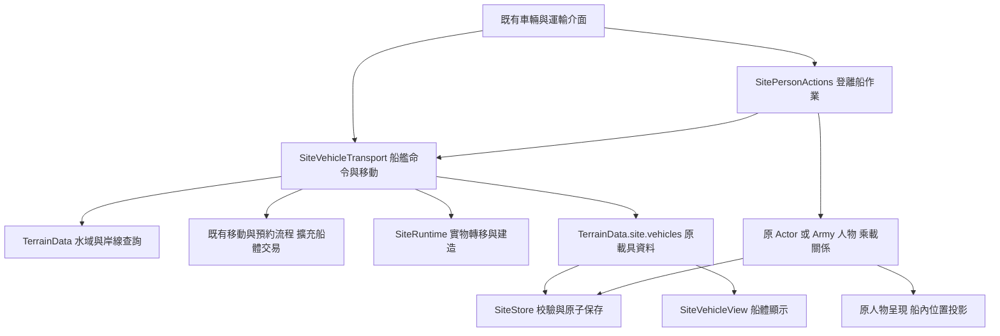

# Worldgoing 船艦架構規劃

日期：2026-10-03–05。規則修訂：4，保留遺體不占位、走到駕駛席接手及玩家退隊原合同。本輪原GD船舶首版具名全案CLOSE：P0–P5接線、final10、六型各百人Full、獨立Roster、核可六型正式Art＋Life、280 live10／100量測、GPU9與來源閉包完成。100人實測約14 FPS航行／16 FPS停泊限制保留；原無FPS門檻，不宣稱全專案性能達標。第1–10節原字節保持，限定接受及全部歷史見第11節。

本計畫依目前 D:\worldgoing 原始碼與 PROJECT_ARCHITECTURE.md 規劃。建議先完成單一 Site 的小型運輸船，再擴充造船、海戰與跨 Site 航行。船沿用原載具、人物、實物、時鐘與保存責任；新增的是水域通行和乘載關係。

暫定第一版以運輸與登陸為主，使用槳船、固定船席與前往駕駛席的有限走動、一層甲板。槳船與單層是建議範圍，尚不是使用者已選定的年代、美術或戰鬥規則。依後續船型示意、占格及容量速度討論，第 2 節已列六種候選的平衡提案，並依百人隊需求調整人數與船員編制；數值可供原型與素材設計使用，仍待實測調整。

## 1 現況與可重用基礎

以下為本輪原始碼靜態核對，沒有以歷史測試代替本次驗證。

- 正式主場景仍是 TerrainLab 的單一 Site。RegionLab 是獨立地理檢視與人物移動測試，尚無正式跨 Site session。不能把舊版 GameSession／TravelRuntime 當成現在可接線的系統。來源：PROJECT_ARCHITECTURE.md 的正式入口段；scripts/region_lab/region_lab.gd:2。
- 原 TerrainData 已有 water_kind 與 water_body，但沒有水深、吃水或可航水域契約。水格目前不可步行，can_step_static 即使帶 profile 仍先檢查陸地通行。來源：scripts/terrain_lab/terrain_data.gd:29、101、115。
- 原 SiteVehicleTransport 持有 terrain.site.vehicles 的操作入口。cart／wagon 有唯一 ID、原隊伍、操作人、位置、方向、貨艙與掃掠預約；目前只支援長 1／3 格的陸車。來源：scripts/terrain_lab/site_vehicle_transport.gd:3、7、20、31。
- 原操作人查詢只接受 TerrainArmy 列，接車資格限後勤隊；獨立 Actor 玩家不是現成的可操作人。原控制者可下令不等於原控制者已能親自操船。來源：scripts/terrain_lab/site_vehicle_transport.gd:199、213。
- 原貨物裝卸最後交給 SiteRuntime.transfer_items，保留貨物量、唯一 item ID、holder 與版本檢查。但接觸條件目前要求人物能走到陸地庫存旁，船岸裝卸須擴充。來源：scripts/terrain_lab/site_vehicle_transport.gd:425、439。
- 車輛現在借用操作人的 Army 步進，並不走一般人物的 Reservation Grid 同批提交。Grid 也硬查陸地 can_step。船的多格原子移動是待施工合同，不能列為現成功能。來源：scripts/terrain_lab/terrain_army.gd:2423、4238；scripts/terrain_lab/site_movement_reservation_grid.gd:122。
- 原 SiteStore 對車輛欄位數、種類、人車步進及占格有嚴格校驗；第二位人物不能直接站進原車輛占格。來源：scripts/terrain_lab/site_store.gd:1963。
- 原 SiteVehicleView 是唯讀呈現者，可沿用入口，但其單張車圖與地面列排序不能直接證明大型船、帆與船員的遮擋正確。來源：scripts/terrain_lab/site_vehicle_view.gd:4、26。
- 現有建築計畫已把碼頭與橋梁留待獨立水岸合同，未把它們實作成一般住宅。來源：SITE_BUILDING_REQUIREMENTS_AND_IMPLEMENTATION_PLAN.md:75、366。

## 2 第一版可完成的玩法

先做一艘小型運輸船、一名原人物舵手、少量原人物乘員與原實物貨物。玩家可選船、指定操作人、靠岸登船、裝貨、航行到另一處合法岸邊、下船及卸貨。

第一艘船的占地先以寬 2 格、長 4 格規劃。依現行地理格網的 2 公尺水平尺度，約為 4×8 公尺；人物容量、貨量與速度的首輪提案見下表，實際模型比例與平衡仍待確認。不要以美術圖片大小反推碰撞範圍，也不要把目前 cargo 的容量單位直接稱為公斤。

首版界線：同一張 Site、四向邏輯朝向、固定船席、停穩後登離船；依使用者決定，允許船上人物實際走到空駕駛席接手。這項有限走動見第 6 節；自由甲板走動、船內樓層、船載馬車、跨船轉乘、船體破壞與沉沒仍留後續。船上人物保留原生命、昏迷、供養與疲勞；不是把乘客換成人數數字。

建議的船型演進是小型渡船、較大型運輸船、作戰船。同一份船型定義決定占地、座位、操作需求、容量、速度與視覺引用；後兩類在實際需要時才加入，第一版不建立完整艦種樹或自由拼船編輯器。

### 2.1 六種船型的容量與巡航速度

以下均為 2026-10-03 的遊戲設計值，已落為 `SiteVehicleShipDefinitions.VERSION=1`，不是史實船舶性能。占格採寬×長，首版以完整矩形保守占格；速度以平靜水域、標準可用船員、滿載直行計算，單位為動作秒。每格 2 公尺。滿載指人員席位或全船貨載任一達到上限。

使用者要求配合每隊 100 人。此版先按「100 人可平均分船」解讀，採用 100 的因數作為每船人數上限、最低及標準船員；並非每艘都採 100 人的倍數。此解讀尚待使用者回覆釐清；占格、物品容量與速度暫維持上一輪提案。

| 船型 | 占格 | 全船人數上限 | 最低／標準船員 | 百人隊所需船數 | 全船物品容量 | 滿載格／秒 | 滿載公尺／秒 |
| --- | --- | ---: | ---: | ---: | ---: | ---: | ---: |
| 小渡船 | 2×4 | 10 | 1／1 | 10 | 80 | 1.0 | 2.0 |
| 河道運輸船 | 3×7 | 20 | 2／5 | 5 | 600 | 1.2 | 2.4 |
| 沿海貨船 | 4×12 | 25 | 2／5 | 4 | 2,000 | 2.0 | 4.0 |
| 運兵船 | 4×10 | 50 | 2／5 | 2 | 500 | 1.6 | 3.2 |
| 巡邏戰船 | 3×12 | 25 | 5／10 | 4 | 200 | 2.5 | 5.0 |
| 大型樓船 | 6×16 | 100 | 10／20 | 1 | 1,200 | 1.0 | 2.0 |

小渡船便於短程載人；河道船用較小船體承擔貨運；沿海貨船容量最大且直行較快，但轉向慢；運兵船優先配置座位；巡邏船最快但貨量小且需要較多操作人員；樓船兼顧較多人員與補給，操縱最慢。這些用途是數值設計理由，不代表相關海戰、造船或跨區玩法已開放。

人數包含舵手與船員，不是額外附送船員。例如運兵船 50 人在標準 5 名船員下，可再載 45 人；百人隊分乘兩艘，由隊內 10 人操作、其餘 90 人乘船。大型樓船標準 20 名船員下，可再載 80 人。最低船員也包含唯一舵手，其餘由原人物擔任槳手／水手，不能新增虛構 NPC。「百人隊所需船數」表示整隊包含操作人一起運送，不表示另外載 100 名乘客再免費提供船員。

2 公尺地圖格是船體導航尺度，不是每格只能放一張座位；固定席位使用船內局部位置。上述人數仍須在模型上排出不重疊的座位、操作位置與登離船口；排不下時先調整布局，仍不足則提出相鄰的整分容量或船體尺寸修訂，不靠隱藏乘員達標。樓船人數是整船總上限，未實作多層甲板前不因示意圖有樓層就重複乘算。

全船人數與物品容量是兩個獨立限制，可以同時達上限；減少乘客不自動擴大貨艙，也不開放超載航行。百人分船只解決人數分配，裝備與行囊仍須符合每艘物品上限，超量時須另行安排貨運，不能憑人數足夠就放行。

**船與真人分開計數是本次必要規劃變更。** 現行 SiteVehicleTransport.plan_team 與 SiteStore._validate_vehicles 把車輛加進隊伍 100 名額，直接套到船會使「100 名人員＋1 艘船」被拒絕。因此水船仍放在原 vehicles、引用原 team_id，但不占隊伍真人名額；陸車先保留原名額規則。人物名冊及全 Site 人物上限沿原 owner 校驗，水船筆數、船體空間、貨量與保存大小則由原載具及保存守衛另驗，不能把船變成人物列或放寬所有計數限制。

百人隊分乘多船時，原隊員仍保留原 team_id、指揮責任與接任規則及共享疲勞，只以原人物乘載關係指向不同船；不為分船拆成新隊，也不把船員從原名冊扣掉。玩家主動正式退隊另依 4.3 的既有入退隊流程處理，不把一般分船視為退隊。指揮者仍會因在場範圍、KO 或死亡依法接替，不保證 current_commander 永遠不變。未登船的岸上隊員仍占原隊伍名額。正式登船、船員指派、測試部署、UI、清隊及保存都必須採同一套人船分開的計數，不能只在畫面把上限顯示成 100。

### 2.2 物品容量與守恆

容量使用原資源／實物的抽象計量，沒有新增公斤或噸制。全船負載 Q＝船艙、所有乘員行囊與實裝、船上遺物及各 holder 對應開封口糧的唯一加總，再加原 team_supply 中實際存放於本船的共用庫存與開封剩餘份。人物自身由人數上限限制，不再虛構每個人的公斤重量。

沿原 SiteRuntime.carried_load 查詢各 holder，再加回其 equipped 數量，讓同一件裝備穿上、脫下、轉進船艙或成為遺物都計 1 單位；資源沿原 inventory_size，開封口糧沿原剩餘量。此查詢已透過 opened_food 計入人物 person_supply 的開封剩餘份，不可再加一次；team_supply 則須另由原供養入口讀取本船位置庫存。總量只做唯讀加總，不改原個人 CARRY_CAPACITY，也不另存船艦物品帳本。每個 holder、item ID 及供養庫存只能計一次；已吃餐份是歷史權益，不再算可搬運物資。

例：一艘運兵船載 50 人，各有 5 件實裝、沒有其他隨身物，已用 250 單位；船艙、其他行囊與本船共糧合計還可放 250 單位，不能再裝 500。若船艙已裝 250，本船再分配任何共糧都超載。百人隊分乘兩艘時逐船驗證，不能用另一艘剩餘容量抵銷本船超載。人數滿而物品未滿時，仍按滿載速度航行。

登船、裝卸、向船上遞物、搜刮與其他可改變負載的命令都要檢查交易後的全船負載；僅檢查目的 holder 容量不足以保證整船不超載。船內互轉依交易前後淨額判定，不能把暫態來源／目的各算一次而誤報超載。死亡立即釋放人數 N 與船席，遺體不占位；原物品轉為船上遺物仍計 Q，直到依法食用、移出船外或經原物品規則消耗才減少。釋放人數不等於釋放物品容量。

#### 2.2.1 原隊伍共糧的位置與消費

首版採原 team_supply 的版本化位置庫存。原 entry.inventory 與 sustain.open_rations 現在没有物理位置；不能以人物 carried_load 代替，也不能把全隊拆成多份 person_supply 來避開，否則會拆掉原隊伍士氣與供養責任。

1. **唯一數量來源**：新版在原 team_supply 內以位置庫存取代可修改的聚合 inventory／open_rations。每筆只採合法岸格或原 vehicle_id，持有資源量及開封剩餘量；同隊同位置合成一筆。舊聚合量不與新版並存，總存糧由位置庫存派生。原船艙及人物 holder 仍各自擁有原物品；轉成共糧須走原供養交易，不能讓任意船艙食品自動變成可吃的隊伍糧。
2. **首次涉船轉換**：純陸地舊隊先保留原路徑。首次登船前停止未完交糧、對齊原供養時間，明確指定原隊可合法交糧的岸上裝貨點，將全部既有共糧一次落定於該岸格，再依船岸交易逐船裝載。這是舊抽象庫存的一次格式／位置轉換，UI 必須明示；不能聲稱舊資料已有岸上錨點，也不能選遠方任意格搬走原糧。候選預檢失敗時，原庫存、版本與餐份狀態均不變。
3. **同一供養狀態**：全隊仍只有一份 sustain、士氣、routed 與原供養時鐘。每個原時段只推進一次，不能逐船重跑整隊 advance。分餐前按人物有效位置將跨岸／跨船 cohort 的 ids 暫分組，完整保留 hunger、coverage、meal_until、bonus_paid／bonus_pending；每組只消費可達的位置庫存，最後由原流程結算一次整隊士氣、生命與時間。相同歷史可沿原規則壓縮，但每次分餐須重新分組，不保存第二份乘員名冊。
4. **可達性**：航行及停船時，仍由原隊供養的乘員只直接取用本船共糧；岸上存糧或另一船的餘糧不會自動供應。岸上人物依原接觸／可達查詢取得指定岸格庫存，不用直線距離穿牆取糧。岸船之間先完成停穩與接觸守衛，再由原交糧／卸糧交易移交。首版船船轉糧與跨船取糧不開放。已吃餐份跟隨原人物保留，上下船不退款、不重發；某船缺糧只影響該船成員的吃飯結果，仍由原全隊規則彙總士氣。已正式退隊的玩家改依 4.3 使用原個人供養與自己的行囊。
5. **交易與容量**：搬移、交糧、食用、開封及原超額掉落都沿原供養／Runtime 執行；版本、可達性、原隊共糧容量與各船 Q 全部預檢通過後才一次提交。船上移出共糧但轉入同船貨艙，按淨額不增加 Q；直接向滿船交糧應拒絕。原減員造成超額時，物資仍在原所在地沿原遺物入口處置，不能掉回歷史岸格；船內供糧掉落物不占船席，但仍計 Q。
6. **相容與失敗**：team_supply 與 Sustain 同步升級版本／驗證分支，新團隊狀態移除舊聚合 open_rations；舊陸隊與個人供養保留各自合法路徑。原 rations／交糧／剩餘量 UI／死亡減員／清隊／保存均經同一版本感知查詢。所有位置庫存與 cohort 預檢成功才推進，不能第一船已吃、第二船驗證失敗而留下半筆結果。未分配、重複位置、不存在的船或雙份聚合數量都拒絕，不能用忽略未知欄位的方法載入。

位置庫存不是額外的船貨副本；數量只在上述原供養 owner 一處。船型表的 Q 不因加入此合同而提高，補給與行囊仍須共用表列上限。

### 2.3 輕載 船員與操縱速度

首輪只採負載與可用船員兩項修正，之後再依實測調整。風向、水流、吃水與船體受損尚未接入，帆船表列值也只是標準推進的設計速度。

- N 為船上活人數，包含船員、乘客、KO 人物與正走向駕駛席者，每人只計一次；遺體不計 N、不占船席。Nmax 為表列人數上限。Q 是上節全船物品負載，Qmax 為表列容量。
- 負載率 L＝max(N／Nmax, Q／Qmax)。任一超過 1 即拒絕造成超載的命令；不能截斷成 1 來放行。
- 正常船員下的直行速度＝表列滿載速度×(1.25－0.25×L)。任一容量滿載就是表列速度；輕載最多快 25%，不另開衝刺加速。原船員本身也占席位，所以實際空貨船通常達不到理論上限。
- 可用船員是人在本船指定操作位置、符合原可行動條件且沒有兼做其他互斥作業的人。任何符合原可行動條件的本船乘員走到空駕駛席，都可成為唯一 operator_id；不要求預先指定候補、軍官身分或特定兵種。尚在走動者不算舵手。其他槳手／水手依船型原操作位置判定，每個人物只計一次。達標準人數時船員倍率為 1；有最低人數但未達標準時，倍率由最低的 0.5 線性增加至 1。小渡船最低等於標準，1 人即倍率 1。額外船員不繼續疊加速度。
- 低於最低人數或失去合格舵手，不再提交新步；原已承諾步先完成，再停船。半步內負載／船員變化不追溯修改當步時間，下一步重算。
- 每格用時＝1／當步格速。船速由船本身的 committed step 保存，不套用人物固定 0.38 秒的陸地一步。

最低人數與標準人數不同時，船員倍率明確為 0.5＋0.5×(可用人數－最低人數)／(標準人數－最低人數)，超過標準取 1；低於最低不計公式而停止新步。所有倍率讀原人物狀態，划行疲勞仍由原隊伍／個人規則計算，不新增船員疲勞池。

靠泊最後一格與離岸第一格上限為 0.5 格／秒；倒船取當時直行速度的 25%。90 度轉向的標準船員用時建議依序為：小渡船 1.5 秒、河道運輸船 3 秒、沿海貨船 5 秒、運兵船 4 秒、巡邏戰船 2 秒、大型樓船 8 秒。船員不足但仍達最低時，轉向時間除以上述船員倍率；負載不另加轉向倍率。每次轉向仍須取得完整掃掠預約，有時間數值不代表可以在窄河原地旋轉。

先驗小渡船，再驗河道運輸船與運兵船。其他船型沿這份表規劃資產與測試，對應系統完成前不啟用。每次調整數值需保留船型定義版本，在存讀時識別相容性，不能無提示讓既有船突然超載。

## 3 唯一資料責任

- **船的實例**放在原 vehicles 集合，沿用 ID 與貨艙 holder；船型靜態定義可在原載具模組內擴充，待規則明顯變大才抽成純資料檔。
- **船的位姿與在途步進**由原載具記錄持有。船是移動單位；舵手只是操作資格與職務引用，不靠人物在水格上走路帶動船。
- **人物**仍只在原 Actor／Army 或已接管的原生人物 owner。原人保有身分、HP、裝備、任職、隊伍與供養；不上另一套船員人物資料庫。
- **物品與貨物**仍在原 item_records、holder、cargo。登船不改人物手上物品的 holder；裝卸才透過原交易移交實物。
- **水面規則**沿 TerrainData 查詢，地理或生成來源仍沿現有 TerrainGenerator／RegionTerrainAdapter。可重建索引不能成為第二張海洋地圖。
- **顯示**沿 SiteVehicleView 與原人物呈現入口。船身晃動、水花、帆與人物插值只呈現結果，不反過來決定通行、承載或命中。
- **保存**沿 SiteStore；不新增 ShipStore。新增欄位與格式版本必須同步加入保存前及候選載入後的校驗。

SiteController 只轉接介面與結果，不持有另一份船艦狀態。也不新增艦隊 AI 時鐘、船員疲勞池或獨立航海 inventory。

## 4 船艦與乘載資料

以下是語意提案，欄位命名須依施工時的現行快照規格定案。

**船型定義**最少需要：船型 ID、版本、四向 footprint、登船口與席位的船內座標、一處駕駛席及其他操作位置、通往駕駛席的船內通路、乘員上限、全船物品容量、最低／標準船員、移動與轉向耗時、視覺資產引用。駕駛席算在原 Nmax 內；模型布局須讓其他席位上的人能實際走到該席。第一艘小渡船只需要一名當值舵手；其餘船型依第 2 節需求加入原人物操作位置，帆裝與武器槽等到相應玩法才落實。

**船實例**沿用原 id、kind、team_id、operator_id、cell、facing、cargo、holder。水船的 move 必須有自己唯一的來源／目標位姿、動作時間進度和已承諾的掃掠格，不再從操作人的腳步推導。stop_pending 沿原語意完成已承諾步後停止。

**乘載關係**存於原人物，例如 embarked_vehicle_id 與 berth_id；兩者一起存在或一起不存在。船上乘員名冊由原人物關係查詢派生，不另存一份可獨立修改的 crew_ids。operator_id 是職務引用，不能兼任兩艘船的操作者。開始新步與接任時，必須指向本船上符合資格的原人物；已承諾步內失能的例外見下節。

人物位置採互斥語意：

1. 在地面時，原 cell 與原 committed step 是位置權威。
2. 在船上時，位置由船的位姿與 berth 的船內座標派生；前往駕駛席期間改由原人物作業的船內路徑與進度派生，完成後落在目的 berth。兩者互斥，呈現、互動與傷害共用同一有效位置。人物不再參加陸地尋路與地面占格；不能在岸上留下另一個可碰撞、可被攻擊的影子人。
3. 原 cell 若因相容需要暫留，只能是非權威歷史值。所有位置消費端都必須先辨識乘載關係；保存驗證也不能把歷史 cell 當成目前合法落腳點。

第一版建議以同隊人員登船為準入範圍，另保留 4.3 已在船上玩家正式退隊的特例；按第 2 節在原名額守衛中分開計算水船與真人，原百人隊可分乘多船而不拆隊。正式水船操作資格取決於本船位置與原可行動條件，不能把原陸車的後勤隊限制直接套到整支待運隊伍，或為操船改寫全隊兵種與用途。一般跨隊登船、混合俘虜、馬匹與船載車輛在需求確認後擴充。這項限制要在 UI 說明，不能因快照碰巧可存就偷偷放寬。

P1 技術原型操作人先採原後勤 Army 成員；P2 的完整百人隊運輸須沿原人物查詢擴充水船職務準入及 4.3 的玩家退隊特例。Army 列玩家退隊後仍在原容器，不複製或移交成另一個人物；若開放獨立 Actor 玩家登船及親自操船，必須一起擴充原人物查詢、權限、控制切換、位置與保存守衛，未完成前明確拒絕該入口。

### 4.1 有效位置與指揮在場

P0 的位置消費端清單至少包括：地面占格／預約、個人路徑與隊形部署、軍令及 AI、指揮在場／代理接任、供養的安全／停步判斷、救助與死亡、搜刮與裝卸接觸、選取／相機／控制切換、呈現及 SiteStore。每項列出原查詢入口、乘載分支、更新時機與驗收案例；只改人物繪圖或 combat_ground 不算完成。

原 TerrainArmy._refresh_command_presence 的 native presence／delta 入口直接讀 cells，只有人物 moving_to 非空時才補投影。它是普通 Army 的原生加速，與第 9 節另行封鎖的 Crowd owner 不同。首版只要該隊有乘載者，就讓指揮在場查詢回退原 GD 路徑，使用船位與席位派生的有效位置；未涉船隊伍保留原加速。乘載集合改變時清除原 presence 幾何快取，船移動期間於原指揮更新節點標記幾何失效；不另開指揮時鐘。最後一人離船後先重建幾何，再恢復原生入口。

兩船分離／靠攏、指揮者 KO／死亡時，沿原範圍、遲滯及軍官接任順序判定。供養的 stopped 也必須包含所屬船的移動／轉向，不能因人物 moving_to 為空就把航行算成停步休整。

### 4.2 軍令與船令的首版規則

沿原 TerrainArmy、SiteArmyAI 與 SiteVehicleTransport 加守衛。名冊／指揮成員查詢仍含尚未退隊的乘員；地面移動參與者查詢排除所有乘員。運輸限制由原乘載關係及登離船作業派生，不另存一份可漂移的「船隊模式」。

- **開始登船**：全隊須先依原合法入口進入 HOLD，既有地面 committed step 完成、MOVE 部署與預約收束後，才接受第一件登船作業；同時沿原 Army 取消舊 pending formation 與部署／路徑意圖，避免下船後又自動發 MOVE。不得用登船繞過正在執行的強制潰退。接受人工運輸操作時沿原人工接管規則關閉 AI，不能在失敗預檢時改掉原令或 AI。
- **有人在船或有登離船作業**：整隊 MOVE、RETURN、ATTACK／PURSUE 及啟用戰術 AI 返回 BUSY 並說明先完成運輸。守衛放在原命令入口並涵蓋陣型變更、內部重試與 corps reposition，不只擋 UI。這是首版明示限制；岸上隊員仍可依原允許的局部互動登船、裝卸與自衛，但不得替船上人物建立地面路徑。自動接敵查詢同樣遵守此參與者邊界。
- **HOLD／停止**：非潰退隊伍接受 HOLD 時，清除岸上後續移動與各船後續航行意圖；已承諾的人／船步進各自完成再停。單船停止只作用指定船。強制潰退優先，HOLD 不清除 routed；其停船與恢復規則見 5.4。
- **航行／靠泊**：命令只作用指定船，由原控制／指揮入口校驗請求人權限，再檢查本船舵手與船員資格。同隊身分本身不等於有下令權限，不以遠方另一船的空位、船員或庫存通過本船守衛。原 AI 不代發航令。
- **登船提交**：完成時重查原軍令、作業與預約版本；一次清除該人物的地面路徑、部署資格、未提交 claims，解除地面占格並建立乘載關係。已有 committed step 時拒絕提交，不能抹掉已承諾移動。
- **離船提交**：先取得合法岸格，再解除乘載並重建原地面占格；原隊正常運輸維持 HOLD，不恢復登船前的 MOVE 或 AI。若隊伍已 routed，仍屬該隊的落岸者保持原 RETREAT 與撤退進度，交回原地面撤退 owner；4.3 已退隊者交回原個人移動／供養規則，不重新套用舊隊軍令。最後一人離船及作業全部結束後，普通軍令入口才恢復。

部分人在船、部分人在岸的情況也使用同一規則；首版不加入多船自動編隊或全隊一鍵同步航行。

### 4.3 玩家在船上正式退隊

依使用者決定，這是目前受控玩家主動呼叫原退隊入口的特例，不擴充一般 NPC 自動退隊。沿原 leave_row／leave_player、membership_change 與個人供養處理；原人物仍是同一人，船上的位置、行囊、裝備、holder、N 與 Q 不因退隊改變。

- 保留原清醒、自由、作業及身分守衛；船的航行半步或船內走動尚未完成時回傳 BUSY，停穩後可退隊，不強迫先上岸。退隊一次完成原 membership、指揮接任、供養及共享疲勞解除；不得順便把歷史岸格恢復成有效位置或寫入地面部署。
- 原已吃餐份與飢餓進度經 membership_change 轉入原 person_supply；之後由原個人供養消耗自己的行囊食物。隊伍共糧留在原位置庫存，不自動分送或複製給玩家。補充行囊仍走原取得／轉移入口與實際接觸條件，不能從海上遠取岸糧；無糧時沿原個人缺糧規則處理。原個人供養中的開封剩餘份也計入所在船的 Q。
- 已在船上的玩家退隊後可繼續乘船，也可走到空駕駛席操作；若原本已在該席且可行動，保留唯一 operator_id。操作資格須辨識原人物的合法退隊狀態，不再硬性要求 is_member；船的 team_id 與原船令權限不隨之轉給玩家，受控當值舵手沿原操作人授權下令。玩家退隊不解除原船所屬隊伍的 routed 航行限制。
- 這個乘載結果跟隨原人物保存，之後切換控制者也不強迫該人下船、不恢復共糧或重發餐份。船與離船入口從原人物的乘載關係找船，不能再依賴退隊後可能為空的 player_army()。未入隊者不再接受原隊地面命令；清隊仍須保護留在原容器的該人物及船上關係。船上重新入隊沿同一原入口、容量及供養轉移守衛辦理，不新增第二套退隊名冊。

## 5 水域與船體移動合同

### 5.1 可航水域

TerrainData 新增水域專用唯讀查詢，例如 can_navigate_water 與 can_place_water_vehicle。沿現有有界方向搜尋重用搜尋與預算邏輯，讓一步合法性依船型與姿態判斷；不複製整套 A* 或另建導航地圖。

水域型態、可航程度與水深是不同資料。water_kind 代表淡鹹類別，water_body 是水體關係，不能用來直接推導吃水。首版可在生成規則／測試地圖中明訂「此水域允許本船通航」，標示為遊戲規則；真實地理尚無可航來源的水面回傳 UNKNOWN，不默認成深水。

未來加入吃水時再擴充有版本、有單位與來源的水深資料。未知水深不能填 0 充當實測；海拔也不能替代水深。河口跨淡鹹水以明確連通邊界判斷，不硬性要求整條路徑 water_body ID 相同。

船型 footprint 的每格、連通邊及轉向掃掠都須合法；不能只檢查船中心。第一版橋下通行在淨空合同未完成前拒絕，不因水格存在就穿過橋梁或碼頭。

### 5.2 預約與提交

船艦沿 SiteVehicleTransport 擴充多格移動交易，由原場景的動作時間推進。路徑候選只讀，不先移動或取得永久占格。

每一步按以下順序完成：

1. 依原船位與姿向計算下一位姿、完整 footprint、轉向掃掠及所需時間。
2. 同步檢查水域、地形阻擋、既有船車占格、其他已承諾預約，以及岸邊人物的有效位置。
3. 整組預約一次成功才寫入 move；任一格衝突整步拒絕。
4. 插值期間保留原位置、目標與完整掃掠；到期一次提交船位與方向，乘員位置查詢自然跟隨同一船位。
5. 下令停止、取消或舵手失能，不回滾已承諾步；安全完成後清除後續意圖並停船。

舵手在半步中 KO／死亡時，原 operator_id 可以暫時保留為該步的歷史操作引用，必須同時標記 stop_pending，且不得發出新步。位移進度由船自己持有，不再要求該人仍清醒或仍有地面步進；完成後解除失效操作職務。保存只允許這個可驗證的有限過渡，不把失能者當成有效新操作人。死亡人物的原 ID 依原死亡規則保留，不因這一例外再造代理人。

現有車輛路徑與 Grid 是兩條既存執行路徑。P0 必須先列出它們互查 blocker 的時序，再以最少修改確保船的掃掠在同一輪對人物／車輛可見。若需把船 proposal 接入原 Coordinator／Grid，就在原類別擴充多格及水域規則，不另建 ShipReservationGrid，也不把陸車全面遷移當成首版前提。最後採用哪個既有入口，由這項時序稽核與一個人船衝突測試定案。

原子單位是整艘船，不是把乘員各自移動一格。倒船、原地轉向是否允許都應由明確步驟集合定義；第一版可採四向直行、低速倒船與需要掃掠空間的轉向，不能用動畫旋轉跳過碰撞。

### 5.3 唯一時間與人員更新

航行、靠泊與轉向用既有動作秒；供養、疲勞及後續造船工時用原遊戲時間規則。全域暫停停止兩者；時間倍速對兩種時間的既有差異不另改寫。

乘員在船上仍由原人物 owner 更新生命、KO 與供養。疲勞沿原隊伍共享規則或未入隊人物自身值。第一版划行的疲勞成本須明訂接到原規則的工作量，不再增加船員專用疲勞數值。

### 5.4 船上士氣潰退

原供養仍可觸發全隊 routed，原 TerrainArmy 保留唯一 RETREAT 與撤退進度。水上分支是載人運輸的必要條件，不延到海戰才處理。

1. 潰退成立時，沿原 SitePersonActions 取消／使失效尚未提交的普通登離船作業，人留在交易前所在側；已完成的登離船不回滾。清除後續普通航行意圖，正在執行的人／船 committed step 先完成。船上人物保留席位、原供養與身分，岸上人物繼續原地面撤退。
2. 船停穩後只接受停止或「撤退靠岸」目的的航令。該航令由原強制撤退 owner 核準、原船移動入口執行，檢查有效船員資格，可選可達且符合原撤退安全判斷的合法靠泊點；不能藉此發出攻擊、追擊或普通運輸。首版由使用者指定候選靠泊點，強制撤退不因指揮者不在場而要求普通軍令授權，也不新增自動艦隊 AI。若沒有合法路線、合格船員或可用靠泊點，保留原人船與 routed，顯示等待原因，之後由原命令／更新入口重查。
3. 船上乘員不執行逐人陸地退路；水上沒有落腳格不得直接寫 surrender_pending、site_exited 或刪除原人物。這個等待狀態不是已完成撤退，也不能只因停船就宣告全隊安全整隊。
4. 合法靠泊後，明示以撤退目的重新建立原離船作業，重驗後逐人取得岸格；堵塞者留船等待。仍屬原隊的落岸者保持 RETREAT 及原撤退進度，接續原地面撤退；4.3 已退隊玩家交回原個人位置、控制及供養規則，不重新加入舊隊 RETREAT。只有原供養／撤退 owner 的正常恢復條件可以解除各自的 routed，不呼叫普通 HOLD 代替。首版 KO 人物留原席，沿原救助資格與有效位置縮短昏迷並等待自然甦醒，恢復可行動後才可離船；尚未實作的活人搬運入口明確拒絕，不冒稱原救助已能搬人。
5. 保存保留原 routed、撤退進度、船的航行目的與已承諾步；載入重驗靠泊目標、船員及位置，失效目標停止後續步並保留等待原因，不把海上等待改成投降或瞬移回岸。船位與半步本身非法仍依第 9 節拒絕整份候選。

## 6 靠泊 登離船與裝卸

靠泊先成立一組關係：船體在合法水域、停穩的朝向、指定登船口、相鄰可站立岸格，以及岸船高度差在允許範圍。不能只用「離岸一格」認定可登船。

**登船流程**：通過 4.2 的原軍令／AI／預約準入 → 選定船與原人物 → 人物走到岸上接觸點 → 原 SitePersonActions 計時 → 完成時重查身分、資格、距離、船位與原軍令版本、席位、補給位置及容量 → 一次退出地面占格並建立原人物乘載關係。作業進行時船暫不可起航。登船不建立新人物，也不複製裝備或貨物。

**離船流程**：停穩並找到合法岸格 → 由原移動預約取得落腳格 → 完成時解除乘載關係並交回地面位置權威。兩人不能取得同一落腳格；無空間保持原人在船上，不能推到水中或瞬移到遠岸。

**裝卸流程**：沿 SiteVehicleTransport.transfer 與 SiteRuntime.transfer_items，將原陸地接觸守衛擴充成已驗證的船岸接觸；保留原版本、容量及權限檢查，並檢查交易後全船人員／物品合計符合第 2 節。船在動、岸格遭占用或來源版本改變均不得搬貨。

停船、登船、下船、裝卸的查詢與正式提交共用同一守衛。UI 預覽可以顯示失敗原因，但不能為了顯示可操作就先取得席位或移轉實物。

舵手死亡或昏迷後，船完成已承諾步再停。死亡立即空出駕駛席，任何本船可行動乘員都能依下列流程走過去接手；不設備用駕駛席或預定接班人。KO 仍是活人並占原席，沿既有救助／自然甦醒處理，不能把 KO 當死亡直接清位。遺物沿原死亡與 holder 流程留在船上，不能生成在失效岸格或不可達海底。

**走到駕駛席與接替交易**：

- 船停穩、move 為空、歷史 operator 引用已收束且 operator_id=0，駕駛席沒有活人或其他作業預約時，本船可行動乘員可前往。原下令／個人操作權限仍須成立；到席者的兵種、官職及是否預先列為船員不影響操作資格，4.3 合法退隊玩家同樣適用。
- 沿原 SitePersonActions／人物移動作業增加「前往駕駛席」這一種有限船內移動，由船型通路與原動作時間推進，船內有效位置跟隨行走進度；抵達前不改派 operator_id。首版每船一次只接受一人前往，預約原席、通路及目的席，期間船不能起航，其他登離船或裝卸作業不能與這筆作業衝突。人仍只計一次 N，行囊與裝備 holder 不變。
- 已開始的行走採原已承諾移動原則：停止／取消或 KO 後完成已承諾的通路到合法目的席，再停止；只有抵達且仍可行動、接手意圖未取消才可承職。死亡則由原死亡入口在當下船內有效位置結算、釋放該人的席位與作業預約，不讓替補瞬移、穿越活人或繼續以死者操船。首版作業中保存回傳 BUSY；P0 須把通路、耗時、預約與完成順序落到原入口。
- 抵達時重查船位、原人物與已預約的目的席，落定目的 berth 並釋放原席及作業預約；若職務版本、可行動資格與接手意圖仍有效，同筆指派唯一 operator_id。途中 KO、取消或職務失效也保留合法到達 berth，但 operator_id=0、船保持停止。人物 ID、N、Q 及物品 holder 不變。routed 時由 5.4 原撤退 owner 核準同一流程。
- 接手不自動恢復已取消的航路；新航令仍驗最低船員及當步速度。駕駛席被 KO 人物占用、通路不通或沒有人可行動時維持停船，顯示等待原因；等原人甦醒、恢復資格後可在席接手。岸上或別船的人必須先合法登船，不能隔空接任。

沿原 ground_loot 增加互斥位置分支：既有陸地 cell，或原 vehicle_id 加船內局部位置。不新增船上掉落物資料庫。船上遺物隨船位派生世界位置，不計 N、不占 berth、不發布人物占格或通路預約；可與駕駛席或乘員位置重疊。呈現若保留遺體也遵守相同不占位規則。SiteStore、物資呈現、搜刮接觸及回收均辨識此位置分支，不能把它正規化成當時的水格 cell。

### 6.1 死亡釋位與遺物守恆

沿原死亡、Runtime.leave_ground_loot 與搜刮回收入口處理；不新增空遺體容器或強制卸遺體作業。

- 死亡即從活人 N、席位及可用船員排除；原死亡入口將裝備、行囊及開封口糧一次移交本船原遺物容器，成功後解除原人物乘載關係。若轉存失敗，保留原物資及其船位置關聯，仍納入本船 Q，並由原待結算死亡守衛阻止保存／清隊；不得因釋位而漏算或刪除物資。原死亡標記與 loot_settled 防止重複結算。
- 零物資沿原 EMPTY 結果完成死亡結算，remains_id 可為空；不為占位而建立空容器。非空遺物依原 holder 與 item ID 保存，從人物轉到同船遺物時 Q 不變。
- 搜刮依整筆交易淨額計算：轉入同船乘員行囊或船艙時 Q 不變，合法移出船外才減少。取空容器沿原 clear_empty_ground_loot 回收，同步清除仍存在的原死亡人物 remains_id；這時不再減 N 或釋放第二次船席。岸船搬物仍須停穩、接觸及原交易守衛。

死亡釋位可在船的半步內完成，但船的 move、進度與 sweep 不變。半步死亡舵手的歷史引用只驗原死亡人物 ID、原船合法已承諾步及 stop_pending，不依賴必然存在的 remains_id 或遺體占席；步完解除操作職務，之後才接受替補走向駕駛席。船上遺物查詢索引從原 ground_loot 的 vehicle_id／船內位置派生；ground_loot_at 與地面 dirty_rows 只處理陸地分支。

新格式中，尚存在的死亡人物若有非空 remains_id，須引用存在且 original_owner 相符的原容器。合法取空回收同步清引用，舊檔已回收容器的歷史引用只在候選遷移中清空。遺物可在原人物清除後保留 original_owner 歷史 ID，不要求為物主重建人物；不另存第二份遺體位置。

### 6.2 清隊與船隻解除歸屬

原清隊守衛仍須保留。隊伍及其原人物容器尚有乘載活人／KO／已退隊玩家、未結算死亡、未完船步、登離船／前往駕駛席作業或未處置的船上共用補給時，清隊返回 BUSY。先完成離船、KO 救助／待醒、原作業收尾及補給移交；全部預檢通過後，才能沿原清隊與 park_team 解除無活人船隻的 team_id／operator_id。已結算遺體不阻擋清隊；船艙及船上遺物仍保留原容器、位置、物資與歷史物主 ID，不再次按死者歷史岸格掉落。不得透過清隊或測試窗重置刪除人貨，也不得留下活動乘載或操作關係指向已刪人物／隊伍。

## 7 造船 維修與船體美術

第一個技術切片可沿既有明示測試窗建立測試船。正式取得船則在後續沿原 SiteRuntime 建造與生產完成，測試生成不算造船玩法完成。

碼頭／船塢是原 feature 的水岸用途：岸上工作面、水上泊位、進出水道分開驗證。造船沿原工人、原料實物及遊戲工時；完工前先驗水上 footprint，有空間才把原建造結果轉成唯一船實例。泊位被堵時保留進度與原料狀態，不能吞材料或重複產船。取消、拆除與維修要明訂原料處置，未定規則不能自動刪船貨。

美術採船體、甲板、槳／帆、旗幟與後續武器掛點的模組概念，但第一版用固定船型定義，不做自由拼裝建造器。船首方向、尺度、船內座位與接岸點由同一份船型資料提供，避免模型、占格和人物位置三份數字不一致。

先產出四方向外觀與人物比例預覽，使用者看過預覽後才正式接入資產。船體、乘員及遮擋甲板的前後層沿既有呈現入口擴充；大型帆、岸牆與多船交錯要另做 GPU 畫面驗收，不能只以俯視占格正確代替。

## 8 海戰與跨 Site 的後續邊界

海戰先區分船體與乘員目標。乘員傷害寫回原人物，船體耐久寫回原載具；投射物與命中位置讀同一套船上世界位置查詢，不另建 NavalCombat 資料權威。甲板武器、射界、船體遮擋、友軍、彈藥 holder、失能停船與投降都需逐項規劃。

甲板自由移動與接舷是另一階段：完整甲板可走面、登船邊界及船間接觸不能硬塞為 TerrainData 每 XY 唯一地面表面。若要加入，先擴充原人物位置／移動合同，確認與原近戰、射線、救助、死亡及保存一致，再開放操作。V1 固定席位及前往駕駛席的有限通路並不代表完整甲板導航已具備。

沉船必須先有乘員、KO 人物、遺物與貨物的去向規則及可保存狀態，再開船體可被摧毀。不能以刪除船節點清掉整船的人貨。第一版沒有船體戰鬥；不能因此讓既有角色的死亡處理丟失實物。

跨 Site 沿現行 RegionGrid 的固定地理位址規劃，先完成正式旅行入口及一次性交接責任。船、乘員、個人物品、船艙與未完移動只能在一處被執行；來源 Site 卸載與目的 Site 載入不能各產生一艘船。

跨圖失敗時保留來源，目的候選通過人物／船貨／座標／預約檢查後才整批接管。兩張檔案各自原子寫入不等於跨 Site 交易，需要另定可恢復的交接保存合同。遠洋用粗粒度航段推進，進入現場才展開 Site；不長駐實體化整片海域。這是後續設計要求，不是現行功能。

## 9 保存 相容與模式準入

沿 SiteStore 升級原載具與人物快照格式，舊車輛明確沿舊規則正規化；新格式按種類驗證已知欄位，不以移除嚴格檢查來容納船。

保存與載入都需檢查：唯一船 ID、已知船型版本、合法水域與 footprint、唯一乘載關係、活人有效席位、操作資格或合法失能停船過渡、同隊或 4.3 合法退隊乘載及名額、各 holder 原容量及全船物品上限、item ID／holder 守恆、活人無重複占席、在途時間和完整預約一致。船上遺物必須引用同 Site 存在的船與合法船內局部位置，但不與活人爭席、不計 N。不得信任存檔提供的 sweep，須以船型及來源／目標位姿重算核對。

共糧位置庫存與新版 Sustain 同步校驗，拒絕舊聚合量與新位置數量雙存；退隊人物的供養 owner 唯一、餐份歷史與個人開封剩餘量相符。死亡與 remains 引用依 6.1 驗證，零物資不要求空容器；原地面路徑、deployment、pending formation、claims 不得引用已乘載者；routed、撤退靠岸意圖與半步目的須符合 5.4 的轉移規則。剛觸發 routed 的既有普通 committed step，僅在 stop_pending、無後續普通航行意圖且原半步／預約合法時允許保存；恢復後完成該步停船，再接受撤退靠岸，不能追溯改寫當步目的。指揮 presence 幾何快取、供養的位置分組及船上遺物查詢索引都從原資料重建，不保存第二份權威。

有效 operator_id 必須對應本船駕駛席上唯一可行動原人物，包含合法退隊後仍乘船的人；不以「目前正受控」作為持續有效或載入的必要條件。半步歷史舵手只適用 5.2 的有限過渡。保存後恢復原當值舵手，不另選候補；非法席位、兩個活人共席或重複操作引用均拒絕，遺物與人物同位置則合法。

載入先建立候選 TerrainData／原人物／船艦與重建索引，完整通過才替換現場。壞船型、重複乘員、失效 holder、非法半步或超載均保留原現場與原存檔。登離船、裝卸及前往駕駛席進行中，首版沿現有作業守衛拒絕保存；航行半步要能保存與恢復，不能不告知地退回岸上。

Crowd 模式要單獨準入。現在車輛操作人與若干裝卸入口依賴原 TerrainArmy，不能推定 native 人物已支援乘船。第一階段限定已支持的人物 owner；不支持時在命令前明確拒絕。後續若支援 Crowd，需在原 native owner 與其序列化格式實作同一乘載合同，不能偷偷生一份 GD 假人代替。

## 10 施工順序與驗收

1. **P0 合同與最小原型設計**：核對車輛／人物 blocker 發布時序；定船型 footprint、原子預約入口、人船名額分開計數、乘載關係、時間與格式版本。交付原入口及位置消費端清單、4.2 軍令守衛、4.3 玩家退隊與個人供養、2.2.1 共糧轉版／分餐方案、5.4 水上潰退、第 6 節前往駕駛席作業及死亡釋位／遺物方案，以及一艘船一舵手的交易／測試夾具規格。每項須有原責任檔案、提交順序、失敗不改狀態的條件；未定的預約入口與格式欄位須在 P0 結案前定案。
2. **P1 航行與原貨艙**：沿測試窗建立一艘測試船與一位原後勤操作人，先完成單人固定席的最小乘載關係，再完成水域直行、轉向、倒船、選取、停船、衝突拒絕及貨艙身分保存。同時接必要的有效位置、原 Army 指揮加速回退及原軍令準入守衛。測試夾具直接建立合法起始狀態，不在岸上留下代理操作者；未完成的載人事件不得開放正式操作。技術階段，尚非完整正式船艦玩法。
3. **P2 乘員與水岸運輸**：依序完成共糧位置格式／交易與原分餐回歸；登離船、玩家退隊與同隊混合狀態的軍令仲裁；水上潰退／靠岸／接回地面撤退；死亡釋位、遺物及清隊守衛；最後整合百人同隊分船、原隊船員準入、補給、走到駕駛席接替及航行半步存讀。小型案例先通過再擴大到百人，下面新增案例不得只靠原航行 PASS 代替。全部通過才稱單 Site 運輸船閉環完成。
4. **P3 正式造船與介面**：船塢選址、原料與工時、下水及取消守恆；正式「車輛與運輸」視窗接入；通過預覽確認的船體與船員素材正式發布。此階段完成正式取得與使用船的流程。
5. **P4 海戰**：先船上固定位置的目標／射界，再船體傷害、接舷、自由甲板與沉船去向。每個子項獨立驗收，不以航行通過冒稱海戰完成。
6. **P5 跨 Site 航行**：在正式旅行與持久化交接合同成立後接入，另驗粗細模擬切換、地理接縫、取消、失敗恢復及人貨守恆。

每階段只修改原責任檔案及必要測試，保留工作區其他改動，不一次建立整套未使用的 ShipManager／FleetManager／海洋 ECS。

主要接線責任：

- SiteVehicleTransport 與原 Coordinator／Grid：船步、船令、掃掠、靠泊及岸格預約。
- TerrainArmy／SiteArmyAI：原軍令、陣型重試、地面參與者、指揮在場、撤退交接，以及玩家原入退隊與疲勞責任。
- SiteSustain／SiteCaptivitySupply／SiteFoodDelivery／原 Controller 供養入口：共糧格式、位置、交易、完整餐份歷史與整隊單次結算。
- SitePersonActions／SiteRuntime／原 Controller 死亡入口：登離船、前往駕駛席作業、死亡釋位、遺物、搜刮回收及既有引用收尾。
- SiteStore／原呈現與選取入口：新舊格式、候選遷移、引用與索引重建、有效位置顯示；不得把上述狀態轉由 UI 保存。

必要驗收案例：

- 水格不因此允許步兵、馬車通行；未知可航水域拒絕；海陸／河口規則一致。
- 船中心通過而船尾撞岸、窄河不足寬、岸角轉向掃掠、邊界越界均整步拒絕。
- 兩船對向、同格爭用、同輪轉向，以及岸上人物／陸車接近掃掠邊緣沒有雙重占用。
- 已承諾半步遇到取消、暫停、舵手 KO／死亡，不回滾、不穿岸、不新增後續步進。
- 登船席位搶用、兩人下船爭格、船位變更、超載、移動中裝卸均保持人物與貨物守恆。
- 人數含原船員與 KO；全船負載含船艙、行囊、實裝、個人口糧、原共糧位置庫存與遺物。滿船後不能靠穿脫裝備、船內互轉或死亡騰出免費物品容量；死亡會釋放 N 與船席，原物資仍計 Q。合法船內互轉不誤判超載。
- 百人隊分乘 10 艘小渡船、5 艘河道船、4 艘沿海貨船、2 艘運兵船、4 艘巡邏船或 1 艘樓船時，原人物 ID／team_id 不變，指揮與接任仍由原規則決定，沒有遺漏、重複或額外船員。按每階段已實作的船型分項驗證；逐船物品超量照常拒絕。
- 水船不占真人名額，但仍受原載具及保存限制；100 真人加船不誤拒，101 真人不因上船而繞過本次百人隊入口上限。原陸車名額、其他既有隊伍入口及保存邊界另做相容回歸，不以本提案全面改寫所有隊伍上限。
- 載人與載貨任一達上限採滿載速度；輕載、最低／標準船員、失去舵手、倒船與靠泊的動作時間符合第 2 節。半步存讀恢復原時間，不因讀檔重新加速。
- 上船後無岸上碰撞影子，選取、相機、供養、KO、控制切換、隊伍命令、死亡、清隊及顯示均讀有效位置。
- 船型或乘員存檔遭竄改、非法預約、holder 錯置、版本不支援時，候選載入失敗而原現場保持不變。
- 原 cart／wagon、陸地隊伍、建築阻擋、原地面裝卸與無船舊檔回歸通過。
- 功能、headless 保存、正式畫面與效能分開記錄。先以 1 艘、再多艘與不同乘員量實測，不以現有陸戰人數成績預告船艦容量或 FPS。

修訂 2–4 必須獨立通過的案例：

- **補給與 Q**：兩艘運兵船各 50 人、各有 250 實裝＋250 船艙貨時，任一船再收共糧均拒絕；卸出相應貨量後才可交糧。同船共糧轉貨艙 Q 不變，開封與食用前後按原剩餘量守恆。
- **隔船及岸船供養**：同一餐份 cohort 分處兩船及岸上，只有一船有糧；原已吃餐份保留，到下一次分餐只有可達群體取糧。互換席位、缺糧補發、cohort 壓縮及存讀後仍無隔船消費、重吃或重算全隊士氣。
- **共糧轉版原子性**：舊庫存含未開封及小數開封量；成功後唯一新位置總量一致、餐份／士氣／時間不變。任一位置非法、交糧版本過期或第二船預檢失敗，全筆不改。純陸隊與個人供養舊路徑回歸。
- **原軍令入口**：半隊上船、半隊在岸，逐一驗 MOVE／RETURN／ATTACK／PURSUE、AI 開啟、陣型變更及內部重試均不寫乘員地面路徑；HOLD 與單船停止按各自範圍完成半步再停。最後一人離船後不恢復舊 pending formation、MOVE 或 AI。
- **作業中潰退**：普通登船／離船計時中觸發 routed，未提交者留原側，已提交者不回滾；全隊在水上及岸船混合皆無個人水上退步或錯誤退場。普通航行半步中觸發 routed 的 stop_pending 過渡可存讀，完成原步即停且不續行普通目的；撤退靠岸、岸格暫堵解除及半步存讀後，落岸者繼續原 RETREAT。KO 留席持續供養與倒數，救助及自然甦醒後再驗離船。
- **死亡與遺物生命週期**：空手或有裝備者死亡均立即釋放 N 與原船席；空手沿 EMPTY、有物資留原船遺物。轉存失敗仍完整計 Q、保留原物資及待結算守衛，重複結算不增加容器。半步舵手死亡可在沒有 remains 的情況存讀，仍完成原船步後停止。取空回收同步清引用，不再次釋放人數。
- **滿載接替**：10 人小渡船舵手死亡後 N=9，Q 保留死亡前物資量；半步未完時拒絕接替，停穩後任一可行動普通乘員實際走到空駕駛席才取得 operator_id。兩人搶席只有一筆成功；取消、途中 KO／死亡及職務版本失效均依第 6 節收束，走動中禁止起航與保存。接替不再減 N、不改 Q；合法新乘員可補回 N=10，但仍須通過 Q。舵手僅 KO 時仍占席，救助／甦醒後重驗。較大型船接替後另驗最低船員，不因找到舵手就免費補足槳手。
- **同船搜刮淨額**：滿物品容量船上遺物的 5 件裝備由本船乘員取走，Q 維持原值，不能再額外裝 5 單位；死亡已釋放的 N 與船席不再變動。相同裝備依法卸至岸上後 Q 才減 5，保存恢復後結果一致。
- **玩家退隊特例**：船停穩時玩家沿原入口退隊，原人／船席／holder／N／Q 不變；已吃餐份及疲勞保留，共糧不複製，之後只沿原個人供養吃自己的行囊食物。當值舵手仍可依法操船，普通乘員退隊後可走到空駕駛席接手；切換控制及存讀後乘載與供養仍合法，重新入隊不重吃。原船 routed 不因退隊解除，清隊不能刪除此人；半步或互斥作業中退隊失敗時全筆不改。
- **指揮幾何**：兩船分離／靠攏、船上隊長 KO／死亡及最後一人離船，原 GD 有效位置、接任與範圍結果正確；有乘載者不進讀歷史 cells 的原生快路徑，退出乘載後重建再啟用。航行不得算成 stopped。
- **清隊與壞檔**：乘員、KO、已退隊玩家、未結算死亡、未交接共糧或未完作業仍存在時清隊拒絕；處置完成可 park 無活人船隻，已結算遺物與貨艙實物照常保存。刪除有物資的遺物容器、錯置物主／活人席位、雙份共糧量、重複供養 owner 或留下乘員地面 claims，候選載入均失敗且原現場不變；遺物不占席的合法重疊不誤拒。

## 11 本輪交付狀態（2026-10-05；本輪原GD船舶首版具名全案CLOSE；百人效能限制保留）

本節為本輪正式結案紀錄。原第1–10節合同及bytes保持；結案範圍是原GD船舶首版的具名功能、美術、GPU與效能量測。100人約14／16 FPS限制保留，原測試沒有FPS通過門檻。正式文件發布收據見 output/site_ship_close_20261004/final_closure_20261005_2318/DOC_PUBLICATION.json；最終具名帳目、來源核對與交接見同目錄 CLOSURE_RECEIPT.json。

### 正式來源／美術與editor/import

完整SOURCE／ART／BUILD／ENGINE release為final_close_20261005_1450/SOURCE_BUILD_ENGINE_HANDOFF.json，Root接收見source_return_20261005_153050_094/root_ship_lease.json。Source9是本輪shared epoch；pair build_id 28f7acaef5dc38cd6850105470d83d7fa72d732a58cc532ae60919e4295a13b6；crowd DLL F19691B9…73295A0、army_idle 5C338291…55028，Native20與release匹配。原歷史Source7／8／phase1不重標當次Source9重跑。

使用者「核可，接入這版」及art_publication_20261005_154116_232/PUBLICATION.json支持v3五型＋v4tower六張原PNG正式發布，bytes不編修。View24931045…767E8F、manifestB2405C4E…48AB7E、shader9F67B538…11869EF原發布pin保持；不是光靠出版即證明遮擋／GPU／效能。

第一editor 20261005_154132_098 canonical PASS62.107s仍保留certificate noise、另project.godot忽略與Scan thread aborted；該輪退出時六船PNG import尚不存在，不能聲稱完整匯入。第二unchanged canonical helper 20261005_154739_445明確--headless --editor --import，PASS44.253s，六PNG import完成；仍不代替功能／GPU。

Art leaf先前Ferry 20261005_171318_455 FAIL105.252s（Real boarding route fits deadline）保留。APPLIED收據art_near_pier_staging_candidate_20261005_1645/actual_apply_20261005_171708_967/APPLIED.json只變Art專用近港初始staging，32965776…166A0→3F1E0584…253080；原walk/reserve/commit、真timed board/helm、100人、62 Must、13 captures、95s內部/120s外部不變。該次Art staging未改當時Perf夾具，Full／Roster／live性能各保留原真路程範圍。

### 當次 final10 全部具名PASS

來源final10_20261005_161519_575742/INDEX.json；10份result/source hash pins匹配，exit0、非timeout、source0：

- site_ship_clock_test：20261005_155055_611 PASS，16.024s，source0。
- site_ship_combat_test：20261005_155124_504 PASS，15.298s，source0。
- site_ship_transitions_test：20261005_155153_170 PASS，26.684s，source0。
- site_ship_repair_test：20261005_155232_589 PASS，25.858s，source0。
- site_ship_json_test：20261005_155311_028 PASS，21.431s，source0。
- site_ship_travel_test：20261005_155345_017 PASS，29.449s，source0。
- site_ship_journey_edge_test：20261005_155429_304 PASS，57.582s，source0。
- site_ship_journey_test：20261005_155540_134 PASS，35.228s，source0。
- site_vehicle_rider_batch_test：20261005_161257_713 PASS，24.651s，source0。
- site_shared_step_replay_test：20261005_161352_428 PASS，34.989s，source0。

Rider三個原FAIL 155628_985／160645_930／160940_814原result/log/source保留。平地restore-only及新增同步20s硬assert候選已撤回，不能當正式合同。正式leaf回到首FAIL原A6 fixture與49assert，只新增_process完成flag guard，currentC291945C…2A5E05；未完成仍parent，原20秒數值不變，完成後不再對cleanup誤報。不是cold combat_enable≤20秒／FPS接受。FullB3D9F35B…819469只增加觀察列印，原接受不改。

### 六型獨立Full與Roster

- ferry：20261005_162738_717 PASS，353.262s，10艘，100 board／100 off，source0。
- river：20261005_163623_425 PASS，274.714s，5艘，100 board／100 off，source0。
- coastal：20261005_164559_102 PASS，275.876s，4艘，100 board／100 off，source0。
- troop：20261005_165306_978 PASS，234.935s，2艘，100 board／100 off，source0。
- patrol：20261005_165802_214 PASS，289.218s，4艘，100 board／100 off，source0。
- tower：20261005_170349_359 PASS，159.54s，1艘，100 board／100 off，source0。

彙整full100_final6_20261005_1709/INDEX.json：600次board／600次off是六次各原100人，不是600個不同真人或600同場。48個expected outputs actual SHA/bytes／mtime在各執行窗，source0、retentionerror=null，immutable82 manifest 852F10F7…F4B59原snapshot引用，不重建大baseline。Full僅船真航3格、合法靠岸、真半步Controller／Store保存、最終Store讀回及人物步行回parking；沒有船航回原anchor。

獨立Roster 20261005_170759_893 canonical PASS251.235s、source0；原100人兩船split/rejoin、返anchor、KO副隊長、GD/native切管及101 UI guard各原範圍，100board／100off。不把Roster另稱第七型船，也不混入600次的不同人數推論。

### 六型美術與生命週期GPU，以及效能測試的修正歷史

- ferry：20261005_171739_527 canonical PASS，59.782s，source0；13 原始 PNG 已封存，Root 逐張看圖收據存在。
- river：20261005_171943_214 canonical PASS，56.645s，source0；13 原始 PNG 已封存，Root 逐張看圖收據存在。
- coastal：20261005_172242_633 canonical PASS，57.533s，source0；13 原始 PNG 已封存，Root 逐張看圖收據存在。
- troop：20261005_172705_659 canonical PASS，60.025s，source0；13 原始 PNG 已封存，Root 逐張看圖收據存在。
- patrol：20261005_173159_589 canonical PASS，56.782s，source0；13 原始 PNG 已封存，Root 逐張看圖收據存在。
- tower：20261005_173413_458 canonical PASS，63.294s，source0；13 原始 PNG 已封存，Root 逐張看圖收據存在。
- life：20261005_173626_529 canonical PASS，53.115s，source0；10 原始 PNG＋contact sheet 已封存，Root 逐張看圖收據存在。
六型 78 張與 lifecycle 10 張原始 PNG 共 88 張，另有 contact sheet，均有 Root 逐張看圖收據；靜止 HUD 不作 live 效能結果。

live效能原來源與失敗完整保留：舊B78 Perf10 `20261005_173844_579` PASS70.995s／一張原PNG已看，屬歷史；它已明確排除目前GPU9，不能替代新來源10人結果。Perf100三支真FAIL各自封存：

- `20261005_174109_341` B78，70.42s，NO_AUTHORITY；當時搬糧要求非合法原命令權。
- `20261005_175120_275` EB2，187.473s；合法commander全量搬糧成功，後續真步行／登船準備deadline失敗。
- `20261005_182421_580` 971，187.372s；canonical FAIL／exit1／未timeout，原訊息「Timed boarding/helm original shared clock deadline」。不是效能採樣PASS。

971準備版本已實套及驗證的範圍另行保留：`perf100_parallel_jobs_candidate_20261005_1812/actual_apply_20261005_182357_504/APPLIED.json`只改_prepare_fleet，另21方法raw相同；十船每船exclusive原job、十波100個真board各2ACTION、十個原helm，原57接受predicate／200grain／岸夾具／真走路／共享時計與疲勞／warm60／至少120frames和3s不變。971 Perf10 `20261005_183659_122` actual canonical PASS75.476s／exit0／未timeout／source0／retention null，archive與Root逐圖review已存在；這是當時current source971的獨立成功，現在是280前來源歷史，不可填進280同來源GPU9。971 Perf100第三支FAIL仍保留。D18及withdrawn候選未冒充正式或PASS。

**時間決策已核准且已實套。** 人類直接答覆「好」，Root於`2026-10-05T22:43:01.186127+08:00`沿原測試三個精確錨點套入setup600秒／原live180秒／canonical outer840秒；原接受predicate全部保留，沒有FPS門檻。正式來源從971變為`280967B40F1B513186675ABF6A286D54A77986EA2613849E305AB622C4986C43`。原核准／APPLIED收據：`perf_setup_budget_candidate_20261005_183208_736/actual_apply_20261005_224256_708697/APPLIED.json`。原草案經此答覆轉為已核准實套；三支原FAIL記錄保持。280 runtime已由下述兩支actual完成；獲准的setup時間本身不構成PASS，判定依真收據。

套用前22:41 bookend保留為原來源核對；同来源280的兩支actual已完成、立即封存並Root逐張看圖。971→280套用前後全部61個_must呼叫的原predicate逐項保持；600setup／180live／840outer是人類明確核准的時間界線。warm60／至少120frames與3sec、共享ACTION/GAME／原Sprite／原供糧cohorts皆保留。前段57個predicate數字僅記錄較早parallel-job修正當時的比對範圍，未重標成此次budget套用的數量。

### 280同來源實測與明確百人限制

**100人／10艘原船實測只有約14 FPS航行、16 FPS停泊；這是本輪具名接受完成後仍存在的效能限制。** 原測试没有FPS通過門檻；不稱「效能達標」、高人數流暢或wholeproject性能完成。RealizedFPS是實測frame count／wall，不以HUD或median倒數替代。

- 10人 `20261005_224402_942` actual canonical PASS113.611s／exit0／未timeout／source0／retention null，一艘原船；10 ArmyRows＋2個原Actor＝12原來源。航行frame median14.394ms／p95 21.56ms／realized63.746713 FPS，192 frames／3.01192s／GAME182s；停泊median13.121ms／p95 19.653ms／realized66.613884 FPS，201 frames／3.017389s／GAME182s。兩階段各warm60；航行原船1實際有進展。Setup原ACTION30.18／GAME1810s。
- 100人 `20261005_224717_763` actual canonical PASS397.304s／exit0／未timeout／source0／retention null，10艘原船；100 ArmyRows＋2個原Actor＝102原來源。航行median48.778ms／p95 67.936ms／realized13.939903 FPS，120 frames／8.608381s／GAME252s；停泊median61.247ms／p95 67.689ms／realized16.387899 FPS，120 frames／7.322476s／GAME240s。兩階段各warm60；航行10／10原船均有原路徑進展。Setup原ACTION204.06／GAME12242s。
- 100航行process CPU median67.874ms／p95 **775.807ms**，Army CPU median8.906ms／p95 9.886ms；停泊process CPU median67.789ms／p95 72.94ms，Army CPU median8.649ms／p95 9.554ms。這是report測值，未據此猜CPU主因或創新性能gate。10航行process CPU44.388／49.749ms及Army1.765／2.178ms；停泊process24.945／26.049ms及Army1.674／1.828ms。
- 硬體／renderer：Intel Core i5-14400F、NVIDIA GeForce RTX5060、Forward+；原GD ArmyRow Sprite分支，batch=false。兩個原Actor是額外原來源，沒有把它們改成額外船乘客或聲稱Native／Crowd／batch A-B／export實測。

兩支原`performance_report.json`分別在`art_publish_readiness/gpu_archives/site_ship_fleet_performance_test/10/20261005_224402_942/observed_gpu_leaf/`及`.../100/20261005_224717_763/observed_gpu_leaf/`，完整report與相應canonical、source snapshot、archive_manifest、Rootreview皆保存；十人report SHA70BADE77…47B8E4C7、百人18B341E8…62BE75。

供養界線：280十人report八人coverage0／hunger0.872777777777752，兩人coverage1；百人63人coverage0／hunger3.90611111111153，37人coverage1。兩隊report均未routed且原存活predicate通過。這證明原位置供養與cohort歷史保持，**沒有證明全員吃飽**，不新增餵飽接受要求或把不同分組抹平。pre280的971十人75.476s PASS及B78十人PASS只留原epoch，不補current GPU9。

### GPU9與套後source閉包

`final_gpu9_actual_20261005_2258/INDEX.json`真正完成：六Art＋Life＋28010／100共9 canonical PASS，source0／exit0／未timeout／retention null；**90張ORIGINAL PNG＋1張contact sheet extra**，Root逐圖Viewed及原SHA對應。Art78＋Life10＋兩張新280Perf圖＝90；舊B78／971圖均排除當前計數。沒有以圖像HUD作FPS。

套後、所有GPU後且正式文檔前的fresh bookend為`shared_dependency_impact_20261004/perf280_budget_bookend_candidate_20261005_183757/20261005_230109_587266_root_after_all_gpu_tests_before_docs/RESULT.json`，23:01:09–23:01:13，all_requested_hash_checks_passed=true；Root成功Get-Process為Godot0。Root本輪224union包括epoch215，其中212same＋Art3F1／Perf280／LabCAEAF8三個exact合法變更，unexpected空；saved/current immutable82與GPU4、Native20/pair28f7、Source8共享5限定join、Plan§§1–10與canonical helperB743各原pin均核對通過。這是來源／收據閉包，不把Source8證據重標當次fresh shared5 runtime，也不重跑wholeNative或加新gate。

原APPLIED.json的「好」本來就是正確UTF8 U+597D，SHA `EBA78D1D734F60371F0AEAD72DE0FC647F7170AFDCED6BAE4E64EE2507352FA0`保持；先前乱码只出現在工具stdout。`actual_apply_20261005_224256_708697/ENCODING_DISPLAY_CLARIFICATION.json`撤回「原文件編碼需修復」說法。原收據、額外metadata-label副本及澄清都保留；final bookend使用原APPLIED.json，沒有以APPLIED.HUMAN_ANSWER_UTF8.json副本替代或修改原文。

### 共享與他案的限定承接

Source8 shared5：fatigue122344_946；named-save fault fixture123224_887；refuge123913_296；male/female headless foot124026_366／124147_831。依final_source_return_20261005_1530/SHARED5_SCOPED_JOIN.original.json及Siege final NAMED_EVIDENCE_INDEX限定承接；Source9只_saved_person numeric membership局部Siege變更，82其他Store methods／原GD row early-return保持。不是fresh Source9 shared5全組重跑、不是Actor/Crowd登船准入；原fault122408_483 FAIL4ScriptErrors／StoreV5 FAIL仍保留。

FireP0早期獨立基線缺口完整保留：work-clock162441_310缺原可選NPC為FAIL；cadence162304_721雖有marker仍因material-null errors canonical FAIL，不重標其狀態，也不引用未獨立確認的241數字。這些不是Ship82 baseline的PASS。

最新finite SOURCE6/Engine已於`2026-10-05T18:20:12.520004+08:00`明示歸還，Root於18:22:05正式核收。原收據`fire_source_engine_loan_20261005_180009_490/FIRE_RETURN.explicit.original.json`與`output/fire_p0_close_20261005/SOURCE_ENGINE_RETURN_RECEIPT.json` SHA同為`159B1A00FB58808E697259E3B65668A0C8BED297E967D505F16DE0DCBA0EB4B7`；`ROOT_RECEIVED.json`記六檔original/current exact、85pins ALL_MATCH、Engine query成功Count0、215比對只有Lab一檔變更，其他214相同／UnexpectedSourceChanges空。這是回交當時bookend，不替代最終Ship current215閉包。

Lab唯一production改動為既有controller-null guard單縮排：B707DA2A2ED4AB98C029B9A5C6730DF0B0F903B9ED7A9A374194D18602CF20E3→CAEAF8E426E3C4FB72328141090B1CEB08AA4E070DA8D1E0DAAF222FEF8AB801；原true-controller分支保留。其他五檔是有限原測試fixture更正，exact六檔before/after見`ROOT_RECEIVED_APPLIED_SOURCE6.json`，不能稱全部test不變。Source9/Native20pair未在此loan更換；此前final10／Full／Roster／GPU7仍各屬原來源，shared5僅Source8→9限定join，非當次全面fresh rerun。

finite return保存12次actual：7PASS／5FAIL，85證據pins由Root全核收。PASS：phase180413_141、cadence181007_608、rangedArmy181043_854、surface181624_763、rangedRules181700_305、rangedFlow181715_591、sharedReplay181733_801。FAIL：surface180502_803／180720_533／181307_449、work180838_641／181421_125。Work最後原controlled captain同真team pool共3人版本已改，但UNRUN保留；FireP0其他自身基線仍PENDING，未CONTRACT_READY／未close／P1Started=false。這些有限PASS不合併成Ship新全套或Fire完成。

Siege final CLOSED_WITH_REPORTED_PERFORMANCE_MISS及GD/Native300未滿原frame目標保留，不能以Ship具名核心／GPU結果覆蓋或擴成wholeproject FPS。

### 最終具名判定

**本輪原GD船舶首版具名全案CLOSE，100人約14／16 FPS實測限制如實保留。** P0–P5本輪原責任接線、final10、六型各100人Full、獨立Roster、核可正式六型Art、原Life、280 live10／100原量測與GPU9/source閉包均依具名原收據完成。Full合計600board／600off是六次各原100人的獨立測例，不能称600不同人；Full三格航路／半步Store／finalStore／人走回原parking保持原界線，並非每艘船全部返航驗收。此結案不擴成Crowd／IndependentNativeActor登船、任意遠洋真地理、5k／10k、全專案FPS、Native性能接受或export。

正式Plan第3行與本節、結案README已發布；DOC_PUBLICATION.json記錄實際前後hash、第1–10節與歷史原bytes核對。具名驗證共26支：核心10、六型Full6、獨立Roster1、GPU9，各依原來源epoch與scope接受。最終文檔後來源核對及Source／Art／Build／Engine實際交接收據另存本輪final_closure_20261005_2318目錄；交接是否已送達依其中 HANDOFF_DELIVERY.json，不用本文提前替代送達證據。原Siege→Ship歷史release、Fire有限歸還與所有FAIL／INVALID_RECORD均保持各自時刻及判定。

### 2026-10-04第11節歷史原文（以下時態不代表現在）

以下完整保留原第11節bytes；其中尚待驗收等語句只屬歷史狀態。

## 11 本輪交付狀態（2026-10-04 第一段整合）

本節記錄正式整合與具名驗證，整理時間 2026-10-04T06:36:45+08:00；修訂4的合同保持原定要求。正式原码已沿原 Runtime／Transport／Army／Actions／Sustain／Controller／Store／Lab／RegionSaveSlot整合P0–P5本輪接線，没有第二份人物、艦隊、物資、航路或時計owner。**已實作不等於全案驗收完成；目前不能close全P0–P5。**

P0–P2保留原六型定義、水域及原子船步／岸格預約、原人物列乘載、有效位置、登離船／实走駕駛席、唯一供養、共享疲勞、死亡立即釋位／EMPTY無空容器、原遺物／物品守恆、清隊及候選嚴格存讀。P3已接原材料／工時／船塢造船下水及取消、原civil码頭／船塢與岸修paid receipt／致命傷原子材料結算。P4已接原武器／弓射／投射物／船体伤害、row甲板位置／guest及原實走甲板／接舷／沉船撤岸；船步先收束，能行动者走向最近合法岸格，KO／無路死亡且船貨留原殘骸。P5已接正式旅行caller、原ACTION與GAME、返航取消／KO等待／存读／一次性交接、原Actor absence與粗旅程現場query排除、原水域geometry與pending输入守卫。

具名PASS只按各輪source快照支持其範圍：定義／水域、導航／排他預約／並行登離船潰退、位置供養／共享時計、死亡／EMPTY／满Q搜刮／JSON壞檔、造船、自然岸修與致命材料原子性、自然設施Runtime守衛合同、戰鬥、實走甲板／接舷／沉船及撤岸途中KO、Actor presence、RAW Slot全閉包／家族引用唯一交接（`060740_530`）與正式旅行／完整JSON語義／原時計精確恢復（`061342_295`）。原phase1各具名日期、PASS／FAIL及source見 [全案收尾紀錄](output/site_ship_close_20261004/README.md) 與追加verification帳目；之前2026-10-03的21人／六型100原列乘載夾具／九張灰模GPU僅保留為其歷史具名範圍。

第一段整合最後editor/import `063520_047` PASS14.266秒／ChangedDuringRun=0，沿unchanged canonical helper保留before／after及source closure快照；僅支持最後parse/import，不擴成全部百人、美術或效能完成。

此前legacy-empty目的地無receipt所以不進冷補算，已沿原Slot.attach_settlement及120ACTION真源時計補正；`062137_601`雖已真PENDING，仍因cold `holder.item_ids`與同token恢复守卫FAIL。只對存在Actor計算manual容量後，新presence `062539_909`與固定水Geometry `062545_536`全支PASS；Geometry64.721秒／ChangedDuringRun=0，真7200 GAME目標19次續作與7202目標18次續作，原輸入／水域凍結／岸WORK／biology斷言全部保留。`063203_556`再診斷成功恢復control僅Dictionary keyorder不同，完整JSON／binary64時計與phase相同；測試成功恢復分支採完整JSON語義并strictGAME／phase相等，壞檔拒絕同引用／rawbytes及精確file restoration未改。Edge `063327_401`最後全支PASS38.236秒／ChangedDuringRun=0。固定source土壤維持UNKNOWN／0；固定真旅程測bridge／road／WorkTeam／biology／GAME／Store，已有海岸设施的取消／升級／fatalHP／receipt另在原自然生成合法地基的Runtime合同測試，沒有為測試新增production soil或熱改來源。

**尚未完成的擴大驗收：** 六型100真人逐一真timed登離船、百人指揮及101UI、最後共享原碼Building／Siege交接回歸、新船体使用者核可及正式資產發布、六型／21人生命週期正式遮擋及連續轉向GPU、live10／100人船隊median／p95／FPS。24張v4比例GPU `060354_587`已PASS且根代理人工逐張核對，只支持比例預覽；尚無使用者新版核可，不當成正式百人畫面或可玩性能。Crowd/native人物與獨立Actor乘船仍未準入，原命令在前拒絕。

全部FAIL、INVALID_RECORD、原原因、來源快照／DLL／素材hash與後續修正PASS保留，不覆写歴史。每隊100人數值沿第2.1本輪技術定義，人船分計；舊合法夾具、21人流程及陸戰效能不能替代本輪完整100人船艦驗收。
