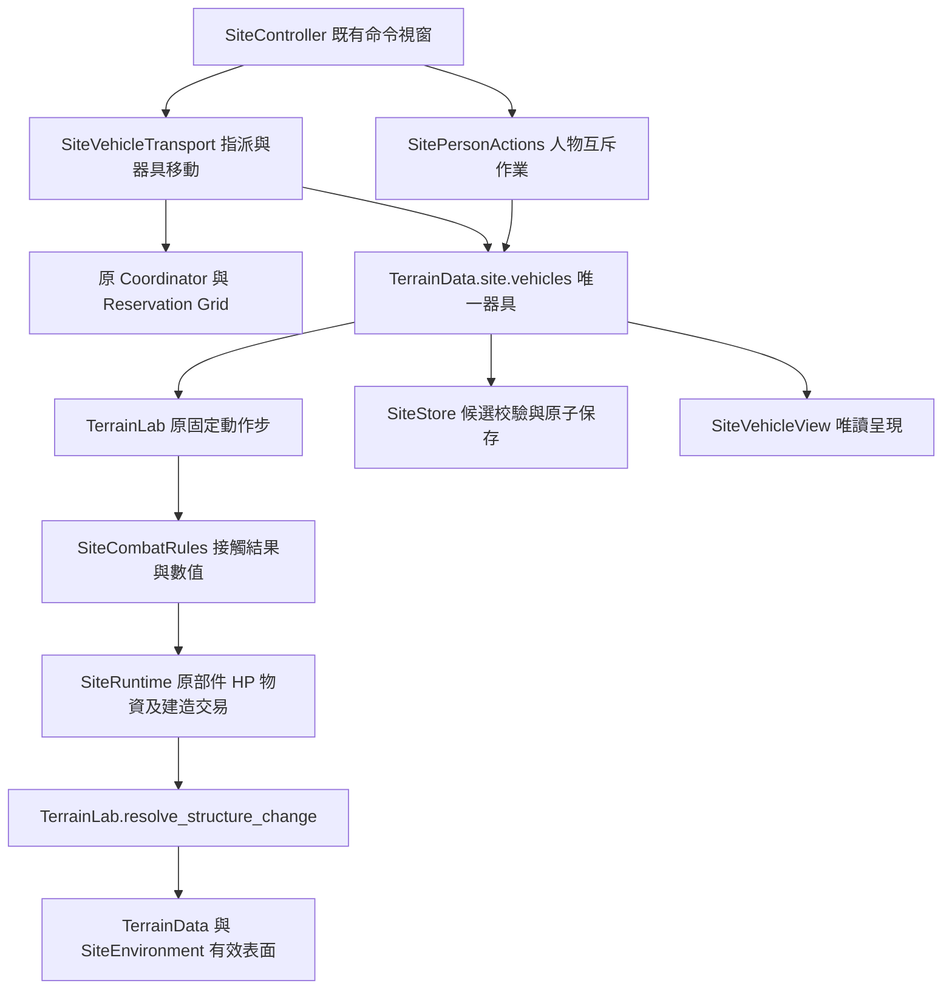

# Worldgoing 攻城器具機制與規格計畫

日期：2026-10-03；最新具名驗收：2026-10-05，Source9。六類攻城器具已沿既有 owner 完成玩法接線：固定重弩、衝車、牽引投石機、配重投石機、攻城梯與攻城塔。建造、原人 crew、實物彈藥、多人移動／轉向、攻擊、受損／修理、殘骸、登城、原生模式與保存仍由原權威持有。**實作與具名驗證收束：CLOSED_WITH_REPORTED_PERFORMANCE_MISS；300 人正式场景仍未達原幀時間目標。** 原四個 60 秒案例、兩筆獨立 90 秒補充、來源、歷史失敗及畫面限定接受分列於 §11、§13 和 [完整實作紀錄](output/site_siege_close_20261004/README.md)，不宣告全部 runtime／效能 PASS。

器具範圍已定為衝車、重弩、牽引投石機、配重投石機、攻城梯、攻城塔六類，先不含火藥。衝車負責破門，重弩負責直射壓制，投石機負責破牆，攻城梯與攻城塔負責建立登城通路。施工順序建議先完成固定重弩的操作、實物彈藥及接觸結算，再完成衝車的多人原子推運；兩者構成首批可玩的攻城閉環。具體年代、文化外觀與未明確定案的數值仍為提案，不當成使用者已核准或歷史性能。

本次使用者定案如下，後文以此為準。

1. 器具採上述六類。
2. 器具另計，不占隊伍人員名額；操作人必須是原隊員，不額外生成操作兵。
3. 保留最低／標準操作人數：不足標準時效率降低，低於最低時停止新操作；已承諾動作仍依安全收束契約完成。
4. 普通手持武器拆木構較慢、拆石構極慢，主要破城效率由攻城器具提供。對木 0.25／對石 0.05 是首輪待測倍率，方向已定案，不再將是否採用此分工作為待確認問題。

既有 `SITE_COMBAT_DESIGN.md` 的 D62、D75、D76 繼續有效：攻城有效命中可誤傷友軍；重弩每發最多命中三名不同人物；投石只傷害可見石體實際接觸者，首次落地停止，不加隱形爆炸圈。

## 1 現況與設計邊界

本節保留施工前静態查核基線；實作後差異見 §11。文件中的歷史 PASS 不代表本輪重新驗證，舊文件寫「尚無牆 HP」的段落也不能覆蓋目前原始碼。

| 現行能力 | 實際依據與可重用範圍 | 攻城仍需補齊 |
| --- | --- | --- |
| 建築部件及破壞 | `site_runtime.gd:53–59、1096、1968`；木部件 100 HP、石部件 300 HP，門扇與門框分開 | 器具目標、命中、材質抗性與平衡 |
| 真人攻擊建築 | `site_person_actions.gd:401、434、927`；原人物實裝近戰、相鄰接觸、一秒一擊 | 多人操作班及自動重複攻城命令 |
| 破牆後續 | `terrain_lab.gd:1379`；有效表面更新、失效步處理、人物墜落、原軍令保留 | 大型器具失去支承與多部件同輪破壞 |
| 車輛及貨物 | `site_vehicle_transport.gd:7、31、290、358、439`；一人操作、1／3 格陸車、掃掠及實物轉移 | 矩形機體、多人站位與整組原子移動 |
| 人物遠射 | `site_combat_rules.gd:33–88`、`terrain_lab.gd:1975、2096`；弓弩、原人命中與友傷 | 長射程、器具發射、重弩穿透、投石弧線及結構目標 |
| 原生群眾分流 | `terrain_lab.gd:1243`；active 時由 `crowd_site.step` 接管人物 | 攻城的原生准入、命中与清回守衛 |
| 保存 | `site_store.gd:26、1999`；候選校驗、嚴格車輛欄位、脫戰保存 | 版本化器具、crew 關係、耐久與建造資料 |

共同邊界如下。

- 地圖水平每格 2×2 公尺，Site 現行 100×100 格；射程與占地使用同一格網。導航高度層沒有公尺換算，不把牆高 2 層寫成 4 公尺。
- 每 XY 只有一個有效行走表面。城門洞上方沒有可站平台，不增加塔內地面與塔頂同格雙層人物。
- 器具及其 crew 都是真正現場資產。人物身分、HP、裝備、供養、指揮與共享疲勞沿原 Actor／Army；操作班不是另一份兵員。
- 本版只處理同一 Site。跨 Site 運送、船載器具、火藥、火焰蔓延、挖掘地道與大範圍連鎖倒塌後置。
- 首批 P0／P1 的 GD 人物路徑保留其歷史範圍；其後 P6 已沿原 CrowdSite／CrowdPersonOwner 完成具名原生攻城與清回驗證，當前准入與保存仍守原人、實物、承諾步及共同時計合同。實際可接受的路由、來源與效能差距見 §13。

## 2 器具種類與首輪數值

六類器具與最低人數機制已定案；下表具體人數、占地、HP、速度、射程及時間為待原型調校的遊戲初值。占地為四向旋轉前的寬×長，僅表示機體；crew、進出與轉向另需空間。標準速度與攻擊週期使用動作秒，製造使用遊戲分鐘。器具停妥才可操作，不邊走邊射。

| 器具 | 用途及階段 | 機體占格 | 最少／標準操作人 | 器具 HP | 推運格／動作秒 | 有效距離 | 標準攻擊週期 |
| --- | --- | --- | ---: | ---: | ---: | --- | --- |
| 衝車 | 首批；破門、木構 | 2×3，約 4×6m | 2／4 | 300 | 0.50 | 前端相鄰部件 | 3 秒／撞 |
| 重弩 | 首批；直射人員、壓制操作班 | 2×3，約 4×6m | 1／2 | 140 | 首版固定就地建造 | 3–30 格，6–60m | 8 秒／發 |
| 牽引投石機 | 第二批；木石結構 | 3×4，約 6×8m | 4／8 | 200 | 首版固定就地建造 | 8–40 格，16–80m | 12 秒／發 |
| 配重投石機 | 後續重型；較厚城防 | 4×6，約 8×12m | 4／8 | 320 | 首版固定就地建造 | 15–60 格，30–120m | 20 秒／發 |
| 攻城梯 | 後續；狹窄登城通路 | 部署 1×2，約 2×4m | 搬設 2／2 | 每段 80，共兩段 | 首版只做就地部署 | 接原牆高 2 導航層 | 架設 12／收起 8 秒 |
| 攻城塔 | 最後；較寬登城通路 | 3×4，約 6×8m | 推運 4／8 | 450 | 0.25 | 必須合法接牆 | 鎖定展橋 15／收橋 10 秒 |

重弩與兩型投石機共用「原 vehicles 中的固定器具」生命週期，不另外生成一座具有另一份 HP 的同名 feature。首版沒有拖曳搬家或裝車功能；放錯位置可安全拆除，已耗建材不全額退回。機械尺寸是玩法包絡，投石臂、弩臂、操作區須在預覽中另外標示，不能由小機體格子推出四周都能站人。

人數不足時，可用人數 n 介於最低 m 與標準 s，工作倍率為 `0.5 + 0.5 × (n-m)/(s-m)`；達標準後封頂 1，m=s 時足額即 1。少於最低為 0，不能開新輪次。週期及推運速度分別除以／乘以該倍率，傷害不隨人數倍增。新輪次重算，已承諾移動的時間固定。

射界採四向機體姿向及正前方 ±45° 可瞄準扇區。超出扇區先轉向、重新瞄準；固定不代表可無視掃掠原地瞬轉。固定重弩轉向暫定 3 秒，牽引型 6 秒、配重型 10 秒；衝車／塔 90° 轉向為 4／8 秒。上述時間只計機體旋轉，不含 crew 逐格前往轉向工位及返回操作位；各型均採 §6.1 的分階段轉向與完整空間檢查。

### 2.1 材料與製造提案

沿原 wood、stone、iron、fiber、cloth、tools；數量是既有遊戲資源單位，不是公斤。工具是開始與施工期間必須持有的原工具，不憑空附送。

| 器具 | 每台建材提案 | 標準總工作量 |
| --- | --- | ---: |
| 衝車 | 木 40、鐵 8、纖維 8、布 8 | 120 人工遊戲分鐘 |
| 重弩 | 木 24、鐵 12、纖維 10 | 90 人工遊戲分鐘 |
| 牽引投石機 | 木 60、鐵 12、纖維 20 | 180 人工遊戲分鐘 |
| 配重投石機 | 木 100、鐵 24、纖維 30、石 80 | 360 人工遊戲分鐘 |
| 攻城梯 | 木 12、纖維 6 | 30 人工遊戲分鐘 |
| 攻城塔 | 木 120、鐵 24、纖維 24、布 20 | 480 人工遊戲分鐘 |

人工分鐘由真正到合法施工位的工作者累積；同一人不可同時建造、推運、裝填與送貨。首批最多 4 個建造工位；雙工人有效施工 1 遊戲分鐘只增加 2 人工分鐘，不因隊伍名冊有百人便百倍增加。暫定不要求新設「攻城工坊」；沿原建設與工作入口供料施工，科技／文化解鎖待制度需要時再加。

新增 `siege_bolt` 與 `siege_stone` 到原資源白名單及製作入口：一支重弩矢用木 2、鐵 1，製作 60 遊戲秒；一枚石彈用石 2，製作 30 遊戲秒。兩型投石機首版共用同一石彈，威力差由器具決定；這是簡化平衡，不宣稱相同史實彈重。不可用普通 bolt 或天然石礦直接射擊。

重弩彈艙上限 20、牽引投石機 12、配重型 8 枚；無攻擊彈藥的器具不附送彈艙。彈艙是原 cargo 的用途限制，UI 數量直接查原資源，不另存 ammo_count。裝卸仍需真人到合法外側接觸格，以原 holder/version/capacity 交易完成；完整器具沿原所屬隊授權，殘骸僅依 §6.3 的 P1 單向搜刮例外放行，不全域放寬搬貨權限。

## 3 操作班 指揮與時間

操作資格為同方、同一所屬隊、存活、清醒、自由且能行動的原人物；首版操作班採原 Army 成員，獨立 Actor 親自操炮留到同等查詢與保存完成後開放。玩家可沿既有指揮權下令，不等於無條件自動指派玩家身體。

crew assignment 的唯一可寫關係放在原器具記錄的 `crew_slots`，每個槽引用一個原 person_id，反查索引只可重建。射手、裝填手、推手是器具職務，不改人物原兵種、軍官資格或隊伍用途；第一版需擴現有只准後勤隊操作的檢查，不將戰鬥隊偷偷改成後勤隊。`operator_id` 若為相容保留，只能與指定主操作槽一致，不允許兩份可分別修改的指派。

每名人物全 Site 同時只可占一個器具槽位，並與採集、工作、看守、押送、配送、其他車輛操作及未來乘船互斥。人的位置仍是原 ground cell，不能被器具中心吸附。crew 需各自走到外側合法工位，原 Grid 一格一人；機體 solid footprint 不含这些人物格。美術可有屋頂覆蓋操作區，但遮擋／防護須有真正接觸幾何，不能把「在操作班」當成全身免傷。

**人員與攻城器具分開計數已定案。** 器具仍引用原 team_id／陣營與指揮授權，但不占隊伍人員名額，也不建立人物列。例如原 100 人隊可另配 1 台衝車，由其中 4 人操作，仍是同一隊 100 名原人物；其餘 96 人可執行其他合法任務，不是 104 人或 99 人。操作班繼續計入原人員上限、供養、共享疲勞與指揮，操作期間不能兼任原戰鬥／工作行為。

**crew 與原隊軍令採以下首版契約。** `crew_slots` 是唯一職務關係；原 Army／MovePlan／DeploymentPlan 保留完整原名冊，由此關係派生暫離一般隊形的成員集合，不另存一份 crew 軍令或舊槽位鏡像。指派先驗原人物可用、無承諾步及無互斥作業；人在途中便拒絕本次指派，原人、軍令與器具不變。成功指派時，原 Army 同一次提交撤掉該人的未承諾提案與目的槽位／租約，再由原人物與 Grid 逐格走到器具工位；其他成員的既有合法槽位與承諾步保留。

| 命令或事件 | 對 crew 與原隊的處理 |
| --- | --- |
| 一般 MOVE／ATTACK／PURSUE／RETURN／HOLD、換隊形 | 只規劃未占器具職務的可用成員；crew 保留原器具命令，不被拉回隊形，也不列入一般隊伍的待抵達／隊形未完成判斷。一般軍令不代替器具的攻擊或停止命令；無一般參與者時明確回報，不自動解除 crew |
| 器具停止 | 取消未離手攻擊及尚未承諾的操作，保留 crew 指派；已承諾動作安全收束，人物停在實際到達格，等候後續器具命令 |
| 顯式解除、RETREAT、潰退、失去指揮 | 優先停止新操作；已承諾動作收束後解除相關 crew。RETREAT／潰退由原撤退入口接回，失去指揮維持原無指揮規則，不自行恢復進攻 |
| crew 接敵、失能、被俘或死亡 | 即刻沿原人 owner 結算受擊與失能，停止該人新操作；保留承諾交易的歷史參與者到安全收束再清職務。接敵者解除後才可主動交鋒，餘員重算最低人數 |

暫離者不得主動進入原交鋒、普通遠射、救助或其他工作入口，但仍正常受擊；軍官資格及指揮距離仍查原人物與實際位置。解除由 `SiteVehicleTransport` 指派／解除入口通知原 Army，依**當前**軍令、隊形意圖與實際位置重新規劃合法槽位／路徑，不恢復指派前的過期槽位。無合法槽位者沿原 following／waiting 機制等候，保留原人並顯示原因；不傳送、不搶別人的租約，也不因重新入隊失敗恢復器具職務。原 `issue_combat_order`、隊形規劃／到達判斷、`exchange_ready`、普通遠射／救助准入與 Store 必須共用這份派生關係；只加移動禁令不足以完成互斥。

現行車輛入口把人與車合計限 100，攻城接入必須明確按種類拆開計數：正式／測試部署、建造、指派、易主、隊伍拆併、清隊、UI 與 SiteStore 共用同一規則，不只在畫面改數字。原人物單隊及全 Site 上限保持原合同；攻城器具數量、占地、材料、物資容量與保存大小另驗，額外器具不代表無限可部署。舊 cart／wagon 的現有名額規則不由本次攻城定案一併改寫，船艦則沿其獨立計畫；不得全域移除既有車輛或人物守衛。

動作秒推進推運、轉向、架設、裝填、瞄準、發射與彈體。施工、修理、製作、供養沿遊戲時間，沿用 `SiteRuntime.game_seconds` 的戰時／平時轉換。暫停全停；低幀不丟時間；不新增 `_process` 內另一套攻城時鐘。疲勞只寫原共享值：首輪暫定每輪操作成本相當於每名有效 crew 一次原交鋒成本，由原共享疲勞入口統一聚合，禁止每人各把整隊成本完整加一次。

合法攻擊輪次開始、成功發射／撞擊及有效命中沿原 `mark_combat`／戰鬥事件刷新 10 秒脫戰緩衝；攻擊輪次與在途彈體仍存在期間維持戰時，不能讓 20 秒裝填中途切回和平加速。對純城牆炮擊也適用，避免無人物交鋒時建造與修理仍吃和平 60 倍時間。僅選取或預覽不進戰時，停止後等原攻擊收束及原緩衝結束才恢復。

無指揮、潰退或撤退時不開新攻擊，依上表安全解除器具職務；潰退／撤退者沿原撤退流程離開，器具留在現場。crew 失能或接敵後按仍可用人數判斷是否停機；對已離手彈體不取消，對未發射前搖則取消且不耗彈。恢復指揮需重新下令，不自動恢復舊進攻。

## 4 命令與器具狀態

首批提供：選取、指派／解除操作人、移動到部署位、轉向、攻擊指定部件／位置、停止、修理、卸彈、拆除。自動開火需要明确攻擊命令；待機不能自動射擊。停止新一輪攻擊與撤退優先於重複射擊。

狀態沿同一器具資料表達：`building → idle → moving / turning / deploying → ready → loading → aiming → released → recovering → ready`；固定器具不走 moving，衝車不走 loading。塔完成合法對接後用 `deployed` 表示有效表面可用；收橋沿 deploying 作業完成後回 idle。turning 命令內依序處理前往轉向工位、機體旋轉、前往新操作位，不另造人物狀態權威。`disabled` 表示當下少員／無彈／受阻等可恢復原因，`wrecked` 表示 HP 歸零。不要同時存多個互相矛盾的可動／可射布林。

- 先有可用 crew、合法工位與目標，再開始輪次。重弩 8 秒暫拆為裝填 5、瞄準 2、後搖 1；牽引型 12 秒為 8＋3＋1，配重型 20 秒為 15＋4＋1。衝車 3 秒為準備 2、碰撞生效 0.25、回復 0.75。
- 裝填只保留原 cargo 中一枚待用彈的引用／版本約束，不另造「已裝填」庫存。真正成功發射時原子扣一次、建立唯一 attack_id；取消前搖不扣，已射不退。補給或卸彈改變相關來源時重查，無法維持約束便取消待發輪次。
- 重複 UI 訊號、重複動畫通知、同幀結算只可建立同一次攻擊。攻擊時鐘與接觸決定有效事件，畫面動畫不直接扣 HP。
- 目標為 `structure(feature_id, part_id)`、`vehicle(vehicle_id)`、`person(person_id)` 或 `ground(cell)` 的互斥型別。發射後固定軌跡，不追蹤原目標；同位置新物件不可沿用舊引用被當作原目標。
- 最小／最大射程以發射口到瞄準點的水平距離判斷，精確邊界可射；首版不提供高度增加射程加成，也不允許射出 Site 後在鄰 Site 結算。

## 5 攻擊 傷害與城防互動

### 5.1 衝車

僅對正前方、真實可接觸且仍存在的門扇／牆部件撞擊。每撞一個部件，不按整座城門全部扣血；門扇毀壞只開出該部件的真實破口，門框、另一門扇及鄰牆保留。目標已不存在或門扇離開撞擊位置時不隔空扣血。

撞擊頭需有與畫面一致的有效掃掠。前方人物可擋住撞擊頭，友敵都按有效接觸受傷；不能為了打門穿過活人或免除友傷。首版不允許移動碾壓、推擠人群開路；單純車體接觸只造成阻擋。

### 5.2 重弩

依 D76 逐段掃掠并依接觸時間排序；同時接觸以穩定 ID 決勝。首輪穿透預算暫定 100，身體阻力 40、木盾 25、石盾 35、鐵盾 45、鋼盾 55；這組穿透阻力不同於人物護甲的 HP 防護，須放在原 CombatRules 中。

盾先減剩餘威力，再檢查剩餘彈體是否真正碰到後方身體；沒有碰到便沒有 HP 傷害。同人盾與身體合併，該人只計一次傷害；最多三名不同人物，友軍也占名額，預算耗盡立即停止。命中第一個結構／器具即結算並終止，即使該次剛好打破木門也不在同發再穿到後面；不可毀物、非法地形邊界永遠阻擋。

### 5.3 投石

飛行使用與地圖投影一致的拋物軌跡，弧高以導航高度單位定義，不虛構重力或垂直公尺。沿 TerrainData 原高度／結構幾何做連續掃掠，不能只在落點檢查。實際軌跡能越過低牆才可越牆，被更高結構攔截則在首碰處結算。

石體碰到的人各結算一次，可以多於三人，但必須都被可見石體掃到；首次地面或結構碰撞後結束，不彈跳、不滾動、不加圓形範圍傷害。對結構只作用於實際首碰的部件集合，每部件同發一次；不因 feature 占地很大就整棟同扣。首版牽引／配重石體直徑暫定 0.5／0.75 格，視覺尺寸與碰撞需相符。

瞄準不保證命中：牽引／配重型最大射程的水平散布半徑暫定 1.5／2 格，隨距離比例線性縮放；發射時從圓內均勻取一次落點並固定，不在途中重抽。使用原可保存的決定性 RNG 路徑或其器具命名狀態，不能用畫面幀率與系統時間。最大射程瞄準與散布後實際落點須各做合法邊界判定，出界結果明確結束，不偷偷夾回邊界格。

### 5.4 初始傷害與近戰破牆平衡

以下是同時需測試的提案，均未套用。器具傷害不是 `exchange_hp` 假裝成高級鋼劍；在原 `SiteCombatRules` 擴充具名器具的純數值規則。

| 攻擊 | 命中木部件／門扇 | 命中石部件 | 人物基礎 HP 威力／衝擊 |
| --- | ---: | ---: | ---: |
| 衝車 | 60 | 6 | 35／60 |
| 重弩 | 8 | 2 | 60／35，按接觸時剩餘穿透威力比例修正 |
| 牽引投石機 | 50 | 40 | 70／80 |
| 配重投石機 | 100 | 90 | 90／100 |

人物欄為進入原防護與受擊管線前的威力，不是無視護甲的直接扣血。重弩屬刺擊，石彈與撞擊屬鈍擊；人物與盾牌幾何、防護及 HP／stun 分算以既定戰鬥契約為準。若現行快速人物遠射不能提供 D76 所需接觸資料，必須補在原接觸／批次查詢 owner，不能用「附近三個人」代替穿透，也不能偷偷退成固定命中率。

首版人物 `power`／`brace` 不作用於器具威力或攻城命中率，也不被操作器具／遭攻城命中消耗。原 `TerrainArmy.ranged_apply_hit` 會消費 brace，不能不加區分就套給攻城；應沿原受擊 owner 分出攻擊 profile，保留原 HP、暈眩、打斷與死亡結算，不無故扣技能。技能將來影響攻城時另訂具體效果。

**已定案的既有行為調整方向：** 普通手持近戰目前用 `exchange_hp(weapon, "none")` 直接傷害木石結構；接入攻城時統一進原 `structure_damage` 純規則，讓普通武器拆木構較慢、拆石構極慢。首輪測試採對木材乘 0.25、對石材乘 0.05，不改人對人傷害，也不重設現有牆 HP。器具表列傷害已含對應材質效果，不再重複乘。驗收需比較相同目標下普通武器與器具的有效拆除時間；倍率可以調校，但須維持已定的用途分工，不能把尚待平衡誤寫成玩法方向未定。

示例只供估算：滿員衝車對 100 HP 門扇需兩撞，完整週期共 6 動作秒；牽引型對 300 HP 石部件需八次有效命中，完整週期 96 秒；配重型需四次、80 秒。這些不含部署、彈道飛行、瞄準失誤、補給、被打斷與修復，不是實測破城時間。厚牆多格是多個真實部件，破一格不等於穿透整個厚度。

### 5.5 同輪破壞與反制

命中共用原接觸排序與 CombatRules，但按目標分派：人物走原 Actor／Army 受擊入口；建築部件走 `SiteRuntime.damage_structure_part → TerrainLab.resolve_structure_change`；器具走 Runtime 對原 vehicles HP 的交易，只有部署塔等失去有效表面時才需結構變更與墜落。不能把人物或 vehicle ID 當成 feature ID 傳入部件 API。同一固定步先按接觸時間及 attack_id 確定命中，再合併同部件傷害；門框連帶門扇、失去表面、墜落每人每次實際高度變化只結算一次。不可對同一毀壞結果重複呼叫墜落，或先讓人走入舊表面再修索引。

防守者可射擊 crew、出城襲擊器具、沿原工作者修門／修牆、關門阻斷通道與奪取空機具。屋頂或盾牌只能保護真的擋住的方向。首批不做火焰與沸油；若要加入，另立來源、燃料、蔓延及友傷規格。

## 6 移動 登城與器具生命週期

### 6.1 衝車的多人物原子推運

原 `SiteVehicleTransport` 已有方向搜尋與掃掠，原 `SiteMovementReservationGrid` 仍以單人成員步進為主。首版多人衝車在原 Coordinator／Grid 擴充 compound proposal，只處理器具單格平移：器具來源／目標位姿、機體平移掃掠、每名推手同方向正交一格的原 from／to 與共同耗時，一次准入、一次完成；任一格不合法整組不動。不新建 SiegeGrid，也不讓四人獨立走完後用平均位置拖動車。多格工位旋轉另依下列流程，不放寬原 `TerrainData.can_step` 的人物單格合同。

crew 仍保有原人的唯一 cells／moving_to／move_progress；平移時器具與推手共用該次交易的進度，不能另有第二份獨立倒數。一般人步進仍保留 0.38 秒，器具參與步需新增受控 duration 契約，查清所有讀取 MOVE_DURATION 的消費端。共享交易可重建索引不能取代原人位置權威。

先限定平整、乾燥、同一有效地面高度的陸地，機體與工位必須都可達；拒絕樓梯、牆頂、涉水、跳躍、陡坡、擁擠窄門。四向平移、低速後退（正向速度 50%）與完整掃掠轉向；無空間便等待／回報無路，不拓寬地形。

**各型 90° 轉向採三階段，固定重弩自 P1 起同樣適用。** 轉軸固定為定義錨格 `cell` 的中心，旋轉期間錨格不變；四向 footprint、操作位及轉向工位以同一轉軸的整格偏移定義，避免偶數寬度器具繞幾何中心後落在半格。每個 kind 必須提供與美術一致、位於完整旋轉掃掠外且可操作機具的轉向工位，以及原槽到新槽的一對一對應；缺少合法工位或接觸幾何的 kind 不得開放轉向。

1. **真人就位：**機體保持原位；本次參與 crew 全員沿原單格步與 Grid 到各自轉向工位，途中保留職務互斥。任何必要路徑不通便等待／回報，機體不先轉；取消時只收束已承諾人物步，保留各人實際到達位置。
2. **機體轉向：**全員到位、達最低可用人數且沒有在途人物步後，重查地基、完整旋轉掃掠、其他機體、人物與預約；原 Coordinator／Grid 一次取得掃掠及參與者站位的交易預約才開始。crew 保持原 cells，不建立跨格 moving_to 或假走路；機體旋轉進度只由原 vehicle 的該次 turning 交易沿動作秒推進，完成才提交新 facing。停令／少員不回滾已承諾轉向，支承失效則依下段處理。
3. **回操作位：**提交新姿向並釋放旋轉掃掠預約後，crew 依固定槽位對應逐格走到新操作位；本輪必要工位依最低／實際可用人數選定，不要求標準人數的全部槽位填滿，到位後按 §2 人數倍率操作。未達必要到位條件前不攻擊或推運；遇阻保持實際位置並等待／回報，不能跨過車體或直接吸附。反向轉向也重新經過三階段。

轉向停止／取消只取消尚未承諾階段；已承諾人物步／機體旋轉安全收束後，清除該命令的作業進度、交易引用及掃掠預約，機體保留最後實際提交的 facing，crew 保留實際 cell。HP 大於零者依停止原因落 idle／disabled，不留 turning；HP 歸零仍為 wrecked。人不在操作位可保留指派與合法待機原因，但不能標 ready；後續器具命令須重新安排逐格就位。此安定狀態才適用 §8 的存讀規則。

停令、少員或推手失能不回滾已承諾步：保留該步歷史參與者，到安全終點後停機解除失效槽。若地面被摧毀而使承諾本身失效，優先採既有結構失效處理；來源仍合法才可整組撤回，來源也失效則保留原來源格位權威、整組取消未完成提交，再按實際高度損失結算人物墜落與器具損傷。首輪器具每下降一导航層扣最大 HP 的 25%，跌落後地基不再平整則停機待清理；不搜尋遠方空格傳送。不能有人到終點、車回起點。死亡／遺物位置必須跟隨同一實際提交結果，不能被退出操作的快取留下影子人。

### 6.2 雲梯與攻城塔的准入條件

攻城梯首版採兩格升高通路，沿既有 wall_stairs 的 +1／+2 有效表面與坡口，人物逐格爬行，不點一下瞬移上牆。新增 `siege_ladder` feature kind，兩個部件各 80 HP、獨立受損，Store 從該 kind 派生最大值；不改普通木樓梯各段 100 HP。任一段毀壞即斷開完整登城路徑，另一段仍保留原 HP。這是遊戲的登城梯段；若美術要求近乎垂直貼牆梯，須先重新設計通路，不把兩格坡道暗稱完成垂直攀爬。

梯子部署後只有原 feature 擁有耐久與通路；可攜梯的「物品→部署 feature→回收物品」轉換等唯一 ID、holder、剩餘耐久與作業原子守恆完成後才開放。首輪只做就地施工／部署，不能複製一份可回收梯具在行囊內。

塔首版只設一層可站頂台、獨立格入口坡道／梯道與對接橋；塔體下方不可站人。推運期間塔上不得有人，停穩、完整地基、牆高相容且對接成功後才开放攀登。收橋／移塔先要求塔與橋清空、沒有在途步及其預約。牆被毀或橋失去支承走同一結構變更／墜落管線，不傳送撤人。

移動塔的 vehicles 記錄與部署後的有效表面只能有一份權威：從同一 vehicle 的 kind、phase 與 deployed pose 派生可重建的頂台／梯道／橋表面，由 TerrainData／SiteEnvironment 合併查詢；不複製第二份 feature HP。原 `SiteVehicleTransport.blocks_cell` 及其消費端須按查詢用途區分，不能用忽略同隊車輛的捷徑開放塔頂：

| 塔的 phase／條件 | 人物行走查詢 | 車輛掃掠、建造與部署查詢 |
| --- | --- | --- |
| building、idle／ready 但未對接、moving、turning、deploying、disabled | 不提供可站頂台；機體實體占地阻擋人物 | 完整機體／工地與該次掃掠都阻擋，禁止重疊 |
| deployed 且地基、入口、橋支承有效 | 只在派生有效表面及合法坡口准入，仍驗原導航高度、單格步與一格一人；同 XY 不再被本塔的無高度阻擋重複否決，也不開塔底地面 | 機體地基與部署附屬結構仍占地，另一器具／一般建築不得侵入 |
| wrecked 或支承失效 | 同輪撤除失效表面並結算原人物／在途步；殘骸實體占地拒絕新進入 | 殘骸與仍存在的實體占地繼續阻擋，清除後才釋放 |

部署塔不因 crew 離開或少員而自動改成 disabled、撤掉表面；只要支承仍合法便維持 deployed，少員只拒絕收橋／移塔等新操作。正常收橋、解除部署、移塔或拆除前，須驗頂台、橋、入口及所有進出承諾步／預約清空；通過才可開始撤除表面的作業。HP 歸零或支承失效則沿同一結構變更批次撤表面、處理失效步及實際墜落，每人每次高度下降只算一次。墜落者保留原實際格；若仍在失去表面的塔體／殘骸 footprint 內，只允許規劃以其外側合法格為終點的離開路徑，途中可逐格穿越同一失效 footprint，原地形、其他障礙及一格一人仍有效。此例外從原人的來源格與同一器具失效狀態派生，外側人物仍不得新進入；有占用者時不能清除，也不能為消除重疊傳送人物。

人物導航、原 Coordinator／Grid 的阻擋索引、一般建設／部署及 Store 候選布局必須共用上述用途規則。跨資料集合的布局與候選導航完成前，塔不能發布成可登城功能；首版仍依 §8 全面拒絕帶器具的 native 接管，P6 才驗證相同用途規則的 native 消費端。

### 6.3 建造 修理 毀壞與奪取

首批機具選定「直接在原 vehicles 建造」：Runtime 先核對材料、權限、全部占地與工位，再原子扣料並建立 `phase=building` 的唯一 vehicle；完工原地變 ready/idle，ID、材料與 HP 不經 feature 複製。建造不能攻擊或移動，預留工地對人物、車輛、一般建築與 native 部署都可見。SiteWorkTeam 現有保存驗證只接受 `feature:` 工作目標，必須擴充 `vehicle:` 目標、工位查詢、失效與 Store 驗證，不造影子 feature 繞接。

**取消退款須保留受損歷史。** 新器具必填 `ever_hp_damaged: bool`，建立為 false；Runtime 成功提交任何 `old_hp > new_hp` 的實際 HP 損失時，與 HP 同一次交易置 true，包含敵傷、友傷與墜落。無效接觸、零傷害不置位；旗標只可 false→true，修滿、完工、中立化、奪取與存讀皆不重設。未完工且旗標為 false 才按每項 `floor(paid_cost × (1-progress/total_work))` 退款並先驗接收容量；旗標為 true 或已完工者，每項退款固定為 0。取消／拆除仍須驗無人、無預約、無未收束交易且 cargo／holder 已清空，退款與刪除一次提交；拒絕或重複通知不能退料、吞貨或先刪器具。如此零進度滿 HP 工地也不能反覆承傷、全額退款、免費重建。

器具本體首版按木構目標承傷，表列對木傷害亦用於原 vehicle HP；人物近戰攻擊器具需在原 SitePersonActions 擴充具名 vehicle 目標及相鄰接觸守衛，不能直接呼叫建築 feature API。器具 HP 由 Runtime 對原 vehicles 提交，不另造 feature；原人物近戰材質倍率同樣適用。施工物從建立起即可被攻擊，先以完整器具最大 HP 作遊戲簡化，已受損者完工不自動補滿；HP 歸零的工地也轉原 ID 殘骸，不再完工或退款生成新器具。

修理沿 Runtime 原材料／工作交易及 SiteWorkTeam 的真工人，只修 HP 大於零的同方停機器具，殘骸首版不可修復。缺損比例 q 的材料為每種原建材 `ceil(原數量 × 0.4 × q)`，工作量為原建造人工分鐘的 `0.25 × q`，工具只檢查不消耗；這是器具修理提案，不覆蓋現有城牆／門扇修理規則。修復量按預訂缺損累積，不因中途又挨打就免費補到滿；取消／重複通知不能重複退料或重複補血。

HP 歸零時器具成為原 ID 殘骸，立刻停止新操作；crew 按 §3 安全解除，已承諾步保留歷史參與者依 §6.1 收束，不順便殺死操作班。已離手彈體依原出發快照續行，不因殘骸清除而取消；支承喪失另走原地形規則。殘骸保留 footprint 及原 cargo／holder，原實物不得消失。

**P1 即提供殘骸單向搜刮與清障，不依賴 P4 完整敵具奪取。** 只對 `phase=wrecked`、HP=0、crew 已解除且承諾動作已收束的原器具開放。執行者須為原可行動、空閒且具有本人／本隊授權的人物，逐格到達 footprint 外緣的合法相鄰接觸格；由原地形與接觸守衛驗證，不要求走進實體占地或接觸不可達的中心格。

- 搜刮只准「該殘骸原 holder／cargo → 執行者原 holder／cargo」。僅免除來源殘骸的原敵隊授權，接收側權限、職務互斥、兩端版本、來源實物與容量仍全部驗證；同時核對 vehicle ID、phase、HP 與位姿未變，再用原 `Runtime.transfer_items` 單次提交。容量不足、過期、人物移動／失能或競爭失敗均原狀拒絕。原一般 transfer 的敵隊授權不放寬，也不允許經此入口裝貨、操控、修復或轉隊。
- 清障採同一執行者授權與外緣接觸條件，再沿原 Runtime 移除守衛確認所有資源為零、holder 內實物／裝備皆空、無人物／預約／未完成交易或表面使用，才原子刪除原 vehicle。清除不產建材、不先刪除再補地面掉落；人物背包不足時分批搬走後再清除。
- 敵隊仍存在時保留殘骸原 team_id 也可搜刮；原隊清除時沿既有 `park_team` 路徑安全解除 crew／命令並將 team_id 轉為 0，ID、HP、貨物與 holder 保留。Store 繼續拒絕不存在的非零 team_id，不以殘骸為由放寬全部物資授權或孤兒引用。

HP 大於零的完整敵具奪取保留為 P4 獨立交易：機具停妥、原 crew 已解除、沒有在途／攻擊、申請者有本隊授權且實際相鄰、無 2 格內可行動敵人，持續 10 動作秒才提交。過程受擊或條件改變即取消。成功保留 vehicle ID、HP、受損歷史與全部物資，只轉所屬隊／陣營並重新指派，不把原操作人一起「轉化」。目前陸車禁止敵車接管，這是新工項；P1 殘骸搜刮不提供此能力。

## 7 程式責任與資料規格

器具定義最小欄位：kind、definition_version、四向 footprint／sweep 規則、錨格轉軸、四向操作位／轉向工位及槽位對應、外緣接觸格規則、最少／標準人數、HP、時間、射程／射界、彈藥種類／容量、攻擊 profile、建材／工時、呈現資產。塔另定義各 phase 的實體占地與有效表面派生規則。先放原載具／戰鬥模組中的純定義；不為六種候選造插件框架。

器具實例沿原 vehicles 擴為有版本的合法種類：id、kind、definition_version、team_id、cell、facing、原 cargo／holder、hp、ever_hp_damaged、phase、crew_slots、建造／修理紀錄、器具命令，以及存在時的 committed transaction 引用。建造紀錄含 paid_cost、total_work、progress；受損旗標屬同一 vehicle 的不可逆歷史，不由當前 HP 反推。修理另含預訂 repair_amount、已提交 repair_applied，並以原缺損與規則版本驗證費用，避免新傷免費補滿。max_hp 從有版本的 kind 定義派生，不接受存檔任意提高；crew 的一般隊形暫離集合與塔表面／阻擋索引均可重建，不增加可分別修改的鏡像欄位。

每台另保存單調增加的 next_attack_seq 與散布 RNG 狀態；attack_id 使用 Site 身分＋vehicle_id＋sequence，成功發射／撞擊時才與扣彈／事件原子提交。取消預覽／前搖不重抽散布，安定存讀也不能重置序號或 RNG。占地、可用 crew 數、UI 射程圈與反查索引由資料派生，不另存第二份可修改結果。

射擊進度在原器具，飛行事件由 TerrainLab 的既有遠程更新入口統一管理，引用 vehicle_id／attack_id／出發快照；不得掛在會因主操作人換人／死亡被刪掉的個人 projectiles 清單。事件包含固定軌跡、剩餘穿透、已命中原 person_id 集合、來源陣營及規則版本，暫态不做戰中保存。

具體施工點如下。

| 原檔案 | 最小必要擴充 |
| --- | --- |
| `site_vehicle_transport.gd` | 器具種類、與人員分開計數、矩形占地、crew 指派／解除通知、工位、分階段轉向、依用途阻擋、殘骸限定搜刮及清隊中立化；後續完整敵具易主 |
| `site_runtime.gd`、`site_environment.gd` | 兩種彈藥、原配方、器具建造／修理、HP 與受損旗標同交易、條件退款、殘骸清除、工地／塔表面派生；保留 feature.parts HP |
| `terrain_data.gd` | 原幾何／有效高度、塔頂唯一表面與合法邊查詢；必要時提供有界長射線與弧線接觸資料 |
| `site_person_actions.gd`、`site_work_team.gd` | 操作互斥、指派／解除、vehicle 工作目標／工位／保存、原近戰部件及器具攻擊 caller |
| `terrain_army.gd`、原 MovePlan／DeploymentPlan／DeploymentRegistry、Coordinator／Grid | crew 暫離／重新加入隊形、命令優先權與到達／交鋒准入、原槽位租約釋放、真人單格到位、平移 compound proposal、轉向預約、失效與撤退收束 |
| `site_combat_rules.gd`、`terrain_lab.gd` | 器具純規則、唯一射擊時間、重弩／石體真實掃掠、部件結算與墜落 |
| `site_controller.gd`、`site_army_ai.gd` | 正式／測試部署與人員／器具分列、選取與命令、原授權、停止原因；後續才加 AI 攻城決策 |
| `site_vehicle_view.gd`、既有人物呈現 | 器具分列排序、操作動作、彈體／受損；顯示不持有玩法狀態 |
| `site_store.gd`、`crowd_site.gd` | 新版車輛與不可逆受損旗標、crew／原隊形合同與塔候選導航、獨立器具計數與原人上限校驗、殘骸存讀、脫戰保存、native 准入／安全清回 |

特別注意：現有 `RANGED_MAX_RANGE=10` 同時限制人物弓弩合法性與射線列舉。重弩 30 格不能直接把這個常數改成 60；保留弓弩 8／10 格，原幾何列舉改接受有界 profile 上限，器具與普通武器分别驗證。

## 8 保存 原生模式與失敗原子性

1. 現行 cart／wagon 無新版本資料仍按舊合法合同遷移；新增器具採 `vehicle_version=2` 提案。頂層 FORMAT 及船艦提案是否需共同升版於施工基線再定，不能在共享工作區搶占既定版本或放寬所有未知欄位。
2. 保存器具種類／版本、HP、ever_hp_damaged、位姿、原 cargo／holder、crew 職務、已付材料／工作量／修復預算與合法待機命令，以及 next_attack_seq／RNG 狀態。crew 的 HP、裝備、疲勞仍保存於原人；原隊名冊／軍令／隊形合同沿原 Army 保存，不抄進器具。
3. 首版新器具必須停妥、無發射／裝填／架設／轉向／推運作業、無 crew 前往工位／解除交接中的承諾步，且原脫戰守衛通過才可保存；轉向前後重站位也在此限制內。另須檢查全 Site 由 TerrainLab 持有的攻城彈體／待提交命中事件均已收束，即使來源 vehicle 或最後一個殘骸已刪除仍適用，不能只逐器具或查原人物 projectiles。取消後原地等待的 crew 可在無在途步、停止原因及工位關係合法時保存，不要求傳送回操作位。現有非攻城人物／陸車可保存在途的合同不被這條全域禁止。不可悄悄清彈、重置進度後說保存成功。
4. 載入在候選 TerrainData 重建機體／工地／有效表面及所有關係，逐項驗 crew 唯一性、原人存在、隊伍權限、HP 範圍、資源白名單、holder 唯一、實際站位及無非法重疊；crew 不得同時占一般隊形目的槽／租約，完整 Army 名冊仍含該人。新器具缺少 ever_hp_damaged、型別非 bool，或 HP 小於定義最大值卻標為 false 均拒絕，不能用目前滿 HP 補成未受傷。殘骸須 HP=0、旗標為 true、無 crew／未收束動作，原貨物與合法 team_id 或 0 保留。合法 deployed 塔頂人物，以及表面失效後仍在原塔體／殘骸格的人物，均按 §6.2 用途規則驗證；後者須已收束墜落／移動交易、保留原人物唯一 cell，依原格位與器具失效狀態接受此既存占用，僅可逐格向外離開，不能當成非法重疊誤拒、准許新進入或清除有人殘骸。人員上限只按原人物名冊計入攻城操作人一次，攻城器具另驗，不沿舊人車合計公式誤拒「100 人＋器具」。成功才整體替換。錯誤保留原存檔和現場，不能刪器具或補生 crew 修檔；舊 cart／wagon 不套新旗標欄位，也不放寬其原名額規則。
5. native active 時先預檢能否保全全部原人、物品、軍令與現有 GD 容量，再沿既有 `CrowdSite.clear / CrowdClearHandoff` 清回，重查原 person_id 後開始攻城。不支援或正在不安全狀態便拒絕命令；不得只停止 native 卻遺漏尚未清回的人。
6. 只要 Site 有攻城器具／工地／未清殘骸，或 TerrainLab 還有未收束的攻城彈體／命中事件，首版 native 部署、升級、讀檔接管入口全部拒絕；來源 vehicle 已刪除也不能繞過，不能只把 UI 按鈕禁用或查人物 projectiles。集中事件全部收束且原其餘准入守衛通過後才可接管，不得讓 GD 算器具／彈體、native 算 crew 卻各吃一次時間或各持一份人。
7. 原生攻城列第二輪獨立工項：部件事件與人物命中批次、占格／掃掠、決定性排序、保存與清回、同種場景 GD/native 等值及實際 GPU 效能各自验證。

以上第 5～7 項記錄首版 GD 攻城的清回／原生拒絕邊界及原生第二輪工項；P6 後續沿同一 CrowdSite、原人物身分、共同時計、候選校驗與清回 owner 擴充，具名結果見 §13。這段歷史條件不代表當前所有原生攻城入口一律未實作，也不以新具名結果回填首版 runtime PASS。

## 9 介面 美術與 AI

正式入口沿「建設與製作」選型／施工，「車輛與運輸」選機具／crew／彈藥，「隊伍與軍令」下目標或停止；不能另造一套攻城測試主場景。測試部署只進原可移除的 SiteTestWindow。

選取器具時顯示 HP、原所屬隊、在位／最低／標準 crew、真實彈藥、當前輪次及停止原因；取消施工預覽顯示逐材料退款，曾受損者明示「曾受損，取消不退料」。隊伍資訊分列「原人員 100 人／其中操作 4 人／另配衝車 1 台」，並標示一般軍令目前作用於非 crew 成員；器具停止與全隊撤退作用依 §3 顯示，不把操作人加算兩次。部署預覽同時顯示機體 footprint、操作格、轉軸、轉向工位、完整旋轉掃掠、入口及最小／最大射程；準星顯示目標部件，不把點在門框和門扇視作同一物件。殘骸顯示搜刮／清障及容量或占用阻擋原因，完整敵具不提前顯示可用接管命令。地上影子只提示預計落點／散布，不畫會造成圓形傷害的誤導爆炸圈。

NPC 發射前等待明顯友軍遮線／石體危險區清空；玩家直接射擊時顯示同樣提示，但保留既定可自行發射規則，離手後友軍走入仍受傷。首批只有人工指令，暫不讓 AI 自行採買、造器具或選攻城策略。

後續 AI 擴原 `site_army_ai` 同一節拍：衝車優先有路可達的敵門；投石優先指定牆部件；重弩壓制射界內敵操作班。無彈等待補給、無路等待／回報，遭突襲或潰退先人員撤離；缺指揮不恢復舊進攻。不得用第二個每兵攻城 AI。

美術先製作各型比例稿與四向預覽，標出機體、操作位、發射口、彈體、碰撞包絡與受損／殘骸；審閱滿意後才正式接入資產。原普通兵 Sprite／MultiMesh 與既有骨架不另起一套；缺推車／裝填動作要列新增資產，不把站樁當完整動畫。塔與梯預覽必須放真實比例人物及可走格，不能拿帶人插圖當導航驗證。

## 10 施工階段與驗收

| 階段 | 可交付結果 | 必須證明 |
| --- | --- | --- |
| P0 合同與預覽 | 原 owner／caller 基線、人員／器具分開計數、crew 軍令／槽位、受損退款及殘骸權限、轉向工位、長射線與接觸方案、原生准入、兩型灰盒／比例稿 | 不改既有弓弩射程；沒有雙人物／雙物資；100 人另配器具合法；普通武器破牆基線與抗性變更清楚；受損退款、crew 軍令及殘骸權限在 P1 前成為明確合同 |
| P1 固定重弩 | 就地建造、原人到位、分階段轉向、真彈補給、射擊、受損／修理、殘骸搜刮／清障、停妥存讀 | D62／D76、單次扣彈、射手死亡飛行續行、crew 與原軍令互斥及重新入隊、受傷工地取消無免費承傷循環、敵隊存在／清除後殘骸皆可清理、原狀拒絕 |
| P2 衝車 | 多人推運、轉向、破門、少員停機、撤退棄車 | 平移車與人同一交易；轉向前後真人逐格重站位；窄口／對向／旋轉不重疊；門洞與墜落結果正確 |
| P3 牽引投石機 | 弧線、實際石體、多目標真接觸及城牆破口 | 越牆／攔截、無隱形範圍傷害、首落停止、同輪部件與墜落不重算 |
| P4 擴充 | 配重型、敵具奪取、攻城 AI | 沿相同規則擴參數；所有物資、角色及命令守恆 |
| P5 登城 | 梯段、部署塔／橋、真人上下及斷路 | 按用途查塔頂與實體阻擋、單 XY 一表面、禁止帶人移塔；頂台可走而車輛／建築不能侵占地基；破支承／收橋／在途／保存均合法 |
| P6 原生與規模 | native 攻城及大場景 | GD/native 狀態等值、清回、故障保存、正式 GPU 及幀時間各自通過 |

P1 必須交付具體可玩的弩砲；只有數值與假射線不算完成。受損退款、crew 軍令及殘骸權限必須在 P1 驗收關閉；分階段轉向自 P1 重弩開始驗，P2 再涵蓋衝車平移，不能延後真人路徑直到多人推運才處理。P2 完成才稱首批攻城閉環，不以一人推車加三個跟隨動畫冒稱多人操作。塔的用途阻擋與表面失效在 P5 驗收，後續階段不反過來阻止前兩項小範圍驗收。

驗收至少覆蓋下列實際錯誤邊界，先延伸既有 building surface／crowd integration／ranged／vehicle／store 測例，不新建大套框架。

- 人與物：同人搶兩槽、失能／俘虜／守衛／工作衝突、解除後可重新指派原工作、無彈與錯彈、過期 holder、最後一枚彈兩台競爭、取消不耗彈、一次發射只扣一次。
- crew 軍令：同一百人隊中重弩裝填，其他成員 MOVE／ATTACK／PURSUE／RETURN／HOLD／換隊形，crew 不被拉走、不普通遠射／交鋒、不阻止一般隊伍到達；空一般參與者明確回報。驗在途指派原狀拒絕、舊目的槽租約釋放、器具停止保留職務、RETREAT／接敵安全解除、依最新命令重新入隊及無空槽等待，名冊／原人 ID 不變。
- 工地退款：未受傷按進度退料；零傷害不置旗標；零進度 140 HP 重弩承受 139 傷害後取消退 0，再造必須重新付全料，重複循環沒有免費承傷。敵傷／友傷／墜落、受傷後修滿／完工／存讀均不清旗標；重複取消與退款容量不足不得改現場。有貨、有人／預約或未收束交易時取消不得吞掉原物。
- 殘骸清障：敵隊仍存在及已清隊的有貨殘骸，原真人均可到外緣分批搜刮並清障；滿背包、過期版本、兩人搶最後實物均守恆。占格／預約阻止清除，殘骸存讀後仍可繼續搜刮；完整敵具仍拒絕此入口、普通裝卸權限不放寬，清障不產建材，已離手彈體不因來源殘骸清除消失。
- 編制：同一 100 人隊另配 1／多台器具，人數與原 ID 集合不變；指派 4 人只改職務，供養仍計 100 人。正式／測試部署、建造、易主、拆併、清隊、存讀同規則，無兼任或假生成 crew；解除職務、器具移交／拆除／變成殘骸不增減原真人數；原人物超額及舊 cart／wagon 違規仍拒絕。滿員、少員與低於最低分別驗正常效率、降速、停止新操作。
- 結構平衡：同種普通武器分別攻擊木／石部件，套正確材質倍率且人對人結果不變；器具傷害不二次乘倍率。記錄普通武器、衝車、投石機對相同部件的時間與人力，確認普通武器拆木慢、拆石極慢的既定方向。
- 接觸：近遠邊界、友軍前擋與離手後闖入、盾後沒碰到身體、同人多部位只傷一次、重弩 3 人上限、牆後第四人不傷、普通弓弩 8／10 格不變、低幀不穿透細障礙。
- 地形：城門左右部件分開、門框毀壞、牆頂有人、樓梯有人／在途、兩彈同輪破同支承、真石體外的人無傷、曲線先撞高牆、Site 邊界。P5 驗各 phase 的頂台准入、少員不撤部署表面、塔頂可走但另一車／建築不得侵占同 XY、正常收橋被占用／在途拒絕、毀塔及斷橋同輪只墜落一次；落在失效塔體／殘骸中央格的原人可跨數個原單格步走出，外側人仍不得進入，不能清障吞人。
- 移動：平移中一個 crew 步不合法便整組不動；兩台對向、門道有人、承諾半步時推手 KO／死亡、地基消失、同時停令／死亡／被俘均保留原人與遺物。轉向前後工位相距數格時每人只走原單格步；轉向工位／路線被擋、掃掠被占或有預約均不開始旋轉，已走到的 crew 不回滾；轉向承諾後停令／少員安全收束，新姿向工位未到齊不攻擊／推運，四次 90° 後錨格與 footprint 正確復原。
- 保存：安定狀態 round-trip 同值，含一般隊伍執行軍令而 crew 留器具、取消重站位後已清 turning 交易的原地等待、受傷工地／修滿器具、帶貨殘骸、合法部署塔，以及表面失效後已收束但仍在塔體／殘骸格的原墜落者；後者讀回仍可逐格向外離開，不傳送或再扣一次墜落傷害。射擊／推運／轉向與 crew 交接步中明確拒存；壞 crew ID、重複角色或一般目的槽租約、受損旗標缺欄／非 bool／與 HP 矛盾、HP NaN／越界、孤兒非零 team_id、未知 kind／版本、非法 footprint／物資均不改原現場及原檔；舊 cart／wagon 與無器具檔仍可用。
- 原生：active 下安全清回或原狀拒絕；帶器具候選／舊 UI 訊號不能繞過 native 准入；最後一個殘骸清除但原攻城彈體仍在飛或命中待提交時，保存與 native 接管均原狀拒絕，彈體正常結算直到全部收束，再依原脫戰／准入守衛判斷。無雙時計、無第二份人物、超出可保全容量不偷偷裁名冊。
- 畫面與效能：四向模型／工位／射口／碰撞對齊，破門前後真通路、crew 遮擋與殘骸；先用 100 人＋1 重弩／1 衝車，再用 300 人＋8 器具做正式場景 60 秒採樣，記錄硬體、p50／p95／p99、原人数与有效命中。首輪目標中位幀不超 33.33ms、p95 不超 50ms，未達就報差距；不外推 5,000／10,000 人可玩。

執行 Godot 時用原 canonical `verify_godot.ps1`、一次一個程序、明確逾時並保留失敗證據；headless 契約、編輯器載入、GPU 目視、實物／存讀與效能分列。美術預覽審閱不能替代正式戰鬥驗收。

本節原 P0–P6、十二類邊界與數值門檻完整保留。最新結果見 §13：原 GD／Native ×100／300 四案皆已實際執行，crew 到位 30 秒、RAM 推運 30 秒、warmup 10 秒、至少 60 個實際採樣秒及原 HP／ID／時計門檻均未放寬。原兩個 300 人 60 秒案例在配重石彈尚未落地時失敗；另具名的 90 秒補充只延長採樣、保留相同付費機械負載，完成全部八具真傷害與時計條件後，仍在原 p50 ≤33.33 ms／p95 ≤50 ms 門檻 FAIL。按本節「未達就報差距」交付完整測量及未達項，不將原 FAIL 改成 PASS，也不另增 catch-up 接受門檻。

## 11 已實作、已驗證與最終差距

六類攻城已接入原 owner。固定重弩、衝車、兩型投石機與攻城塔沿 `SiteRuntime.SIEGE_DEFINITIONS`／原 vehicles；梯沿原 feature、部件 HP 與部署 phase。施工、修理、取消、不可逆受損旗標、實物彈藥與補給沿 Runtime、WorkTeam、cargo／holder 的版本交易。器具另計；crew 取得職務，原人物 ID、名冊、裝備與供養只計一次。

GD 多人推運沿原 Army、MovePlan、Coordinator 與 ReservationGrid；原生沿 CrowdSite、CrowdPersonOwner 及原 compound token。一般軍令作用於其餘成員，crew 安全解除後按最新軍令重新規劃；原承諾步、停止、失能與撤退不產生第二份人物或時間。撞頭、弩矢與石體使用原 mesh／盾、真地形及部件接觸，原 HP、單次扣彈、序號、RNG 與共同時計各自保留。

梯架設／收起、塔部署／收橋及頂台導航沿原 action／有效表面；破支承、墜落、失效體內原人逐格向外離開、敵具接管與殘骸搜刮由原 owner 結算。Store／Controller 先驗完整候選再原子替換，在途、飛行與未提交事件仍按具名守衛拒絕。正式功能入口沿既有建設、車輛與軍令介面，測試只用原可移除 SiteTestWindow。

已核准四向 PNG 沿原 VehicleView，男女 `siege_push`／`siege_load`／`siege_pull` 沿原素體、骨架、裝備與染色，真 action 派生工作姿勢，受擊／KO 優先。Source7 修正原 Atlas 的整數／等值浮點 body 准入；Source8／9修正原 Store 的 Actor crew 保存及 JSON 讀回身分，不新增人物／renderer／保存權威。當前 Source9 發布收據為 `3d21e2b5…`，Store `b5d2c9b6…`、Atlas `3fff86dc…`、DLL `f19691b9…`、paired build `28f7acae…`；發布當刻 UNRUN 與後續實跑收據分開保留。

原 P0／P1 起點與全部失敗仍在 [第一輪實作紀錄](output/site_siege_p0_p1_20261003/README.md)。本次具名結果、不同來源的有限適用性、48 案／207 個原圖槽位及十二類判定見 §13和[最終具名索引](output/site_siege_close_20261004/final_close_20261005_1450/NAMED_EVIDENCE_INDEX.json)。六類已具玩法，不能繼續把另五類寫成只有展示；也不能把來源沿用改稱 48 次同版新 PASS。

仍有明確差距：300 人 GPU 幀時間未達原目標，正動作欠帳在兩個 90 秒補充中分別增加 64.756604／65.744785 秒；守恆不等於即時速度。原 image/export warning、certificate noise、KO／車體自然遮擋及 06／07 同圖均保留；專用完整破損動畫、未測方向的細機構與所有出貨／大規模效能不由本結案推論。計畫按原 §10 的未達報差距條件收束實作與具名驗證，沒有宣告 P6 效能 PASS、export 或 SHIP 接受。

## 12 四向素材與方格校準

2026-10-04 依使用者「先校準吧」，保留固定重弩原四向與射口定位，其他五類各生成四張獨立透明 PNG，取代概念稿分幅的斜向視角。地面前後軸對齊正方形格的上下／左右方向，立柱保持直立，斜梯、投石臂和吊橋保留高度投影。人工地基中心作為同一 `SiteVehicleView` 的 Sprite pivot，各型四向共用等比縮放；此次 2026-10-04 四向校準批次當時只處理素材與地面方格，未新增其他五類玩法記錄；其後六類玩法與正式 owner 接線的當前狀態見 §11、§13。

最終完整匯入、原 VehicleView 72 幅回歸與六類 GPU 方格預覽通過，六張實際圖逐圖審查。24 幅素材／Sprite、20 組宣告地基軸、4 幅重弩保留及 24 個邏輯占格分開核對。地基定位含可見量測與人工推估，不當作遮住的四腳或精確相機證明；該次校準不證明塔外梯與機構細節、導航、推運／裝填或完整損壞流程；後續各項只按 §13 所列實際功能、work clip、四向圖與原作用範圍接受，不由歷史素材校準推論完成。記錄、全部失敗與六類預覽見 [四向校準紀錄](output/site_siege_direction_calibration_20261004/README.md)。

## 13 六類攻城最終具名驗收與證據邊界

本輪依使用者「很好 繼續把計畫close」完成六類原 owner 接線及全部指定具名流程。**結論：CLOSED_WITH_REPORTED_PERFORMANCE_MISS。** 這是實作與具名證據的收束；原性能目標仍有 MISS，四個原 60 秒案例保留 2 PASS／2機械 FAIL。完整來源、canonical、原報告／CSV／PNG與最後 Source/build/Engine交接以[最終具名索引](output/site_siege_close_20261004/final_close_20261005_1450/NAMED_EVIDENCE_INDEX.json)和[交接收據](output/site_siege_close_20261004/final_close_20261005_1450/SOURCE_BUILD_ENGINE_HANDOFF.json)為準。

### 13.1 48 案／207 圖的選用

原需求仍為 48 案／207 個 PNG 槽位：歷史 Visual30／128（art24／92、Tower4／32、UI2／4）＋Source7 GD4/cache2及 Soldier男女2 共8／56＋Source9 Actor男女2／14＋Contact3／3＋RAMRight1／2＋Performance4／4。所有207原圖均由Root實際觀看並作具名限定接受，保留每槽位原來源及遮擋限制；這不是48次Source9 runtime PASS。Tower4另綁Source7真正男體96工作frame的來源、geometry與dye，只補依賴，不冒四次Tower重跑。

RAMRight選 Source9 `20261005_141807_749` 的同一原案例兩張圖，45／45、481原步及原人物2～6保留；半步0.5041666667的底盤／木梁共同平移48.265625px，撞擊時可見頭與原collision centre同值。撞頭部分被木障礙遮住，沒有宣稱全輪廓可見或逐像素碰撞。新兩图各自與先前Source6原圖同SHA，兩批收據與舊圖均保存，仍只占原一案／兩槽位。

選用 Performance4 仍是原四個60秒案例的四張圖。另兩張90秒補充已實際觀看，僅作另外具名負載證據，不增兩個required slots、不改成50案／209圖、不回填原300人60秒場景PASS。raw `manual_visual_review=PENDING` 原樣保留，Root的真判讀以另份像素收據綁定；HUD FPS不用來替代採樣。

### 13.2 原具名功能與回歸

| 具名範圍 | 真結果及保留界線 |
| --- | --- |
| 原 Army100 | 五scope、2291項、10479原共同步；同一原隊公共軍令／供給，headless，不冒GPU／Native／FPS |
| 原 contacts21＋Store12 | 33案；29份已報8039項，另4份未報總數不猜；14 roundtrip、103原子拒絕，保留原來源 |
| 原 Native14／death／Lifecycle11 | 9 native＋5 parity共1063項、19非assertion witness；death211；Lifecycle11含男女LIVE各329及另次death211，各保留原build／epoch |
| Source6 incoming3＋GDbody8 | 原三個GPUincoming及八個GD body路由完成；GD2680項，20 proof clips中19有真Hips位置可centered，原reload_crossbow不准入；首次25秒timeout與另次診斷不改 |
| Source6原A/B4 | GD／native RAM／ballista，324 counted＋16 diagnostic，335真拒絕；原ordered events／HP／ammo／RNG／2221時計比較採EPS0.0002，不称bitwise／FPS接受 |
| Source7 GD4＋cache2 | 六原工作／控制／持久化流程案，722全真／42原圖；獨立程序cache也保留原流程与來源 |
| Source7 Soldier男女2 | 原八scope每案七图，218全真／14原圖；原native-row保存路徑，有限適用Source9，不改稱新跑 |
| Source9 Actor男女2 | male106、female110全真／各七圖，八原scope與各2734步；合法female原Genesis小fixture，初次female18失敗留存 |
| Source9 dedicated StoreV7 | 135全真，20個語意／原子拒絕負例；真pending target／Actor／roster／JSON讀回，不冒全部存檔版本／GPU證據 |
| Source9 Balance24 | 24原配置4428全真；木／石／普通武器／RAM／兩石機真HP0與重弩原兩次命中分列，重弩完整拆除TTK為估算 |
| Source9 Targeted7 | 七原canonical PASS；五integration共411 assertions，core兩案只報原6＋5合同組；AI第120列為metadata，119個ok列全真 |
| Source8 Shared5有限沿用 | fatigue156時序組、named-path fault fixture、refuge、男女LIVE各329；原fault腳本與StoreV5 FAIL25保留，混合批次不稱全PASS |
| Source9 Contact3 | late_friend617、shield_only1285、wall_fourth960，合2862全真與三原圖；盾僅接觸而body miss HP不減；wall_fourth到牆前已耗完三人budget，不獨立證明仍有餘能bolt遭牆截停 |
| Source9原正式mixed V3 | 單一headless呼叫使用男女同a704 namespace普通cache，各20 clips／632RGBA／1264雙pass已存在；58全真，整／浮body及bool／string／fraction／越界、錯gear／body／source與拒絕後恢復皆按原gate；cache／輸入不改，不冒GPU |

Balance的可比較實測保持原口徑：普通武器對木／石各50／750輪至HP0；足額RAM對木／石各2／50轮、5.233333／149.233333動作秒；牽引對木／石3／11發、37.5／133.4秒；配重1／4發、21.3／81.2秒。最低人數RAM對木／石10.433333／298.433333秒。重弩兩次真命中對木16／石4傷害，13／150發完整TTK只是原估算。GD／native相同數值屬這24配置，不外推所有接觸、RNG或全場景效能。

### 13.3 四個原60秒測量及兩筆90秒補充

六筆皆採真GPU／未固定幀，原100人配置一重弩＋一衝車、6原crew；300人配置八器械、44原crew，原人物ID集合維持，器具另計。原crew30／RAM30／warm10、600內部／610外部逾時及付費牆／實物扣彈／所有HP與時計門檻未變。90秒補充只改SAMPLE_SECONDS 60→90與一行scope說明，原正式測例不改；raw literal60標籤保留，依真actual_sample與候選SHA明確限定為補充。

| 案例／canonical | 真採樣秒／幀數 | p50／p95／p99 ms | 機械、時計與原canonical |
| --- | ---: | --- | --- |
| GD100 原60／140719_499 | 60.000462／4486 | 13.139／36.874／50.865 | 全61真、機械／時計／幀目標PASS |
| Native100 原60／141131_587 | 60.000723／8652 | 5.326／10.664／36.611 | 全64真、機械／時計／幀目標PASS |
| GD300 原60／140920_373 | 60.109328／597 | 63.271／172.689／243.493 | 第213配重7號HP0 FAIL；配重8號原gate未到、raw HP0；幀gate未到，數值MISS |
| Native300 原60／141429_673 | 60.230152／409 | 133.798／333.460／416.169 | 第216同一配重HP FAIL；8號gate未到、raw HP0；幀gate未到，數值MISS |
| GD300 補充90／143125_324 | 90.122381／760 | 68.226／239.123／303.488 | 214真，全部八具HP／時計完成；唯一第215原幀門檻FAIL |
| Native300 補充90／143404_296 | 90.296077／534 | 139.243／417.601／462.462 | 217真，全部八具HP／時計完成；唯一第218原幀門檻FAIL |

以上canonical ID均為20261005日期。原兩個300案例只推進19.933333／20.100000遊戲秒，配重首發航程尚未完成，兩個石體仍飛行；沒有用猜測散布miss改寬牆。90秒補充實際推进25.366667／24.233333遊戲秒，兩座配重各真HP90；GD兩重弩各3發／HP6、兩RAM各8撞／HP48、兩牽引各2發／HP40；Native兩重弩各3發／HP4，其餘同具名值。末端仍有2／4枚彈體，不能稱所有已發彈體均收束。

原目標p50≤33.33／p95≤50ms不改。兩個90秒補充的超標差各為34.896／189.123ms與105.913／367.601ms。每份CSV全部幀與四數值欄（frame、GPU、render CPU、workload probe）的p50／p95／p99／mean／max／n獨立重算與原報告相符（CSV六位小數誤差≤1e-6）。共同硬體為i5-14400F、16邏輯處理器、RTX5060、Windows10.0.26300、Godot4.7.2 debug、Forward+／D3D12、1600×1000、VSync0／maxFPS0／timeScale1，native使用f196／build28f7；不冒release build或跨硬體結果。

| 案例 | accepted input秒 | committed game秒 | pending start→end秒 | debt增加秒 |
| --- | ---: | ---: | --- | ---: |
| GD100 原60 | 60.000538 | 60.000000 | 0.025248→0.025786 | 0.000538 |
| Native100 原60 | 60.008614 | 60.000000 | 0.010276→0.018890 | 0.008614 |
| GD300 原60 | 60.114836 | 19.933333 | 4.883159→45.064661 | 40.181503 |
| Native300 原60 | 64.747211 | 20.100000 | 0.022432→44.669643 | 44.647211 |
| GD300 補充90 | 90.123271 | 25.366667 | 4.326258→69.082863 | 64.756604 |
| Native300 補充90 | 89.978118 | 24.233333 | 0.023995→65.768779 | 65.744785 |

全部使用原 `accepted_input - committed_game_seconds = pending_end - pending_start`，residual最大約1.003e-12秒，未越原EPS0.0002。bookend在下完攻擊命令後、第一FrameSampler callback前，因此input與callback採樣秒可不同；Native300原60的64.747211不被改成60。資產準備及warmup排除採樣。正欠帳原樣報，守恆不證即時速度；沒有補tick、drain debt、偽造幀或增新catch-up gate。原兩60機械FAIL與兩90幀FAIL全部保持canonical exit2。

### 13.4 原十二類 gate 的具名判定

| 原gate | Root判定與來源 |
| --- | --- |
| G01 人與物 | 具名功能接受；原slot／holder／ammo、contacts／Store／Native14，另GD6、Soldier2、Actor2及targeted補實際原路由 |
| G02 crew軍令 | 具名功能接受；原Army100同隊公共軍令／供給及crew解除，工作八scope保留原ID，300多隊不冒同隊Army100 |
| G03 工地退款 | 原具名受損旗標／退款／容量原子性證據有限沿用；沒有Actor Store修正引入新退款owner |
| G04 殘骸清障 | 原具名有貨殘骸／權限／占用／飛行續行與存讀接受；原wreck圖不單獨代替邏輯 |
| G05 編制 | 原100人另配器具與Native14，Actor與採樣原ID集合補證；無假生crew、供養不雙計 |
| G06 結構平衡 | Source9 Balance24具名接受；真HP0與重弩兩命中／估算TTK分開 |
| G07 接觸 | Source6 incoming3/GD8/A-B4有限接受；Source9 Contact3及RAM原真接觸補證，wall_fourth限三人budget結果 |
| G08 地形 | 原塔梯／支承／墜落／在途／邊界具名接受，targeted石體路由補證；不推全地圖 |
| G09 移動 | 原整組平移／真人逐格轉向／停止／少員與RAMRight、Actor工作補證，期限與Grid原子性不放寬 |
| G10 保存 | 原Store12／death／Lifecycle及GD／Soldier保留來源；Source9 StoreV7135／20負例與Actor真pendingJSON／原子load補齊，舊FAIL不抹 |
| G11 原生 | 原Native14／C2／death／Lifecycle／A-B保留；Shared5與Source9 Actor、targeted、真GPU原人／時計各只接受其具名scope |
| G12 畫面與效能 | 48／207原圖qualified接受，兩90補充另列；100兩案原幀目標PASS，300機械／時計有完整補充、幀目標MISS。按原未達報差距收束，不寫全P6PASS |

G01～G11是既有具名合同與有限来源適用性的功能接受，不是整個專案、所有AI、所有存檔或48次同版新驗證。沒有將static peer、parser、發布時UNRUN、metadata或單張圖算成實際runtime PASS。

### 13.5 原失敗、警告及最後交接

保存全部原epoch及每次失敗：早期warm0、Capture前置timeout、incoming25秒timeout、各parser／fixture／到位／機械／幀失敗、Source7 Actor save FAIL、Source8 Actor load FAIL與fault原Script Error、StoreV5/V6及Source9初次female18。後來成功只新增收據。早期Performance來源及本次原60／補90分別凍結，不改舊結果，也不弱化接受條件。

原base.png image/export warning與GDScript backtrace、root certificate store known_noise、rawPENDING、06=07、KO／車體自然遮擋全留。工位姿態、來源proof、數值witness與碰撞量測各守原範圍，沒有完整新破損動畫／所有人體輪廓／逐像素碰撞／export接受。第一个48 poses／96雙pass是動畫frame，與48案矩陣不同。

最終Source9的25祖先與原Source6／7／8收據、原1074程式路徑、Native20／DLL／paired build、canonical verifier、實際Godot、原import及private cache均按真正before／after核對。最后2473個已追蹤依賴的SHA／bytes／mtime／roles／origins維持；4954原素材path-set保全，但未引用原素材的全部raw bytes明示不在此封印範圍。兩份Markdown只更新當前狀態，原合同與historical receipts不改。

Source/build/Engine的最後程序核對、時間與交回範圍見[真交接收據](output/site_siege_close_20261004/final_close_20261005_1450/SOURCE_BUILD_ENGINE_HANDOFF.json)；Ship仍由其原owner另行驗收。原VehicleView sibling置於character前、部署梯row排序 `10+min(lower.y,upper.y)` 共享合同保留。沒有另一套人物、物資、導航、renderer、World或時計；不外推5000／10000人可玩、跨build相容或出貨。
