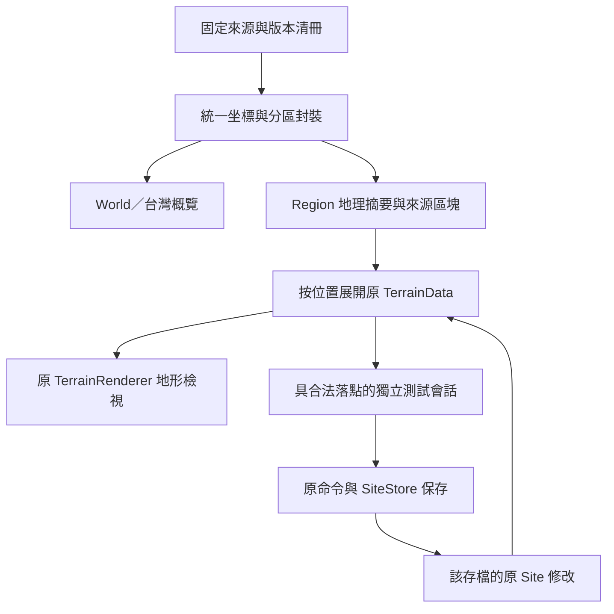

# 台灣與周圍海域：World／Region／Site 地圖構成規劃

日期：2026-09-27

版本：原始規劃 v0.1＋實作驗收紀錄（2026-09-27）

狀態：**r4 已補齊全內容地圖，P0–P4 地圖範圍及獨立 Vulkan 場景驗收通過，最新結果見第 17 節。正式入口未更動，本任務未提交。**

第 1–15 節保留實作前的討論與提案語境，其中「尚未實作／尚未驗證」指當時狀態。第 16 節保留 r2／r3 與補洞前的驗收紀錄；使用者要求補齊缺口後的 r4 工作與最新驗收見第 17 節。

現況依據：本輪讀取的 `project.godot`、`PROJECT_ARCHITECTURE.md` 與正式 TerrainLab 程式。工作區已有大量其他修改，本文件不覆寫它們。

## 1. 本輪結論與已確認事項

先完成台灣本島、澎湖、綠島、蘭嶼與周圍海域的固定地圖，保留真實水平距離。以有限範圍驗證三層地圖、分區載入、地理銜接與修改保存，通過後再擴充地球其他地區。

使用者已確認：

- 最終 World 參考地球，採有限世界，保留真實距離。
- 初期採固定地圖；本輪不規劃隨機世界生成。
- Site 為 100×100 格，每格水平尺度 2 公尺；每張 200×200 公尺、4 公頃。
- Region 為 100×100 個 Site 位置；名義尺度 20×20 公里、400 平方公里。
- Region 的任意陸地位置都對應可展開的 Site，聚落與地形可以跨 Site。
- 最終支援跨 Region；台灣是首批地理內容範圍。
- 玩家與 NPC 都可能修改世界；現在只規劃地圖如何承接修改，不展開內政、NPC 決策、背景生產或戰爭。
- 詳細地圖按需載入，不同時建立整個世界的細格與人物。

以下仍是**本文件提案**，不可寫成使用者已確認或程式已完成：精確海域邊界、投影與容許誤差、高程的遊戲化方式、資料來源組合、快取容量及時間門檻。

## 2. 本期範圍與完成定義

本期交付範圍為：固定地理資料來源、座標及穩定地點身分、World／Region 概覽、任意已備妥陸地 Site 的細節展開、跨界一致性、原 Site 修改的保存，以及地圖載入效能。

海域先承擔海陸輪廓、島嶼間距、地理定位與分區測試；不以海域可顯示代表已有船舶、航行、海戰、潮汐或海床玩法。

本期不包含：玩家／軍隊正式旅行、跨圖物品轉移、內政、NPC 遠地模擬、國家與行政制度、歷史城市與道路復原、全地球分區、無縫相機縮放、角色／GPU 群眾重構。

**地圖驗收與遊戲旅行分開命名：**第一批「開啟 Site」是地理檢視／測試入口。通過地圖驗收後，仍需下一項工作完成原人物與實物的旅行交接，才能稱為可玩的跨 Site 旅行。這不縮減最終任意陸地可進入的目標。

全台灣地圖完成，必須滿足內容遮罩內每個陸地 Site 都可由固定基底展開；少數展示場景通過只算代表切片通過。陡坡或懸崖可以檢視，但人物落點仍須符合實際通行規則。

## 3. 現行程式核對與接入限制

### 3.1 可以延伸的現有擁有者

- `project.godot:15`：正式入口仍為 `scenes/terrain_lab/TerrainLab.tscn`。
- `PROJECT_ARCHITECTURE.md:127–149`：舊 World／Region／Travel 已移除；不可把歷史系統當作已存在的接點。
- `scripts/terrain_lab/terrain_data.gd:9–38`：原 `TerrainData` 持有 100×100 細格、地形／環境陣列、資源基底及稀疏狀態。新地理仍展開到這個擁有者。
- `scripts/terrain_lab/terrain_renderer.gd:2–4,45–50`：原地圖採 Node2D、本地格位與 64px 格寬；本輪確認的 2m 尚不是既有完整公尺換算契約。
- `scripts/terrain_lab/site_store.gd:65–125`：原保存已有校驗、暫存寫入與恢復，但重建仍呼叫 preset／seed 生成。固定地圖要延伸原保存格式的基底識別。
- `scripts/terrain_lab/site_runtime.gd`：原採集／建設／地形修改仍是命令入口，Region 不另存一份可獨立修改的資源或庫存。

### 3.2 必須先解決的缺口

1. **高度不相容。** `terrain_generator.gd:9–13` 將最大高度限制為 1–5；`TerrainData.height_levels` 與 `cliff_drops` 是 byte；`site_store.gd:121,489` 同樣限制高度。`can_terrain_step` 依等高或互通的一級坡口判斷。真實 DTM 公尺高程不能直接塞進現有欄位。
2. **缺少跨圖邊界輸入。** 原生成以每圖 seed、旋轉與局部地貌展開；原邊界偵測忽略圖外鄰居，原坡口演算法只連接圖內平台。既有種子可重現，不代表相鄰 Site 連續。
3. **水域分類過於局部。** `site_environment.gd:55–73` 依 preset 把水域視為海水或淡水，以局部格索引當水體身分；河口同圖包含海、河與湖時需要固定水體資料。
4. **生成新圖會建立新情境。** `site_environment.gd:42–47` 預設新 ID、時間 0、起始存貨與倉庫。固定地理的載入不能每次獲得新物資。
5. **換圖不是旅行。** `terrain_lab.gd:387–465` 清除原隊伍、切換整張快照，新圖亦重設人物持物與疲勞。人物／物品 ID 現為 Site 範圍；時間也屬於 Site。
6. **全海圖缺乏陸地出生點。** 原初始化直接使用 `spawn_cell` 建立 depot／worker 索引。海域摘要不能直接套入陸地情境初始化。

原交戰、投射物、死亡結算、人物作業與供餐等切換／保存守衛全部保留。此案不放寬部隊數量、保存容量或既有渲染准入。

## 4. 台灣測試範圍提案

### 4.1 資料取得視窗

建議先取 **東經 119.0°–122.5°、北緯 21.5°–25.5°** 的資料視窗，包含本島及上述離島周邊。這是便於整理來源的經緯度外框，不是等距 Region 網格，也不是政治或行政範圍。

導入時將外框邊線加密取樣後投影，再向外對齊固定的 20km 網格。不能只投影兩個角，亦不能以經緯度度數直接計算精確 Region 數。正式 Region 數待第 P0 階段以來源坐標系統與投影工具計算。

外框可能包含其他岸段；未製作地區維持真實地理背景並標成未開放，不能改畫為海洋。世界擴充只增加內容範圍，不重新編號既有 Region／Site。

### 4.2 地理類型與可用性分開

每個地點至少有兩種獨立資訊：

- 地理類型：陸地、海洋、內陸水域、海陸混合；使用固定來源幾何判定。
- 資料／開放狀態：已備妥、缺資料、範圍外。缺資料不等於海洋，也不等於平原。

沿海 Site 不能只看中心點決定整張海或陸；須保留相交海岸與陸地覆蓋。小島、狹長半島、河口與湖中島都應有樣本。

### 4.3 第一批代表地形

以來源完整性選定精確圖幅後建立：西部平原、山麓／河谷、中央山地、東岸陡峭海岸、河口、澎湖、綠島、蘭嶼。名稱是候選測試類型，不宣稱已選好精確 Site。

其中至少一組跨 Region 邊界，至少一組覆蓋四張 Site 的共同角點；避免只測地圖中央。

## 5. 座標、真實距離與穩定身分

### 5.1 建議座標方案

台灣試驗採一個有明確版本的局部投影分區，候選為 **TWD97／TM2 121（EPSG:3826）**。原始來源保留其真實 CRS；澎湖等採 119 分帶的來源先正確轉換，不能直接把數值當作 121 分帶。

121／119 分帶、中央子午線與尺度比可查官方運輸研究資料 [S6]。固定地圖封裝與對照驗證使用成熟的 PROJ／GIS 工具，遊戲執行時讀取預處理區塊；不為本案手寫新的測地投影演算法 [S7–S8]。

以下三種精度分開驗收：

- **格位契約**：每格名義 2 投影公尺、Site 200m、Region 20km，所有層使用同一換算。
- **地理距離**：長距離量測使用橢球測地距離；不能用世界地圖像素估算。
- **來源精度**：20m DTM 的取樣間距與各圖幅本身誤差，不會因展開為 2m 格而提高。

投影存在尺度差異。提議 P0 檢查台灣完整外框與離島，局部 200m／20km 測線的格網長度對測地長度偏差目標不超過 **0.1%**；這是待確認工程容許，尚未計算或驗證。若要求所有格子在球面上精確為 2.000…m，就必須另定球面分區／格形，不能沿用平面方格卻宣稱完全無誤差。2m 水平格也不自動等於斜坡地表路程 2m。

### 5.2 固定原點與位址

提議投影網格固定於 `E=0, N=0`，不以本次裁切外框的左下角作原點。以一個穩定 `atlas_id`（例如 `earth_tw_tm2_121_v1`）識別投影／網格契約；它與來源資料版本分開。

- Site 位址：`atlas_id + site_x + site_y`，x 向東、y 向北。
- Region 位址：`atlas_id + floor(site_x/100) + floor(site_y/100)`。
- Site 內的格位仍是原 `Vector2i`；地理位址只用來定位與載入，不成為第二份人物位置。
- 地點 ID 不包含亂數、時間、載入先後、外框大小、來源檔雜湊或本次美術版本。
- 同一地點可換資料版本，但舊存檔仍引用原版本，不能靜默套用到新地形。

穩定地點 ID 與遊戲存檔實例分開：修改記錄由 `world_instance_id + save_slot + site_id` 定位，透過每個遊戲／存檔的目錄隔離。新遊戲使用新實例 ID，同一地理位置不因此改名；複製存檔也不能覆蓋另一個槽位。不能直接沿用原 `user://sites/<site.id>.json` 作所有遊戲共用的位置。這些是原保存入口的路徑／manifest 資訊，不另建第二個世界狀態擁有者。

坐標換算提案（`E,N` 為投影公尺）：

```text
site_x = floor(E / 200)
site_y = floor(N / 200)
region_x = floor(site_x / 100)
region_y = floor(site_y / 100)
site_in_region = floor_mod(site_xy, 100)

local_x = floor((E - 200 * site_x) / 2)
local_y = 99 - floor((N - 200 * site_y) / 2)

cell_center_E = 200 * site_x + (local_x + 0.5) * 2
cell_center_N = 200 * site_y + (99 - local_y + 0.5) * 2
```

地理 N 向北；原畫面 y 向下，因此只在共用轉換處翻轉。範圍採西／南含、東／北不含的半開區間。負坐標須 floor，不得截向零；邊界公尺值、近邊界量化與誤差處理都使用同一入口，禁止不同呼叫者各加 epsilon。

正式實作前需用整數格位與固定精度的公尺／公釐輸入做正反轉測試；地理坐標、區塊位址與局部格位是同一位置的轉換表示，不可各自被 UI 任意修改。

### 5.3 世界擴充

現在只實作台灣分區，不把單一台灣投影延伸到全世界。未來可新增別的投影分區；地理索引必須讓每個位置只有一個權威地點，重疊區或接縫不能產生兩份 Site。全球日期變更線、極區與分區接縫另有驗收，不由台灣測試替代。

## 6. 固定資料來源與資料製作

### 6.1 首批來源候選

- **高程：內政部 20m DTM。** 2025 版說明範圍為本島及部分離島，各圖幅年代不一；下載資源為局部更新清冊。須組合既有基底與更新幅、明訂優先次序，不能把「2025 年版」理解成每個格子同年且完整重測 [S1–S2]。
- **海岸、湖泊與水面：國土測繪中心 1:25,000 經建版地形圖候選。** 官方提供數值資料；具體 SHP 圖層、欄位及離島涵蓋尚待抽樣驗證。行政界、海堤、河川法定範圍不得直接替代實際水面 [S3–S4]。
- **河道補充：水利署河川河道。** 用於河川識別及幾何對照；尚須核對線／面形式、寬度、圖幅斷線與資料年代 [S5]。
- **海域：首批只需可靠海陸輪廓與海水類型。** 海底高程可後續裁切 GEBCO，詳細港口／淺灘不以其概覽格網代替 [S10]。
- **全球概覽：Natural Earth。** 僅作遠景或範圍外參照；其 `10m` 指 1:10,000,000，比較細的 200m Site 岸線仍須使用別的來源 [S11]。

DTM 已知有澎湖來源清冊，但綠島與蘭嶼的可用圖幅仍要實查。來源缺口保留 `missing_data`，不以隨機地形補成「已完成」。現代地形資料的填海、河道工程或水庫可能與歷史年代不同；本期作固定地理技術測試，不宣稱某歷史年代復原。

### 6.2 來源清冊

每批資料記錄：提供單位、資料名稱、下載 URL、發布／取得日期、圖幅年度、原始 CRS、水平／垂直單位與基準、NoData、覆蓋範圍、來源解析度、授權、原始雜湊、轉換工具及參數、產物版本與雜湊。

依政府資料開放授權條款保留提供者顯名聲明 [S9]。原規劃階段只核查公開頁面與清冊；後續下載與實包驗證見第 16 節。現有 manifest 已記來源網址、雜湊、座標與高程基準，但 MOI 逐幅年度、確切取得日期及授權文本隨包保存仍待補證，不能宣稱本節清冊全部完成。

### 6.3 建議製作順序

1. 先取得少量代表圖幅，核實欄位、CRS、年代、垂直基準與離島覆蓋。
2. 將來源轉到同一試驗投影；保留 NoData，檢查格網原點及半格偏移。
3. 建立來源拼接優先序；以可追溯人工修正處理衝突，不用平均掩蓋海岸／河道錯位。
4. 製作固定海陸／水域幾何、高程、Region 摘要與空間索引。
5. 以 Region 邊界切封裝，但保留取樣所需鄰域；跨界幾何保留共同 feature ID 與切點。
6. 製作少量必要概覽層級。執行時只讀本機封裝，不依賴即時網路服務。
7. 產出固定基底 manifest、來源聲明與驗證記錄，鎖定版本。

原始 GIS 大檔置於明確的製作工作區，不能當作遊戲啟動時全數解析的資料；正式包只納入審閱後的必要產物。遵守現有 LFS clean guard，不為匯入地圖修改它。

## 7. 三層資料構成與生命週期



### 7.1 World／台灣概覽

保存開放範圍、粗地理圖層、可查詢的 Region 索引與資料版本。畫面顯示海陸、主要地形水系、距離尺及所選位置；縮放到 Region 時才讀取較細資料。

概覽不逐一實例化數百萬個 Site，也不需要為海面上每個空格建立單獨檔案。

### 7.2 Region

每個 Region 保存：

- 固定地理範圍、投影／基底版本、來源品質與可用性。
- 100×100 份 Site 地理摘要：陸地覆蓋、代表／最低／最高高程、地形起伏摘要、水域型態與細節資料可用性。
- 已裁切但保留共同 ID 的海岸、河流、湖泊等幾何。
- 高程與來源區塊索引，以及與鄰區的共用取樣規則。

摘要用緊密陣列，不用每格一個 Node／Dictionary。它是來源及 Site 修改的可重建讀取結果；不能與 Site 分別維護兩套樹木、庫存或建築實體。

Region 格的單一地形色只作概覽；不能憑中心格顏色推論整張 Site 可以通行、含多少資源或完全沒有水。

### 7.3 Site

選定地點後，以固定地理資料及相鄰取樣展開原 `TerrainData`。一張 Site 仍是 10,000 細格。

資料模式至少區分既有 `preset` 與新 `fixed_geography`。這是原生成／重建入口的明確分支，不建立第二套可獨立遊玩的 Site 擁有者。

固定地圖的細節提案：高程及水域依固定來源重採樣；人工修正固定保存。首批不加會改變海岸、河流、礦產或可通行性的隨機噪聲。資料不足以判定林木／礦藏時，不把地表顏色冒充已調查資源。裝飾是否允許固定規則鋪設，待細節美術另定。

### 7.4 載入狀態與失敗處理

狀態順序：定位 → 查可用性 → 讀固定基底 → 驗證版本 → 展開／套差異 → 檢查地形 → 地形檢視；只有合格的獨立地圖測試會話才走原入口綁定。

地形檢視沿原 `TerrainData`／`TerrainRenderer`，不初始化 Actor、Army、倉庫、工人、起始存貨或時間。既有 `SiteEnvironment.initialize` 將固定地理準備與情境初始物資拆成明確步驟，兩者仍留在原擁有者；來源高程、海陸等檢視不依賴合法出生點。含陸地但全為陡坡／障礙的 Site 仍可檢視，互動測試則以「無合法落點」拒絕。純海及缺資料沿同樣原則處理。

在正在遊玩的會話中，地圖預覽不能呼叫會清除人物／存貨的原換圖流程，也不覆寫目前可玩 Site。正式旅行整合前，互動地理測試使用隔離的測試存檔／會話，沿原 TerrainLab 驗證；不把測試角色變成第二份玩家。

- 同一時間只有一份活動 Site；安全切換驗證期間允許舊圖＋候選圖暫時共存，候選尚不推進人物模擬。
- 取消、快速切換目標、舊讀取較晚完成，都不能覆蓋更新的目標；過期結果釋放。
- 目標缺資料、校驗失敗或超出開放範圍時保留目前場景及原存檔，不退回隨機 preset。
- 海洋可檢視摘要；純海 Site 不建立陸地玩家、倉庫或工人。混合海岸圖依真實陸地與通行條件選測試落點。
- 離開只釋放可重建資料；尚未成功保存的修改不當作可丟棄快取。

## 8. 地形與跨界契約

### 8.1 高程是本期首要設計關卡

需分開三件事：來源絕對高程（公尺）、人物可通行的坡面／台階規則，以及畫面顏色／岩壁的呈現。

**建議方向**是沿原 `TerrainData` 保存固定高程輸入及地形修改，再由同一處派生可通行與呈現資料。`height_levels` 若保留，須明訂為派生值或既有 preset 的欄位，不能同時與公尺高程各自被修改。

本文件不擅定「現有一級＝兩公尺」，也不直接將全台高山壓成 0–5。P0 應用同一組平原、河谷、山地相鄰樣本評估：

- 能否保留現有階梯外觀，同時用一致的絕對高程／坡度推導地形？
- 若需增加高度容量，原存檔範圍、岩壁落差、選格、通行、攻擊判斷各需改到哪裡？
- 所有地方共用何種垂直取樣與量化規則？

需要使用者檢視樣圖後決定真實起伏與遊戲化程度，才能核准山地 Site 實作。這個決定不阻擋先做固定概覽與來源驗證。禁止每張 Site 獨立 min–max 正規化、為了讓人走通而偷偷填河或加隨機坡口。

### 8.2 共用邊界

- 所有取樣都依固定投影位置與該存檔鎖定的基底 manifest，與載入順序無關。
- 細格取樣與地形邊緣計算需要圖外 halo；來源插值至少保留插值核所需鄰點，坡度計算再加對應鄰域。不能僅讀 100×100 本體後把外面當空。
- 對同一邊界位置，兩側的高程、海陸分類、水體 ID、幾何交點必須一致。
- A 的東邊出口與 B 的西邊入口互相對應；道路／橋梁將來加入時沿用共同 feature ID 與交點。
- 修改邊界格時，由該格所屬 Site 保存；鄰圖的 halo 與派生摘要依版本失效重建，不複製成第二份可寫格位。
- 驗证 A→B 與 B→A、四向邊、四圖交點、反覆讀回及資料分塊順序。

相鄰格中心本來就相距 2m，不能要求兩側中心高程永遠相等；應比較同一世界位置的共同邊界樣本及相鄰差值是否來自同一來源。

### 8.3 水體

海岸、海水、河水與湖泊使用固定水體識別。全台海洋可有共同水體身分；河流跨 Site／Region 不重編成不同河。

海水表面、河流／湖泊水面與底床高程各有語意。山中湖面不被改成海拔 0；河流中心線也不自動代表已知寬度。來源只有線時，Region 可以顯示線，正式 Site 水面寬度須有来源或明确人工設計。

河口先記錄海／河交界與水域型態；淡鹹混合、潮汐、水文模擬不在本期。NoData 不轉成高度 0，不由高度 0 自動推斷海洋。

## 9. 保存、修改與版本

固定基底是唯讀資料；目前世界沿用「固定基底＋原 Site 稀疏修改」。修改來自玩家、NPC 或測試命令時，仍由相同命令與原擁有者提交。

沿原 `SiteStore` 擴充：

- `base_kind`、固定地點 ID、`atlas_id`、`grid_contract_version`、`base_revision`、必要產物雜湊。
- 原地形、資源、建築、物品與人物差異及既有驗證。
- 固定基底重建分支；既有 preset 存檔保持原重建路徑。

同一 `world_instance_id`／存檔槽的外層 manifest 鎖定一組相容的地理基底、網格與轉換版本。**已造訪及未造訪的 Site 全部由這份鎖定 manifest 解析**；不能讓已造訪 A 使用舊資料、第一次進入的 B 自動使用剛更新的新資料。Region 與概覽也讀取同一 manifest。

來源資料更新不改變地點 ID，但會改變 `base_revision`。舊差異必須套用舊基底；若舊基底不可用則拒絕載入並說明，不把變更套到新岸線／新高程。跨版本遷移是單獨可審閱工作，需涵蓋相依邊界；不能逐 Site 滾動更換基底後留下不相容接縫。

不把每個未造訪 Site 寫成空存檔；有實際修改才建立相應紀錄。大量已修改地點的檔案分組與索引需在實測後決定，初版不先建分散式資料庫。

Region／World 的建設、地貌改變等顯示摘要由相同修改版本派生。摘要失效可重建；不能讓玩家從摘要 UI 改出另一份建築資料。

現有 Site 檔案原子保存不等於兩張 Site 間人物／貨物的原子搬移；後者屬後續旅行整合，不在此保存擴充的完成宣稱內。

## 10. 最小程式接入方向

沿用正式入口與現有 owners。以下是職責與候選檔名，實作前依現場程式合併重用，不預先建立空框架。

- `MapCoordinates`（候選新純工具）：唯一地理分區／格位換算，不保存人物。
- `RegionData`（候選新資料入口）：固定圖資 manifest、緊密摘要、來源區塊查詢與有界快取；可先同檔完成，不拆成多個 service／manager。
- `RegionMap`（候選新 Node2D 視圖）：繪圖、選取、縮放及開啟地理 Site 的意圖；不持有可修改庫存與人物。
- `TerrainGenerator`：增加固定資料展開原 `TerrainData` 的入口，原 preset 模式保留。
- `TerrainData`／`TerrainRenderer`：按 P0 高程結論最小延伸，沿原通行／地形繪製路徑；地圖仍為 2D。
- `SiteEnvironment`：明確區分情境初始化與既有地理載入，接受穩定地點及固定水域，避免每圖自動送物資。
- `SiteStore`：增加固定基底識別與重建校驗，保留原保存守衛。
- `TerrainLab`／`SiteController`：以原組裝及指令入口管理畫面與安全切換，載入地理測試不冒充旅行。

目前沒有可直接使用的舊 `GameSession`／`WorldData`／`RegionRuntime`，不照歷史文件複製整套。World 概覽初期可以是同一 RegionMap 的遠景層級；無需為名稱再建一套場景系統。

## 11. 效能與容量預算提案

本節數字是**待實測的工程目標，不是已驗證效能**。P0 先記錄本機 CPU、GPU、RAM、解析度、Godot／renderer 與磁碟來源；後續比較固定同一場景、鏡頭與角色條件。

### 11.1 資料量算例

- 一張 Site：10,000 個 2m 格。
- 一個 Region 的摘要：10,000 份 Site 記錄；假設固定 16 bytes／記錄，原始欄位為 160,000 bytes，未含向量及索引。
- 一個 Region 的 20m 高程：概念上 1,000×1,000 取樣，float32 為 4,000,000 bytes；實際封裝另含邊界點、halo、遮罩與對齊。
- 一個 Region 全部展成 2m：100,000,000 格。這不是正常載入方式。

容量情境可先用 **400×480km＝480 個 Region** 作預算試算；這是計算假設，**不是已投影的正式台灣外框**。16-byte 摘要全量約 76.8MB；20m float32 高程的完整矩形約 1.92GB。這些是未壓縮原始欄位量，不能當遊戲包或實際 RAM 的估計。

### 11.2 結構上限

- 詳細活動 Site：1；切換候選：最多 1，峰值明確包含舊圖＋新圖。
- Region 的 20m 來源區塊：起始上限 9 個，受總 bytes 限制；未取得配額不排入第二批無限預讀。
- 遠景先讀概覽，不能為了繪製縮小的全台圖讀遍所有 20m 高程。
- 新增地圖 CPU 常駐資料（來源區塊、細圖／候選、索引等）提議上限 128MiB；新增地圖紋理提議上限 128MiB。既有角色資產另列，仍記錄整個程序與 VRAM 峰值。
- 地圖套件單塊超出容量時，改善切塊或 LOD；不丟棄水域或來源錯誤來湊預算。
- 原始 GIS 匯入可採離線分塊製作，其時間／記憶體另計；不列為正常遊戲切圖成本。

### 11.3 初步時間目標

- 一般地圖穩定操作，新地圖功能的主執行緒增量 P95 目標 ≤2ms。
- 候選 Site 就緒：冷讀 P95 ≤2s、暖讀 P95 ≤0.5s；讀取期間有可取消狀態，不能假稱瞬間載入。
- 主執行緒建置／上傳採有界批次，單批目標 ≤4ms；切換最大停頓目標 ≤50ms，另報 P95／P99／最大值。
- 快取暖機後反覆平移／切換 100 次，活動／候選／快取數量不超上限；固定鏡頭及相同快取狀態下，回收後常駐資料差額目標 ≤16MiB 且無持續成長趨勢。

若基線因既有軍隊或美術已超過幀預算，分開報告基線及地圖增量。不能從空白 Region 預覽推出整個 TerrainLab 60 FPS，也不能用獨立 crowd benchmark 代替正式場景。

## 12. 分階段落地與驗收

### P0：資料與座標契約

產出：確認後的海域遮罩、來源清冊、樣圖、投影／原點／位址契約、投影尺度誤差報告、三種高程呈現樣本與選定方案。

驗收：圖幅 CRS 與垂直單位可追溯；本島及三離島來源覆蓋明確；缺口可見；正反座標、負值及邊界測試通過；外框擴大不改舊 ID。投影資料數值尚未驗證前，不宣布正式 Region 數。

依賴拆成兩條：P0 的來源／座標部分通過即可進 P1；高程遊戲化樣圖與規則選定是 P2 山地互動測試的前置，不阻擋 P1 概覽與只讀地形檢視。

### P1：台灣概覽與 Region 瀏覽

產出：固定資料封裝、概覽／Region 2D 畫面、尺度尺、位置與來源品質查詢、海／陸／缺資料／未開放狀態、有界快取。

驗收：全範圍平移縮放不新增完整 Site；顯示與取樣來源一致；跨海域可定位離島；快速切換／取消不顯示舊請求；記錄冷暖資料讀取與記憶體。

### P2：相鄰 Site 地理切片

產出：原 TerrainData 的固定資料模式，平原／河口／海岸與跨 Region 的相鄰 Site；高程方案選定後加入山地切片。

驗收：A→B／B→A 相同、四向邊／四圖角點一致、混合海岸不丟陸地、水體 ID 跨界相同、沒有每圖正規化或隨機補通。純海檢視不初始化陸地情境。此階段不宣布旅行完成。

### P3：固定基底保存與原 Site 修改

產出：原 SiteStore 固定基底分支；原命令的地形／建設／資源修改可保存及重建。

驗收：離開再回來不重置、不重送存貨；修改來源無論玩家或測試 NPC 都沿同一狀態；損壞檔／版本不符保留原現場與存檔；既有 preset 保存仍通過。

### P4：完整測試範圍與效能收斂

產出：所有內容遮罩內陸地可展開、全部來源缺口清單已解決或明確列未完成、三離島與海域定位測試、正式場景的性能記錄。

驗收：不同地形、邊界與高程極端都有覆蓋；100 次載入／返回記憶體穩定；冷暖載入／主執行緒停頓／快取峰值符合核定預算。若仍有缺資料，不能把局部展示標成全台灣完成。

### 後續獨立工作

地圖 P0–P4 通過後才排：原人物與車貨旅行交接、共同時間、跨 Site 保存恢復；之後再討論 NPC 世界活動。全球新增地區與跨投影接縫也需自己的證據。本文件不預先實作這些系統。

## 13. 必留的驗收證據與反例

每階段保留：輸入版本、來源雜湊、測試位置、條件、通過／失敗、截圖或資料差異、性能原始記錄、尚未覆蓋項目。

必要案例：

1. 同地點在重新啟動、不同載入順序與資料封裝順序後仍相同。
2. 地理位置 → Region／Site／局部格 → 格中心地理位置，符合半格與量化容許；另做不經格位量化的精確坐標往返。
3. 位於格線、Site 線、Region 線、負值及四區交點的點有唯一歸屬。
4. 外框向外擴張、來源檔重新排序或新增離島，不改舊地點 ID。
5. 海岸穿格、極小陸地覆蓋、狹長半島、湖中島、河口、全海圖，類型與開放狀態正確。
6. 鄰圖高程與共同邊界一致，內陸水域不因水域類型而變成海拔零。
7. 缺 DTM、錯 CRS、年代衝突、校驗失敗、NoData 與範圍外都不能靜默生成假地形。
8. 邊界修改後鄰圖摘要／halo 更新，重讀不復原已修改地點。
9. 固定版本存檔拒絕錯基底，同時保留原資料；既有 preset 存檔不受影響。
10. 快速選 A→B、取消 A、A 晚完成、讀取失敗、切換後回收均不留下錯場景或未受控工作。
11. 世界概覽與 Region 的 Node／完整 TerrainData 數有上限；100 次切換不累積空場景。
12. 跨圖幾何與 GPU 畫面分開驗證；程序結束碼 0 或一張截圖不能替代完整地圖驗收。
13. 兩個新遊戲、兩個存檔槽使用同一地理 Site，修改互不污染；檔案位置不能碰撞。
14. 更新安裝的底圖後，舊存檔第一次造訪新鄰圖仍使用鎖定的舊 manifest；共同邊界不變。
15. 全陡坡或無合法出生點的陸地仍可純地形檢視；不建立無效 depot／worker 索引，也不改動正在玩的會話。

Godot 實作驗證沿專案原 `godot-runtime-verify` 有界 helper，保留失敗記錄及最新 100 份已完成紀錄的既有保留機制；原生背景狀態監看依 AGENTS.md。原規劃階段尚未執行 Godot；後續已執行的測試、失敗與效能界線記於第 16–17 節。

## 14. 實作前需要確認的三項提案（原規劃記錄）

1. **精確範圍**：119.0°E–122.5°E、21.5°N–25.5°N 作資料視窗，實際開放內容另用遮罩。
2. **距離精度**：局部投影固定方格＋測地距離，先以 0.1% 為待驗證尺度誤差門檻；使用者已確認真實距離，尚未確認這個數值容許。
3. **高程呈現**：保留真實高程來源，先比較固定規則的局部遊戲化／擴充高度方案；不延用各 Site 獨立 0–5 壓縮。

資料來源候選、性能門檻與細節展開規則皆隨 P0 的實際證據修訂；調整需寫明原因，不能以放寬門檻掩蓋失敗。

## 15. 外部來源

本輪查閱日期為 2026-09-27。這些是資料／工具來源，不等於遊戲已下載並驗證對應資料。

- [S1 2025 年版全臺灣 20 公尺 DTM](https://data.gov.tw/dataset/176927)
- [S2 全臺灣 20 公尺 DTM 基底清冊](https://data.gov.tw/dataset/35430)
- [S3 112–116 年經建版 1:25,000 地形圖](https://data.gov.tw/dataset/176020)
- [S4 國土測繪中心經建版地形圖說明](https://www.nlsc.gov.tw/cp.aspx?n=1549)
- [S5 水利署河川河道](https://data.gov.tw/dataset/25781)
- [S6 運輸研究所資料：TWD97 121／119 分帶與投影參數](https://www.iot.gov.tw/uploads/asset/data/6619b3f0367376304acd5181/B1004710.pdf)
- [S7 PROJ Transverse Mercator](https://proj.org/en/stable/operations/projections/tmerc.html)
- [S8 PROJ 測地距離計算](https://proj.org/en/stable/geodesic.html)
- [S9 政府資料開放授權條款第 1 版](https://data.gov.tw/license)
- [S10 GEBCO 格網水深資料](https://www.gebco.net/data-products/gridded-bathymetry-data)
- [S11 Natural Earth 比例尺與資料](https://www.naturalearthdata.com/downloads/)
- [S12 Godot 大型世界座標與 2D 限制](https://docs.godotengine.org/en/stable/tutorials/physics/large_world_coordinates.html)

## 16. r2／r3 實作與補洞前驗收紀錄（2026-09-27）

本節是執行紀錄。使用者已授權完成五階段，但要求不改正式入口，且本任務的檔案不納入任何 commit。`project.godot` 仍指向 `res://scenes/terrain_lab/TerrainLab.tscn`，沒有本任務差異。`scenes/region_lab/RegionLab.tscn` 是可單獨開啟的地理測試場景；它不是正式旅行或可保存的遊戲入口。

### P0：資料、座標、高程規則——代表切片通過

- 固定位址採 EPSG:3826、原點 `(0,0)`、每格 2m、Site 100×100 格、Region 100×100 Site；19×24 個 Region／4,560,000 個 Site 摘要覆蓋本次外框。實測最差投影尺度差為 0.044462%，低於本計畫 0.1% 工程目標。負座標、格／Site／Region 線、四角與重新排序位址由 `region_lab_contract_test.gd` 驗證。
- r2 固定封包使用內政部 20m DTM 與 GSHHG 2.3.7 海岸，來源 CRS、轉換與雜湊記於 `assets/region_lab/earth_tw_tm2_121_v1/manifest.json`；217 個來源區塊、653 個受檢封包檔，約 110.8MB。全圖稽核會把沒有來源的地方保留為缺資料，不以海洋或平地填充。
- 原 `TerrainData` 的 0–5 台階及坡道仍是人物通行權威；來源絕對公尺高程只作唯讀地理資料。玉山代表 Site 實測高程 3777.363–3946.632m，原台階規則的 120 步合法路徑可抵達最高格；20m 來源插值成 2m 遊戲格不等於 2m 實測精度。

### P1：台灣概覽與 Region 瀏覽——獨立場景通過

- RegionLab 用單一緊密概覽紋理顯示全外框、Region 網格、四島、海洋、缺資料與範圍外真實陸地；可平移、縮放、按 Site 位址選取及查詢狀態。範圍外陸地保留地理外觀但禁止展開。概覽不建立數百萬個完整 Site。
- 地形來源在背景執行，快速選取及取消會丟棄過期結果。最終 Vulkan／VSync 開啟的真 UI 競態驗收 `20260927_104131_551` 通過：A→B→A 清掉舊 B 佇列並只顯示最後要求的 A；取消 A 後不用重新選站即可重開。245 個畫面間隔 P95 16.82ms、最大 33.34ms。初期 52.501ms 及 D3D12 呈現停頓的失敗結果仍保留；此為獨立場景，不代表正式 TerrainLab FPS。
- 最終 r2 GPU 擷取 `20260927_044020_243` 已人工檢視台灣概覽與玉山 Site；獨立場景關閉裝飾性筆刷後，原台階與坡道仍可見。原 renderer 的預設筆刷設定未改。

### P2：相鄰 Site 地理——代表切片通過

- 固定來源展開原 `TerrainData`，用 102×102 遊戲格鄰域取樣及共用 20m 來源中心，原 `TerrainRenderer` 顯示。平原、玉山、東岸混合海陸、澎湖、綠島、蘭嶼、純海及四 Region 共同角點均有實包測點。
- `20260927_042327_932` 合約驗證含 126 個坐標案例、1,600 個相互對應坡道、392 次公開／快取取樣一致與 100 次重建；`20260927_042935_455` 實包驗證跨界高程、台階與水體一致。純海不初始化人物、倉庫或存貨；來源 NoData 和無 ID 內陸水會拒絕展開。
- 河流／湖泊的水面寬度、共同水體 ID 尚無可用的封包來源，因此不能宣稱內陸水域地理已完整；本期沒有把河道線冒充 2m 水面。

### P3：固定基底與原 Site 保存——地形、建設及庫存切片通過

- `RegionSaveSlot` 鎖定世界實例、槽位、atlas、網格版、基底版與 manifest hash；真正可變資料沿用 `SiteStore` 和原 `SiteRuntime`，版本錯誤、損壞與跨界鄰圖修改均拒絕錯套，不另建世界狀態權威。未造訪 Site 不寫空存檔。
- `20260927_044759_920` 合約驗證原整地命令跨 Site 讀回，以及原道路命令的施工中保存→讀回續建→完工再讀回；feature／索引保留，石材 4→3 只扣一次，兩世界／槽互不污染，錯版本拒絕且原檔不變。既有 preset 的 workflow／loot 回歸驗證通過。
- 真實固定圖尚無具來源的土壤與自然資源層，`resource_base` 目前為空；因此自然資源的耗竭／清除／再生保存未驗收。RegionLab UI 只做地理預覽，尚未提供可修改且持久化的 Site 遊玩流程；原人物／貨物跨 Site 旅行仍屬後續獨立工作。

### P4：全範圍與效能收斂——嚴格驗收未通過

- r2 正式封包的四島內容域有 **896,191** 個陸地／混合 Site 完整可展開；仍有 **11,711** 個應涵蓋 Site 缺資料：本島 9,993、澎湖 950、綠島 228、蘭嶼 540。全圖稽核的嚴格結論為 FAIL；已可展開地點全具 12×12 來源鄰域，不代表缺口已解決。
- r3 隔離試驗引入 Copernicus GLO-30 的水體遮罩與地表模型作海岸佐證，**仍只使用原內政部高程**。它新增 4,404 個可展開 Site，卻同時擴張內容域；全域缺資料仍有 14,601 個 Site。蘭嶼 `[1545,12170]` 的真 GPU 畫面出現矩形海灣／陸塊：逐 20m 格的跨來源 10m 門檻接受 21 格、拒絕鄰接的 23 格，使岸坡斷續。反例在 r3 trial 的 `coast_counterexample_lanyu.json`；此版**不升正式 r2**，亦不能作全台完成證據。Copernicus 垂直基準與 DSM／DTM 差異不允許無紀錄混用。
- r4 只讀補洞試算保持 r2 和 GSHHG 岸線不變，逐一檢查 11,711 個缺資料 Site 的 12×12 來源鄰域。4,676 個 Site 沒有可由補高程解決的 MOI 陸格缺值；其餘 7,035 個中，即使只要求每個缺格的 Copernicus 水體遮罩為陸且 DSM 有效，最多只有 31 個全 Site 可候選補齊；增加 DSM >2m 條件只剩 9 個。這是樂觀上限，還沒有垂直基準轉換及接縫品質證據，因此不製作假完整的 r4 封包。逐 Site 證據見 `earth_tw_tm2_121_v1_r4_probe/cop_height_gap_probe.json` 與 `cop_height_gap_sites.jsonl`。
- 另查 [OSM 陸地多邊形](https://osmdata.openstreetmap.de/data/land-polygons.html)（ODbL）及 [Geofabrik 臺灣抽取](https://download.geofabrik.de/asia/taiwan.html)，尚未納入封包。蘭嶼 `[1545,12170]` 小範圍的 100 個 20m 點中，OSM 判陸 62 點，但其中 1 點仍為 MOI NoData；改善岸線不能單獨提供缺失高程。這是局部反例，不能外推為全島覆蓋率，也不能據此升版。
- `20260927_043002_832` 來源 API 100 次切換測得冷 P95 709.735ms、暖 P95 128.034ms；不含 UI／GPU。初版完整 UI `20260927_045001_725` 因首繪幀最大 124.268ms 失敗。分段畫布 v4 保留原圖像：概覽與玉山對基準裁切均為 RGB 0 像素差。UI 競態修正後，Windows RTX 5060、1440×960、**Vulkan／VSync 開啟**的 `20260927_104223_323` 獨立 RegionLab 100 次開啟／返回通過：52,000 個真 `_draw` 批次 P95 0.434ms、最大 3.087ms、超過 4ms 為 0；畫面間隔 P95／P99／最大 16.875／17.636／33.326ms；冷／暖就緒 P95 990.524／425.952ms；第 5 次暖機後常駐差 2,806,380B、來源快取峰 20MB、返回節點數 557、殘留 actor 為 0。原始逐批 JSONL 保留在 `output/region_lab_real_acceptance/`。這是獨立場景／指定硬體與驅動的結果，不能代表正式 TerrainLab FPS。
- 專案原設定是 **D3D12／VSync 開啟**；在目前桌面下，空白 GPU 場景也出現 P95 264.92ms 的畫面間隔（`20260927_055124_967`），同空白場景暫關 VSync 為 P95 0.62ms（`20260927_055400_990`）。D3D12 原設定的完整效能驗收仍失敗；沒有因此更改 `project.godot`、放寬 50ms 門檻或把 VSync-off 診斷視為正式通過。全程序紋理／VRAM 峰值、正常操作地圖增量 2ms，以及正式 TerrainLab 與地理圖並存的基線增量仍未測；本任務要求不接入正式入口。
- 原 `terrain_lab_test.gd` 的移動斷言失敗／逾時，以及 army save 測試的 renderer material-null 錯誤，各自保留原始失敗紀錄 `20260927_040123_500`、`20260927_040604_278`；沒有把測試自身印出的 PASS 當成整套回歸通過。

截至本節 r2／r3 驗收，四島內容遮罩內每個陸地／混合 Site 都可展開的目標尚未達成。失敗紀錄保留，不能用後续候選結果倒改成通過。所有圖資和程式保持未提交；正式入口沒有改動。

## 17. r4 補齊可用地圖（2026-09-27）

使用者要求「缺口想辦法補齊」後，採用固定向量岸線及明示品質的高程估值補齊地圖。完整可展開與全部實測是兩件事：原有效 MOI 值保留；插值、外推、其他地形推估分開標記，來源缺值數量與補法不從紀錄刪除。r2 保持可重現，r4 有獨立的 `base_revision`、manifest hash 與保存版本。

### 岸線、水面與高程

- 固定 OSM 來源包含 1,378 個完整閉合陸地面及 58,489 個開放水面；保留原外環、內孔與 OSM way／relation 身分。來源時間、下載網址、SHA-256 與 ODbL 文本隨封包保存在 `assets/region_lab/earth_tw_tm2_121_v1_r4/source_metadata/`；離線重建輸入位於 `tools/region_lab/.tmp/osm_source/`。外框未開放的地理背景沿用 GSHHG。
- 岸線及水面離線轉成 2m 遊戲格分類，沒有將 20m 海陸格直接放大。小島陸地採相交格保留，最多有一個 2m 遊戲格的邊緣外擴；這不表示岸線本身具有 2m 測量精度。細分類依 Site 壓縮保存，執行時只保留有限數量。
- 河湖各有穩定來源身分，跨 Site 共用同一水體 ID；未註明鹽度的水面使用 `water_kind=4`，原淡水取用規則不會把它當作已知淡水。海洋沒有虛構海底高程；內陸水面保留來源／估值高程，不一律壓到海平面。
- 高程品質為 0 海洋或無高程、1 原有效 MOI、2 同島鄰近 MOI 插值、3 同島鄰近 MOI 外推、4 明示估值。估值封包另存方法及最近 MOI 支援距離；Copernicus 僅提供有紀錄的相對地形推估，不標成 MOI 實測高程。
- 原 `TerrainData` 的 0–5 台階、坡口及移動規則繼續負責通行。原 `SiteStore`／`SiteRuntime` 繼續保存地形與遊戲修改；本輪未建立另一套人物、資源或保存權威。

### 驗收證據

r4 品質與水體合約通過 `20260927_123500_573`：來源／區塊品質雜湊、不同河湖 ID、跨 Site 共用 ID、非零內陸水面，以及未知鹽度不提供淡水。2m 細岸線合成合約通過 `20260927_124420_396`，涵蓋四 Region 交點、負座標、同一粗高程格內的細海陸、湖中島及損壞封包拒絕；這些合成驗收不替代全域真資料與 GPU 驗收。

保存補洞已通過 `20260927_125150_186`。原 `SiteEnvironment.initialize` 會清除固定來源交付的 `resource_base`，使讀回的資源修改失去基底；現在固定地理分支保留已驗證 loader 提供的基底，索引仍由原擁有者重建。合成固定基底驗證林木耗竭與永久清除、食物耗竭／720 分鐘再生、兩次原 `SiteStore` 保存讀回；原 preset 資源合約 `20260927_125229_029` 通過。真台灣圖尚未加入土壤、林木或礦產來源，不以合成測試冒充實地資源層。最初失敗與測試自身 JSON 數型比較錯誤均保留於驗收紀錄。

r4 全圖資料稽核已通過。舊 r2 的 11,711 個缺資料 Site 保留於不可縮減的比對清單 `output/region_lab_real_acceptance/r2_gap_inventory.jsonl`；每個座標都有補成可展開地形或依新岸線確認為海洋的結果，沒有藉由縮小內容範圍消除缺口。

第一份完整候選的獨立稽核 `r4_full_audit_20260927_132138` 保留為 FAIL：原 11,711 個缺口均有逐點結果、896,191 個原可開啟陸地 Site 無退步，全部新陸地的 102×102 細格鄰域可用；但有 13,981 個原有效 MOI 取樣被改值。三方追查確認為重新投影時，較大處理視窗使恰好靠近來源像素邊界的取樣改選鄰格。修正採用鎖版 r2 的有效 MOI 取樣作為 r4 補值前的固定輸入，再計算估值及台階；不能在輸出端只改高度而留下不一致的台階，也不能放寬原值保存驗收。

第二份完整候選 `dcc4171ccda374e6f4c6bc95f68bc0cfb5f01acdb6643594517a98f760125b3d` 的 `r4_full_audit_20260927_135603` 已確認原 MOI 改值、新增 q1 原始 TIFF 比對差異、可重算台階公式差異皆為 0；缺口與可展開性亦通過。這份仍保留為 FAIL，因 5,051 張 Site 的概覽品質低報了細格插值所用的水域支援來源。另有 6 張混合海岸 Site 的 167 個有效取樣，其 200m 台階背景越過未封裝的純海區塊；這些不當作公式已驗證，須以固定來源重建的稽核用 halo 補證，無須增加遊戲執行時的地圖資料。

最終資料版本為 `moi-35430-osm-20260927-r4-pinned-source-quality-fix`，manifest SHA-256：`e3108aad1cbfd5118af08fd699ac03bf64d19b5bc9d186154dc9a5fea279f7b8`。138 個來源區塊約 145.6MiB；r2 manifest 仍為 `2ab25eeaa685782b42928d206ec808e4f1bb4da5e771cc67f0f86e8fefb07f61`。獨立稽核 `output/region_lab_real_acceptance/r4_full_audit_20260927_140942/r4_recovery_report.json` 為 PASS：

- 四島內容域的 **914,075 張非海洋 Site**，全部通過 102×102 細格及鄰域取樣：本島 907,404、澎湖 4,872、綠島 468、蘭嶼 1,331。缺資料、無法展開、原可開啟 Site 退步及內容範圍縮減皆為 0。
- 原 11,711 個缺口中，**7,193 個恢復可展開，4,518 個由固定 OSM 向量確認為海洋**；結果記於同目錄 `gap_sites.jsonl`。外框未開放地理與原 GSHHG 逐格一致，未把福建沿岸當海洋或開放內容。
- 比對 89,736,890 個原 r2 有效 MOI 取樣，保留陸地／內水的原值差異為 0；新增 1,408,871 個 q1 取樣另與官方 TIFF 的固定格網重投影逐值比對，差異為 0。77,696 份細岸線遮罩及 164,666,347 個內水格中心均通過來源幾何核對；概覽品質低報為 0。
- 獨立重算 87,376,463 個區塊內部及 3,567,997 個邊界台階取樣，公式差異與未驗證數皆為 0。原缺證 167 點由 `r4_level_halo_evidence/index.json` 補齊；三份稽核用 halo 與既有封包的 3,090,900 個取樣逐值一致。這些證據保存在 `output`，不增加遊戲執行時資料。

以上是全圖資料證據；以下 Godot 場景與 GPU 驗收使用同一份最終 manifest，不能互相替代。

### 最終版本的執行驗收

- 編輯器解析 `20260927_141315_836` 通過；系統根憑證訊息仍保留，沒有宣稱零警告。細岸線合約 `20260927_141429_080` 與完整座標／固定保存／資源合約 `20260927_141441_455` 通過。
- 真圖驗收 `20260927_141823_209` 通過：玉山來源高程 3777.36–3946.63m，以原移動規則走 120 步到最高格；內水 body 7433（`way/1263181010`）跨 `[1097,12194]`、`[1098,12194]` 保持同一身分，4 個共同邊格一致，保存讀回保留 56 個水體格且未知鹽度不當淡水。臺北基底指紋、四 Region 交點、四島代表點與純海均通過。
- 真圖驗收最初的 `20260927_141520_127` 因測點判斷錯誤失敗並保留：測試把所有 class 4 混合岸線都假設為海岸，實際首個候選有 9,733 個陸格、267 個內水格、0 海格。修正測試依實際水體分類選取同時含海陸的 `[1573,13270]`，保留河湖岸反例；未更改資料分類或降低海岸驗收條件。
- GPU 擷取 `20260927_142106_436` 與 `20260927_142140_726` 通過；人工檢視台灣概覽、玉山與蘭嶼 `[1545,12170]`，確認原台階／坡道仍呈現、海岸連續且沒有 r3 的矩形陸海碎塊。UI 顯示來源及估值品質，選站與代表地點選單一致。圖片位於 `.visual_captures/region_lab/r4_final_e310_20260927_1421/` 及 `r4_final_e310_20260927_1422_lanyu.png`。
- Vulkan／VSync 開啟的非同步／取消 `20260927_142226_006` 通過：A→B→A 只展開最後的 A；取消後可重新開啟；分段顯示途中返回能回收畫布、人物與快取，隨後切到臺北完整顯示 520 個畫布。畫面間隔 P95 17.405ms、最大 18.977ms。
- 純資料來源 API 100 次開圖 `20260927_141944_835` 通過：20 次冷讀 P95 1223.239ms、80 次暖讀 P95 177.761ms，快取約 9.13MB，Godot 靜態記憶體差約 9.29MB。此項不包含 UI 與繪圖；「冷」指應用程式來源快取未命中，不代表作業系統磁碟快取已清空。
- 最終 r4 的首輪完整 UI 100 次 `20260927_142349_916` 保留為 FAIL。載入及繪圖已達原門檻：冷／暖就緒 P95 1532.825／491.236ms，52,000 個繪圖批次最大 2.155ms，畫面間隔最大 21.774ms；但地圖 CPU 靜態記憶體增量 166,694,981B 超過 128MiB。追查後，58,408 份水體巢狀 Dictionary 是可避免的常駐開銷；改為同一 RegionData 內的緊密欄位及 ID 索引，磁碟 manifest、水體來源、名稱與校驗不變，以逐水體查詢取代保留整份解碼字典。另一個失敗是操作時間取樣混入了載入時的 1,074,784µs：依 [Godot 主迴圈實作](https://github.com/godotengine/godot/blob/master/main/main.cpp)，`TIME_PROCESS` 是每秒更新的區間最大值，非逐幀 CPU 值。原始值保留，穩定期操作須重新量測；不能單憑直接函式執行時間代替全場景成本。
- 緊密水體清冊版重新通過完整合約 `20260927_143057_863`（新增稀疏 ID 1,000,003、查無 ID、未知鹽度驗證）、真圖 `20260927_143444_062`、細岸線合約 `20260927_143728_615` 及編輯器解析 `20260927_143754_131`。獨立操作量測 `20260927_143524_147` 通過：空白到概覽的 Godot 靜態記憶體增量降為 49,254,098B，較首輪少約 52.3MB。空白／平移縮放各暖機 180 幀後量測 600 幀，在當次桌面各約 4.17 秒、觀測到 5 段監視器值；穩定 P95 7.904／7.745ms，差 -0.159ms，符合 ≤2ms 目標。負差代表當次量測浮動，不宣稱地圖加速引擎；直接操作函式 P95 0.038ms 僅作輔助拆帳。全程原始值與暖機值均保留。

### 完整 UI 壓力驗收及交付界線

`20260927_143934_365` 在 Windows、RTX 5060、Vulkan、VSync 開啟、1600×900 視窗、59.997Hz 螢幕條件下，完整 100 次 Site 開啟／返回為 **PASS**。依序輪替臺北、玉山、澎湖、綠島、蘭嶼，每站 20 次，使用最終 r4 manifest 與緊密水體清冊。原門檻未放寬：

- 首輪五站來源快取未命中，冷就緒 P95 **1532.302ms**；其後 95 次暖就緒 P95 **488.699ms**，各低於 2 秒／0.5 秒門檻。整批混合冷暖的 P95 為 504.180ms，暖載門檻的分母不混入首次冷載。
- 每次完整提交 520 個原 renderer 畫布，合計 52,000 個真實繪圖批次；批次 P95 **0.427ms**、最大 **2.849ms**，超過 4ms 為 0。3,323 個操作畫面間隔 P95／P99／最大 **16.926／18.070／22.399ms**，最大低於 50ms。測試自己的逐格檢查及紀錄寫入另記耗時，沒有算作遊戲 UI 工作。
- 新地圖 Godot 靜態記憶體最高取樣增量 **114,434,907B（109.13MiB）**；紋理增量 **31,650,304B（30.18MiB）**，分別低於 128MiB。引擎 video 增量 88,675,984B 含紋理，不重複相加；靜態＋video 增量另報 203,110,891B。取樣點包含空白基準、概覽、每次完整 Site 與返回；不是瞬時分配器尖峰。
- 第五站暖機後靜態記憶體差 **2,809,068B**，低於 16MiB；来源快取峰 **47,436,377B**，保留 64MiB 上限。節點基準 557、顯示時峰 558，100 次返回均回到 557，殘留 actor 為 0。
- 同程序空白／概覽平移縮放各暖機 180 幀後取樣 600 幀，各約 10 秒、11 段監視器值；穩定 `TIME_PROCESS` P95 **20.470→20.266ms**，差 **-0.204ms**，符合 ≤2ms 目標。原報告 `memory_sample_points` 的「120 stable frames」為舊文字，實際基準依本段 180＋600 幀取得；原始陣列及數值保留，產生器文字已校正。
- 額外以同一實際 Godot 程序 PID 37124 量測 85 份 OS 記憶體、84 份 GPU 程序計數器樣本：觀測到的 Peak Working Set **1,033,900,032B**、Peak Paged Memory **1,347,555,328B**、GPU dedicated **291,844,096B**／shared **232,046,592B**。這些是整個程序的峰值，包含原專案引擎／角色等資產及配置開銷，不能當作地圖增量；GPU 計數器以 1 秒間隔取樣，亦不宣稱捕獲每個瞬間尖峰。

全部 Godot 通過及失敗紀錄保存於 `output/region_lab_real_acceptance/verification_runs/`，原始批次記錄為 `lifecycle_batches_31168467.jsonl`，OS 原始取樣為 `r4_e310_lifecycle_packed_20260927_1438/os_process_memory.json`。85 份程序樣本中有 1 份 GPU 計數器取樣無效，錯誤文字仍保留，GPU 峰值來自其餘 84 份有效樣本。全圖資料稽核與 Godot 執行驗收使用同一 manifest；本輪未重寫 r2、未修改正式入口，也未提交檔案。

完成驗收後，僅將獨立 RegionLab 的 `RegionData.DEFAULT_MANIFEST` 切到 r4。不帶測試 manifest、未注入 TestSource 的正常啟動擷取 `20260927_144311_326` 通過，實際 hash 仍為 `e3108aad…`；1440×960 概覽與玉山畫面位於 `.visual_captures/region_lab/r4_default_20260927_1442/`，已人工檢視。正常預設來源的非同步／取消 `20260927_144356_916` 亦通過，包含 A→B→A、取消後重開，最大畫面間隔 33.3ms。保存的驗收索引共 81 份，包含本輪 19 份關鍵通過與失敗紀錄。

本次完成的是固定台灣地理、連續 Site 地形、原擁有者的保存契約及獨立場景效能。真實土壤／林木／礦產資料層、正式角色車貨旅行、共同世界時間、NPC 世界模擬與全球跨投影接縫沿第 12 節列為後續獨立工作。原專案 D3D12／VSync 的桌面停頓紀錄仍在第 16 節；本次採獨立程序的 Vulkan 選項驗收，未更動正式專案 renderer，也不宣稱正式 TerrainLab 的 FPS 已驗收。

## 18. 開啟前可辨識 Site 地形（2026-09-29）

原 Region 概覽把每個 200m Site 壓成一個分類像素，放大仍無台階、坡口及水岸形狀。現在保留遠景摘要，選取 Site 時自動載入地形縮圖；「查看所選附近地形」定位約 600m 的近景範圍，逐張顯示相鄰 Site。一般縮放達每 Site 128 像素且可見格數小於 32 時，也會載入細地形。返回地圖恢復進入前的位置與縮放。

縮圖直接使用同一 `RegionData.make_terrain_data` 的原 `TerrainData`，按 100×100 格繪製地表、0–5 台階、水域、崖緣及坡口。這是簡化地形色圖，不是完整 renderer 的材質截圖；未新增地形、人物、資源或保存權威，也未更改 r4 圖資及高度規則。近景純海格與細岸線海水共用顏色，避免分類底圖造成色差接縫。

每張縮圖 300×300 RGBA8、360,000 bytes，快取上限 32 張（純像素合計 11,520,000 bytes，並非程序總記憶體）。同一來源最多一個工作執行緒；預覽只保留紋理及小型摘要，不常駐完整 TerrainData，也不初始化人物或可變 Site。明確開啟要求可重用尚在產生的同站結果；取消後附近預覽繼續，切換選取會取消舊開啟要求，選中縮圖不會被背景載入淘汰。資料失敗會清除舊選站圖片並顯示原因。

本輪驗收及保留界線：

- 地形合約 `20260929_095444_480` 通過：合成資料與玉山、跨 Site 內水 7433、蘭嶼真圖，共 50,000 個中心格及 200,000 條方向邊，確認色圖、地形指紋與來源錯誤傳遞。初輪 `20260929_095032_021` 雖逐格比對通過，但空合成水體陣列呼叫雜湊 update 觸發引擎錯誤，保留為 FAIL；補空陣列處理後才重驗通過。
- 主場景腳本解析 `20260929_095617_817` 通過。既有 GPU 非同步／取消回歸 `20260929_095859_148` 通過，333 個操作幀間隔 P95 16.88ms、最大 49.746ms；保留原 50ms 門檻。
- 新 GPU 預覽驗收 `20260929_095954_283` 通過；人工檢視後統一近景海水顏色，再以 `20260929_100220_245` 驗收整個可見範圍完成載入。Windows／RTX 5060／Vulkan／VSync、1440×960 下，玉山與蘭嶼預覽、附近地圖及開啟後地形指紋／水體陣列指紋一致。最終六張擷取和結果在 `output/region_lab_real_acceptance/preview_ui_20260929_1003_complete/`；近景擷取分別顯示 20/20 與 15/15 格就緒，人工確認跨 Site 地形及岸線連續。
- 同一 GPU 測試通過快速 A→B→A、預覽中開啟／取消、取消後續載鄰格、舊開啟要求不得隨重新選回而復活、失敗來源不得留舊圖、34 個不同選站的快取淘汰與 32 張硬上限。開啟前無人物或 Site 可變狀態，預覽與開啟來源工作不重疊；玉山、蘭嶼開啟仍各完成原 renderer 的 520 個畫布批次。

本輪通過與失敗的原始驗證記錄另存 `output/region_lab_real_acceptance/preview_fix_20260929/verification_runs/`。本輪未重跑第 17 節的完整 100 次效能矩陣，不將歷史數值冒充新增預覽後的量測；此功能仍僅在獨立 RegionLab，正式入口未改，本任務內容未提交。

### 除錯輸出補驗（2026-09-29）

使用者指出必須啟用 Godot 除錯工具後，以 `--debug --check-only` 重驗 `20260929_100740_068`，實際重現 6 則 GDScript 警告；原 helper 因 exit 0 顯示 PASS，不能據此認定無警告。先前不含 `--debug` 的結果沒有涵蓋這項驗收。警告修正只涉及局部變數改名：`RegionData` 的內層 `body`、`RegionLab` 的 `ready`，以及其載入依賴 `SiteController` 的 `selected`、`TerrainArmy` 的內層 `inputs` 和兩個 `scale`；未改警告設定、公共 API 或行為。

短版 editor 檢查 `20260929_100827_146` 留有 `Scan thread aborted`，不作完整掃描證據。改用原 verifier 的 headless 模式加 `--editor --debug --import`，`20260929_101056_389` 完成匯入與編輯器載入，39.976 秒、exit 0、0 則 GDScript 警告／腳本錯誤；仍保留獨立的 Windows 根憑證環境訊息。helper 的歷史保留作業另回報一份較舊執行紀錄被其他程序占用，未強制刪除或終止該程序。

GPU 預覽驗收也明確加 `--debug`，`20260929_101236_483` 為 PASS：35.296 秒、exit 0、stdout/stderr 中 0 warning／0 script error，玉山及蘭嶼同源地形、六張新擷取、切換、取消與 32 張快取上限均通過；人工複核蘭嶼完整近景。結果位於 `output/region_lab_real_acceptance/preview_ui_20260929_debug_warnings/`。除錯前後原始 log 保存在 `output/region_lab_real_acceptance/preview_debug_20260929/verification_runs/`，之後的本場景檢查指令均應保留 `--debug` 並另外檢查警告。

## 19. 連續坡面取代方向箭頭（2026-09-29）

原 renderer 每條坡道各畫窄色帶和箭頭，與崖面開口不同寬；連排、轉彎和寬坡會留下斷帶，Site 外側坡道也因缺本地鄰格而漏畫。現在由原 `TerrainRenderer` 合併同格坡臂與接合區，坡面和兩種崖面繪製共用開口計算；以原地表材質、連續高度明暗及柔化收尾呈現坡度，移除方向箭頭。並排坡面接成整片，Region 縮圖沿用同一開口計算。

草地底圖和坡面共用 20 格／1280px 的材質週期，每張 100 格 Site 恰好重複五次，避免原 1254px 紋理在邊界換相位。固定地理 adapter 僅保留原取樣外圈 404 筆高度／水域證據，供跨 Site 寬坡判斷；原 `refresh_boundary` 沿用相鄰存檔查詢，同時刷新四邊及角落，全部驗證成功才更新。整地後依當前高度重新判斷，不保存一份可能過時的坡道決策。原高度、坡道 bit、通行規則、地形 fingerprint 和固定來源 hash 均維持。

驗收全部啟用 `--debug`：

- GPU 第一版 `20260929_104725_277` 雖普通／分段繪製一致，但人工檢視仍有寬坡梳齒和過強砂色，不作最終外觀。第二版 `20260929_105442_041` 保留為 FAIL：跨 Site 坡口 576 個像素中有 432 個不同，確認為草地材質週期未對齊；修正材質週期後第三版通過，再補齊並排側邊漸變。
- 最終 GPU `20260929_110618_443` PASS，16.112 秒、0 GDScript 警告／腳本錯誤。四向、連續上坡、四格寬坡、轉彎／多出口、禁止通行崖面、玉山真圖共六組普通／分段擷取，逐像素差異皆為 0；兩張 Site 的坡口與 Site 內部坡口對照亦為 0。繪製前後地形及 `can_step` 指紋相同。圖片及結果在 `output/terrain_ramp_continuity/20260929_slopes_r4/`，已人工檢视寬坡及轉彎。
- 地形預覽契約 `20260929_110917_067` PASS：60,000 個中心格、240,000 條方向邊及 26 項連續性比對，包含四向跨 Site 並排坡、玉山真實鄰圖、非法角落失敗保持原狀、鄰圖整地使接合消失／恢復；還原後地形 fingerprint 一致。0 GDScript 警告，保留 Windows 根憑證環境訊息。
- 實際 RegionLab UI `20260929_110745_679` PASS，36.369 秒、0 warning／0 script error。玉山及蘭嶼預覽與開啟後地形／水體指紋一致，各完成 520 畫布；切換、取消、失敗清圖及 32 張快取上限通過。六張擷取在 `output/region_lab_real_acceptance/preview_ui_20260929_slopes_final/`，已人工檢視玉山開啟畫面。
- 存檔契約初輪 `20260929_111023_618` 行為通過，但除錯輸出揭露 `RegionSaveSlot` 的局部 `refreshed` 重名警告；局部改名後 `20260929_111247_804` 重驗 PASS，24.641 秒、0 GDScript 警告／腳本錯誤，仍保留根憑證環境訊息。126 項座標、1,600 條 reciprocal ramp、100 次載入及既有保存／讀回／版本拒絕契約均通過。初輪記錄保留，不把 helper PASS 當作無警告。
- TerrainLab 操作提示同步移除已不存在的箭頭說明，只有一行文字調整；`20260929_111418_598` 除錯解析 PASS、0 GDScript 警告。原 verifier 的歷史保留作業曾回報舊 shader cache 被其他程序占用，未強制刪除或終止程序，與遊戲腳本警告分開記錄。

本輪原始通過／失敗記錄另存 `output/terrain_ramp_continuity/verification_runs/`。這是原共用 renderer 的視覺修改，不是新增地形或渲染權威；正式入口設定及 r4 manifest 未改，未提交。未重跑完整 100 次效能矩陣，也不宣稱正式 TerrainLab 的 FPS 已驗收。

## 20. 固定地圖資源（2026-09-29）

使用既有 Geofabrik Taiwan OSM 2026-09-26 快照的土地利用多邊形，另封裝 `earth_tw_resources_v1`，不改 r4 地理 manifest。138 個 Region 各有一張 20m 地類格網，執行所需封包 2,599,835 bytes（manifest 與 138 個 tile，不含說明文件及驗證報告）；原始來源、SHA、空幾何排除、分類及八類來源取樣留在封包 manifest。這是現代地類範圍，並非歷史重建、個別樹木普查或資源儲量調查。未知分類不代表沒有資源。

原 `SiteEnvironment` 依森林、草地／草甸、灌叢／荒原、果園範圍決定可配置種類；固定全域格位決定 2m 資源位置與遊戲存量。魚群只在既有明確淡水／海水且本 Site 有同高岸邊工作格處生成，鹽源只取海水；未知鹽度不當淡水。僅在相鄰 Site 有岸邊的水格尚不能跨圖作業，暫不配置可作業據點；不把這個限制當作實地沒有魚或鹽。未標示地類、建成區、一般農地與未確認礦材的採石區不虛構天然礦藏。來源中採石分類包括七股鹽山，不能一律生成石料；礦材補查兩次正常 API 請求均回 HTTP 406，原始查詢與錯誤留存，未據此捏造礦種。

OSM 在玉山峰頂也有大片森林標記，因此依[玉山國家公園植被說明](https://www.ysnp.gov.tw/RecreationArea/1fbfec62-e8ce-4916-a902-a6c28c9dd33e?Tab=6)加上保守遊戲限制：絕對海拔 3600m 以上不放林木，3850m 以上只留稀疏草本候選。這不是逐物種或全台植被調查；高度仍取既有帶品質標記的來源值，不能用 0–5 台階假裝真實公尺。證據與限制納入資源 manifest，新 SHA-256 為 `a6b9c68722c9755f4b99a0704eebd5368b6dd2fe431a7eca78a48e8fd6ee49cf`。

`RegionData` 只快取一張 1MB 資源區塊，計入原 64MiB 來源上限。`RegionTerrainAdapter` 將 immutable `resource_base` 交給原 `TerrainData`，原索引與連通性修補負責林木阻擋，保護落腳點與坡口。預覽只讀基底、顯示可見種類及來源說明；進入 Site 後才初始化原 Site 狀態並由 `SiteResourceView` 繪製。預览不建立人物／庫存，未發現鐵礦不顯示。

保存沿用原 `RegionSaveSlot`／`SiteStore`，固定資源來源 hash、規則版本及資源基底 fingerprint 納入校驗；資源量、耗竭、永久清除與再生仍是原 `site.changes` 稀疏差異。新資源版與舊地理空資源存檔不混用，版本不符保留原檔並拒絕載入，沒有暗中遷移或補滿。原 preset 生成規則、正式入口及 r4 manifest 保持不變，未提交。

資源契約、真森林採集／存讀、縮圖與 GPU 實景、取消切換、原 preset 回歸已通過；細節見 `output/region_resources_20260929/README.md`。原 100 次切換完成且節點／記憶體回收符合門檻，但暖載入 P95 586.336ms 及 56 個超過 4ms 的坡面批次仍未達標，不宣稱完整效能 PASS。獨立分段量測把尖峰定位到原生繪圖提交；保留原門檻及失敗紀錄。


## 21. 固定地圖改為有限坡口（2026-10-01）

使用者指出玉山整條山界都變坡、失去阻隔；根因是 RegionTerrainAdapter 與 refresh_boundary 把所有乾地一階高差直接設 ramp。本次明確修改固定地形生成規則，取代第 19 節當時「坡道 bit／fingerprint 不變」的工作邊界。來源高程、水域、台階取樣與原山壁繪製保留。

Site 內沿原 TerrainGenerator 的同高平台連通坡選擇，使用 Site ID 固定順序；跨 Site 每段相同雙側高度的一階乾地接縫只開中央一格，兩側與保存刷新共用規則。原 TerrainData 仍決定通行，原資源 owner 在選完入口後保護坡口。自然入口固定 36px，保留兩側石壁，不再從 halo 的高度差推定並排坡。固定入口樣板只供重建，不存入 JSON；整地後復原入口與讀檔一致，原未選的邊不會僅因一階高差變成坡。

新增 ramp_rule_revision=sparse_platform_passes_v1 到固定基底及存檔槽。原槽與新規則不混用，舊檔保留、不遷移。這是遊戲入口生成規則，並非實測登山路徑。玉山 (1228,12981) 內部 280 條候選邊只留 4 個坡口，276 條形成阻隔；原可達區仍連通，抽測封閉鄰格需要 97 步繞行。400 條跨界邊互認，四次整地存讀斷言一致。

GPU 原山壁與跨界坡面、真正 RegionLab 全景、預覽及資源契約通過。最終專項數值檢查完成，但共享專案同期 crowd owner 修改使完整編譯／匯入仍 FAIL，不把 exit 0 或單項斷言當作全專案通過。完整原始證據、保存相容性與限制見 [本輪記錄](output/region_mountain_passes/20261001/README.md)。正式入口未改，未提交，未重驗效能門檻。
