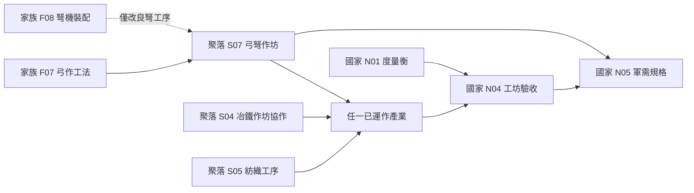

# 家族、聚落與國家科技樹 v2 草案（v2.4）

更新：2026-10-07（Asia/Taipei）。狀態：**D01–D12 與 T2／T3／T5／T6／T7 均保留已確認；科技玩法尚未實作或執行驗收，TECH-AI-01／02 均未完成。** v2.1 補至 40 候選，v2.2 補世界固定政策、真工匠門檻與七項決策，v2.3 補 R27–R35 的研究／授課／保存契約。本輪依「再次審核並修正計畫，直到沒有問題」形成 v2.4：明定 P1 原營地材料授權者及生命週期、D10 按世界政策追加守衛、原隊伍具名同意入口、研究與材料權限的交接界線，以及 NPC 新同意沿原職責 AI 開關；新增 R36–R40 及相應驗收。歷史 R01–R35 保留，不新增使用者決策。

本稿承接 [10 月 2 日原稿](../FAMILY_SETTLEMENT_NATION_TECH_TREE_PLAN.md)及後續前置缺口討論，是本輪後續討論與施工規劃的版本。保留原稿作歷史紀錄，不覆寫其中當時的查核結果。本輪只交付本文件；不修改遊戲、存檔、其他計畫或 Git 提交。

## 1. 結論與 v2 修正

**家族保存與傳授技藝，聚落提供在地生產能力，國家推行制度與協作。** 三者並存；聚落等級、個人技藝、職位權限與國家制度各有不同作用，不能併成一個科技總等級。

本稿保留原 30 個候選節點（各層 10 個），v2.1 另補 10 個軍工／造船／甲冑／火攻候選（第 4.4 節），共 40 個；首包已確認只完成 F07「弓作工法」的試作、學會、傳授、新工單效果和存讀，並包含取得原隊派工同意的正式隊員。五節點跨層鏈 F07／S07／N01／N04／N05 是後續候選，不是首包的全部前置。

相較原稿，已修正：

1. 家族已有 v2 職位和家主任命，聚落已有中心、身分、居民與管轄，國家已有職位分工。沿現有 owner 接入科技，不重建這些組織。
2. 現行已有 32 種 FEATURES、8 種 RANGED_RECIPES，另有煉鋼、陶器、繩索、羊毛織布和鋼製工具配方。舊稿「19 種設施、4 種手作、鋼／羊毛／倉庫皆待建立」不再代表現況。
3. 原 Region 旅行、共同時間及冷地點補算已有程式；缺少的是科技資料在這些流程中的契約，不能再新增第二個世界時鐘或旅行 owner。
4. F07 製弓沿有效遊戲秒；進入交戰會按原手作規則拒絕／取消，不能描述為「戰鬥時仍慢慢研究」。研究已驗收階段與當前作業進度分開處理。
5. 首次成功研究同時產生「家族保存工法」與「試作者已學會」兩個不同事實；傳授同時占用老師與學生，不能只占用其中一人。
6. 科技完成條件、當下生效條件及尚待開發的功能分開。已學會的知識不因匠人離開而消失，但無合格操作人員時不會自動生產。
7. 已定案的家主任命、職責代行、隊伍優先等規則持續沿用；本次 D01–D09 也已依使用者回覆確認，決策與未完成工作分別記錄於第 10 節。
8. **D10（v2.1，v2.2 補契約）：** 使用者選定「新遊戲要研究」。鋼（含鋼製工具）、羊毛織布、配重投石機、攻城塔，在相應節點上線後建立的新世界中改由科技取得；既有世界不因後續節點發布追加門檻。門檻只限制製造／新建，取得的物品及器械仍可使用、基本維修照舊；實際工匠資格與師傅留場見第 5.3 節。

使用者於 2026-10-07 先回覆「7.要記錄下來，不然我不知道還沒做。其餘依建議更新。」確認 D01–D09，後續要求「先將缺口補齊」並對七項逐一回覆「依建議」，形成 v2.2；「再次審核並修正計畫」形成 v2.3。本輪再依「再次審核並修正計畫，直到沒有問題」逐輪修正並複審；第 10.4 節七項方案維持已確認，未完成追蹤保留。方案確認不代表程式已完成；首包數值與離線 0.5 倍為已採用的初始測試值，尚未經平衡驗證，其餘節點與候選欄位仍須按分期展開。

## 2. 本輪現況證據

查核位置：`D:\worldgoing`。對話原附 Dropbox 路徑本輪仍不存在。Git HEAD 查得 `24eaf20`，但工作區有未提交修改，因此此 SHA 只作定位，**不表示本稿查核的是乾淨提交快照**。函式名是主要定位依據，行號可能隨共享工作區變更。

- **家族已建制。** [SiteFamilyContinuity](../scripts/terrain_lab/site_family_continuity.gd) 的 `validate_family:20` 支援 v1 名冊／v2 名冊與 offices；`appoint_head:71`、`duty_resolve:62`、`apply_office_plan:92` 已存在。尚無 family_id、科技紀錄、研究或授徒入口。`register_members:200` 目前重建 family 字典時只特別保留 offices，新增科技後必須同步保留新欄位。
- **職責有共用規則。** [SiteOffices](../scripts/terrain_lab/site_offices.gd) 的 `CATALOG:16` 中家族只有 `family.roster`。研究與授徒須有真入口才加入，名稱沿 [職位與職責計畫](../OFFICE_POSITIONS_AND_DUTIES_PLAN.md) 的 `family.research`、`family.teach`；授徒職責統一用 `family.teach`（2026-10-08 使用者決定，沿程式現況），不新造一個首長權限系統。
- **正式控制接續只在死亡後。** `SiteFamilyContinuity.choose:243–246` 只允受控人物真正死亡後接續，`SiteController._control_family_person:4435` 是此流程的 callback；正式 UI 沒有在世自由換人入口。P1 不可靠輪流控制取得隊伍同意，須沿第 6.1 節補真請求／決定入口。
- **NPC 職責決定已有開關。** 職位計畫第 5.1 節及 NPC AI 計畫第 8.2 節已確認：`duty_ai` 關閉時，NPC 持有權限但不自行決策；`SiteDutyAI.review:124` 按原隊開關評估，`TerrainArmy.set_duty_ai_enabled:3710` 只改原旗標。P1 具名請求不能繞過它自動取得 NPC 新同意，也不把關閉視為撤銷已正式接受的原工作。
- **聚落已有 owner。** [SiteSettlement](../scripts/terrain_lab/site_settlement.gd) 的 `FIELDS:11`、`found:211`、`cell_in_jurisdiction:116`、`residents:127`、`advance_capture:324 → fall_to:367` 的陷落流程，以及 `validate:45` 管理原聚落。居民由原住宅登記、存活和陣營推導。目前一 Site 最多一中心，管理入口有 Crowd 限制。以函式實際名稱和源碼為準，不能再寫「聚落不存在」。
- **國家已有 offices。** [SiteEquipmentOrders](../scripts/terrain_lab/site_equipment_orders.gd) 的 `nation_offices:53`、`nation_head_executor:69`、`nation_duty_resolve:73`、`appoint_nation_head:89` 和 `valid_nations:812` 已接職位。新型資料的 military_head 為推導值，不能與 offices 雙寫。國家研究、財政和聚落隸屬仍不是這幾個職位自動提供的能力。
- **真實生產端已增加。** [SiteRuntime](../scripts/terrain_lab/site_runtime.gd) 的 `RANGED_RECIPES:13`、`FEATURES:49`、`FEATURE_RECIPES:85` 是現況定義。依 D10，只有煉鋼／鋼製工具、羊毛織布、配重投石機、攻城塔四類在新遊戲改為科技門檻（第 5.3 節）；其他現有建造、營帳、火箭及基本配方不鎖，舊存檔四類也不鎖。
- **配方選取不等於實際加工。** `SiteRuntime.request_feature_recipe:1449` 只設定原設施配方；實際工人、批次扣料、工時及交貨沿 `_feature_work:3926`。`wool_cloth` 產出原 `cloth`，`steel_tools` 產出原 `tools`；門檻以配方辨識，不把通用布料／工具另判為鎖定物品。原冷補算重播同一加工路徑，不能只在 UI 選單加檢查。
- **來源預算並非原製弓自帶權限。** `SiteRuntime.ranged_craft:392` 直接查原 `site.inventory`／`depot_items`、工具及容量，尚無科研來源授權／上限入口，也無營地物權職位。`SitePersonActions._source:1393` 回原營地，`_ranged_craft_context:1256` 查本人停止／清醒自由／營地相鄰／脫戰；`SiteController._open_person_inventory:3762` 有人工原控制／Site 上下文檢查。P1 按第 6.1 節固定原營地及人工取用准入來核額，不由家族職稱推定材料權；具名入口仍須實作。
- **器械下單早於人物入工位。** `SiteRuntime.begin_siege_build:904` 先查空工位並扣料建工程，原 `SiteWorkTeam` 再派人；`advance_siege_work:1214` 接各工位工作量。`SiteWorkTeam` 目前先呼叫 `work_time` 才提交施工量；技藝資格須在原疲勞／工時支出前預檢，提交前再驗同一人物及工位，不能只在最後拒絕進度。
- **六種船已有正式造船入口。** [SiteVehicleShipDefinitions](../scripts/terrain_lab/site_vehicle_ship_definitions.gd) 的 `KINDS:7`、成本及工時定義包含渡船、河船、沿海貨船、運兵船、巡邏船、樓船；`SiteController` 正式造船選單與 `SiteRuntime.begin_ship_build:2914` 已接這六型。此為原始碼現況，不推定六型視覺／玩法皆已驗收。
- **甲冑已有原物品與素材。** 原裝備初始化／明示測試補貨建立實物，`SiteEquipmentOrders` 依既有 item record 配裝；本輪未見正式甲冑製作配方。S13 要補製作與原實物／呈現准入，不把配裝說成生成來源，也不預設重做所有圖集與定義。
- **新世界政策需沿原保存接線。** [RegionEntry](../scripts/region_lab/region_entry.gd) 的 `request_new_world:25` 接主選單新遊戲；`RegionSaveSlot.open_map:47` 以預期內容重建 pin，`_same_pin:98` 檢查既有精確欄位。不能只把科技版本寫入顯示用 `world.json` 就宣稱已保存，須沿原世界／slot／Site 載入保留同一政策並驗非法值。
- **F07 有可沿用的交易。** [SitePersonActions](../scripts/terrain_lab/site_person_actions.gd) 的 `begin_ranged_craft:724` 只預檢；`settle_after_contacts:1026` → `_commit` → `SiteRuntime.ranged_craft:392` 成功後才扣料與產物提交。弓基準為木材 4、纖維 2、120 有效遊戲秒；受疲勞與原作業條件約束。
- **研究時鐘與交戰限制。** [TerrainLab](../scripts/terrain_lab/terrain_lab.gd) 的 `_advance_fatigue` 把原 game_seconds 傳給 `person_actions.advance`；手作沿 `Fatigue.work_seconds` 推進。`SitePersonActions._ranged_craft_context:1256` 要求 `combat_left == 0`、清醒自由、停止、營地相鄰。和平倍率 60、simulation_speed=1、無疲勞時，基準一把弓約 2 現實秒；此換算是源碼推導，非本輪實測。
- **授課 REST 仍需補接原恢復准入。** `SitePersonActions.blocks_fatigue_rest:2036` 目前只放行安全的 `fire_suppress` REST；`TerrainLab._advance_team_fatigue:2037` 在 2071 行以此檢查全隊是否能恢復。不能只新增授課暫停標記而保留原拒絕，否則正式隊員會因作業仍忙碌而無法恢復。原 `_advance_team_equipment:995–1009` 已示範按同一疲勞池分組及合計參與者努力率；第 6.3 節沿此 owner 語義補授課接線，不複製疲勞池。
- **原疲勞結算仍逐作業進行。** `TerrainLab._advance_original_shared_step:1477` 先呼叫 Controller tick，`SiteController.tick:2499` 的 Runtime／原工人工作可先寫疲勞；`TerrainLab._advance_fatigue:1916–1925` 再處理訓練、人物作業，之後另處理守衛與其餘原努力。`SitePersonActions.advance:885` 仍迭代 `_jobs`，各作業在 `933–967` 讀改原 pool。多人裝備的分組只涵蓋其參與者，不是全池既有一次彙總。授課須在這些原 caller 當段寫入前完成第 6.3 節需求收集與接線，不能只在授課入口加兩人的努力率。
- **授課提交需重驗雙方。** `settle_after_contacts:1064–1068` 的一般分支只重查 executor 的非受控敵情；多人裝備分支才遍查其參與者。新增授課不能只擴 busy 映射，還須在原接觸結算後同時重驗老師與學生，包含學生在課程到時後才失效的情境。
- **原手作來源檢查分項處理。** `SitePersonActions:1205–1209` 比對執行者 holder／cargo 身分及執行者 holder.version，營地 holder／stock 則比對原物件身分；`SiteRuntime.ranged_craft:403–409` 在提交時檢查當下材料和容量。營地合法交貨改變其 version 不會單獨取消原手作。科技仍須另驗本次來源授權及累計預算，不能將所有 holder 的版本變動視為同一種失效。
- **存檔有分項限制。** [SiteStore](../scripts/terrain_lab/site_store.gd) 現為 format 3；原人物作業 `save_guard:80` 遇未完成工作會 BUSY。Controller 已有火災 checkpoint 例外，但該例外拒絕非 fire_suppress 工作，不能套用給製弓／授徒。
- **旅行與冷地點已有接線。** [RegionTravel](../scripts/region_lab/region_travel.gd) 的 `extract:109`／`insert:421`、[RegionSaveSlot](../scripts/region_lab/region_save_slot.gd) 及 TerrainLab 的 `replay_site_to`／`advance_cold_site` 是現成邊界。尚無科技的移交／重播支持；首包必須處理拒絕或保留語義，而不是讓新欄位在旅行時默默消失。
- **原家族移交會合併／複製名冊。** `RegionSaveSlot._transfer_family:868–895` 將兩端名冊合併並複製回兩端，`RegionTravel.insert` 重建家族；`SiteFamilyContinuity.choose:265–273` 的跨地死亡接續在歸檔後複製整份 family。新增科技須先區分同／異 family_id 和唯一項目持有者，不能把原名冊複製直接當成科技交接。
- **冷補算終點仍經保存守衛。** `TerrainLab.replay_site_to:1609–1614` 在固定目標後查保存與 capture；研究工單未完成會沿 `SitePersonActions.save_guard:80` 得到 BUSY，失敗的冷候選在 `advance_cold_site:5201–5207` 被回收。T2 啟用前須補限定研究的終點保存／交接，不能只乘 0.5 就視為已支持。
- **器械試驗及繳獲證據尚無欄位。** `advance_siege_work:1214–1237` 只累積共享進度，完成即清空 build，沒有原試作者收據；`takeover_siege:1325–1357` 只改 team_id／holder.version，沒有繳獲來源。`SiteStore._validate_siege_vehicle:2659` 限定欄位及 vehicle_version=2，後續試驗／分析資料須沿原 vehicle 與 validator 明確升版或遷移，不能從目前持有方倒推來源。

本輪在 TerrainLab／Region／World 腳本搜尋研究／科技及 research／technology／tech_tree，只有職責目錄中保留研究入口的註解，未找到正式研究流程。部分舊架構／AI 文件的「無聚落」「職位尚未實作」段落已落後源碼；本稿修正文內描述，不擴張修改那些文件。

## 3. 沿用的規則與仍需補的內容

### 3.1 已有規則，不再另行決定

依現行原始碼和職位計畫：職責各有唯一所屬職位；空缺或暫時失格由原首長按原規則代行；組織調整權不另交給科技系統。職位不等於技藝，控制接續不授予職位或知識。族人同時是正式隊員時，沿既定的隊伍優先／取得派工負責者同意，不由家族命令偷走正在訓練、搬運或戰鬥的人。

原 Site 時鐘、人物、裝備、配方、庫存、住宅、聚落、職位、旅行及存檔繼續各自擁有原資料。科技完成不送人、不送免費物品、不提升訓練值、不改文化階序。

### 3.2 P1 真正缺口

- 在原 family 中建立穩定科技歸屬與版本化研究資料。候選是補一個固定 family_id；不從現任家主／受控者 ID 推算，不另造平行家族名冊。初版仍只有原 family owner，多家族管理不擴入。
- 在原人物保存「已學會哪些技藝」，補同一欄位的 Actor／Army／Crowd 冷資料驗證與必要移轉。組織工法與人物技藝是兩種事實，不維護兩份相同人物能力帳本。
- 正式 `family.research`／`family.teach` 命令、原作業互斥、試作成功一次記錄、老師與學生共同授課。
- 研究人員與原營地材料的合法調用；家主身分不自動授予隊伍調人權或整個 Site 的庫存所有權。
- 正式 UI、取消／中斷結果、已驗收階段存讀及舊檔相容。

這些可以隨 F07 一起實作，無需先完成 40 節點、完整婚姻族譜、國家財政或新居民系統。

## 4. 節點目錄（40 個候選）

每項分別標示「科技前置」「玩家新增用途」「開發接點」。科技前置是遊戲內條件；開發接點是程式交付條件，不能拿尚無命令入口的節點讓玩家付費研究。

F07 已在第 6 節展開並確認首包契約；其餘 39 個節點仍為提案，必須補齊可見操作、成本及驗收，才能由候選變為可研究。所有科技節點尚未實作，現有基本玩法繼續可用；D10 的四類門檻只有對應節點真正上線後建立的新世界才納入（第 5.3 節），此前建立的世界保留原政策。

### 4.1 家族：技藝與傳承

- **F01 農事記錄**｜科技前置：無。新增用途：建立可追溯的耕作試驗紀錄，為適地留種提供知識。開發接點：實際生產結果與試驗條件；若只有文字紀錄，併作 F02 的試驗階段，不單獨收研究成本。
- **F02 適地留種**｜科技前置：F01。新增用途：選擇留種作業和適地種植方案。開發接點：收穫／留種守恆、種子效果；不憑空加水或肥力。
- **F03 炭化控火**｜科技前置：無。新增用途：合格操作員可採改良炭化工序。開發接點：原炭窯，先只考慮工時改良，材料與產物沿原配方。
- **F04 冶煉鍛打**｜科技前置：F03。新增用途：符合建立時門檻政策的新世界解鎖 smelter `steel` 與 smithy `steel_tools` 配方（D10）；舊世界兩配方照舊可用，本節點在舊世界只記知識、不另給加成。開發接點：原配方提示與實際 `_feature_work` 的操作者／扣料／工作段共用門檻；先驗零鋼起步的合法研究試作（第 5.3 節），不能只鎖選單。鐵料、通用工具、基本鐵匠配方不鎖。
- **F05 纖維處理**｜科技前置：無。新增用途：纖維前處理方案。開發接點：必須有可區分的工序選擇；未有獨立收益時可併作 F06 試驗階段。
- **F06 毛紡織造**｜科技前置：F05。新增用途：符合建立時門檻政策的新世界解鎖 weaver `wool_cloth` 配方（D10）；植物纖維織布與繩索不鎖。開發接點：原配方提示與實際加工共用操作者資格；`wool_cloth` 仍產出原通用 `cloth`，不新增另一份布料 owner。
- **F07 弓作工法**｜科技前置：無。新增用途：已學會者的新製弓工單工時較短，並可傳授。開發接點：原 bow 手作／人物／family；首包已確認效果為工時減少 10%，其餘成本、產物和戰力不變。
- **F08 弩機裝配**｜科技前置：F07。新增用途：改良弩作工序。開發接點：原 crossbow 手作與實際鐵料；基本製弩仍可用，且此節點不阻擋 S07 的製弓工序。
- **F09 丈量放樣**｜科技前置：無。新增用途：工程施工準備方案。開發接點：若不能產生可執行的方案選項，保留作 F10 的準備階段；不改地圖尺度或導航。
- **F10 木石營造**｜科技前置：F09。新增用途：較複雜工程的改良施工法。開發接點：沿現有普通建物、牆、門、梯、橋的原施工規則，不再將它們統稱為未實作。

### 4.2 聚落：設施與工序

- **S01 供水排程**｜科技前置：無。新增用途：合法管理者選擇用途優先順序。開發接點：原水源能力／供水分配、原聚落管轄；不增加水源總量。
- **S02 灌排工程**｜科技前置：S01、F09。新增用途：符合地形與水源的灌排方案。開發接點：具體渠道／服務範圍與施工；不用全圖農業百分比代替工程。
- **S03 炭窯工序**｜科技前置：F03。新增用途：指定炭窯採用改良工序。開發接點：原設施改造、合格操作員；人物離開只停效，不刪聚落已驗收知識。
- **S04 冶鐵作坊協作**｜科技前置：F04。新增用途：原冶煉與鐵匠間的分工工單。開發接點：真物資來源及交付；不強制另研究 S03，合法外來燃料亦可用。
- **S05 紡織工序**｜科技前置：F06。新增用途：指定原織布設施採用改良批次。開發接點：工法與人員檢查，不與家族相同工時加成重複連乘。
- **S06 糧食乾燥與倉儲**｜科技前置：無。新增用途：乾燥處理或明確的新糧儲管理規則。開發接點：倉庫已存在，具體乾燥品類／損耗規則仍需定義；不為逼研究而對既有糧食追加腐敗懲罰。
- **S07 弓弩作坊**｜科技前置：F07。新增用途：作坊工單、真操作席位及供料授權；弩改良另需 F08。開發接點：選定原設施作宿主並補工序，現有 smithy 並不等於已可批量接軍需訂單；首席位只對應一位真人。
- **S08 修造與備件**｜科技前置：S07。新增用途：針對指定器具的維修／備件配方。開發接點：現有建物、船舶等維修不可冒稱為個人裝備耐久；只在選定器具的真損耗與維修契約成立後開放。
- **S09 工程標準化**｜科技前置：F10。新增用途：保存並重用合法施工方案。開發接點：每次仍重查原占地、權限、人員和材料；若沒有獨立操作，先併作 S10 的施工準備。
- **S10 防禦工務**｜科技前置：S09。新增用途：新防禦工程協作／維護安排。開發接點：已有牆門梯與損傷流程照舊，先定具體新增命令，再決定是否值得單列科技。

### 4.3 國家：制度與推廣

- **N01 度量衡制度**｜科技前置：無。新增用途候選：發布公共採購規格，例如批量、可接受的原物品與替代品。開發接點：應與原配裝標準區分，不能只新增一個無操作的進度條。
- **N02 戶籍與勞役登記**｜科技前置：無。新增用途：國家層級的合法登記與工程徵調。開發接點：聚落居民名冊已存在；沿原人與職責增加國家授權，不另外生居民。
- **N03 糧儲與賑濟制度**｜科技前置：N01、S06。新增用途：指定真儲備、配送對象和支出上限。開發接點：原物資、來源授權與交付；有倉庫不等於有國庫。
- **N04 工坊驗收制度**｜科技前置：N01，及任一 S04／S05／S07。新增用途候選：由有權者認定符合規格的原作坊，保留資格和撤銷原因。開發接點：驗收標準、真作坊引用及授权；不要求三種產業全部完成。
- **N05 軍需規格制度**｜科技前置：N04、S07。新增用途：按既有裝備標準下有物資上限的生產訂單，再由原領裝流程交付。開發接點：原 nation offices、配裝標準、作坊工單；已有「設定配裝標準」不需重新研究。
- **N06 公共工程編制**｜科技前置：N02、S09。新增用途：授權負責人組織原工人與材料執行工程。開發接點：合法調人與施工命令，不增加額外工人或全圖速度。
- **N07 技藝傳習制度**｜科技前置：任一家族技藝。新增用途：國家資助並組織真師徒教學。開發接點：先有可區分於基本授徒的名額／資助操作；基本家族授徒不需要 N07。
- **N08 道路驛運制度**｜科技前置：N06。新增用途：公共路線與運輸安排。開發接點：沿已有旅行／車船／共同時間；制度授權與遠地技藝推廣尚需接線，道路不自動加速。
- **N09 稅籍與財政制度**｜科技前置：N01、N02。新增用途：合法實物稅／支出制度。開發接點：財產、來源、徵收和支出命令，不能把同 Site 庫存都視為國有。
- **N10 地方行政制度**｜科技前置：N02、N09。新增用途：地方職掌與國家授權。開發接點：聚落隸屬及可撤銷權限；跨地版本另需 N08 與既有旅行的資料整合，不另建地圖 owner。

### 4.4 軍工、造船、甲冑與火攻（v2.1 補回）

原稿沒有這幾條，但現行程式已有五種攻城器械、碼頭／船塢、六型船的正式造船、火箭與建築燃燒；D10 又把配重投石機、攻城塔改成相應新世界需研究，必須有節點承接。下列仍是候選，同樣受第 4 節「開發接點未完成不得收研究成本」約束；既有六型船不追加門檻。

- **F11 器械木作**｜科技前置：F09。新增用途：符合建立時門檻政策的新世界解鎖攻城塔（D10）；學會者在固定重弩、衝車、牽引投石機施工工位的工時改善（候選值待定）。開發接點：原 `begin_siege_build` 備料准入及原施工工位工作段；依第 5.3 節合格師傅實際參與，固定重弩、衝車、牽引投石機本身不鎖。
- **F12 配重機構**｜科技前置：F11，且本族曾有人完成一座牽引投石機。新增用途：符合建立時門檻政策的新世界解鎖配重投石機（D10）。開發接點：同 F11；分析證據不取代牽引投石機實績或科技前置。
- **F13 舟楫工法**｜科技前置：F09。新增用途：原船塢施工的候選工時改善；S12 的家族前置。開發接點：沿原六型船的施工路徑，渡船、河船、沿海貨船、運兵船、巡邏船、樓船原造船權均不鎖；工時改善仍須另定數值與驗收。
- **F14 鞣革**｜科技前置：無。新增用途：製革作坊改良工序；S13 前置。開發接點：原 tannery。
- **F15 引火配方**｜科技前置：F03。新增用途候選：投石機用火罐彈藥。開發接點：沿火攻系統的燃燒規則與新彈藥定義；火箭不鎖。
- **S11 器械場**｜科技前置：F11、聚落 3 級。新增用途：指定場地讓器械施工超過攻城計畫首批 4 個工位。開發接點：每個工位仍對應真人與原施工互斥。
- **S12 船塢工序**｜科技前置：F13、原船塢、聚落 2 級。新增用途候選：原船塢的新增工序／協作操作。開發接點：另列可見操作、成本與驗收；不得以解鎖已有沿海貨船／運兵船等六型為收益。若新增船型，須明列不同型號及完整契約；未展開前不可研究。
- **S13 甲冑作坊**｜科技前置：F14、F04、聚落 3 級。新增用途：皮甲／鐵甲製作配方。開發接點：目前缺正式製作配方；產物接回原 `item_definitions`／`item_records` 及唯一實物建立路徑，優先沿用既有甲冑素材與定義，只補實際缺項與呈現准入。配裝使用已有實物，不當作製作來源。
- **N11 軍器監**｜科技前置：N04，及 S11 或 S13。新增用途：國家對器械／甲冑的驗收與訂單；職責候選 `nation.arsenal`。
- **N12 水師編制**｜科技前置：N05、S12。新增用途候選：把原船隻編入原國家軍團與相關指揮操作。開發接點：須展開有別於現有船舶操作的正式編制／指揮契約；不鎖已有巡邏船、樓船。真正新增船型另列型號及完整玩法驗收，未展開前不可研究。

## 5. 前置、驗收與生效

### 5.1 三種條件

1. **開發條件**：該節點對應命令、存讀和驗收已完成；未完成就只顯示規劃候選，不能收研究成本。
2. **研究／採用條件**：科技前置、合法歸屬、試驗人員、場地、成本及授權成立；完成後留下已知／已驗收紀錄。
3. **運作條件**：每次使用都查原人物技藝、真設施、物資、管轄、職責及停效原因；不保存一個永遠有效的全局加成。

家族工法可提供學習來源，但不能代替實際匠人。聚落已驗收技術不因操作員死亡倒退；缺人只停用需人執行的工序。科技也不能繞過中心停效、原民用建物 grade 上限或既有權限；等級管理工程容量，科技管理工序，停效及占領依已確認的 D08 處理。

### 5.2 首條跨層候選

此圖只展示部分依賴，完整以前述目錄為準。以 S07 作 N04 的產業來源時，最小候選集合為 F07、S07、N01、N04、N05，共五個；不含 F08／S04／S05。N07 教育不是 F07 的前置，避免教育與技藝相互等待。

N01／N04／N05 已確認採 D09 的條件規則：只有三項各自具有獨立可見操作及代價時才分開研究。第 4 節列出操作候選；若實作時只有最後一步帶來新操作，合併玩家流程或延後中間節點，不為保留數量強做三道進度條。藍圖 ID 保留以供追蹤，不等於三項都會上線。

### 5.3 D10 門檻規則（v2.2，已確認）

使用者先選「新遊戲要研究」，前輪再確認 D11 的製造／使用界線及 D12 的實際工匠／師傅留場。以下為落實 D10 的施工契約，不表示門檻已接入遊戲。

**追加門檻的共同順序：**先沿原載入／世界上下文解析並驗證固定政策。只有該政策含目前配方／器械所屬類別時，才追加下述 D10 的本人技藝、師傅、有限研究例外檢查；未列入該類別的世界仍走原准入、原成本／工時與提交，不因人物未學或沒有研究項目而拒絕。合法舊格式先依相容規則還原為無門檻政策；新格式必填政策缺失或非法則拒絕。不能把「合法舊格式未設門檻」與「新格式缺少必要上下文」混用。F07 工時改良及其他已研究新效果仍依各節點規則，不從這個空政策自動取得。

1. **世界建立時固定政策：** 主選單「新遊戲」沿原 `RegionEntry`／`RegionSaveSlot` 建立流程記錄當時已通過研究、取得、保存與 NPC 配置驗收的門檻類別及規則版本；該政策隨原世界永久保存。後續發布節點不得回填或擴大既有世界的門檻。合法舊格式缺欄位視為無門檻；新格式必填欄位缺失、未知版本、非法類別或資料衝突須拒絕，不能假裝成舊檔放行。不依存檔日期、目前建物或庫存推測。
2. **四類範圍：** 僅煉鋼／鋼製工具（F04）、羊毛織布（F06）、攻城塔（F11）、配重投石機（F12）。其他現有內容一律不鎖，包含六型船、基本布料／工具及其他器械。`wool_cloth`／`steel_tools` 鎖的是原配方路線，不是其產出的通用 `cloth`／`tools`。
3. **按批次納入新世界：** 某類節點、合法首次研究與同類 TECH-AI-02 配置通過後，才可加入之後新建世界的政策。P1（F07）不納入任何門檻；P1 世界日後更新仍不加鎖。F04 先上線的世界只記當時已開放類別，日後 F06 上線不回鎖該世界。未訪 Site、旅行、另存與冷載入均沿同一原世界政策，不另按 Site 建立時間判斷。
4. **製造／使用界線（D11）：** 普通製造與新建查門檻；交易、搜刮、繳獲、移交、配裝、既成器械操作及基本維修沿原准入，不加 D10 知識要求。修理可使用已取得的鋼等材料，但自行製造材料仍查原配方門檻；不得把新建改名修理，或把不可修理的殘骸當成重建入口。
5. **受鎖配方由實際操作人學會（D12）：** 該世界政策含 F04 或 F06 時，相應普通 `steel`／`steel_tools` 或 `wool_cloth` 加工才追加「本人已學會」；仍由實際到原工作入口、具原資格的原人物執行。每次扣新批次材料及累積工時／本段工作努力前重新查；下令者會、家族已知或曾選過配方均不能代替本人資格。受鎖類別的未學者不扣新料、不加進度、不收本段工作努力。正式派工、原直接命令與冷補算共用此准入；受鎖路徑缺少原人物或新格式必要政策上下文不可默認取得資格。未鎖類別的原批次續作及下一批沿原准入。
6. **受鎖器械備料與施工分開（D12）：** 該世界政策含相應 F11／F12 時，原下單仍查幾何、空工位、權限與材料，扣料前另確認原施工隊有合法可承接的已學師傅；不要求師傅預先站進下單時必須清空的工位。備料後，只有至少一位合格師傅已到本器械合法工位、持有本器械原施工任務且當段實際參與，才允許本人及未學助手累積建造工時。准入在原 `work_time` 收取努力前查，提交前再驗同一人物／工位，不由 UI 或上一幀資格代替。該類別未列入政策時不追加此技藝／師傅門檻。
7. **受鎖工程無合格師傅留場即停工：** 按上述世界政策啟用本工程門檻後，當段已沒有任何合格師傅在本工程合法工位實際參與，包含最後一位離位、REST、失能、死亡、任務被替換或失去施工資格時，助手同步停止本器械建造；保留已付材料、器械身分與原進度，停工期間不補算。若另一位合格師傅仍在合法工位實際施工即可續作；停工後由合格師傅合法到位承接。一人不能替多座器械掛名，附近站立或同族已知均不算；共同工作區間按原時間及實際資格計，不因人物處理順序多算工時。此規則用於門檻施工，基本修理仍依 D11 照舊。
8. **已完成批次可交貨：** 已付料且加工已完成的批次，即使當下沒有已學操作者，仍可沿原交貨權限、位置與容量一次交付；不新開批次、不補工時、不重扣或重發。未完成的已付批次保留材料與進度，等待合格操作者續作；下一批重新查製作資格。
9. **NPC 起始技藝：** 採已確認的 T7，按正式開局情境為勢力配置有限的具體原工匠及起始技藝，沿原人物保存；工匠可沒有已登錄家族，只有真實合法家族存在時才沿其原 family 登錄工法，不能自動塞入玩家家族。已掌握 F12 的背景工匠可沿 D12 合法施工，不需本局重跑首次研究，也不回填虛構牽引投石機實績；F11／牽引實績仍約束新的 F12 首次研究。不以國家旗標令全民精通，不因加入勢力、擴編、讀檔或控制切換補發。TECH-AI-02 按 F04／F06／F11／F12 分別驗收，當批門檻不等待其餘類別；此項不等於 NPC 自主研究或自主規劃生產完成。

### 5.4 尚未學會時的研究自舉

F04／F06／F11／F12 上線前，須明列從未學會開始的完整試驗階段、實際材料來源、總額上限及完成要求；F04 另驗零鋼庫存也能合法取得第一份知識。優先沿未被鎖的基礎工序試驗；若需操作目標配方或施工，只對正式研究項目綁定的原試作者、原工單、指定配方／器械及有限試作次數豁免正在研究的知識門檻。其餘科技前置、原隊同意、材料授權、場地、工具、供水、工時、疲勞、產物、累計預算及提交守衛全部照常；F12 的牽引投石機實績前置仍須成立。

研究例外不是普通量產資格，不能改用途／配方、轉給其他人或其他工單；取消、撤權或本次項目失效即停止，換人／重送不能重置預算或免費產出。有效研究工作仍只沿原作業推進一次；正式試驗與普通生產共用原扣料／產物提交，不由 UI 直接給知識。試驗階段、成本、合法起步與保存驗收未完成前，該類節點不可研究，也不能納入新世界門檻。

器械試驗不能把共享 `build.progress` 或最後一位工人的 `complete` 回傳直接兌成個人研究成功。F11／F12 展開時，原試驗階段須明定指定試作者應親自完成的有效工作及助手允許範圍，並在原器械建造完成、清空 build 前，同次提交綁定原項目、試作者、器械及試驗階段的收據。甲完成部分後由乙收尾、普通合格工匠接完或研究取消後完工，都不能把甲的工作算成乙已學會；不符合個人證據的施工可沿合法普通工程產出實物，但不得補發研究成功。施工、材料、證據與知識仍由原 owner 提交，未展開此契約前不開器械研究例外。

## 6. F07 首包的可執行契約

本節採第 10 節已確認的首包方案與初始測試數值；程式及平衡驗證仍待完成。

### 6.1 範圍與授權

一個活動 Site、原 family、原 F07、原營地與至少兩位真實原人物。透過既有家主任命／名冊和 `SiteOffices.resolve` 解析研究或教學決策者。新增職責依現有 later duties／缺省補位契約接入，既有首長可按原規則代行；不能靠科技面板自封家主。

首包由玩家明示下令。決策者、試作者、老師和學生可為不同原人；`family.research` 決定項目和授權，人物技藝決定誰能教／使用效果。開始、恢復與提交前重查目前職責與組織引用，不以舊職位名稱或曾經合法的快照放行。

**合法交接與過期候選分開：**沿職位計畫第 3.6 節，改名或合法調動職責不取消已正式下令且原範圍仍有效的項目／作業，之後修改、續派或停止權歸當前負責者（含合法代行）。既有作業仍即時查原組織、項目、人物、隊伍同意與來源授權，不將舊下令人必須永遠等於新 decider 當成完成條件。尚未正式接受的候選在 revision 改變後須重新解析，舊負責人不能憑過期組織職責追加、變更或取消研究／授課作業；材料核准、加額與撤銷另按下述原營地人工資格判定，不能把兩種權限合併。明示撤回、任職者離任的原清除規則及真實資格失效照常，不把合法交接混成撤權。來源及本次隊伍同意的作用域不因單純職責換位自動擴大或消失。

**P1 模式前置：**首次研究只接受「本家族未知 F07＋尚未學會的試作者」；個人重學只接受「本家族已知＋尚未學會者」；授課只接受「本家族已知＋同一登錄家族的已學老師／未學學生」。已學者加入未知 F07 的家族仍可普通製弓 108 秒，但不因加入自動寫家族已知，也不走基準 120 秒的首次試作；外來工法導入仍屬後續。已學者的研究／重學請求回報已學會，不新增多餘工單。

家人資格用當前 Site 對應的原 `(site_id, person_id)` 引用核對。現有 `member_ids()` 只回整數，不能拿異地同號人物作本地族人。原世界移交若已正式重定位引用，則讀重定位後的原資料，不自行搜尋別的 Site 補一個同號人。

正式隊員已納入首包（D02），必須完成既定「該隊派工負責者同意」的可執行入口；家族職責不可覆蓋原隊伍工作。同意由原隊當前合法的 `team.work` 決策者作出，只涵蓋具體原人物及本次研究／授課。老師、學生分屬兩隊時各查各隊；撤銷、轉隊或相關授權變更後，開始／恢復／提交均重新解析，不能保存永久的「家族可調用此人」旗標。來源授權與調人同意是兩件事，不能互相替代。驗收須覆蓋正式隊員的合法同意與拒絕；僅驗兩位未受隊伍管轄的人物不足以完成首包。

**P1 同意有可達的正式請求入口：**家族研究／教學的當前合法決策者先提出綁定原人、原隊及本次項目／課程用途的具名請求，交原 `TerrainArmy` 的 `team.work` 決定路徑；此接線須隨 P1 完成。入口即時解析真正的當前 decider（含原合法代行），不接受家族 UI 自填 decider ID 或假同意。decider 是目前受控者時，由本人正式確認，無須開職責 AI；是非受控 NPC 時，先查該原隊 `offices.duty_ai=true`，再由原派工入口只對這一份玩家已提出的請求執行窄規則：原 decider 合格、組織與用途有效、所請原人確屬本隊且是合法族人、清醒自由且停止、隊伍已 HOLD／安全脫戰，並通過原忙碌／訓練／後勤／車輛與任務優先守衛才可批准，其餘拒絕並回具體原因。NPC 原隊開關關閉時不得新批准或自動重評；提示須由原有權首長合法啟用，或按原人事權調整職責，不由研究窗代開、代任命或造同意。請求不替隊伍發 HOLD、不取消原任務、不抽走忙碌人員、不自行挑研究或發工單。雙隊師徒各走自己的原決定路徑，全部批准後家族入口才開始一份授課。

同意只保留本次原人／原隊／用途及合法決定引用，沿原項目或本次原作業候選保存，不建平行同意 owner。開始／恢復／提交均按當下真實條件重驗；過期且尚未正式接受的候選拒絕，已正式接受的同意按作用域及合法交接規則處理。單純關閉職責 AI 不撤銷既已正式接受且仍有效的同意／原工作；明示撤回、原資格失效及新用途另按原守衛，不能以重新開旗重放批准或作業。原受控者活著時，正式 `SiteFamilyContinuity.choose` 不能自由切換人；本流程不依賴死亡接續或測試改 controlled ID。這個回應具名調人申請的窄准入不是 NPC 主動研究／授徒安排，不以完整職責同意 AI 為前置，也不能據此關閉 TECH-AI-01。

**材料授權與累計預算：**本次研究／重學試作項目必須引用合法來源及總額授權，原 family 的項目區段保存授權識別、材料上限和已成功支出。換試作者、取消、暫停、存讀或以新嘗試序號開工，都不重置同一授權的已支出。原工單開始時預檢剩餘額，提交前再次檢查；只在原物品交易成功時同步增加實際支出，取消／失敗不扣費、不占用未成功支出。調人同意不等於材料授權，研究決策者也不能代替來源的合法授權者自行加額。授課無材料費，故不要求木材／纖維額度、不造零額度科研授權；仍驗本課家族職責、雙方原人、隊伍同意與原營地位置／場地條件，撤銷研究材料額度不取消合法無耗料課程。

**先準備、再核准、才開工：**家族研究決策者先合法建立或續用同目的的原項目及試作者引用，這一步不占人物、不扣料、不推工時、不給知識；原隊伍同意與來源核額再綁定該正式項目。全部適用條件成立後才下原試作工單，避免「核准需要項目、建項目又需要核准」的自鎖。項目準備／等待期間可按原保存契約保留資料，不能把等待項目當成 active 原人物作業。

**P1 核額資格固定：**來源只用本 Site 原 `depot_items`／`inventory`，不擴到倉庫、私人 holder、隊伍口糧或國庫。原 `SitePersonActions` 新增具名科研用途核額入口，包含 `grant`（核准）、`increase`（提高同額度上限）、`revoke`（撤銷）三種人工操作，寫回原 family 項目最小授權區段；准入必須同時滿足：請求者就是當下受控的原人物、該原 Site／營地仍與候選相同、原 Site／世界未暫停、未被 active Crowd 接管，且此人通過原營地手作取用條件（清醒自由、停止、營地相鄰合法格、脫戰及原人物作業／派工／訓練等忙碌守衛允許取用）。直接命令與 UI 都重查同一條件；不能只傳入某個合格 person_id 或假 UI 勾選。這是沿原營地可用基線核准特定科研用途，不新設全 Site 物權，也不由家主、工頭或國籍推出庫存所有權。研究方向權與隊伍調人同意仍各自另驗，來源核額不批准研究或調人。材料名與數值沿原有限資源堆疊契約驗正整數／上限，累計支出不得超核准上限；額度不是庫存預留、不預扣或搬物，當下實料、工具及容量仍由原工單預檢／提交判定。

核准綁本 Site 原營地、正式 family／項目／目的、原核准人及有限材料總額；同目的重送核准不另生新授權或清已支出。合法加額只明示提高同一授權總上限，撤銷立即令未提交的相關原工單安全取消，不扣新料、不退已成功支出／成品／證據；重啟同目的仍沿原累計，不因撤銷後再核准多出一份可重放額度。尚未提交候選遇控制／原人／Site／來源更換則拒絕且不改任何狀態。已正式核准的本次額度可供指定原研究者依授權使用，無須核准者持續受控或留在營地；切換控制、合法職責交接、營地其他合法交貨不自行撤銷，來源被非保存流程替換或明示撤銷則失效。存讀時沿同一原 Site 的完整候選校驗重建授權與來源引用，不保存 Node／物件指標，也不把新營地當舊來源。NPC 自動研究後續只能使用已有的有效額度，不能自行核准／加額／恢復已撤銷授權。

首個三把弓流程的初始總額為木材 12、纖維 6。例：甲成功兩把後累計 8／4，換乙後仍剩 4／2；乙自己的第一把可成功，其第二把須因剩餘額不足拒絕。只有來源合法授權者明示調高本次總額後才能續作；保留先前支出與證據，不因加額重新發物或歸零。每次無師傅重學是明示的個人項目，另取得該次三把弓的來源及上限授權，不能借用已耗盡的首次研究額度。保存此最小支出資料於原項目，不建立通用科研財政帳本。

### 6.2 首次研究與試作

已確認初始測試數值：完成 3 個有明示研究用途的原製弓工單才驗收 F07。每個仍用原 bow 配方與基準工時；三個成功工單合計木材 12、纖維 6，得到 3 把真弓，不另加科研耗材。此為首包採用值，尚未經平衡驗證。

- 普通製弓不被暗中計入研究；開始研究時先建立原家族項目與目標試作者，再將目的引用附到原製作工單。
- 初次研究不要求先會 F07。它是對已能做的基本製弓作改良試作，避免「先學會才能研究自己」的循環。
- 首包三次成功證據必須屬於同一原試作者。一個成功工單只累計一次；此人完成第三次時，同步記錄家族 `已知 F07` 和此人 `已學會 F07`。甲完成 2／3 後換成乙，甲的歷史成果保留供查核，乙從自己的 0／3 開始；不能只做最後一把就繼承甲的個人學習成果。項目／工單鍵必須區分試作者與本次嘗試。
- **證據生命週期：**同一正式持有者、科技、研究目的與規則版本下，沿同一原項目按原試作者保留已驗收階段；甲 2／3→乙 1／3→換回甲，甲可續本人 2／3，乙不可使用甲證據。取消單份在途工單或暫停項目不清已驗收階段，明示續同一目的時沿原項目／授權累計支出恢復，不另生可重放副本。改目的、不同家族／scope 或不相容規則不得直接合併。首次研究完成後該目的關閉，其他試作者的未完成證據只留歷史，不自動抵個人重學的三次要求。證據來自原成功提交收據，不因成品後來合法移交／消耗而抹除，也不因新項目序號重發成品。
- 完成後再次要求研究同一已知工法不重發知識／獎勵；未學會者改走教學或第 6.5 節的明示重學方式。
- 製作不再並行一個研究 Timer；原工作進度、疲勞及物品提交都只有一份。

**提交邊界：**在原接觸結算後的 `_commit → ranged_craft` 路徑，先查項目、工單目的／去重鍵、原人物、現行授權、剩餘預算和原配方；原物品交易成功時，同步記錄該次證據及實際支出。所有可失敗的項目／知識／來源驗證必須在原不可失敗提交尾段之前完成，尾段不能 yield 或 callback。第三次成功的「材料、真弓、累計支出、成功計數、家族已知、試作者學會」一次成立或全不成立；相同工單鍵重送在物品配置前拒絕，不得再發弓或扣料。不能先發物品，再由 UI 消息回呼「可能」登記研究；也不能先給技能再嘗試扣料。原 `_finish` 結果目前沒有可保存的研究去重鍵，此為首包需補的最小欄位，不引入通用事件帳本。

### 6.3 傳授

首包採一師一徒、本家族已知 F07、同一登錄家族的老師已掌握而學生尚未掌握；兩人同 Site、在營地的合法相鄰教學範圍、清醒自由且可被合法指派。一課 300 有效遊戲秒、無額外材料、不產生弓。這是獨立授課作業，不假借製弓再造一把課程獎品。

由原 `SitePersonActions` 持有**一份**授課作業及兩個原人物引用。兩人都必須通過忙碌查詢及原工作占用；不能只把教師放入 `_jobs` 卻讓學生同時採集或訓練。團隊派工、個人作業和保存守衛都須看見兩人的占用。

進度只由兩人同時合格的時間段累計一次，按同區間逐時較慢者的有效工作率累計；不可將兩人的秒數相加而令一課加倍完成。疲勞按原人物／團隊疲勞 owner 結算；授課共同區間按以下規則接入原單步：

1. 依同一實際疲勞 owner／pool 分組，無共用池者各自一組。本課努力率 `R_lesson,g = Σ PersonFatigue.effort_rate(person.body)` 只代表本課份額；該函式已處理 pool.count，不再除人數。同池在同一實際區間的其他合法製作、移動、訓練或另一課也須由原 owner 彙總成總斜率 `R_total,g`，不能只用本課份額推算整池疲勞。
2. 原 owner 先收集該區間各原作業／移動的有效努力需求，按到時、資格改變、各池原效率分段界線及休息界線分段，並納入老師／學生有效工作率的交會點；共同工作 `dt` 受雙方可用時間及所屬池的 `R_total,g` 限制。收集須在原 shared step 的任何當段努力寫入之前，包含 Controller tick 的 Runtime／WorkTeam／手動工作、原訓練、人物作業、守衛及移動；不能到 `person_actions.advance` 才讀已被其他 caller 前進的 pool，或事後扣回疲勞。組內含非受控參與者時沿原 80 休息線；受控者獨立池保留原例外，與非受控者共池則仍受共同區間限制。尚未發生的努力不能先收取，不依 `_jobs` 插入順序讀改已前進的 pool。
3. 本課有效工時是共同區間內 `min(v_teacher(t), v_student(t))` 的積分，`v(t)` 沿原疲勞工作率 `1 / (1 + slowdown(f(t)))`。先分到雙方效率高低順序固定的區間，才以各池該段起始疲勞、共同 `dt` 及 `R_total,g` 呼叫原 `Fatigue.work_seconds`，取該段兩者較小值再累加；不能先把兩人跨交會點的整幀各自積分後取較小值。同池共用一條疲勞路徑；若超過本課剩餘量，先反解完成界線並縮短區間。其他工作到時或中斷後須在下一分段重新計總斜率，不能把整幀其他工作一律當成仍持續。
4. 每個原 owner 只結算一次該段實際總努力，其中本課只占 `R_lesson,g × dt`；其他份額亦不得重收。師徒 `handled_seconds` 都記本課實際工作 `dt`，不記有效工時或 `dt/2`，其他原工作保留其實際區間。此為 P1 尚待補的原疲勞／作業接線，不宣稱現行已有一次彙總，也不新增疲勞 owner 或世界排程器。角色、人物／作業插入順序、長幀／分幀及跨門檻均須一致。

同池、pool.count=2、疲勞 79.9 的兩位非受控參與者，合計原努力率為 `WORK_RATE`，到 80 約只容許 36 遊戲秒；不能各按 `WORK_RATE/2` 放行約 72 秒。此為原數值的靜態推導，後續 A05 需驗證。

若同池 count=3，師徒與第三位製弓者在同區間一起工作，總斜率仍為 `WORK_RATE`，共同到 80 仍約 36 秒；不能授課先跑就放行 54 秒、第三人先跑就只給本課 27 秒。這是原數值的靜態反例，不是 runtime 結果；A05 另驗第三人移動、不同作業先到時和兩課共池。

跨池亦有交會反例：老師獨立池疲勞 40、努力率 `WORK_RATE`，學生 count=10 共享池疲勞 40.3、其他人閒置時努力率 `WORK_RATE/10`；300 實際遊戲秒中約第 120 秒交會。整段各自積分後取較小值約 287.179767 有效秒，按交會點分段後約 287.108957；本課採後者。這是原公式的靜態推導，A05 須以同一案例驗長幀／分幀一致。

移動、換 Site、受擊、失能、撤權或調人同意失效時取消當前課程並釋放雙方；已學會的技藝不變。疲勞休息可保留當前課程進度，但仍占用此作業，直到恢復或明示取消。完成時只將學生標為已學會，不另開一家族研究、不重發研究成果。

**雙人接觸後提交：**授課沿原 `settle_after_contacts`，在剛到 300 秒後仍重查雙方的原人物、位置、受擊版本、清醒自由、各自適用敵情及當下職責／同意。全 Site 交戰或任一方移動、受擊、失能、離族／撤權則取消並一起釋放；任一非受控參與者僅有局部 THREAT 時，依原手作將整課進度歸零並暫停，保留雙人占用；未完成課程的 REST 保留進度。控制者原例外僅適用本人，不替另一方免敵情。知識只在雙方均通過後一次提交，完成鍵重送不重授；合法工作恰在休息線完成仍沿原完成邊界結算，不因新 work_resting 標記把已完成工作重置。

**REST 恢復准入：**至少一位非受控參與者仍需休息時，本課雙方都不累計教學工時或本課努力；進度及兩人占用保留，存檔仍 BUSY。`blocks_fatigue_rest` 必須能識別本課雙方，對安全、停止且無待提交工作的授課 REST 放行原恢復檢查；`is_busy` 仍為 true，不能靠解除學生／老師占用讓疲勞下降。全隊 HOLD、其他成員忙碌／移動、敵情及原停止資格仍可阻止恢復，疲勞下降只由原 owner 處理。按原 80→50 休息門檻恢復後，重新驗雙方、位置和授權才續課，不補休息期間的課程進度。

### 6.4 時間、取消、費用與效果

- **原製弓語義優先。** 基準 120 是有效遊戲秒。原遊戲暫停停止推進，疲勞按原規則影響工作。全 Site 交戰、移動、受擊、holder／Site 變更的取消，以及 NPC 敵情／疲勞分支，均沿原手作規則，不用研究標記改寫。
- **保存的是已驗收階段。** 三次試作已成功兩次時，研究紀錄保留 2／3；第三次原手作若取消，不補成成功、不退前兩把已合法生產的弓。尚未結算的原手作進度按原規則處理，不假定可續做。
- **費用不預扣兩次。** 原製弓完成才扣木材／纖維，開始只有預檢；不足或容量變更而失敗不計成功試作。首包無額外研究耗材，取消也沒有額外退款。將來新增別種科研耗材時另定付款階段，不能套用一條全科技預扣規則。
- **既有工單不追溯改價。** 已確認效果為新 bow 工時 120 × 0.9 = 108 有效遊戲秒，開工時鎖定。已開始的 bow 不因中途學會或切換家主而改工時；材料、產物、傷害、射程、圖集准入仍原樣。
- **工法隨本人。** 依已確認的 D03，完成學習者離族不會突然忘記；原家族仍有工法紀錄。離族會影響後續家族研究／教學的授權，不反向刪除已學會能力。
- **防重複加成。** 首條鏈只有 F07 調整製弓工時；S07 提供作坊命令／真席位，N 系列提供制度，不再把相同效果連乘三次。

和平且無疲勞時 10% 只約省 0.2 現實秒／把，可能不夠明顯；首包仍採已確認的 D04 數值，於後續體驗驗證記錄節奏，不擅改全遊戲時鐘。正式 UI 顯示基準／改良有效工時，不宣稱已有玩家體驗測試。

已學會者離族後，在原材料、營地、身體與其他製作條件合法時，新 bow 仍鎖定 108 有效遊戲秒；使用既有技藝不要求仍隸屬原家族。離族者失去原家族的後續研究／教學資格，相關未完成作業安全取消；原家族已知紀錄保留，新加入者不自動學會。個人技藝與上述效果須經存讀及原人搬移驗證，不能只保留一個沒有作用的技能標記。

### 6.5 無師傅、外聘與重新學習

家族紀錄保留不等於現場有會做的人。首包已確認支持「重新試作」：沒有合格老師時，未學會者重走明示試作流程；只授予這名原人物技藝，家族已知紀錄不重複發獎或重置。依 D05，重學仍採同一原人物的 3 次成功試作，不因家族已有工法紀錄縮短；各次沿原材料及真成品交易。

重學入口與首次研究目的明確區分，但仍沿原工單、成功去重、累計預算及保存鏈。這名未學會者的前三次成功試作均為基準 120 有效遊戲秒，第三次提交才取得技藝，之後新工單為 108 秒。完成前已成功的 1／3、2／3 階段可按 BUSY 邊界保存；讀回後仍綁同一原人物，不能借前人進度或重發已提交成品。必要驗收另列 A12。

老師回到現場後，已有部分重學階段的學生可明示改走授課；若試作仍在途，先沿原取消入口安全結束，不能兩項作業同時占人。授課成功在同一知識提交中關閉該學生的未完重學目的，保留已成功試作成品、歷史及支出，未用額度不自動改成新項目授權；之後重學請求回已學，不再多造第三把。授課失敗／取消不清原重學已驗收階段，可在本次合法來源與人物條件成立後明示續作。

外來教師、付費教學、書籍實物和跨家族公開授課另列後續；不在首包文件承諾已可聘用。重新試作須明示下令，不按經過時間自動學會。

### 6.6 存讀、人物切換與旅行

研究完成數、工法、個人已學會狀態走原保存鏈。未完成製弓／授課仍沿 BUSY 守衛；存檔不先偷偷結算、取消或補滿作業。原火災 checkpoint 不豁免此限制。

`register_members`、家主任命、死亡接續、Actor／Army 控制切換、拆併隊、Crowd 載入與安全回交，都需保留同一份知識。移除項目試作者時，先安全終止其未完成作業，再保留與原試作者綁定的已完成階段；換人依第 6.2 節重新累計新人的門檻，不能借用前人的 2／3。不能把已知工法或無關族人的技藝一起清空。

P1 不做旅行中研究或離線補研究時間，但既有世界流程已存在：新增持久欄位在 `RegionTravel`／`RegionSaveSlot` 的抽取、插入、家族合併、重定位及冷人物保存中，必須**保留且驗證，或在不可移交時事前明確拒絕受影響的動作**。不能在移交後才發現遺失。此限制只針對未能安全移交的科技狀態，不全面關閉既有旅行。

每個在研項目需有唯一持有位置／scope 和去重鍵；不能在兩份 Site 家族快照各續跑一次，也不能合併兩份成功計數來製造進度。原人已學會狀態隨原人，組織研究狀態隨其正式持有者。若首包先採受限移交，驗收與交付必須列出具體受限情境；完整跨地研究另案。

原家族合併／死亡接續須增加以下前置分支，先準備及驗證整份候選，再歸檔／搬移／換控制：

1. **同一 family_id：**名冊／已知工法可沿合法原引用保留，但活動項目只接受同一持有位置／epoch 的只讀引用，或原 Region 流程的一次原子移交。舊持有者失去續跑資格後新持有者才取得；鏡像／歷史快照不能各續一份。移交不會自動延長來源材料權或隊伍同意，目的地缺條件可停用或事前拒絕。
2. **不同 family_id：**不因目的地名冊含同號人物、同陣營或取第一份 offices 而合併科技／項目。離族者的已學技藝隨本人，不攜走原族活動項目。P1 未支持的不同家族衝突，在改變原檔／歸檔或目的地前明示拒絕，不全面停用其他合法旅行。
3. **跨地死亡接續／舊資料：**接續控制不等於搬走研究所有權；目的地空家族或同族也須先驗正式持有者及原引用，不能在 `archive_current` 後無條件複製整份科技。舊資料無 family_id 時只沿原來源一次遷移保存，不按目前家主、名冊相似度或 Site 名推認兩份科技同族；無法證明或安全移交者事前拒絕受影響動作。已完成人物技能與無關原資料不得被拒絕流程清空。

## 7. 最小資料與 owner 接線

以下是候選欄位語義，不是已提交的 schema 或新框架：

- **原 family 的版本化科技區段**：穩定 family_id、已知科技 ID、目前項目及目的、同目的按原試作者綁定的已驗收階段／最小成功收據、項目序號、唯一持有位置／移交 epoch、來源授權識別／原 Site 與營地來源引用／原核准人／有限上限／累計成功支出／有效或已撤銷狀態和必要規則版本。首包只一個活動研究或重學項目，其他人的已驗收證據是該目的的停用歷史，不另跑作業。取消／換人／續同目的保留收據，目的完成後關閉；不造全世界通用排程器。名冊重建、舊版載入及移交保留同一區段，換人或新嘗試不重置同授權已支出。原載入重建可驗的來源引用，不用營地庫存 version 作核額權，也不保留 Node／物件指標。
- **原人物技藝欄位**：小版本與已學會科技 ID。沿 Actor 快照、Army 原 row 及 Crowd 原冷資料保存；不存另一份 person_id→身體／位置／疲勞表。可參照現有人格欄位的傳遞位置，但人格不是技能，不把科技塞入 personality。
- **原工作附加欄位**：項目引用、一次性工單／階段鍵、參與者、開工工時／配方版本、必要來源和授權引用。即時候選、停效文字和計算加成可重算，不重存成權威。
- **聚落／國家後續區段**：分別落在現有 `site.settlement`／原 nation 記錄；工序採用寫在原設施，國家政策只引用原來源與作坊。不得把 family 的研究永久借存在玩家控制紀錄，也不得設平行 technology_save。
- **T6 後續原人物分析收據**：在原人物最小科技區段保存該節點已取得／已抵用的不可重領收據、核准規則版本及原始研究量的累計抵扣界線。取消項目、未學會即離族、加入另一家族或重開項目均保留最多 50% 的本人上限；原項目只引用其使用，不另存一份個人權威。沿 Actor／Army／Crowd 冷欄與 Region 移交驗證；既有收據與規則版本不相容須明示處理或拒絕受影響操作，不能歸零後重新領。此欄位不列 P1。
- **T6 後續原器械來源**：原 takeover 成功提交只有在既有敵對繳獲判定與來源均可確認時，沿原 vehicle 記錄最小原器械／來源方／取得方及一次成功取得引用；同方移交或自造不生成繳獲證據。新欄位、版本與舊格式規則接 `SiteStore._validate_siege_vehicle`，不用第二份器械帳本。無可信來源的舊器械保留使用／基本維修，但拒絕分析；來源存在卻非法不可當成缺欄位放行。器械消耗與本人分析收據同次原子提交，此欄位不列 P1。

需逐一處理的路徑：

1. `SiteFamilyContinuity.validate_family/register_members/choose` 與原家主任命：版本、同 Site 原引用、名冊重建保留和控制接續。
2. `SiteOffices.CATALOG/LATER_DUTIES/resolve`：有真研究／授徒命令才加入職責；沿現行 requester 與即時 resolve，必要時補授權版本。P1 同時沿原 `TerrainArmy` 的 `team.work` 接第 6.1 節具名請求、真 decider 的人工確認或遵守原隊 `duty_ai` 的 NPC 窄回應，驗 A20；不要求先完成通用 DutyRequest 類別，也不由研究 owner 代批調人。
3. `SitePersonActions.begin_ranged_craft/advance/settle_after_contacts/_commit/_finish`：新增具名科研用途核准／加額／撤銷入口，按第 6.1 節的原營地人工取用判定；原工單、雙人授課、預算與知識一次提交，UI 不寫知識真值。雙人映射同步接 `_job_key_for/is_busy/job_for/cancel/is_working/blocks_fatigue_rest`，沿原訓練與派工的忙碌查詢排除兩人；授課 REST 單獨提供安全恢復准入，保留兩人的忙碌占用。以原 `_advance_team_equipment` 的 pool 分組作參考，不將綁裝備的直線工時誤用為授課有效工時；沿原 shared step 的 Controller／WorkTeam／訓練與 fatigue caller，在努力寫入前完成第 6.3 節收集，再由原疲勞 owner 一次結算。
4. `SiteRuntime.ranged_craft` 及原物品／庫存：提交前驗真材料和容量；無另一本科研庫存。
5. `TerrainTestCharacter.capture_state/valid_state/restore_state`；`TerrainArmy.capture_combat_state/valid_combat_state/restore_combat_state/_install_roster`；`SiteStore` 的原人物與 family 校驗：完整保存與遷移。
6. `CrowdPersonOwner.COLD_FIELDS`、`CrowdSite.sync_to_site`、`CrowdClearHandoff`：個人技藝冷資料往返。active Crowd 的 `crowd_action_guard` 仍拒絕研究／製作；能保存冷資料不等於能在 native 戰場研究。
7. `RegionTravel.extract/insert/rebase_clocks`、`RegionSaveSlot._transfer_family` 與 `SiteFamilyContinuity.choose`：先查同／異家族及唯一項目持有者，再原子移交或事前拒絕；死亡接續不無條件複製科技。人物技能及後續本人分析收據隨原人，原族項目留原持有者；固定地圖載入保持原世界政策，不在冷地點免費加科技時間。
8. `SiteController` 原正式 Window：研究、授徒、進度、作用人物、來源、缺項及停工原因。首包不新增獨立測試場景當作正式玩法入口。

舊檔缺科技欄位時仍可做原製弓、建造與其他現有操作，新改良預設未掌握；新增欄位若存在但非法則拒絕，不能當缺欄位忽略。科技小版本和新 family 版本依語義升版，原 SiteStore 外層只有真的改契約才升版；新版不能宣稱舊遊戲一定讀得懂。

## 8. 實作分期與驗收

### P0：收斂契約與資料相容

以目前已有 family offices／settlement／nation offices 為基礎，依第 10 節已確認選擇，列清新欄位、重建／移交 caller、三種研究模式、證據生命週期、合法職責交接及目前忙碌／命令授權。P1 按第 6.1 節已明定的原營地人工核額資格，完成具名核准／加額／撤銷入口及保存引用；另完成同區間全 pool 努力接線。原 ranged_craft 本身未提供這兩件事，不能只靠文案或假旗標結案。此階段不重建家主、元首、人口、聚落中心、庫存或疲勞 owner。

### P1：F07 首個可玩交付

完成第 6 節：正式選研究 → 真試作 → 家族已知及試作者學會 → 教另一名原人 → 新製弓工時改善 → 存讀與身分切換一致。正式隊員納入首包，必須完成既定調人同意及對應驗收。

普通製作沿現行路徑。Crowd 工作本身可繼續受 guard 限制，但已有新冷資料的往返不能丟失。旅行的完整支持與受限範圍按第 6.6 節實測後分別回報。僅把效果數字接到 UI 或測試入口不算完成。

P1 由玩家人工安排研究／授徒。**NPC 自動研究尚未實作，後續以 TECH-AI-01 追蹤，不阻擋 P1；P1 完成不得連帶將此項標為完成。** 詳見第 10.3 節。

### P2：S07 在地作坊

沿現有 SiteSettlement 管轄、中心停效與原設施 owner，定一個真宿主、一位真操作員、一個真工單和授權材料來源。展示「有工法無設施」「有設施無匠人」「中心停效／失去管轄」的不同結果。不把新科技等同於整個聚落等級。

多操作席位只有在每席能處理人物互斥、入口、材料與一次出貨時才加入。倉庫已有，仍須查具體來源與轉移，不以全局數字假裝兩個倉庫各有同批物資。

### P3：N01／N04／N05 的國家流程

先依 D09 確認每項有獨立操作，再沿原 nation offices 和配裝標準，接真作坊資格、訂單、支出上限與原領裝流程。國家現有任命不重做；研究／訂單職責、物資授權和制度失效才是新增範圍。先同 Site 一國，不以完整財政或外交為前置。

### P4：其他產業與遠地研究

先擴有真生產端的炭窯、紡織；抽象準備節點若無獨立用途，併入相應項目階段。跨 Site 推廣、國家研究與冷地點補算接原世界時間，在明定有效人力、成本及單一持有者後才推進；不是按現實經過天數補滿。T2 的未載入 Site 研究採已確認的初始值 0.5 倍有效研究工時，材料與前置不折扣；P1 第 6.6 節不做離線補研究的邊界不變。T5 俘虜受監管生產、T6 繳獲器械分析另按下述後續驗收接入，不擴入 P1。

**T2 冷補算終點是啟用條件：**0.5 作用於原研究作業的有效產出工時及完成界線求解，該作業中的真試作／產物亦走同一份工作，不在真弓提交後才折研究計數；原 Site 時間、實際努力／疲勞和普通工作不減半。原 replay 固定終點若落在研究工單中途，P4 須沿原 SiteStore／人物作業 owner 支持限定 NPC 研究的可序列化候選捕捉與安全恢復，保留原人物／工單／來源／授權、已付狀態、有效進度、占用及 REST／疲勞關係，驗候選後才原子提交。不能為了保存越過目標補滿、取消丟投入或套火災 checkpoint；未支持的其他在途工作仍沿原守衛。P1 人工在途存檔仍 BUSY，未完成這個後續終點契約前不啟用 T2。

### D10：四類門檻分批上線（與 P1 分開）

F04／F06／F11／F12 各自展開操作、成本、研究自舉、原工序資格與同類 TECH-AI-02 配置；每類通過 G01–G08 中相關案例後，才納入此後新世界的門檻政策。不能因只寫好科技名稱就鎖現有配方／器械，也不能因某一類已完成而宣稱其餘三類或 NPC 自主研究已完成。首包 F07 不等待這四類。

### P1 必要驗收矩陣

- **A01 首次學會**：指定的 3 次成功試作只有 3 把原弓與一次研究完成；家族已知＋試作者已學會，未參與族人仍不會。甲完成 2／3 換乙，乙只完成一把仍不會；甲的紀錄及已生產實物保留，沒有重扣或重發。
- **A02 權限**：正式隊員取得本次合法調人同意後可研習；無職責、非本地同號人、未獲隊伍同意、撤銷同意均拒絕；研究／重學試作無來源額度授權另拒絕。授課無材料費，在其餘本課條件合法時不要求木材／纖維額度；各種拒絕不扣物、不占錯人。
- **A03 教學雙方**：老師學生都不能同時接別項作業，從學生端下採集／訓練／個人命令亦拒絕，REST 期間仍拒絕兼職；任一人失能／移動／離開取消當課，雙方占用都釋放，從任一方取消都不留下孤立占用。
- **A04 原交易與來源語義**：執行者 holder／cargo 替換、執行者 holder.version 失效、原營地 holder／stock 物件替換、來源授權失效、缺料或容量不足均拒絕且不計成功。另一人向同一營地合法交貨或製作只改營地 version，而當下材料／容量／授權仍合法時，本工單可成功；兩個不同工單爭用只夠一份的材料，只准一筆成功。相同完成鍵重送不再扣料、發弓、記支出或進度；第三次提交前項目／授權失效時，弓、成本、成功計數及兩份知識全部不變。
- **A05 時間、共同疲勞與休息**：同池／不同池、互換師徒、長幀／分幀及跨 30／80 門檻的共同工時、努力及進度一致；同池 count=2、79.9 疲勞不能按半個 rate 多放行一倍工作時間。另驗同池 count=3、79.9、師徒加第三位普通製作／移動及兩課共池，依全池同區間實際努力得到相同工作量／疲勞／80 邊界；換 `_jobs` 插入順序、人物 ID 順序或讓第三份工作先完成，結果仍一致。跨池以第 6.3 節疲勞 40／40.3、努力率 W／W÷10 的效率交會案例驗逐時較慢者積分及長幀／分幀一致。原 pool 只收一次實際總努力，其他普通工作不因授課漏收／重收。正式隊員可進安全 REST，保留雙方 busy／保存 BUSY，按原 80→50 恢復後續課；休息中不加進度或本課努力，原全隊／移動／敵情守衛仍有效，受控者獨立池例外不被改寫。雙方 handled_seconds 覆蓋實際共同工作區間且不重算。暫停不推進，交戰遵守原手作取消／拒絕；已驗收 2／3 不因第三次取消丟失。
- **A06 效果界線**：只對已學會者的新 bow 工單改工時；舊工單、弩、弓戰力和原配方不被連帶修改。
- **A07 保存**：已完成／部分完成研究讀回一致；在途手作／授課 BUSY，無重發、重扣或兩地各跑一份進度。
- **A08 身分與名冊**：家主更換、受控者死亡本地接續、名冊增刪保留原工法與進度；被移除執行者的未完作業安全結束。
- **A09 原人搬移**：Actor／Army 拆併或控制切換、Crowd 進出、支持的 Region 移交／冷地點載入保留技藝；不支持者事前明示拒絕，原現場／存檔不變。
- **A10 舊檔與負向資料**：合法舊檔保持原基本玩法；非法科技版本、未知 ID、負進度、重複參與人或衝突歸屬拒絕，不覆寫原檔。
- **A11 正式操作**：玩家從原功能窗人工安排研究及授徒，能看到缺項、實際負責人、效果及「NPC 自動研究尚未開放」；直接命令不能繞過同一准入檢查，新增研究職責或人格欄位不自行發令。
- **A12 無師傅重學**：家族已知 F07、現場沒有合格老師時，另一位未學會的合法族人可從正式入口明示重學。該人 1／3、2／3 尚未學會，自己的第三次成功才學會；合計只扣木材 12／纖維 6、保留三把真弓，前三把均基準 120 秒、下把為 108 秒。原家族已知紀錄不重置或重發；部分成功存讀一致，失效取消、換人及重送沿原去重／預算規則。
- **A13 離族保留個人能力**：已學會者離族、存讀後，在其他原製作條件合法時，新 bow 仍為 108 秒；原家族工法保留，新加入者仍未學會。離族者不能沿用原家族研究／教學授權，正在參與的相關作業安全取消，既有個人技能不被名冊刪除或效果守衛清空。
- **A14 換人與累計預算**：初始授權木材 12／纖維 6，甲成功兩把後換乙；乙只可用剩餘 4／2 成功一把，其第二把因額度不足拒絕且無費用／進度／產物。來源合法授權者明示將總額提高至 20／10 後，乙才能完成另兩把；累計支出為 20／10，乙自己的三次成功才授技藝，甲兩次證據及全部五把成品保留。換人、取消、存讀、新嘗試序號不重置支出，無權加額或超額重送均拒絕；重學另有本次合法來源授權。
- **A15 模式及證據生命週期**：甲 2／3→乙 1／3→甲，在合法加額後甲只再做一把即完成本人第三次；乙不能借甲進度，實物／支出恰為四把，原完成鍵不重放。取消在途工單→保存→讀回→續同目的保留本人證據與支出；不同目的不合併。已學工匠加入未知工法家族仍普通製弓 108 秒，不自動授家族工法或開 120 秒首次研究。重學 2／3 後改授課：成功時同次關閉重學且無第三把；失敗保留 2／3 可合法續作，既有成品／支出不退、不重發；再請求重學已學者不開工。
- **A16 職責交接與候選**：合法改名／調動 family.research、family.teach 或本次 team.work 負責職責，已正式接受且作用域有效的作業可持續，停止／續派權歸新負責者，舊者不得憑過期組織職責追加或取消研究／授課。預檢後未接受候選遇 revision 改變須重查／拒絕；明示撤同意、撤來源授權或原離任清除條件仍中止受影響作業，無扣料／知識。正向交接不能誤判成永久 requester 必須相同，獨立材料核額另按 A19。
- **A17 授課接觸後雙方提交**：課程在 advance 剛達 300 秒後，只學生或只老師移動／受擊／失能、全 Site 進戰或撤權，均不得先授技能；取消時兩人占用一起釋放。任一非受控參與者只有局部 THREAT 則整課歸零暫停，REST 未完成則保留；交換師生／受控者仍檢查另一方。合法工作恰在休息線完成可正確一次提交，完成鍵重送不重授，也不恢復已關閉重學目的。
- **A18 家族跨地及死亡接續**：已學人物及暫停 2／3 項目，分別驗同家族／不同家族／目的地未登錄家族的原 Region 移交與跨地死亡接續；只准唯一持有者續跑，兩份 Site 保存不各跑或合併成功數。不同家族不混授／合併原項目，離族技能隨人但不攜走原族項目；不支援者在歸檔／搬移前拒絕，現場及原檔不變。舊無 family_id 不靠目前家主或同號人誤認同族。
- **A19 原營地人工核額**：當前受控原人在本 Site 原營地具第 6.1 節取用資格時，可明示核准 12／6 並合法提高同一授權至 20／10；研究權／調人同意仍另驗。先建無占用／無支出的項目，再核准與開始試作，驗沒有準備／核准自鎖或提前工作。只有家族／派工職稱但非當前人工請求者、錯 Site／來源、移動／失能／被俘／作業忙碌／不相鄰、active Crowd、暫停或過期控制上下文時，核准／加額／撤銷及直接入口均拒絕，額度、支出、物品、證據與作業不變。非法材料名／負數／溢位／低於累計支出的上限亦拒絕。正式核准後合法死亡接續、職責交接及其他合法交貨仍可續用；原保存／讀回正確重建。研究職責交乙後，甲若仍是受控且有原營地資格，可作材料加額／撤銷，但不能憑舊研究職責下研究命令。明示撤銷取消未提交試作，保留已付成品／證據／支出；同目的重送或再核准不清累計，NPC AI 不自行恢復或加額。已知 F07 的合法授課可在無材料額度時完成，研究額度撤銷不令該課失效。
- **A20 不換控制者的具名隊伍同意**：全部人物存活、玩家控制不變，原家族決策者向兩隊不同 NPC 工頭提出本次師徒請求，兩隊原職責 AI 均開啟且兩份原決定各自批准後，可開始一份合法授課；同隊正式成員亦可研究。任一 NPC 原隊開關關閉（含合法舊隊預設 false）則拒絕新同意，不占雙方、不開課、不代開旗；直接入口亦查同一原旗標，不信 UI 傳入開啟值。由原有權者合法啟用後重送，不重放批准或重開同課。當前受控 decider 的人工確認在 AI 關閉時仍可合法接受；關 AI 不自行取消已正式接受且作用域有效的同意／原工作，明示撤回仍生效。NPC 只回應這份請求，不主動選研究／派試作或停止原隊。MOVE／訓練／後勤／忙碌／失格 decider／錯人錯隊／過期用途或 revision 均真實拒絕，任一隊拒絕不占雙方或開課；重送、撤回與合法交接沿原作用域，不借死亡接續、假 UI 勾選、冒用 decider 或測試改 controlled ID。

沿現有 `site_ranged_crafting_test.gd`、`site_family_offices_test.gd`、`site_family_continuity_test.gd`、`site_offices_duty_test.gd`、`site_work_team_clock_test.gd`、`site_settlement_center_test.gd`、`region_travel_test.gd` 和 Crowd 人物回交測試擴充。這些是後續驗收入口，本輪未執行。

### D10 門檻上線必要驗收（G01–G08，不列入 P1）

- **G01 世界政策與相容**：合法舊檔無門檻；P1 世界更新後仍不加鎖；F04 上線後新建世界鎖鋼／鋼工具，後續 F06 發布不回鎖該世界。合法舊世界與新格式空類別政策的未學人物，仍可按原資格續未完成鋼／鋼工具批次、開下一批及建造原攻城塔／配重投石機；F04-only 世界的未學人物仍可原毛紡／器械路徑，不因缺 F06／F11／F12 技藝或研究引用停工。未訪 Site、旅行、另存、冷載入及重建 pin 保留同一政策。新格式必填資料缺失、未知版本、非法類別或政策衝突拒絕，原現場／存檔不變。
- **G02 真操作者與批次**：在世界政策已鎖該類別時，已選／已保存目標配方但未學操作者，不因下令者或家族已知而開工；正式派工、直接原工作入口、自動 caller 與冷補算均不扣料、不增工時或本段努力。合格工人離開保留已付材料／進度；未學者不能續作，另一位合格者接續不重扣已付批次。未鎖類別的同樣人物／批次沿原資格正常工作，兩路均驗真成本與一次交付。
- **G03 師傅與助手共同區間**：備料前無可承接合格師傅則拒絕且不扣料；師傅走向工位時助手不能先施工。到位實際參與才共同累積；最後一位師傅 REST、移位、失能、死亡或任務替換的當段助手同步停工，不多算整幀。兩位師傅中一位失效、另一位仍合法參與時可續作；換師傅可合法承接。一人掛名兩座、人物處理順序、長幀／分幀均無額外進度或本段努力，材料及器械身分保留。
- **G04 完成品、使用與基本修理**：無已學操作者或供水／工具停效時，已完成付費批次仍可合法領取；容量不足保留，重送不重發，下一批仍查資格。未學者可使用、移交及基本修理取得的既成攻城塔／配重投石機；不能藉修理新建、重建殘骸或免費製造受鎖材料。
- **G05 首份知識的合法取得**：每類未學人物可從正式研究入口按已展開成本完成，F04 覆蓋零鋼起步；同時普通量產仍被擋。驗研究用途／人物／配方／器械綁定、有限試作、真材料／工時／產物、累計預算、換人、取消、存讀及完成鍵重送；偽造用途、超限或失效不授知識、不額外扣料／產物。F11／F12 另驗原試作者的有效工作、助手及共享工程證據：甲做部分、乙收尾、普通工匠接完、取消後完工，均不借甲的工作授乙知識；合法實物只出一次，合格試驗收據在 build 清空前同次提交。F12 新的首次研究仍須牽引投石機實績，不被分析或例外取代。
- **G06 NPC 起始工匠逐類驗收**：情境指定原工匠確實學會當批類別，其他成員不會；F04 涵蓋兩配方，F06 涵蓋毛紡，F11／F12 涵蓋各自器械。由指定工匠經正式命令合法完成真產物、真材料與工時；另驗無已登錄家族的 F12 起始工匠可沿本人能力合法施工，不為此新增玩家 family 或回填虛構牽引實績；未學人物的新首次研究仍查完整前置。存讀／重開場景／加入勢力／擴編／控制切換不重發技藝或免費生成物品。失去合格工匠按原工序停效，取得配置證據不宣稱自主研究／生產 AI 完成。
- **G07 四類範圍與原內容**：六型船、通用 `cloth`／`tools`、植物纖維織布、基本鐵匠、固定重弩／衝車／牽引投石機及其他非四類操作維持原准入。既有甲冑素材／物品與裝備使用不因 S13 未完成而封鎖；未展開新船型／工序不可冒充已解鎖收益。
- **G08 原提交與保存守衛**：材料競爭、撤權／同意失效、原人物或工位被替換、世界政策上下文缺失及重放完成鍵均沿原守衛處理；無重扣、重發、借他人資格或第二份工時。器械試驗提交前原人／項目失效不得先授技能；同一器械／階段重送不重領，不能由清空後共享 build 或普通完成通知補造研究證據。已完成知識與允許保存的階段正確存讀，在途工作沿各原 owner 的 BUSY／保存邊界，不借火災 checkpoint 例外。

### 後續已確認玩法必要驗收（L01–L03，不列入 P1）

- **L01 T2 未載入 Site 研究**：已成立的原研究項目僅按卸載區間有效產出工時的 0.5 倍推進，含原試作工單及完成界線；原 Site 時鐘、實際努力／疲勞、普通工作、材料與前置不減免，移動鏡頭不改倍率。固定補算目標分別停在研究工單中途、REST 中途及下一階段開始後，均可沿 P4 限定候選保存／驗證／恢復，無越時補滿、取消丟投入或旅行反覆 BUSY；P1 人工在途與未支持的其他作業仍沿原守衛。有效人力、疲勞、場地、授權或材料失效即停工；載入／卸載交界、重讀與重播不重算同一區間或同一成功階段，原疲勞池只收一次實際努力，長幀／分幀一致，沿原世界時間及單一項目持有位置。
- **L02 T5 俘虜勞動**：原俘虜在合法監管窄入口可運用既有技藝產出實物並付真成本；仍保存 captive 狀態，普通製作／自由行動不因此放行。強迫勞動不產研究、試作、器械分析或授徒證據，不給研究決策權；監管／原作業資格失效安全停止，不抹除既有技能、不生另一份人物。
- **L03 T6 器械分析**：合法指定原研究者消耗完整、可確認敵對繳獲且對應已展開節點的真器械，本人收據與原器械移除同次提交；真繳獲後存讀來源一致。自造、同方移交、無可信來源舊器械、殘骸、權限／前置不足或原拆除清場守衛不符均拒絕分析，舊無來源器械仍能使用／基本修理；來源存在卻不完整／非法的資料按新版契約拒絕，不能當舊缺欄位放行。對同一研究者／節點，跨取消、換項目、存讀或再拆其他器械最多抵原始研究量 50%；驗未學會即離族→加入另一家族→再分析，以及 Actor／Army／Crowd／Region 往返，原人物收據不歸零、不複製成另一份權威。換人不轉移，同一器械不在另一家族重領。剩餘正式研究／實作及知識提交仍須完成，持有／使用不授技能，不對 F07 三次真弓契約套用此抵扣。

## 9. 本輪審核結果

審核包含原稿、現行源碼、職位／聚落既定計畫、依賴關係和首包工作／保存邊界。下列「已修」指文件已修正或已加入必要施工契約，**不表示遊戲缺口已修復**。

- **R01 高：過時 owner 判定。已修。** 移除「沒有家主／聚落／國家職位」的現況結論；改沿既有 family、SiteSettlement、SiteOffices、nation 記錄。
- **R02 高：家族名冊重建會覆蓋科技。已補契約。** `register_members` 的新欄位保留與遷移納入 P1／A08，不能只改 validator。
- **R03 高：異地同號人誤認族人。已補契約。** 使用原 `(site_id, person_id)` 與正式重定位結果；不只查 member_ids 整數。
- **R04 高：試作重計工時、扣料或完成。已補契約。** 原工單單一推進，接觸後成功提交同步記一次研究證據；不由 UI 消息發科技。
- **R05 高：授徒只占用一人。已補契約。** 一份作業、兩個原人占用、一份共同有效時間，雙方中斷與釋放一起驗收。
- **R06 高：新增冷欄在搬移／讀檔丟失。已補契約。** Actor／Army／Crowd／Region 全路徑保留或事前拒絕；不能將只在 GD 顯示成功當完整持久化。
- **R07 中：戰鬥與存檔語義過度概括。已修。** F07 沿原脫戰手作條件，在途 BUSY；火災 checkpoint 例外不借用。
- **R08 中：已完成知識與即時生效混用。已修。** 工法保留，现场缺人／缺設施／撤權只停用相關動作。
- **R09 中：新配方／建物被當成未實作。已修。** 更新 32／8 定義與 FEATURE_RECIPES。（v2.1：原寫「不將已有鋼、羊毛布重新封鎖」與使用者 D10 選擇相反，已改為第 5.3 節的新遊戲門檻。）
- **R19 高（v2.1）：與 D10 衝突。已修。** 第 1、2、4 節原稿寫明不鎖鋼、羊毛布；使用者已選新遊戲要研究，改寫 F04／F06，新增 F11／F12 承接兩種器械，並補第 5.3 節。
- **R20 中（v2.1）：已有器械、船、火攻沒有節點。已補候選。** 第 4.4 節 10 個候選。
- **R21 中（v2.1）：門檻會讓 NPC 永遠做不出。方向已確認、實作仍追蹤。** T7 採有限原工匠起始技藝，TECH-AI-02 按當批類別驗收，不代表 NPC 自主研究完成。
- **R10 中：準備節點無獨立收益。處理規則已確認，具體操作尚待展開。** F01／F05／F09／S09 等必須有具體新操作，否則併作階段；N01／N04／N05 採已確認的 D09 條件規則，不保證三項都獨立研究。
- **R11 中：首包被完整組織／跨層鏈卡住。已修。** P1 只 F07，已有組織沿用，完整家產、稅務、外交及全部科技不列前置。
- **R12 中：已有旅行卻按「尚無旅行」設計。已修。** 接現有 Region 時間與原人交接，科技補算未接入則明示，不能另造或默默補進度。

- **R13 中：更換試作者可借用前人進度。已補契約。** 成功證據綁同一原人；2／3 換人後新人物從 0／3 起，既有證據與實物不消失。調人同意另限定原隊、原人及本次項目，失效即重查。

### 再次複審的 5 項缺口與文件修訂

下列保留再次複審的發現；「已補」僅表示施工契約／必要驗收已寫入，不宣稱對應源碼或測試已完成。

- **R14 高：授課 REST 被忙碌守衛卡住、同池共同工時未具體化。已補。** 第 6.3 節與第 7 節明列安全恢復准入、原 pool 分組／合計努力率、共同區間、雙方 handled_seconds 及受控者例外；A03／A05 驗安全恢復續課、同池／異池與幀分割，不為休息解除人員占用。
- **R15 中：換試作者可重置授權預算。已補。** 第 6.1／6.2 節明列同一授權累計成功支出、超額拒絕、合法加額及原子提交；A14 覆蓋甲兩把、乙三把的五把實物與 20／10 累計例子，不將第一次 12／6 額度默默放大。
- **R16 中：無師傅重學及離族個人效果缺驗收。已補。** 第 6.4／6.5 節補明確生效及保存邊界；A12 驗三次個人重學、真成本／成品及不重發家族工法，A13 驗離族後仍能使用本人已學效果而失去原家族授權。
- **R17 中：NPC 自動研究可只開工就被關閉。已補。** TECH-AI-01 明列家族 F07 範圍、無玩家逐次驅動的完整三次成功及知識提交、完成後不重複發令、保存與中斷證據。此項仍尚未實作／未驗證，不隨 P1 關閉，不代表聚落／國家自動研究完成。
- **R18 中：holder 版本條件過於籠統。已補。** 第 2 節及 A04 區分執行者版本、來源物件身分、授權與當下材料／容量；合法共享營地變動不因其 version 自動取消，競爭材料、提交失效及完成鍵重放另有負向驗收。

### v2.1 複審缺口與 v2.2 文件修訂

- **R22 高：把既有大型／作戰船與甲冑來源判成待新增。已補。** 第 2、4.4 節按六型正式造船及既有甲冑物品／素材修正；S12／N12 只保留新增工序／編制候選，不追加既有船型門檻。S13 補製作配方並接回原實物系統，G07 驗非四類內容准入。
- **R23 高：分期上線可能回鎖既有世界。已補。** 第 5.3 節將政策固定於世界建立時，沿原保存／pin／未訪 Site／旅行保留；G01 包含跨版本與非法值拒絕。這是落實 D10 的工程契約，不重新要求決策。
- **R24 高：只鎖選單或開工會被換人／冷補算繞過，研究亦可能自鎖。已補。** 第 5.3／5.4 節補原操作者與備料／工位分段、努力支出前准入、師傅共同區間、已付批次及基本修理、有限正式研究例外；G02–G05／G08 驗資格、真成本、合法首次知識及原提交。尚未證實現況有研究死循環，這是新門檻啟用前必備條件。
- **R25 中：勢力旗標不等於人物技藝，全部四類先完成又擋住分期。已補。** TECH-AI-02 改為起始具體原工匠、逐類驗收與保存，G06 驗實際合法製造；四類總追蹤未全部完成仍保持未勾選，但當批不等其他類別。
- **R26 中：把離線定義成不在畫面會受鏡頭影響。已補。** T2 明定未載入 Site 的有效研究工時 0.5 倍，沿原世界時間與原項目持有位置；L01 驗載入交界、真材料及去重。T5／T6 亦以 L02／L03 補俘虜生產和個人分析界線。

### v2.2 複審缺口與 v2.3 文件修訂

本輪再次核對原作業、疲勞、職位計畫、Region 家族交接、器械施工／接管及冷補算終點；下列九組均已補施工契約與驗收，程式仍待分期實作。

- **R27 高：研究模式及證據生命週期未完整定義。已補。** 第 6.1／6.2／6.5 節區分首次研究、個人重學與同族授課；按原人保留已驗收階段，換回或取消後續同目的不丟失，不同目的不混用。已學者加入未知家族只保留本人普通效果，重學轉授課成功同次關閉原目的；A15 驗四把真弓、模式前置及轉課成功／失敗。
- **R28 高：即時職責重查可能誤停合法交接的已下令作業。已補。** 第 6.1 節沿職位計畫區分已接受作業、尚未接受候選、合法 duty 交接與明示撤權；新負責者取得續派／停止權，不要求舊下令人永久保持 decider。A16 驗正向交接、過期 revision 及原離任清除條件。
- **R29 高：本課努力率不足以求整池時間與休息邊界，跨池效率亦可交會。已補。** 第 6.3 節分開本課份額與同區間全 pool 總斜率，原 owner 收集有效需求、在效率交會等界線分段並只收一次實際努力，本課累計逐時較慢者積分；這是待補接線，非現況能力。A05 增第三人普通工作／移動、兩課共池、人物／作業順序、到時後重算及跨池效率交會；不新增疲勞 owner。
- **R30 高：授課到時後只查 executor，可能先授失效學生技能。已補。** 第 6.3 節要求原接觸結算後雙方同次重驗，分開取消、局部 THREAT 歸零暫停與 REST 保留；A17 驗僅老師／僅學生失效、角色互換、休息線完成及重送。
- **R31 高：原跨地家族合併／死亡接續可複製活動項目。已補。** 第 6.6／7 節加入同族唯一持有者／epoch、異族不混科技及舊 ID 不推認的候選分支，不支持者在歸檔／搬移前拒絕。A18 驗 2／3 項目、已有／空家族目的地與跨地死亡接續；離族人物保留技能但不帶走原族項目。
- **R32 高（D10 後續）：共享器械工程不能直接當個人研究成果。已補。** 第 5.4 節與 G05／G08 要求展開原試作者有效工作、助手範圍與綁定原器械／階段的證據，在 build 清空前同次提交；甲做部分、乙收尾或普通工程接完不借用甲證據。此項不擴入 P1。
- **R33 高（P4 後續）：T2 冷補算目標停在研究中途會撞 BUSY。已補。** P4／L01 明列限定 NPC 研究的原候選捕捉、驗證與恢復，0.5 作用於原研究作業產出及完成界線，實際疲勞不減半。驗中途、REST、下一階段及重播；不越時補滿、不借火災例外，P1 在途保存仍 BUSY。
- **R34 高（T6 後續）：繳獲來源與跨家族個人 50% 上限無可保存收據。已補。** 第 7 節與 L03 將最小真敵對繳獲來源接原 vehicle／validator，個人已領分析收據接原人物冷欄及移交；舊無來源器械可使用但不能分析，取消／未學離族／新項目不能再領。器械消耗與本人收據原子提交，不另造人／器械帳本。
- **R35 中（T7 後續）：起始工匠被家族或後天研究前置誤擋。已補。** 第 5.3 節、TECH-AI-02 及 G06 明定原工匠可無已登錄家族，合法家族才登錄工法；F12 起始已學者可按本人能力施工，不回填虛構牽引實績，新的首次研究仍查原前置。

### v2.3 全面複審與 v2.4 文件修訂

- **R36 中（P1）：材料授權者沒有可執行資格判定。已補。** 第 6.1／7 節及 P0 固定本 Site 原營地、當前受控原人的人工取用准入與同一目的有限用途預算，核准／加額／撤銷共用原守衛；另列先準備項目再核額開工、正式核准、死亡接續、來源失效、撤銷及存讀的生命週期。無耗料授課不需假額度，隊伍同意沿第 6.1 節真職責者的具名決定入口。A02／A19 補正向核額、免費授課與負向 oracle，A14 的無權加額沿此判定，不引入公庫／財政或虛構 NPC 同意。
- **R37 中（D10）：無條件人物技藝守衛可能誤擋舊世界。已補。** 第 5.3 節將追加技能／師傅檢查限定於世界固定政策含該類別，先區分合法舊格式的空政策與新格式缺必要欄位；G01／G02 補舊世界、新格式空政策及 F04-only 的未鎖類別正向續作／新開工，不因未學或沒有研究項目拒絕。
- **R38 中（本輪候選複審）：誤用不存在的在世控制切換取得同意。已修。** 初次 v2.4 候選加了「輪流控制負責者」的假設，但正式 choose 只允真正死亡後接續；該候選未通過。第 6.1 節已改為原 team.work 對具名請求的真決定入口及窄批准／拒絕規則，A20 驗全部存活、不換控制者的雙隊正向及拒絕，不擴成 NPC 自主研究。
- **R39 中（本輪候選複審）：研究交接禁令誤蓋材料核額資格。已修。** 初次候選新增獨立核額判定後，第 6.1 節與 A16 的「舊負責者不能加額／取消」變得過廣；已限定為不能憑過期組織職責改研究／授課。A19 驗研究職責交出後，仍合法的原營地材料操作可接受；兩類權限不互相代替。
- **R40 中（本輪交叉複審）：NPC 請求回應漏查原職責 AI 開關。已補。** 沿既定開關語義，第 6.1／7 節與 A20 將 NPC 新同意及自動重評限定於該原隊 duty_ai 開啟；關閉時真拒絕，研究入口不代切旗。當前受控 decider 仍可人工確認；關 AI 不把已正式接受且有效的原同意／工作撤銷，明示撤回與資格失效另驗，重新開啟不重放批准或課程。

文件審核結論：v2.4 以明定的 F07 首包契約及後續啟用條件作分期施工依據；D01–D12 與七項補充方案維持已確認。本輪按新審核者提出的具體問題修訂並再複審，結果以本輪交付證據為準。F07 驗收為 A01–A20，G01–G08／L01–L03 補後續相容案例，均尚未執行；TECH-AI-01／02 均未完成。40 候選仍需按各期展開，不能把文件通過當成實作或 runtime PASS。

## 10. 已確認決策與未完成追蹤

決策來源：使用者 2026-10-07 回覆「7.要記錄下來，不然我不知道還沒做。其餘依建議更新。」確認 D01–D09，決策卡確認 D10；後續要求「先將缺口補齊」，對七項逐一回覆「依建議」。第 1／2 項記為 D11／D12，其餘保留 T2／T3／T5／T6／T7 原編號；全部已確認。本輪「再次審核並修正計畫，直到沒有問題」補具體工程判定與驗收，不重開既定選擇。這是方案確認，不是遊戲實作完成紀錄。

### 10.1 首包已確認決策

- **D01 首批範圍：已確認。** 先 F07，一 Site 普通模式研究／授徒；原人物冷資料仍須通過 Crowd 和既有移交的保留／拒絕驗收。完整跨層鏈及 active Crowd 研究後置。
- **D02 正式隊員：已確認納入。** 接上已定案的隊伍派工負責者同意入口，讓現有軍官／士兵能合法研習；調人同意限定原隊、原人及本次項目，失效即重查。
- **D03 技藝歸屬：已確認。** 家族保留工法，人物各自學會；離族保留本人技藝，加入／繼承／任職不自動精通。
- **D04 首包成本與效果：已確認初始測試值。** 研究 3 把真弓（木材 12、纖維 6，保留 3 把成品）、授徒 300 有效遊戲秒、無額外科研耗材；已學會者的新 bow 工時減少 10%，由 120 降為 108 有效遊戲秒。原營地來源須明示授權及總支出上限，依第 6.1 節跨換人／取消／存讀累計成功支出，超額須由來源合法授權者明示加額。先依此值實作及驗證節奏，不擅改全遊戲時鐘；平衡尚未驗證。
- **D05 無師傅重學：已確認。** 明示重跑同一原人物的 3 次成功試作，只讓重學者取得技藝，不再發家族研究成果，也不因已有紀錄減少次數。外聘付款、實物書籍和跨家族公開授課後置。
- **D06 作業途中存檔：已確認沿 BUSY。** 製弓／授課未完成時維持原守衛，只保存已成功試作階段與已學會狀態；首包不支援在途作業快照恢復。
- **D07 研究安排：已確認首包人工下令。** 沿正式職責權限安排研究／授徒；新增研究職責在未接入 AI 前不自動發令。**NPC 自動研究尚未實作，必須持續追蹤 TECH-AI-01；首包人工操作完成不代表此項完成。**

### 10.2 聚落／國家階段已確認規則

- **D08 等級、停效與占領：處理規則已確認。** 等級管工程容量／既有 grade 上限，科技管工序；中心停效暫停依賴公共管理的新增作業，保留已學知識及既有建物。占領保留在地工序紀錄和實物，原授權失效，待新管理方重驗；不複製到攻方所有聚落，也不轉移人物技藝。哪些工序依賴中心由 P2 逐項列明及驗收，屬後續工程展開，不阻擋 P1。
- **D09 國家節點拆分：條件規則已確認。** 只有「發布採購規格／認定作坊資格／下軍需訂單」各有獨立可見操作和代價時才分開研究；否則將前兩項併作軍需制度建置階段或延後入口。P3 保留 ID 對照並按實際操作改寫最小鏈驗收，不為湊五節點而增加等待。

- **D10 既有進階內容：已確認（決策卡，2026-10-07）。** 新遊戲中鋼／鋼製工具、羊毛織布、配重投石機、攻城塔要研究；舊存檔照舊。細則見第 5.3 節。
- **D11 製造與使用界線：已確認（七項補充第 1 項）。** 門檻限定製造／新建；取得的實物與既成器械可沿原規則使用、移交及基本維修，不把通用布／工具另鎖。自行製造受鎖材料仍須學會，不能用修理名義新建或重建殘骸。
- **D12 實際工匠及師傅留場：已確認（七項補充第 2 項）。** 配方由實際操作人學會；器械可由合格師傅帶未學助手，至少一位師傅須在本工程合法工位實際參與。無合格師傅留場即停本工程；仍有另一名合格師傅參與時續作，停工保留材料與進度，合格承接者到位後續作。備料與入工位分開，支出努力前查資格；詳細共同區間及原提交見第 5.3 節。

### 10.3 未完成工作追蹤

- [ ] **TECH-AI-01｜NPC 家族 F07 自動研究安排｜尚未實作、尚未驗證。** 來源：D07 與使用者要求記錄未完成工作。後續於 P1 正式命令、成本與保存驗收完成後獨立接入，不阻擋 P1，不隨 P1 關閉。
  - **待做：**沿既有人格 `innovation` 與原職責 AI 比較可執行研究候選，經正式 `family.research` 命令安排原人物；不得另造研究 AI owner，或用人格直接給研究點。
  - **接線及關閉範圍：**此項限定普通單 Site、原 `family.research` 的 F07 首次研究自動安排，不含自動授徒、其他家族節點、聚落／國家研究或 active Crowd 研究。未來擴充須另列節點與命名驗收；不得把此項關閉解讀為所有 NPC 科技行為已完成。
  - **完成條件：**在本次合法職責、調人同意及材料額度已具備時，實際 NPC 無需玩家逐把下令，能自行選擇／開始並安排同一原試作者完成三次成功試作，正確提交三把真弓、實際成本、家族已知與該人已學會，完成後停止重複研究。開始、階段間再次派令及提交均走與玩家相同的職責解析、原隊調人同意、材料授權、累計預算、人物互斥及原提交路徑；撤權、敵情、疲勞、缺料與保存守衛沿原契約處理，不免費推進或重複發令，也不自行批准額度或調人。中斷後依當前條件重新解析，在條件恢復且原授權有效時可續已驗收階段，不能重發舊成品。
  - **驗收證據：**保留完整自動 0／3→3／3 的正向命名測試，確認只扣 12／6、只有三把真弓、兩份知識一次成立，完成後續跑不再產物／扣費／發令；另驗 2／3 在途工作結束後保存，讀回既有 duty AI 狀態與原項目，在合法條件下自動完成最後階段且不重放前兩次。負向覆蓋無可行項目、權限／同意失效、忙碌／交戰、疲勞、缺料及額度不足；僅新增職責名稱、人格欄位、UI 選項、手動命令或只開工一次都不能勾選完成。
  - **可見狀態：**首包正式研究窗顯示「人工安排；NPC 自動研究尚未開放」。實作完成後才更新此追蹤狀態與證據位置，未完成時須繼續列在交付報告，避免把人工研究 PASS 擴大為 NPC 自動研究 PASS。

工程自行處理而非交給使用者選擇：去重鍵形式、欄位命名、validator 呼叫位置、同步提交順序和測試檔拆分。它們必須滿足本稿的單一 owner、原子性與保存規則，不需要額外問一次許可。

- [ ] **TECH-AI-02｜新世界 NPC 的 D10 起始工匠配置｜方向已確認，尚未實作、尚未驗證。** 來源：D10／T7；採正式情境一次配置有限原工匠的起始技能，不等待四類自主研究 AI，也不把技能寫成全民國家旗標。
  - **範圍與內容：**各勢力在正式開局情境列出具體原工匠引用、數量、技藝，以及存在時的合法家族歸屬；工匠可沒有已登錄家族，不能依勢力另造 family 或塞入玩家名冊，只有真合法家族存在時才登錄工法。勢力規模只決定明示內容配置，不能由現有名冊長度推定所有人會做。沿原人物及存在的原家族保存，不由科技系統另生工匠或國家技能帳本。起始技能是背景設定，不生成免費器械、物資或假試作證據；已學 F12 者普通施工按 D12 查本人能力，不重跑／補造本局牽引實績，未學者首次研究仍查原前置。
  - **逐類進度：**F04（煉鋼＋鋼工具）、F06（毛紡）、F11（攻城塔）、F12（配重投石機）均尚未實作／驗收。只有當批類別通過 G06 及相關門檻驗收，才可加入之後新建世界政策，不以其他三類尚未完成阻擋當批。
  - **關閉條件：**每類有情境配置及命名證據：指定工匠本人已學會、其他成員未自動學會，經正式命令實際完成相應真產品／器械，材料與工時符合原規則，保存和技能往返保留，讀檔／重進／擴編／加入勢力／控制切換不重發；失去合格工匠按原工序停效。四類皆完成後才能勾選總項目，部分完成須逐類列證據。
  - **交付界線：**配置表、旗標、UI 或起始技能寫入本身不能當作合法生產 PASS；本項不含 NPC 自主研究、自動授徒或自主規劃生產。TECH-AI-01 與其餘自主研究擴充仍獨立追蹤，不能隨本項關閉。

### 10.4 七項補充決策（全部已確認）

來源為前輪逐項「依建議」，本輪保留已確認選擇，對照如下。方案尚未實作；初始倍率／內容配置仍須施工展開與命名驗收，不能把方向確認當成執行 PASS。

1. **D11 製造／使用界線：已確認。** 依第 10.2／5.3 節，只限制製造及新建，所得物品／器械使用與基本維修照舊。
2. **D12 工匠／師傅在場：已確認。** 依第 10.2／5.3 節，實際配方操作者學會；器械熟手可帶助手，無合格師傅留場即停工，保留材料／進度，另一名合格師傅仍參與時可續作。
3. **T2 離線研究：已確認，自 P4 階段接入。** NPC 原研究項目在未載入 Site 期間按 0.5 倍有效研究工時推進；不是鏡頭看不見，也不按現實天數。材料、科技前置、指定研究者及完成要求不減免，沿原世界／Site 時間與單一原項目結算；有效人力、疲勞、場地、授權或材料不足即停，載入交界和重播不重算。P1 第 6.6 節不做離線補研究仍成立，未新增第二份離線研究帳本；驗 L01。
4. **T3 時代上限：已確認。** 本版不含火藥科技及其製品，燃燒武器以火罐、火箭路線為上限；後續配方及材料不得暗中追加火藥前置。這是內容範圍，非火攻實作完成宣稱。
5. **T5 俘虜工匠：已確認，後續受監管生產。** 可在合法監管作業中強迫做工並運用原已學技能產出實物；不得強迫傳授，也不得把強迫試作／分析算成家族研究或個人研究證據，不授研究決策權。沿原作業與拘押權限補窄入口，保留 captive 狀態，不全域放寬 `can_act` 或解除俘虜；目前一般製作拒絕俘虜，這項尚未接入，驗 L02。
6. **T6 拆解繳獲器械：已確認，後續器械研究。** 指定原研究者消耗一座完整、可確認繳獲來源且對應已展開節點的器械，取得該人的一次性分析證據；殘骸不適用。對同一研究者／節點，跨項目取消、存讀及再拆其他器械累計最多抵原始研究量 50%，不能拆第二座直接精通、換人帶走或跨家族重領；器械移除與證據原子提交。剩餘正式研究／實作、科技前置及知識提交仍須完成，不退還既有成本、不因持有／操作直接學會。拆解工時、原清場守衛及對應節點的抵扣階段須先展開才開入口；不改 F07 三次真弓，驗 L03。
7. **T7 NPC 起始技藝：已確認。** 先依勢力／開局情境配置有限原工匠及其起始技能；大國煉鋼／配重等背景配置必須落在具體人物，加入大國不自動學會。一次沿原人物保存，必要的家族工法按合法歸屬登錄；讀檔、擴編、改國籍或控制切換不補發。各勢力名單、工匠數量與技藝清單屬未完成情境內容，隨 TECH-AI-02 當批類別展開並驗 G06；自主研究另行追蹤。

以上七項沒有待確認選項。其餘 39 個候選節點的可見操作、成本、各類合法試驗和情境配置仍是後續施工內容；未完成者不可研究或啟用門檻，也不阻擋已確認的 F07 首包。

## 11. 驗證與交付界線

本輪完成：以 v2.3 重新核對現行源碼、既定職位計畫及整份科技計畫，修訂具體問題並再次獨立複審，形成 v2.4。40 候選與 D01–D12／T2／T3／T5／T6／T7 的已確認方向保留，歷史 R01–R35 保留；新增 R36–R40，將材料核額者、作用域與生命週期、D10 按世界政策追加守衛、原隊伍具名同意、研究／材料權限的交接界線，以及 NPC 新同意遵守原職責 AI 開關寫定。P1 驗收為 A01–A20，D10 為 G01–G08，後續玩法為 L01–L03；TECH-AI-01／02 仍未完成，39 個非首包節點仍須逐項展開。

本輪驗證：原始碼及文件靜態核對；節點唯一性、引用、依賴與 Markdown 連結檢查；獨立審核後修訂。具體檢查結果以交付時回報為準。

本輪未做：遊戲實作、存檔遷移、Godot 或 native 測試、UI 執行驗收、平衡與效能測量、提交或推送。已有程式入口只支持現況描述，不能代替科技系統驗收。
